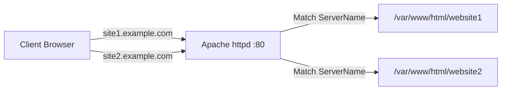

> [!abstract] نظرة عامة على الملف
> هذا الملف مرجع شامل لإعداد خادم الويب **Apache (httpd)** على **RHEL 9**:
> 1. تثبيت وتشغيل Apache وفتح الـ Firewall.
> 2. استضافة **أكثر من موقع** على نفس السيرفر باستخدام **Name-Based Virtual Hosts**.
> 3. تأمين المواقع بشهادات **SSL ذاتية التوقيع (Self-Signed)** للوصول عبر **HTTPS**.
> كل الخطوات مرفقة بـ **Terminal Outputs فعلية** من بيئة Lab حقيقية (`appsrv01` / `192.168.101.128`).

---

# 1. Install & Start Apache (httpd)

## 1.1 التثبيت

```bash
dnf install httpd -y
```

> [!terminal] Output
> ```text
> Installed:
>   apr-1.7.0-12.el9_5.2.x86_64
>   httpd-2.4.62-1.el9_5.2.x86_64
>   mod_http2-2.0.26-2.el9_4.1.x86_64
> Complete!
> [root@appsrv01 ~]#
> ```

## 1.2 تشغيل الخدمة وتفعيلها عند الإقلاع

```bash
systemctl enable --now httpd
```

## 1.3 فتح الـ Firewall لخدمة HTTP

```bash
firewall-cmd --permanent --add-service=http
firewall-cmd --reload
```

> [!terminal] Output
> ```text
> [root@appsrv01 ~]# firewall-cmd --permanent --add-service=http
> success
> [root@appsrv01 ~]# firewall-cmd --reload
> success
> ```


### 1.4 مسارات Apache: RHEL مقابل Debian/Ubuntu

نفس الخادم، ==اسمان وتخطيطان مختلفان== حسب التوزيعة:

| العنصر | RHEL / CentOS / Rocky (`httpd`) | Debian / Ubuntu (`apache2`) |
| --- | --- | --- |
| التثبيت | `dnf install httpd` | `apt install apache2` |
| الخدمة | `httpd.service` | `apache2.service` |
| الملف الرئيسي | `/etc/httpd/conf/httpd.conf` | `/etc/apache2/apache2.conf` |
| إعدادات المواقع | `/etc/httpd/conf.d/*.conf` (تُحمّل تلقائيًا) | `/etc/apache2/sites-available/` + `sites-enabled/` |
| ملف الـ Ports | داخل `httpd.conf` (`Listen 80`) | `/etc/apache2/ports.conf` |
| Document Root | `/var/www/html` | `/var/www/html` |
| فحص الإعدادات | `httpd -t` | `apache2ctl configtest` |
| تفعيل موقع | مجرد وضع ملف `.conf` في `conf.d` | `a2ensite site.conf` ثم reload |
| تعطيل موقع | حذف/إعادة تسمية الملف | `a2dissite site.conf` |

صفحة الاختبار الافتراضية (عند عدم وجود `index.html`):
```bash
# RHEL — صفحة الترحيب
ls /usr/share/httpd/noindex/index.html
# Debian — الصفحة الافتراضية
ls /var/www/html/index.html
```

> [!note] `service` مقابل `systemctl`
> `service httpd restart` ما زالت تعمل، لكنها مجرد ==غلاف قديم== يحوّل الأمر إلى systemd:
> `Redirecting to /bin/systemctl restart httpd.service`
> ✅ استخدم `systemctl restart httpd` مباشرة.

> [!warning] لا تُطفئ الـ Firewall!
> في الملاحظات الأصلية كان هناك اقتراح `systemctl stop firewalld` — ==ممارسة خاطئة==.
> الصح: افتح الخدمة فقط ثم أعد التحميل:
> ```bash
> firewall-cmd --permanent --add-service=http
> firewall-cmd --permanent --add-service=https
> firewall-cmd --reload          # ← بدون reload لن تُطبَّق القاعدة
> ```


---

# 2. Create Document Roots

**Document Root** هو المجلد الذي يحتوي ملفات كل موقع.

```bash
mkdir /var/www/html/website1
mkdir /var/www/html/website2
```

## 2.1 التحقق من صلاحيات وسياق SELinux

```bash
ls -ldZ /var/www/html/website1
ls -ldZ /var/www/html/website2
```

> [!terminal] Output
> ```text
> [root@appsrv01 ~]# ls -ldZ /var/www/html/website1
> drwxr-xr-x. 2 root root unconfined_u:object_r:httpd_sys_content_t:s0 6 Apr 28 15:17 /var/www/html/website1
> [root@appsrv01 ~]# ls -ldZ /var/www/html/website2
> drwxr-xr-x. 2 root root unconfined_u:object_r:httpd_sys_content_t:s0 6 Apr 28 15:17 /var/www/html/website2
> ```

> [!info] لماذا هذا مهم؟
> السياق `httpd_sys_content_t` هو الذي يسمح لـ Apache بقراءة الملفات.
> أي مجلد داخل `/var/www/html` يرث هذا السياق تلقائيًا.
> لو استخدمت مسارًا خارجيًا مخصصًا (مثل `/data/www`) ستحتاج:
> ```bash
> semanage fcontext -a -t httpd_sys_content_t "/data/www(/.*)?"
> restorecon -Rv /data/www
> ```


### 2.2 Document Root مخصص خارج `/var/www/html`

يمكن وضع الموقع في أي مسار (مثل `/srv`)، لكن تحتاج ==خطوتين إضافيتين==: سماح Apache بالوصول + سياق SELinux صحيح.

```bash
mkdir -p /srv/main/www
echo "<h1>Main Site</h1>" > /srv/main/www/index.html
```

`/etc/httpd/conf.d/01-main.conf`
```apache
<VirtualHost *:80>
    ServerName   main.example.com
    DocumentRoot /srv/main/www
    ErrorLog  /var/log/httpd/main_error.log
    CustomLog /var/log/httpd/main_access.log combined
</VirtualHost>

<Directory /srv/main/www>
    Options -Indexes +FollowSymLinks
    AllowOverride None
    Require all granted
</Directory>
```

سياق SELinux للمسار الجديد:
```bash
semanage fcontext -a -t httpd_sys_content_t "/srv/main/www(/.*)?"
restorecon -Rv /srv/main/www
httpd -t && systemctl restart httpd
```

> [!danger] سبب خطأ 403 Forbidden الأشهر
> Apache 2.4 ==يرفض افتراضيًا== أي مسار خارج الـ Document Root الافتراضي.
> بدون `<Directory ...> Require all granted` سيظهر **403 Forbidden** حتى لو كانت صلاحيات الملفات صحيحة!
> (في Apache 2.2 كان يُستخدم `Order allow,deny` + `Allow from all` — ==ملغية في 2.4==.)

> [!tip] ترتيب التشخيص عند 403
> 1. `<Directory>` + `Require all granted`
> 2. صلاحيات المسار كاملًا (`namei -l /srv/main/www/index.html`)
> 3. سياق SELinux (`ls -dZ`)
> 4. سجل الأخطاء: `tail -f /var/log/httpd/main_error.log`

### 2.3 مواقع المستخدمين (`~user`) عبر mod_userdir

تتيح لكل مستخدم نشر موقعه الشخصي عبر `http://server/~username/`.

`/etc/httpd/conf.d/userdir.conf`
```apache
<IfModule mod_userdir.c>
    UserDir public_html
    UserDir disabled root          # ← موصى به بشدة في التوثيق الرسمي
</IfModule>

<Directory "/home/*/public_html">
    AllowOverride FileInfo AuthConfig Limit Indexes
    Options MultiViews Indexes SymLinksIfOwnerMatch IncludesNoExec
    Require all granted
</Directory>
```

تجهيز مجلد المستخدم:
```bash
mkdir -p /home/moadel/public_html
echo "<h1>MoAdel Page</h1>" > /home/moadel/public_html/index.html

chmod o+x /home/moadel                     # Apache يحتاج عبور (x) على الـ home
chmod -R o+rX /home/moadel/public_html     # قراءة الملفات ودخول المجلدات

# SELinux
setsebool -P httpd_enable_homedirs on
chcon -R -t httpd_user_content_t /home/moadel/public_html

systemctl restart httpd
```

الاختبار: `http://192.168.121.140/~moadel/`

> [!tip] بديل أأمن من `chmod o+x`
> `o+x` يفتح العبور على ==كل المستخدمين==. الأدق استخدام ACL لمستخدم Apache فقط:
> ```bash
> setfacl -m u:apache:x /home/moadel
> ```
> راجع [[archive/Linux Fundamentals#17. Permissions & Ownership]].

> [!warning] مخاطر mod_userdir
> التوثيق الرسمي يحذّر: كل مواقع المستخدمين تشترك في ==نفس الـ origin==، فتستطيع صفحاتهم قراءة/التحكم في بعضها (خطر مع المحتوى الديناميكي والمصادقة).
> - `UserDir disabled root` إلزامي عمليًا (وإلا `~root` قد يكشف النظام).
> - عطّل الموديول بالكامل لو مش محتاجه.
> - الموديول ==غير مفعّل افتراضيًا== منذ الإصدار 2.1.4.

> [!note] `Require method` مقابل `Require all granted`
> في الملاحظات الأصلية استُخدم `Require method GET POST OPTIONS` — وهي تقييد حسب ==نوع طلب HTTP==.
> لموقع ثابت بسيط، `Require all granted` أوضح وأقل إرباكًا.


---

# 3. Name-Based Virtual Hosts (HTTP — Port 80)

> [!info] ما هو الـ Virtual Host؟
> تقنية تسمح لخادم Apache واحد باستضافة **عدة مواقع** بنفس الـ IP،
> حيث يميز Apache الموقع المطلوب من خلال الـ **ServerName** في طلب الـ HTTP.



## 3.1 إنشاء ملف إعدادات الـ Virtual Hosts

```bash
vim /etc/httpd/conf.d/httpd.conf
```

> [!note] ملاحظة على المسارات
> - الملف الرئيسي لإعدادات Apache هو: `/etc/httpd/conf/httpd.conf`
> - أي ملف بامتداد `.conf` داخل `/etc/httpd/conf.d/` يتم تحميله تلقائيًا.
> - في هذا الـ Lab أنشأنا ملفًا مخصصًا باسم `conf.d/httpd.conf` لوضع الـ Virtual Hosts فيه.

**محتوى الملف (Port 80):**

```apache
## Website_1
<VirtualHost *:80>
    ServerName site1.example.com
    DocumentRoot /var/www/html/website1
    ErrorLog /var/log/httpd/site1_error.log
    CustomLog /var/log/httpd/site1_access.log combined
</VirtualHost>

## Website_2
<VirtualHost *:80>
    ServerName site2.example.com
    DocumentRoot /var/www/html/website2
    ErrorLog /var/log/httpd/site2_error.log
    CustomLog /var/log/httpd/site2_access.log combined
</VirtualHost>
```

## 3.2 إضافة محتوى المواقع (Web Templates)

يمكنك نسخ Template جاهز أو إنشاء صفحات اختبار بسيطة.
مصدر مجاني للـ Templates: <https://www.free-css.com/free-css-templates>

```bash
ls /var/www/html/website1
ls /var/www/html/website2
```

> [!terminal] Output
> ```text
> [root@appsrv01 ~]# ls /var/www/html/website1
> assets  index.html  readme.txt
> [root@appsrv01 ~]# ls /var/www/html/website2
> about.html  blog.html  css  fonts  images  index.html  js  shop.html
> ```

## 3.3 فحص الإعدادات وإعادة تشغيل الخدمة

```bash
httpd -t
systemctl restart httpd
```

> [!terminal] Output
> ```text
> [root@appsrv01 ~]# httpd -t
> Syntax OK
> [root@appsrv01 ~]# systemctl restart httpd
> [root@appsrv01 ~]#
> ```

> [!tip] قاعدة ذهبية
> دائمًا نفّذ `httpd -t` **قبل** عمل restart للتأكد من عدم وجود أخطاء في الـ Configuration.

## 3.4 تحديث `/etc/hosts` للاختبار بدون DNS حقيقي

```bash
vim /etc/hosts
tail -2 /etc/hosts
```

> [!terminal] Output
> ```text
> [root@appsrv01 ~]# tail -2 /etc/hosts
> 192.168.101.128   site1.example.com
> 192.168.101.128   site2.example.com
> ```

> [!note] على جهاز Windows الخاص بك أيضًا
> أضف نفس السطور في:
> `C:\Windows\System32\drivers\etc\hosts`
> حتى يستطيع المتصفح الوصول للموقعين عبر اسم السيرفر `192.168.101.128`.

## 3.5 الاختبار من المتصفح

افتح:
- `http://site1.example.com` → يظهر موقع **CarVilla** 🚗
- `http://site2.example.com` → يظهر موقع **Healet** 💍

### 3.6 `ServerAlias` وملف إعدادات لكل موقع

`ServerName` هو الاسم الأساسي، و==`ServerAlias`== يضيف أسماء بديلة (مثل النسخة بدون `www`).

`/etc/httpd/conf.d/02-za3bola.conf`
```apache
<VirtualHost *:80>
    ServerName   www.za3bola.com
    ServerAlias  za3bola.com
    DocumentRoot /srv/www.za3bola.com/www
    ErrorLog  /var/log/httpd/za3bola_error.log
    CustomLog /var/log/httpd/za3bola_access.log combined
</VirtualHost>

<Directory /srv/www.za3bola.com/www>
    Require all granted
</Directory>
```

`/etc/httpd/conf.d/03-fatakat.conf`
```apache
<VirtualHost *:80>
    ServerName   www.fatakat.com
    ServerAlias  fatakat.com
    DocumentRoot /srv/www.fatakat.com/www
    ErrorLog  /var/log/httpd/fatakat_error.log
    CustomLog /var/log/httpd/fatakat_access.log combined
</VirtualHost>

<Directory /srv/www.fatakat.com/www>
    Require all granted
</Directory>
```

```bash
mkdir -p /srv/www.za3bola.com/www /srv/www.fatakat.com/www
httpd -t && systemctl restart httpd
httpd -S            # ← يعرض كل الـ Virtual Hosts وترتيبها وأي تعارض
```

> [!tip] لماذا ملف لكل موقع؟
> ملفات `conf.d` تُحمّل ==بترتيب أبجدي== (`01-` ثم `02-` ثم `03-`).
> - أسهل في الصيانة والتعطيل (احذف ملفًا واحدًا).
> - ==أول VirtualHost== في الترتيب هو ==الافتراضي== لأي طلب لا يطابق أي `ServerName`/`ServerAlias`.

> [!note] المسار النسبي في `CustomLog`
> `CustomLog "logs/za3bola.log" combined` مسار ==نسبي إلى `ServerRoot`== (`/etc/httpd`)،
> و`/etc/httpd/logs` هو ارتباط رمزي إلى `/var/log/httpd`.
> ✅ الأفضل كتابة المسار المطلق لتجنب اللبس.

`/etc/hosts` — يمكن وضع عدة أسماء في سطر واحد:
```text
192.168.121.140   www.za3bola.com za3bola.com
192.168.121.140   www.fatakat.com fatakat.com
```


### 3.7 `_default_` مقابل `*` — تصحيح مهم

في الملاحظات الأصلية استُخدم `<VirtualHost _default_:80>` مع `ServerName` — وهذا ==خلط بين نمطين==.

| الصيغة | الاستخدام الصحيح |
| --- | --- |
| `*:80` | ==Name-based== virtual hosts (عدة مواقع على نفس IP) ✅ |
| `10.0.0.1:80` | ==IP-based== (موقع لكل IP) |
| `_default_:80` | Catch-all للـ IP-based فقط — يأخذ `ServerName` الخاص بالخادم الرئيسي |

أولوية المطابقة في Apache (من التوثيق الرسمي):

| الترتيب | الشكل |
| --- | --- |
| 1 | IP محدد + port محدد |
| 2 | IP محدد + port wildcard |
| 3 | `*` + port محدد (`*:80`) |
| 4 | `*` + port wildcard |
| 5 | الخادم الرئيسي (لا يوجد VirtualHost مطابق) |

> [!warning] القاعدة
> ==مطابقة الأسماء (ServerName/ServerAlias) تحدث فقط بين الـ vhosts المتعادلة في نفس المستوى==.
> لذلك استخدم `*:80` و`*:443` دائمًا للاستضافة بالاسم، واترك `_default_` لحالات IP-based الخاصة.


---

# 4. Enable HTTPS with Self-Signed SSL Certificate

## 4.1 تثبيت `openssl` و `mod_ssl`

```bash
yum install openssl mod_ssl -y
```

> [!terminal] Output
> ```text
> Installed:
>   mod_ssl-1:2.4.62-1.el9_5.2.x86_64
> Complete!
> ```

## 4.2 توليد شهادة Self-Signed

```bash
openssl req -x509 -nodes -days 365 -newkey rsa:2048 \
    -keyout localhost.key -out localhost.crt
```

> [!terminal] Output (Interactive DN Fields)
> ```text
> You are about to be asked to enter information that will be incorporated
> into your certificate request.
> ...
> Country Name (2 letter code) [XX]:IN
> State or Province Name (full name) []:Bihar
> Locality Name (eg, city) [Default City]:ARA
> Organization Name (eg, company) [Default Company Ltd]:SinghJee
> Organizational Unit Name (eg, section) []:HO
> Common Name (eg, your name or your server's hostname) []:appsrv01.example.com
> Email Address []:
> [root@appsrv01 ~]#
> ```

> [!warning] أهم حقل
> الـ **Common Name (CN)** يجب أن يطابق اسم الموقع أو الـ Hostname الذي سيصل إليه المستخدم، وإلا سيظهر تحذير mismatch في المتصفح.

## 4.3 معرفة مسار الشهادة المتوقع في `ssl.conf`

```bash
cat /etc/httpd/conf.d/ssl.conf | grep SSLCertificate
```

> [!terminal] Output
> ```text
> #   Point SSLCertificateFile at a PEM encoded certificate.
> SSLCertificateFile /etc/pki/tls/certs/localhost.crt
> SSLCertificateKeyFile /etc/pki/tls/private/localhost.key
> #   Point SSLCertificateChainFile at a file containing
> #SSLCertificateChainFile /etc/pki/tls/certs/server-chain.crt
> ```

## 4.4 نسخ الشهادة والمفتاح إلى المسار الصحيح

```bash
cp localhost.crt /etc/pki/tls/certs/
cp localhost.key /etc/pki/tls/private/
```

> [!terminal] Output
> ```text
> [root@appsrv01 ~]# cp localhost.crt /etc/pki/tls/certs/
> [root@appsrv01 ~]# cp localhost.key /etc/pki/tls/private/
> ```

## 4.5 تعديل الـ Virtual Hosts للعمل على Port 443 (HTTPS)

```bash
vim /etc/httpd/conf.d/httpd.conf
```

**محتوى الملف (Port 443):**

```apache
## Website_1 (HTTPS)
<VirtualHost *:443>
    ServerName site1.example.com
    DocumentRoot /var/www/html/website1
    SSLEngine on
    SSLCertificateFile /etc/pki/tls/certs/localhost.crt
    SSLCertificateKeyFile /etc/pki/tls/private/localhost.key
    ErrorLog /var/log/httpd/site1_error.log
    CustomLog /var/log/httpd/site1_access.log combined
</VirtualHost>

## Website_2 (HTTPS)
<VirtualHost *:443>
    ServerName site2.example.com
    DocumentRoot /var/www/html/website2
    SSLEngine on
    SSLCertificateFile /etc/pki/tls/certs/localhost.crt
    SSLCertificateKeyFile /etc/pki/tls/private/localhost.key
    ErrorLog /var/log/httpd/site2_error.log
    CustomLog /var/log/httpd/site2_access.log combined
</VirtualHost>
```

> [!note] الفرق الجوهري بين 80 و 443
> | Directive | الوظيفة |
> | :--- | :--- |
> | `<VirtualHost *:80>` | استقبال طلبات HTTP العادية |
> | `<VirtualHost *:443>` | استقبال طلبات HTTPS المشفرة |
> | `SSLEngine on` | تفعيل التشفير SSL/TLS لهذا الـ Host |
> | `SSLCertificateFile` | مسار ملف الشهادة العامة `.crt` |
> | `SSLCertificateKeyFile` | مسار المفتاح الخاص `.key` |

## 4.6 فتح HTTPS في الـ Firewall

```bash
firewall-cmd --permanent --add-service=https
firewall-cmd --reload
```

> [!terminal] Output
> ```text
> [root@appsrv01 ~]# firewall-cmd --permanent --add-service=https
> success
> [root@appsrv01 ~]# firewall-cmd --reload
> success
> ```

## 4.7 فحص الإعدادات وإعادة التشغيل

```bash
httpd -t
systemctl restart httpd
```

> [!terminal] Output
> ```text
> [root@appsrv01 ~]# httpd -t
> Syntax OK
> [root@appsrv01 ~]# systemctl restart httpd
> [root@appsrv01 ~]#
> ```

## 4.8 الوصول للمواقع عبر HTTPS

افتح في المتصفح:
- `https://site1.example.com`
- `https://site2.example.com`

> [!warning] تحذير المتصفح متوقع!
> سيظهر **"Connection Not Secure"** أو **"Warning: Self-signed"**
> لأن الشهادة ذاتية التوقيع وليست صادرة من CA موثوق.
> هذا **طبيعي في بيئة الاختبار** — اضغط **Advanced → Proceed** للدخول للموقع.
> ستلاحظ أن الشهادة باسم `appsrv01.example.com` (الـ CN الذي أدخلناه).

> [!success] النتيجة النهائية
> ✅ الآن مواقعك المتعددة تعمل عبر **HTTPS** بشهادات Self-Signed!


### 4.9 من CSR إلى شهادة موقّعة من CA (مسار الإنتاج)

الشهادة الذاتية (§4.2) للاختبار فقط. في الإنتاج تمر عبر ==ثلاث مراحل==:

| الملف | ما هو | لمن يُرسل |
| --- | --- | --- |
| `.key` | المفتاح الخاص | ==يبقى على السيرفر فقط== (سري) |
| `.csr` | طلب توقيع شهادة (يحتوي المفتاح العام + بياناتك) | يُرسل إلى الـ CA |
| `.crt` | الشهادة بعد توقيع الـ CA | يُستخدم في Apache |

```bash
# 1) المفتاح الخاص
openssl genrsa -out www.za3bola.com.key 2048
chmod 400 www.za3bola.com.key

# 2) طلب الشهادة (CN = اسم الموقع بالكامل)
openssl req -new -key www.za3bola.com.key -out www.za3bola.com.csr

# 3) مراجعته قبل الإرسال
openssl req -noout -text -in www.za3bola.com.csr

# → ترسل الـ .csr إلى الـ CA (أو Let's Encrypt) وتستلم .crt + سلسلة الوسطاء
```

الإعداد الصحيح بعد استلام الشهادة:
```apache
<VirtualHost *:443>
    ServerName  www.za3bola.com
    ServerAlias za3bola.com
    DocumentRoot /srv/www.za3bola.com/www

    SSLEngine on
    SSLCertificateFile      /etc/pki/tls/certs/www.za3bola.com.crt
    SSLCertificateKeyFile   /etc/pki/tls/private/www.za3bola.com.key
    SSLCertificateChainFile /etc/pki/tls/certs/ca-chain.crt
</VirtualHost>
```

> [!danger] الخطأ الحرج في الملاحظات الأصلية
> ❌ `SSLCertificateFile /etc/pki/tls/certs/www.za3bola.com.csr`
> الـ ==CSR ليس شهادة== — Apache سيفشل في الإقلاع بخطأ من نوع `X509 lib`.
> ✅وجّه `SSLCertificateFile` إلى `.crt` فقط. بعد التوقيع، ==ملف الـ .csr لم يعد مطلوبًا==.

التحقق أن المفتاح يطابق الشهادة (نفس الـ modulus):
```bash
openssl x509 -noout -modulus -in server.crt | openssl md5
openssl rsa  -noout -modulus -in server.key | openssl md5
# يجب أن تتطابق القيمتان

# فحص ما يقدّمه السيرفر فعليًا
openssl s_client -connect www.za3bola.com:443 -servername www.za3bola.com
```

> [!note] لماذا `*:443` وليس `_default_:443`؟
> مع ==SNI== يرسل المتصفح اسم الموقع أثناء الـ TLS handshake، فيختار Apache الـ vhost والشهادة الصحيحة.
> بدون SNI يُستخدم ==أول vhost== على ذلك الـ port — فتظهر شهادة الموقع الخطأ.

> [!tip] في الإنتاج
> استخدم ==Let's Encrypt (certbot)== بدل الشهادات الذاتية — مجانية ومتجددة تلقائيًا:
> `certbot --apache -d za3bola.com -d www.za3bola.com`


---

# 5. 🚀 Cheat Sheet (ملخص الأوامر)

| Task                          | Command                                                                                        |
| :---------------------------- | :--------------------------------------------------------------------------------------------- |
| **Install Apache**            | `dnf install httpd -y`                                                                         |
| **Enable & Start**            | `systemctl enable --now httpd`                                                                 |
| **Test Config**               | `httpd -t`                                                                                     |
| **Restart Service**           | `systemctl restart httpd`                                                                      |
| **Allow HTTP**                | `firewall-cmd --permanent --add-service=http && firewall-cmd --reload`                         |
| **Allow HTTPS**               | `firewall-cmd --permanent --add-service=https && firewall-cmd --reload`                        |
| **Check SELinux Context**     | `ls -ldZ /var/www/html/website1`                                                               |
| **Install mod_ssl**           | `yum install openssl mod_ssl -y`                                                               |
| **Generate Self-Signed Cert** | `openssl req -x509 -nodes -days 365 -newkey rsa:2048 -keyout localhost.key -out localhost.crt` |
| **Check SSL Paths**           | `cat /etc/httpd/conf.d/ssl.conf \| grep SSLCertificate`                                        |
| **View Error Log**            | `tail -f /var/log/httpd/site1_error.log`                                                       |
| List Virtual Hosts            | httpd -S                                                                                       |
| Debian: Install               | apt install apache2                                                                            |
| Debian: Enable site           | a2ensite site.conf && systemctl reload apache2                                                 |
| Debian: Test config           | apache2ctl configtest                                                                          |
| Custom DocRoot SELinux        | semanage fcontext -a -t httpd_sys_content_t "/srv/www(/.*)?" && restorecon -Rv /srv/www        |
| Enable home dirs              | setsebool -P httpd_enable_homedirs on                                                          |
| Generate CSR                  | openssl req -new -key site.key -out site.csr                                                   |
| Verify key ↔ cert             | openssl x509 -noout -modulus -in site.crt \| openssl md5                                       |
| Inspect live cert             | openssl s_client -connect site:443 -servername site                                            |


---

# 6. 🧠 Interview Tips

> [!success] أسئلة شائعة في المقابلات
> **س: ما الفرق بين Name-Based و IP-Based Virtual Hosts؟**
> ج: الـ Name-Based يستضيف عدة مواقع على IP واحد ويميزها عبر الـ `ServerName` (Header Host)، أما الـ IP-Based فيحتاج IP مستقل لكل موقع.
>
> **س: لماذا نستخدم Port 443 للـ HTTPS؟**
> ج: لأنه الـ Port الافتراضي المتفق عليه لبروتوكول HTTPS (HTTP over TLS/SSL).
>
> **س: ما دور `mod_ssl`؟**
> ج: هو الـ Module الذي يضيف دعم TLS/SSL لخادم Apache ويفعل الـ Directives مثل `SSLEngine` و `SSLCertificateFile`.
>
> **س: لماذا يظهر تحذير أمان مع Self-Signed Certificate؟**
> ج: لأن الشهادة غير موقعة من Certificate Authority موثوق، فتعتبرها المتصفحات غير جديرة بالثقة (مقبولة للاختبار فقط، وفي الإنتاج نستخدم Let's Encrypt أو CA تجاري).
> 

>[!faq]- ما الفرق بين `ServerName` و `ServerAlias`؟
`ServerName` الاسم الأساسي للموقع، و`ServerAlias` أسماء بديلة تُطابق نفس الموقع (مثل `za3bola.com` بجانب `www.za3bola.com`). كلاهما يُقارن بـ Host header، و==أول تطابق يفوز==.

>[!faq]- موقعك يعطي 403 رغم أن الصلاحيات صحيحة — لماذا؟
غالبًا أحد ثلاثة: نقص `<Directory ...> Require all granted` (افتراضي 2.4 = رفض)، أو نقص صلاحية ==العبور `x`== على أحد المجلدات الأب، أو ==سياق SELinux== غير `httpd_sys_content_t`.

>[!faq]- ما الفرق بين `.key` و `.csr` و `.crt`؟
`.key` مفتاح خاص سري، `.csr` طلب توقيع يُرسل للـ CA، `.crt` الشهادة الموقّعة. ==لا يُستخدم الـ CSR في `SSLCertificateFile` أبدًا==.

>[!faq]- لماذا نستخدم `*:443` وليس `_default_:443`؟
لأن الاستضافة بالاسم تعتمد على ==SNI==، و`_default_` مخصص للـ IP-based ويأخذ `ServerName` الخادم الرئيسي، مما يكسر مطابقة الأسماء.

>[!faq]- ما خطر `mod_userdir`؟
كل مواقع المستخدمين تشترك في ==نفس الـ origin== (خطر أمني مع المحتوى الديناميكي)، لذلك يوصى بـ `UserDir disabled root` وتعطيل الموديول عند عدم الحاجة.

>[!faq]- ما الفرق بين تخطيط RHEL و Debian لـ Apache؟
RHEL: `httpd` + `conf.d/*.conf` تُحمّل تلقائيًا. Debian: `apache2` + `sites-available` مع روابط في `sites-enabled` تُدار بـ `a2ensite`/`a2dissite`، و`ports.conf` منفصل.

---


## 🔗 Related Notes & Attachments

- [[school/Storage]] — LVM, RAID, NFS, Samba
- [[Linux Shell Scripting - Complete Guide]] — Automation & Monitoring Scripts
- [[Linux Fundamentals]] — الأوامر، الصلاحيات، SELinux، systemd
- [[Linux Fundamentals#17. Permissions & Ownership]] — الصلاحيات و ACL المستخدمة مع DocumentRoot
- [[Linux Fundamentals#18. Systemd & Service Management]] — إدارة خدمة httpd
- [[Linux Shell Scripting - Complete Guide]] — أتمتة النشر والمراقبة

![[Apache.pdf]]