# Linux L3 Troubleshooting Notes

> [!abstract] Production-Grade Troubleshooting Guides
> Handwritten notes by **Avanish Yadav**, converted to Obsidian Markdown.
> **Covered so far:** 6 guides — remaining pages will be appended to this same file.
> Focus: ==RHEL upgrades, boot & initramfs, SELinux, TLS/certificates, emergency shell, Post-Quantum Cryptography==.

## Contents
- [[#1. Combined L3 Production Incident — RHEL Upgrade + Filesystem + SELinux + TLS]]
- [[#2. Linux Emergency Shell Troubleshooting]]
- [[#3. Post-Quantum Cryptography (PQC) — RHEL 10 Admin Guide]]
- [[#4. Troubleshooting Certificate Issues — L3 Guide]]
- [[#5. Troubleshooting Dracut / initramfs Issues]]
- [[#6. Troubleshooting SELinux Issues]]
- [[#7. Post-Quantum Cryptography (PQC) — L3 Admin Guide]]
- [[#8. RHEL 8 vs RHEL 9 vs RHEL 10 — L3 Admin Guide]]
- [[#9. DevOps Release Pipeline — L3 Admin Guide]]
- [[#10. CI/CD Secrets Management — L3 Guide]]
- [[#11. SELinux Troubleshooting — L3 Guide]]
- [[#12. Ansible Idempotency + changed_when + Handlers]]
- [[#13. Ansible Uptime on 15 Servers]]
- [[#14. Ansible Variable Precedence + Uptime — L3 Interview]]
- [[#15. Dracut / Initramfs Troubleshooting — L3 Guide]]
- [[#16. LUKS + Clevis + Tang — Encrypted Disk Boot Troubleshooting]]
- [[#17. SSL / TLS Certificate Troubleshooting]]
- [[#18. Linux Boot Sequence & Boot Failure Troubleshooting]]
- [[#19. DataVG / LVM Application Filesystem Recovery]]
- [[#20. Disk I/O Bottleneck Troubleshooting]]
- [[#21. No Space Left on Device]]
- [[#22. Inode Exhaustion]]
- [[#23. Too Many Open Files (EMFILE)]]
- [[#24. The OOM Killer Strikes]]
- [[#25. Creeping Memory Leak]]
- [[#26. High Load, Idle CPU]]
- [[#27. CPU Pegged at 100%]]
- [[#28. Swap Thrashing]]
- [[#29. Server Unreachable]]


---

## 1. Combined L3 Production Incident — RHEL Upgrade + Filesystem + SELinux + TLS

### 1.1 Scenario, Symptoms & Target

> [!info] Scenario
> - After upgrading ==RHEL 8 → 9== the application is down.
> - Application logs show ==TLS handshake error==.
> - Some application files are not accessible.
> - SELinux is in ==enforcing== mode.
> - Service fails to start due to permission / dependency issue.

> [!warning] Symptoms (What we see)
> - Application not accessible
> - Service startup failure
> - TLS certificate verification failed
> - Permission denied on application files
> - SELinux AVC denials in logs
> - Filesystem not mounted or read-only
> - Errors after RHEL 8 → 9 upgrade
> - Dependent services not starting

> [!success] Expected End State
> - Application accessible
> - All required filesystems mounted
> - Correct file permissions and SELinux contexts
> - Valid TLS certificate and chain
> - Required packages and services running
> - No errors in logs
> - Application working end-to-end

### 1.2 Layered Troubleshooting Flow (Follow this order)

| # | Layer | Checks / Commands | Common Issues |
|---|---|---|---|
| 1 | **Impact / Scope** — understand the issue | Check who is affected, since when, any pattern?<br>Application, users, only one node or all nodes?<br>Any related recent changes (upgrade/patch/deploy)? | Single node vs all nodes<br>Partial functionality<br>Related services also down |
| 2 | **Recent Change** — find what changed | OS upgrade, patch, package update<br>Application deploy, certificate renewal<br>SELinux policy change, config change | RHEL 8 → 9 upgrade<br>New certificate deployed<br>New application version<br>SELinux set to enforcing |
| 3 | **Filesystem / Mount** — check storage & mounts | `findmnt` • `df -h` • `cat /etc/fstab`<br>`lsblk -f` • `mount \| grep <path>` • `dmesg \| tail` | Filesystem not mounted<br>Mounted read-only<br>Wrong fstab entry or UUID<br>Disk/LVM issue after upgrade |
| 4 | **DAC Permissions** — user, group, permissions | `ls -l <path>` • `ls -ld <directory>`<br>`id <user>` • `getfacl <path>` (if ACL used) | Wrong ownership/group<br>Missing read/write/execute<br>Wrong user running the service<br>ACL preventing access |
| 5 | **SELinux AVC / Context** — check SELinux denials | `getenforce` • `ausearch -m AVC -ts recent`<br>`ausearch -m AVC -c <service>` • `ls -Z <path>`<br>`semanage fcontext -l \| grep <path>` • `restorecon -Rv <path>` | AVC denials blocking access<br>Wrong file context after upgrade<br>Missing SELinux policy module<br>Service not allowed to access file/port |
| 6 | **TLS Certificate / Chain / Key** — check certificate & key | `openssl s_client -connect host:443 -showcerts`<br>`openssl x509 -in cert.pem -text -noout`<br>`openssl verify -CAfile ca-bundle.pem cert.pem`<br>`openssl x509 -noout -modulus -in cert.pem \| openssl sha256`<br>`openssl rsa -noout -modulus -in key.pem \| openssl sha256` | Expired certificate<br>Missing intermediate chain<br>Wrong SAN/hostname<br>Certificate and key mismatch<br>Incorrect permissions / SELinux |
| 7 | **OpenSSL / Crypto Policy** — check TLS compatibility | `openssl version -a` • `update-crypto-policies --show`<br>`openssl s_client -connect host:443 -tls1_2`<br>`openssl s_client -connect host:443 -tls1_3` | Incompatible TLS version<br>Unsupported cipher after upgrade<br>Strict crypto-policy blocking older client<br>Legacy application not supporting TLS 1.3 |
| 8 | **Packages / Config / Dependencies** — check services & configs | `systemctl status <service>` • `systemctl --failed`<br>`journalctl -u <service> -xe` • `rpm -q <package>`<br>`dnf list installed \| grep <package>` | Missing/removed package in RHEL 9<br>Changed config syntax<br>Dependent service not running<br>Port/firewall/SELinux blocking<br>Python or library version change |
| 9 | **Safe Fix (Minimum Change)** — apply the correct fix | Mount / fix filesystem<br>Correct permissions / SELinux context<br>Install missing packages or fix config<br>Update/renew certificate or correct chain<br>Adjust crypto policy if needed (carefully)<br>Restart service in proper order | Avoid unnecessary changes<br>Do ==not== disable SELinux permanently<br>Do not use overly permissive permissions<br>Do not weaken crypto policy without approval<br>Take backup before major change |
| 10 | **End-to-End Validation** — confirm application is working | Check service status and logs<br>Verify filesystem, permissions and contexts<br>Test TLS from same client and external client<br>Verify application functionality<br>Monitor for errors and performance | Application accessible<br>No SELinux AVC denials<br>No TLS errors<br>No permission/IO errors<br>Dependent services healthy |

### 1.3 Important Commands (Quick Ref)

```bash
findmnt, df -h, lsblk -f
ls -l, ls -Z, id
ausearch -m AVC -ts recent
openssl s_client, openssl x509
update-crypto-policies --show
systemctl status, journalctl -xe
dnf list installed | grep <pkg>
```

### 1.4 Common Root Causes

- Filesystem not mounted after upgrade
- Wrong file permissions/ownership
- SELinux context not updated
- Certificate expired or chain incomplete
- Incompatible TLS version/cipher
- Required package removed/changed
- Config syntax change in RHEL 9
- Dependent service not running
- Application not compatible with OpenSSL 3
- Firewall/port/SELinux blocking

> [!danger] Dangerous Mistakes
> - Disabling SELinux permanently
> - Giving ==777 permissions==
> - Changing crypto policy without approval
> - Rebuilding filesystem without backup
> - Using wrong certificate or key
> - Ignoring AVC denials
> - Skipping dependencies
> - Not validating from client side
> - Making multiple changes at once
> - No rollback plan

> [!note] Rollback Considerations
> - Keep previous kernel in GRUB
> - Keep RHEL 8 backup/snapshot
> - Backup configs before changes
> - Keep old certificate available
> - Document all changes
> - Have rollback for application release
> - Verify database/application data
> - Plan for quick service rollback
> - Keep known-good packages/repo
> - Test rollback in non-prod if possible

> [!question]- Interview Follow-up Questions
> 1. How do you identify which layer is failing first?
> 2. What if filesystem is mounted but access is still denied?
> 3. How do you troubleshoot SELinux denials for an application?
> 4. What if certificate is valid but client still fails?
> 5. How does RHEL 9 crypto policy affect older applications?
> 6. How do you validate a certificate and its private key match?
> 7. What logs do you check after an OS upgrade?
> 8. What is your rollback plan if the fix does not work?
> 9. How do you ensure this issue does not happen again?
> 10. How would you handle this in a multi-node environment?

---

## 2. Linux Emergency Shell Troubleshooting

### 2.1 What is Emergency Shell?

- Emergency shell is a ==minimal system state== started by `systemd` when the system cannot complete the normal boot process.
- It provides a ==basic root shell== to perform manual troubleshooting and recovery.
- It is similar to ==rescue mode== but used for more critical failures where the root filesystem or mounting is the problem.

### 2.2 Normal Boot vs Emergency Boot

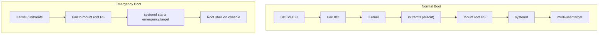

### 2.3 When Does It Happen?

- `/etc/fstab` entries are incorrect or point to non-existent devices.
- Root filesystem is corrupted.
- LVM volumes are not activated.
- Encrypted (LUKS) devices cannot be unlocked.
- Filesystem check failures.
- Missing or wrong UUID, labels or device names.
- Dracut/initramfs missing drivers or modules.
- Critical services required for boot are failing.

### 2.4 Types of Boot Modes

| Mode | Purpose |
|---|---|
| **Normal boot** | Standard multi-user boot |
| **Rescue mode** | Full OS with manual mounting (used for maintenance) |
| **Emergency mode** | Minimal shell when root FS cannot be mounted |

### 2.5 Common Symptoms

- Boot stops with: *"You are in emergency mode. After logging in, type `journalctl -xb` to view system logs."*
- Root filesystem is read-only.
- Services are not running.
- Network may or may not be available.
- Only a minimal shell prompt (`sh-4.4#`) is available.

> [!tip] Goal 🎯
> Identify the reason for emergency mode, ==fix the root cause==, restore normal boot.

### 2.6 Step-by-Step Troubleshooting Flow

1. **STEP-1** — Understand the error message on screen.
2. **STEP-2** — Check recent boot logs using `journalctl`.
3. **STEP-3** — Identify if root filesystem, LVM, encryption or fstab is the issue.
4. **STEP-4** — Remount root filesystem as read-write if possible.
5. **STEP-5** — Fix the configuration (fstab, LVM, encryption, filesystem, etc.).
6. **STEP-6** — Rebuild initramfs if required (`dracut`).
7. **STEP-7** — Reboot and validate normal boot.

### 2.7 Important Commands

```bash
journalctl -xb                          # boot logs with details
systemctl --failed                      # failed services
mount -o remount,rw /                   # remount root as read-write
lsblk -f                                # disks and filesystems
blkid                                   # check UUID and FS type
cat /etc/fstab                          # verify fstab entries
pvs; vgs; lvs                           # check LVM status
vgscan                                  # scan for VGs
vgchange -ay                            # activate VGs
cryptsetup luksDump /dev/sdX            # check LUKS device
lsinitrd /boot/initramfs-$(uname -r).img  # check initramfs
dracut -f                               # rebuild initramfs
fsck -n /dev/sdX1                       # check filesystem (read-only)
xfs_repair -n /dev/sdX1                 # check XFS (read-only)
df -h                                   # verify mounts
```

### 2.8 Sample Scenario — LVM VG Not Activated

> [!example] Scenario
> After a reboot, the server stops in emergency mode.
> It shows `"/dev/mapper/vol-root does not exist"` and gives a root shell.

**Investigation & Findings:**

1. Checked boot logs with `journalctl -xb`.
2. Found error: ==LVM volume group not activated==.
3. Verified with `pvs`, `vgs`, `lvs` → VG exists but inactive.
4. Root cause: LVM VG not activated during boot.

**Fix Implementation:**

1. Run `vgscan` and `vgchange -ay`.
2. Verify LVs with `lvs` and filesystem with `lsblk -f`.
3. Fixed `/etc/fstab` (used correct UUID).
4. Rebuilt initramfs to include LVM modules: `dracut -f`.
5. Rebooted the server.

**Validation:**

1. Server booted normally to `multi-user.target`.
2. All filesystems mounted correctly (`df -h`).
3. Verified application services.
4. Monitored logs for few minutes.

### 2.9 Real-World Causes & Solutions

| Issue | Symptom | Solution |
|---|---|---|
| Wrong UUID in fstab | Boot to emergency mode | Update correct UUID in `/etc/fstab` |
| Missing LVM activation | `/dev/mapper/` not found | `vgscan && vgchange -ay` |
| LUKS unlock failure | Encrypted device not found | Check clevis/tang, initramfs, network |
| Filesystem corruption | Mount error / read-only | Run `fsck`/`xfs_repair` (offline) |
| Missing driver in initramfs | Root device not found | Rebuild initramfs with `dracut -f` |
| Incorrect mount options | Mount failure | Fix `/etc/fstab` options |

### 2.10 Prevention / Best Practices

- Always use ==UUID== instead of device names in `/etc/fstab`.
- Keep a known-good kernel for rollback.
- Test boot after kernel or fstab changes.
- Monitor disk health and filesystem errors.
- Maintain backups/snapshots.
- Validate LVM and encryption configuration.
- Use change management for system changes.

> [!note] Key Points to Remember
> - Identify the ==exact reason== from logs.
> - Fix the root cause, do not just remount and reboot.
> - Use UUID in fstab.
> - Do ==not== run `fsck` on a mounted filesystem.
> - Rebuild initramfs only if required.
> - Validate services and application after boot.
> - Document the issue and fix for future reference.

> [!important] Important
> In emergency mode, the focus is ==recovery, not changes==.
> Take a backup before major fixes. Understand the root cause, reproduce in a lab if possible. Always validate after reboot.

> [!question]- Interview Follow-up Questions
> 1. What commands will you run first in emergency mode?
> 2. How do you fix a wrong fstab entry?
> 3. What if the root filesystem is corrupted?
> 4. How do you recover if LVM is not activated?
> 5. What if the system uses LUKS with Tang/Clevis?
> 6. Difference between emergency mode and rescue mode?
> 7. How do you rebuild initramfs and why?

---

## 3. Post-Quantum Cryptography (PQC) — RHEL 10 Admin Guide

### 3.1 The Quantum Threat

- Quantum computers can break ==RSA, ECC== and other asymmetric algorithms using ==Shor's algorithm==.
- RSA/ECC rely on mathematical problems (factorization and discrete log) that are solvable by quantum computers.
- This threatens ==confidentiality== (encryption) and ==authenticity== (signatures) in the future.

⇒ ==PQC is needed to stay secure in the quantum era.==

### 3.2 What is PQC?

- Post-Quantum Cryptography uses ==new mathematical problems== that are believed to be secure against quantum attacks.
- It is designed to work in real-world systems (TLS, SSH, VPN, certificates, signatures, etc.).
- PQC algorithms are being standardized by ==NIST== (e.g., ML-KEM, ML-DSA).

### 3.3 Key PQC Algorithms

| Algorithm | Role | Replaces | Examples |
|---|---|---|---|
| **ML-KEM** | Key Establishment / Key Encapsulation | RSA/ECDH for key exchange; establishes a shared secret | ML-KEM-512, ML-KEM-768, ML-KEM-1024 |
| **ML-DSA** | Digital Signatures | RSA/ECDSA for signatures; authentication, integrity & non-repudiation | ML-DSA-44, ML-DSA-65, ML-DSA-87 |

*Both are NIST standards.*

### 3.4 Classical vs PQC vs Hybrid Flow

| Flow | TLS Handshake | Characteristics |
|---|---|---|
| **Classical (RSA / ECC)** | RSA/ECDHE | Breakable by quantum • Used today • Still widely deployed |
| **PQC (ML-KEM + ML-DSA)** | ML-KEM + ML-DSA | Quantum resistant • Newer / evolving • Limited support today |
| **Hybrid (==Recommended Now==)** | Classical + PQC | Backward compatible • Stronger security • Real-world practical |

### 3.5 Important Facts for RHEL 10

> [!warning] RHEL 10 does NOT automatically make every HTTPS/SSH connection post-quantum
> - RHEL 10 includes OpenSSL 3 and PQC support, but it's ==not enabled by default== for all services.
> - You must ==explicitly configure== algorithms, crypto policy, and applications.
> - Some services (e.g., OpenSSH, web servers) need manual configuration for PQC.

### 3.6 Where PQC Applies

- TLS/HTTPS (web apps, APIs)
- SSH (logins, automation)
- VPN (IPsec / SSL)
- Certificates (signing)
- Code signing / package signing
- Internal services (microservices)

### 3.7 Protocol / Library / Application / Peer Interoperability

- **Protocol** → TLS 1.3, SSH, IPsec, etc. must support PQC ciphers.
- **Library** → OpenSSL 3.x, liboqs, crypto libraries.
- **Application** → Webservers, SSH, VPN, apps must be updated.
- **Peer** → ==Both sides== must support the same PQC algorithms.

> [!warning] Interoperability Rule
> If any one layer doesn't support PQC, the connection will ==fall back to classical (or fail)==.

### 3.8 Crypto Policy & Configuration

- RHEL uses ==system-wide crypto policies==.
- Check current policy, set policy, then restart services and verify with OpenSSL and application tests.

```bash
update-crypto-policies --show          # check current policy
update-crypto-policies --set FUTURE    # set policy (example)
```

### 3.9 Certificates & Signatures

- Use PQC-enabled certificate algorithms (e.g., ==ML-DSA==) when available.
- Ensure your CA supports PQC signatures.
- Check certificate chain and trust store.
- Update client and server configurations.

> [!note] Note
> Without PQC support in certificates, the connection ==remains classical==.

### 3.10 Performance & Resource Impact

- PQC algorithms are more ==CPU and memory intensive== than classical ones.
- Handshake time can be higher.
- Plan capacity and monitor performance.
- Use ==hybrid mode== to balance security and performance.

> [!tip] Tip
> Test in a lab before full production rollout.

### 3.11 Migration Strategy

1. **Inventory** → find all services and dependencies.
2. **Check support** → verify PQC support in OS, apps, libs.
3. **Check policy** → configure crypto policy and algorithms.
4. **Test interoperability** → client/server/third-party.
5. **Pilot** → start with non-critical services.
6. **Validate** → monitor, test, and then roll out broadly.

`Inventory → Check support → Check policy → Test interoperability → Pilot → Validate`

### 3.12 Common Production Scenario

> [!example] Scenario
> A company enables PQC in RHEL 10, but some external clients cannot connect to the HTTPS service.
> **Symptoms:** handshake failure / unsupported algorithm.

**L3 Approach:**

1. Check server and client OpenSSL versions.
2. Verify crypto policy and enabled algorithms.
3. Check certificate type (PQC supported?).
4. Test with `openssl s_client -tls1_3`.
5. Work with the client team / vendor for PQC support.
6. Roll back to ==hybrid mode== if needed.
7. Document and plan full PQC rollout.

### 3.13 Useful Commands

```bash
openssl version -a                            # Check OpenSSL version and build
openssl list -kem-algorithms                  # See supported KEM algorithms
openssl list -signature-algorithms            # See supported signature algorithms
update-crypto-policies --show                 # Current crypto policy
update-crypto-policies --set FUTURE           # Enable stronger crypto policy
openssl s_client -connect host:443 -tls1_3    # Test TLS 1.3 and cipher negotiation
```

### 3.14 Common Causes & Common Mistakes

**Common Causes:**

- PQC not enabled in crypto policy.
- Unsupported OpenSSL version.
- Application not updated.
- Certificate not signed with PQC algorithm.
- Network / firewall blocking new ciphers.
- Peer does not support PQC.
- Fallback to classical without notice.

> [!warning] Common Mistakes
> - Assuming RHEL 10 auto-enables PQC.
> - Enabling PQC without testing.
> - Ignoring certificate chain format.
> - Changing system crypto policy without understanding impact.
> - Not checking third-party support.
> - Skipping performance testing.

### 3.15 Validation Checklist

- [ ] OpenSSL and PQC algorithms supported.
- [ ] Crypto policy configured correctly.
- [ ] Certificates signed with PQC (if used).
- [ ] All services restarted and working.
- [ ] Interoperability tested with clients/peers.
- [ ] Performance within acceptable limits.
- [ ] Monitoring and logging in place.

> [!question]- Interview Follow-up Questions
> 1. Which PQC algorithms are available in RHEL 10? → *ML-KEM, ML-DSA (via OpenSSL 3).*
> 2. Does RHEL 10 enable PQC by default? → *No, you must configure it.*
> 3. What's the difference between ML-KEM and ML-DSA? → *ML-KEM = key exchange, ML-DSA = signatures.*
> 4. How do you enable PQC in TLS? → *Use policy + configure algorithms + test.*
> 5. What happens if the peer doesn't support PQC? → *Falls back to classical or fails.*

> [!quote] Key Takeaway ⭐
> PQC is not just a feature, it is a ==layered change== across protocols, libraries, applications, certificates and infrastructure.
> In RHEL 10, it gives you the foundation — but you must configure, test and validate it to get real security.
> **Plan → Test → Rollout → Monitor**

---

## 4. Troubleshooting Certificate Issues — L3 Guide

### 4.1 Basics — SSL / TLS & Certificates

- **SSL/TLS** — Encrypts data between client & server.
- **Certificate** — Digital identity for server/client.
- **Root CA** — Trusted CA (pre-installed in OS/Browser).
- **Intermediate CA** — Signed by Root CA.
- **Leaf/Server Certificate** — Issued for server (contains SAN).
- **Private Key** — Must match with certificate.
- **CSR** — Certificate Signing Request (generate certificate).
- **SAN** — Subject Alternative Name (multiple hostnames).
- **Self Signed** — Not trusted by default.
- **Cipher/Protocol** — TLS versions and cipher suites.

### 4.2 Certificate Chain Flow

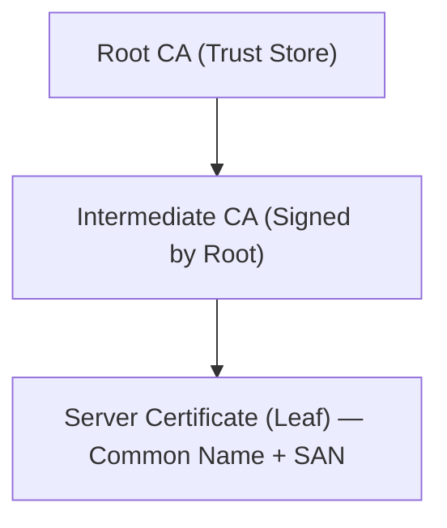

> [!note] Full Chain
> ==Full chain = Leaf + Intermediate(s) + Root== — must be provided by the server.

### 4.3 Where Certificates Are Used?

- HTTPS / Web servers (Apache, Nginx, IIS)
- Application to Application (API, Databases)
- Load Balancers (ALB, NLB, F5)
- Mail Servers (SMTP/IMAP/POP3)
- LDAP / LDAPS
- Java Applications / Middleware (Tomcat, JBoss)
- Databases (PostgreSQL, MySQL, Oracle)
- VPN, Kubernetes (API server)
- Code signing / Package signing

### 4.4 Useful Commands

```bash
openssl s_client -connect host:443 -showcerts          # check cert chain
openssl x509 -in cert.pem -noout -text                 # certificate details
openssl x509 -in cert.pem -noout -dates                # expiry date
openssl verify -CAfile ca.pem cert.pem                 # verify chain
openssl x509 -noout -modulus -in cert.pem | openssl md5  # cert modulus
openssl rsa -noout -modulus -in key.pem | openssl md5    # key modulus
keytool -list -v -keystore file.jks                    # for Java keystore
curl -Iv https://hostname                              # check TLS handshake
openssl x509 -in cert.pem -noout -subject -issuer      # subject/issuer
update-crypto-policies --show                          # RHEL crypto policy
```

### 4.5 Common Certificate Issues

- Certificate expired.
- Hostname mismatch (CN/SAN).
- Missing intermediate certificate.
- Untrusted CA (not in trust store).
- Private key and certificate mismatch.
- Old TLS version / weak cipher.
- Wrong certificate path / file permissions.
- Self signed certificate.
- Certificate revocation (CRL/OCSP).
- Application using wrong certificate.
- RHEL crypto policy blocking old algorithms.

### 4.6 Scenario 1 — Certificate Expired

**Situation:** Website/API not working. Browser shows *"certificate has expired"*.

**Investigation:**

1. Check certificate expiry date.
2. Verify which certificate is used.

```bash
openssl s_client -connect host:443 -showcerts
openssl x509 -in cert.pem -noout -dates
```

**Root Cause:** Certificate expired.
**Fix:** Generate new certificate and install ==full chain (Leaf + Intermediate)==.
**Validation:** Test with openssl, browser and application.

### 4.7 Scenario 2 — Hostname Mismatch

**Situation:** HTTPS fails with *"hostname mismatch"*.

**Investigation:**

1. Check CN/SAN in certificate.
2. Verify client is using correct hostname.

```bash
openssl x509 -in cert.pem -noout -text | grep -i "DNS"
curl -Iv https://hostname
openssl s_client -connect host:443 -servername host
```

**Root Cause:** Certificate does not contain required hostname in CN/SAN.
**Fix:** Reissue certificate with ==correct SAN==.
**Validation:** Test with correct hostname.

### 4.8 Scenario 3 — Missing Intermediate

**Situation:** Works in some browsers but fails in Java/App with *"unable to find valid certification path"*.

**Investigation:**

1. Check full certificate chain.
2. Compare with working server/browser.

```bash
openssl s_client -connect host:443 -showcerts
openssl verify -CAfile ca-bundle.pem cert.pem
```

**Root Cause:** Intermediate certificate not provided by server.
**Fix:** Install ==full chain== on server/app.
**Validation:** Test with Java/curl/browser.

### 4.9 Scenario 4 — Private Key Mismatch

**Situation:** Application fails to start or TLS handshake fails.

**Investigation:**

1. Compare modulus of certificate and key.
2. Verify correct files are used.

```bash
openssl x509 -noout -modulus -in cert.pem | md5
openssl rsa -noout -modulus -in key.pem | md5
```

**Root Cause:** Private key does not match certificate.
**Fix:** Use correct matching key and certificate.
**Validation:** Restart service and test handshake.

### 4.10 Scenario 5 — Untrusted CA

**Situation:** Client/application does not trust the certificate (self-signed or private CA).

**Investigation:**

1. Verify certificate chain.
2. Check if CA is in trust store.
3. Check client system trust store.

```bash
openssl verify -CAfile ca.pem cert.pem
update-ca-trust extract        # RHEL
keytool -list -v -keystore cacerts   # Java
```

**Root Cause:** CA not trusted by client.
**Fix:** Add CA to trust store or use known CA.
**Validation:** Test with openssl/curl/application.

### 4.11 Scenario 6 — TLS Version / Cipher Issue

**Situation:** Client fails with *"unsupported protocol"* or *"handshake failure"*.

**Investigation:**

1. Check supported TLS version/cipher.
2. Verify system crypto policy (RHEL).

```bash
openssl s_client -connect host:443 -tls1_2
openssl s_client -connect host:443 -tls1_3
update-crypto-policies --show
```

**Root Cause:** Client/server using old TLS version or weak cipher blocked by crypto policy.
**Fix:** Enable supported TLS version/cipher or adjust crypto policy.
**Validation:** Test handshake again.

### 4.12 Troubleshooting Flow

1. Reproduce the issue and collect error message.
2. Check certificate details (openssl).
3. Verify hostname, expiry, chain and trust.
4. Check private key match.
5. Check application/server configuration.
6. Check system trust store & crypto policy.
7. Fix the issue and restart service.
8. Validate from client and application.

> [!tip] Best Practices
> - Always use certificates from ==trusted CA==.
> - Provide ==full chain== (Leaf + Intermediate).
> - Use ==SAN== for all hostnames (avoid CN only).
> - Use strong TLS versions (1.2 / 1.3).
> - Keep certificates renewal process ready.
> - Monitor certificate expiry (alerts).
> - Restrict private key permissions (`600`).
> - Use separate certificates for different environments.
> - Test certificate from client side (not only browser).

> [!note] Key Takeaways ⭐
> - Certificate chain must be ==complete==.
> - Hostname should be in ==SAN==.
> - Private key must ==match== certificate.
> - Use strong TLS & ciphers.
> - Keep CA in client trust store.
> - RHEL crypto policy may block old algos.
> - Always test from client/application.
> - Monitor expiry and renew in time.

---

## 5. Troubleshooting Dracut / initramfs Issues

### 5.1 What is Dracut?

- Dracut is a tool to create ==initramfs== (initial RAM filesystem).
- Used during ==early boot process==.
- Contains drivers, modules, scripts required to mount real root filesystem.
- Used in RHEL 7/8/9/10 (replaces older initrd).

### 5.2 Boot Flow (Where Dracut Works)


*Dracut loads required modules, finds and mounts root filesystem.*

### 5.3 Common Dracut Issues

- Root device not found
- Missing LVM/RAID/FC/NFS drivers
- LUKS/Clevis/Tang unlocking failure
- initramfs missing or corrupted
- Wrong kernel or initramfs after update
- Dracut network configuration issues (for remote/NFS root)
- Host not booting after kernel update
- Emergency shell or dropping to dracut shell

```bash
dracut --version
lsinitrd /boot/initramfs-$(uname -r).img
dracut -f
dracut -v
cat /etc/dracut.conf
cat /etc/dracut.conf.d/*.conf
journalctl -xb
modinfo <module>
lsmod | grep <module>
find /lib/modules/$(uname -r)
blkid / lsblk / lvm commands
```

### 5.4 Check initramfs Content

```bash
lsinitrd /boot/initramfs-$(uname -r).img | less
lsinitrd ... | grep <module>
lsinitrd ... | grep -i lvm
lsinitrd ... | grep -i crypt
lsinitrd ... | grep -i network
```

### 5.5 Scenario 1 — Root Device Not Found

**Situation:** System fails to boot with error `"dracut: cannot find root device"`.

**Investigation:**

1. Check `/etc/fstab` and kernel parameters.
2. Verify LVM/RAID/LUKS configuration.
3. Check if required modules are in initramfs.
4. Check UUID/Device names (may have changed).

```bash
journalctl -xb
lsblk -f
blkid
cat /etc/fstab
lsinitrd ... | grep lvm
lvm vgscan / vgs / lvs
```

**Root Cause:** Required storage module not present in initramfs or wrong UUID.
**Fix:** Recreate initramfs with required module — `dracut -f --add "lvm" --add "dm_mod"`; update `/etc/fstab` with correct UUID.
**Validation:** Reboot and verify system boots successfully.

### 5.6 Scenario 2 — LUKS/Clevis/Encrypted Root Failure

**Situation:** System drops to dracut shell and asks for passphrase or fails to unlock LUKS device.

**Investigation:**

1. Check if crypt modules are present.
2. Verify `/etc/crypttab` and kernel parameters.
3. Check Clevis/Tang network availability (if used).
4. Try manual unlock from dracut shell.

```bash
lsinitrd ... | grep crypt
cat /etc/crypttab
curl -I <tang-server>
clevis luks list -d <device>
```

**Root Cause:** Missing crypt module, wrong UUID, or network issue for Clevis.
**Fix:** Recreate initramfs — `dracut -f --add "crypt" --add "dm_crypt"`; fix crypttab/UUID or network connectivity.
**Validation:** Reboot and verify automatic unlock works.

### 5.7 Scenario 3 — Kernel Update Breaks Boot (initramfs Issue)

**Situation:** After kernel update, system fails to boot or drops to emergency shell.

**Investigation:**

1. Boot from previous kernel (in GRUB).
2. Check logs and initramfs for new kernel.
3. Verify required custom modules are included.

```bash
grub2-editenv list
lsinitrd /boot/initramfs-<new>.img
dracut -f -v
dnf reinstall kernel-core
```

**Root Cause:** Incomplete initramfs or missing module/driver for new kernel.
**Fix:** Recreate initramfs and ensure custom modules are included.
**Validation:** Boot using new kernel and verify services.

### 5.8 Scenario 4 — Missing Driver / Custom Module

**Situation:** Hardware (HBA/NIC) not detected during boot.

**Investigation:** Check if driver is in initramfs and kernel supports it.

```bash
lsinitrd ... | grep <module>
modinfo <module>
dracut -f --add <module>
```

**Fix:** Add module in `/etc/dracut.conf.d/custom.conf`.

### 5.9 Best Practices

- Keep `/boot` with enough space.
- Include required modules in `/etc/dracut.conf.d/`.
- Test boot after kernel update (staging).
- Keep previous kernel for fallback.
- Document custom dracut configuration.

### 5.10 Quick Troubleshooting Flow

1. Check error message (dracut / kernel).
2. Check storage/encryption/network.
3. Verify initramfs content.
4. Boot with previous kernel if needed.
5. Fix configuration and rebuild initramfs.
6. Reboot and validate.

---

## 6. Troubleshooting SELinux Issues

### 6.1 What is SELinux?

- SELinux (Security-Enhanced Linux) provides ==Mandatory Access Control (MAC)==.
- Restricts processes based on policies (type enforcement).
- Helps prevent unauthorized access even if application is compromised.
- Default mode: ==Enforcing== in RHEL.

### 6.2 SELinux Modes

| Mode | Behavior |
|---|---|
| **Enforcing** | Blocks unauthorized actions (==recommended==) |
| **Permissive** | Allows actions but logs denials (used for troubleshooting) |
| **Disabled** | No SELinux enforcement (not recommended) |

### 6.3 Important Files & Commands

- `/etc/selinux/config` → global mode
- `/etc/selinux/targeted/` → policies
- `/var/log/audit/audit.log` → AVC logs
- `/etc/selinux/contexts/files/file_contexts`
- `/etc/selinux/targeted/active/modules/`
- `/etc/selinux/targeted/active/booleans/`

```bash
getenforce
sestatus
setenforce 0/1
ausearch -m AVC -ts recent
audit2why < /var/log/audit/audit.log
audit2allow -M mypolicy
ls -Z <file>
restorecon -Rv <path>
semanage fcontext -l
```

### 6.4 SELinux Architecture (Simple View)

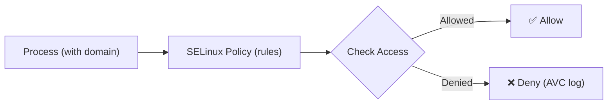

### 6.5 Common SELinux Issues

- Application permission denied (AVC)
- Service not able to bind to non-standard port
- File / directory context mismatch
- Custom scripts not working
- Network/DB connection blocked
- Restoring files from backup with wrong context
- After patch/upgrade application stops working

```bash
getenforce
sestatus
ls -Z /var/www/html
semanage port -l | grep <port>
semanage boolean -l | grep <service>
```

### 6.6 Scenario 1 — Application Permission Denied

**Situation:** Application fails to read/write file or start. Error in logs *"Permission denied"*. AVC log present.

**Investigation:**

1. Check audit logs.
2. Identify denied operation and context.
3. Verify file context and process domain.

```bash
ausearch -m AVC -ts recent
ausearch -m AVC -c <process>
audit2why < /var/log/audit/audit.log
audit2allow -M myapp
```

**Root Cause:** Incorrect file context or missing custom policy permission.
**Fix:** Restore file context or create custom policy — `restorecon -Rv /path`; `audit2allow -M myapp && semodule -i myapp.pp`.
**Validation:** Application works and no new AVC denials.

### 6.7 Scenario 2 — Service Cannot Bind to Port

**Situation:** Custom application (e.g. Java, Nginx) cannot bind to non-standard port (e.g. 8080).

**Investigation:**

1. Check SELinux port policy.
2. Verify service domain.
3. Check AVC logs.

```bash
semanage port -l | grep <port>
semanage port -a -t http_port_t -p tcp 8080
ausearch -m AVC -ts recent | grep <port>
```

**Root Cause:** Port not allowed for service domain.
**Fix:** Add port to correct SELinux type (e.g. `http_port_t`).
**Validation:** Restart service and verify it binds to the port.

### 6.8 Scenario 3 — Application Cannot Connect to DB/Network

**Situation:** Application running but cannot connect to database/remote server.

**Investigation:**

1. Check AVC logs for network denial.
2. Verify boolean settings.
3. Check correct SELinux type for outgoing connection.

```bash
ausearch -m AVC -ts recent
getsebool -a | grep <service>
setsebool -P <boolean> on
```

**Root Cause:** Required boolean disabled or policy restriction.
**Fix:** Enable required boolean (e.g. `httpd_can_network_connect`).
**Validation:** Test connection again.

### 6.9 Scenario 4 — File Context Mismatch After Restore

**Situation:** After restoring files from backup, application stops working.

**Root Cause:** Files restored with wrong context (`default_t`).
**Fix:** `restorecon -Rv /path` or `semanage fcontext -a -t <type> "/path(/.*)?"`.
**Validation:** Application works and context is correct (`ls -Z`).

### 6.10 Best Practices

- Keep SELinux in ==enforcing== mode.
- Use ==booleans== before creating custom policy.
- Maintain least privilege access.
- Monitor audit logs regularly.
- Document custom policies (`audit2allow`).

### 6.11 Quick Troubleshooting Flow

1. Check application error/logs.
2. Check SELinux mode and audit logs.
3. Identify denied resource and context.
4. Apply fix (boolean / fcontext / policy).
5. Restart service.
6. Validate and monitor for new AVC logs.

---

## 7. Post-Quantum Cryptography (PQC) — L3 Admin Guide

### 7.1 Why Do We Need PQC? (Quantum Threat)

- Quantum computers (with enough qubits) can break current ==public-key crypto== based on mathematical problems.
- RSA & ECC depend on ==integer factorization== and ==discrete logarithm== problems which can be solved by ==Shor's algorithm==.
- This will allow an attacker to ==derive private keys from public keys==.
- Symmetric algorithms (e.g. AES) are less affected but require ==larger key sizes==.

### 7.2 What is PQC?

- Post-Quantum Cryptography (PQC) is a set of cryptographic algorithms designed to be ==secure against quantum computers==.
- Standardized by ==NIST== based on lattice-based, hash-based and other quantum-resistant mathematical problems.
- PQC is being introduced in phases and initially used in ==hybrid mode== with existing algorithms.

### 7.3 Key Algorithms to Know

| Algorithm | Full Name | Used for | Replaces | Standard | Examples |
|---|---|---|---|---|---|
| **ML-KEM** | Module-Lattice Based Key Encapsulation Mechanism | Key establishment / key encapsulation | RSA/ECDH for exchanging a shared secret | FIPS 203 | ML-KEM-512, 768, 1024 |
| **ML-DSA** | Module-Lattice Based Digital Signature Algorithm | Digital signatures | RSA/ECDSA for signing | FIPS 204 | ML-DSA-44, 65, 87 |

### 7.4 Classical vs PQC vs Hybrid (High Level Flow)

| Model | Key Exchange | Security |
|---|---|---|
| **Classical (Current)** | RSA/ECC | ==Vulnerable to quantum== (Shor's algorithm) |
| **PQC (Future)** | ML-KEM | Quantum-resistant (when widely adopted) |
| **Hybrid (==Recommended==)** | Classical + PQC | Both classical and post-quantum algorithms used during transition (current best practice) |

### 7.5 Important RHEL 10 Point

> [!warning] RHEL 10 does NOT automatically make every HTTPS/SSH connection post-quantum
> PQC support depends on:
> - OpenSSL / GnuTLS / libraries
> - Application support
> - Protocol support (TLS/SSH)
> - Peer (client/server) support
> - System crypto policy
> - Configuration and certificates
>
> By default, RHEL 10 uses current secure algorithms — PQC must be ==enabled/supported and negotiated==.

### 7.6 RHEL 10 and PQC Support (Overview)

- RHEL 10 includes an OpenSSL 3.x version with ==initial PQC support== (based on upstream).
- Supports ==hybrid key exchange and signatures== with standardized algorithms.
- Actual availability may depend on the exact RHEL 10 minor version and updates.
- Check available algorithms and crypto policy settings before use.

### 7.7 Useful Commands (Check PQC Support)

```bash
openssl version -a                           # Check OpenSSL version and build options
openssl list -kem-algorithms                 # List supported KEM algorithms (e.g. ML-KEM)
openssl list -signature-algorithms           # List supported signature algorithms (e.g. ML-DSA)
update-crypto-policies --show                # Check current system crypto policy
update-crypto-policies --set DEFAULT         # Set crypto policy (DEFAULT / FUTURE, etc.)
openssl s_client -connect host:443 -tls1_3   # Test TLS connection and negotiated algorithms
ssh -Q kex                                   # List supported key exchange algorithms in SSH
ssh -Q key                                   # List supported public key algorithms (signatures)
```

### 7.8 Certificates and PQC

- Traditional certificates use RSA/ECDSA signatures; PQC certificates use algorithms like ==ML-DSA== (or in hybrid with RSA/ECDSA).
- During transition, ==hybrid certificates== may contain both classical and PQC signatures.
- Certificate chain, trust store and client support must all understand the new algorithms.
- Clients and applications must support PQC algorithms to validate the certificate.

### 7.9 Performance and Operational Impact

- PQC algorithms generally have ==larger key sizes and signatures==.
- There can be higher CPU, memory and bandwidth usage.
- Test performance in a non-production environment before rollout.
- Monitor latency, CPU usage and handshake time.

### 7.10 8-Step Readiness / Troubleshooting Workflow

1. **Inventory** — Identify systems, applications, certificates, SSH/TLS endpoints.
2. **Check Support** — Verify library/application support (OpenSSL/GnuTLS, etc.).
3. **Check Policy** — Check and update crypto policy if required.
4. **Test Interoperability** — Test with supported clients/servers (TLS/SSH).
5. **Pilot** — Enable in a non-production environment.
6. **Validate** — Check functionality, performance and logs.
7. **Plan Rollout** — Phased rollout with monitoring and rollback plan.
8. **Monitor & Maintain** — Track updates, CVEs and algorithm support.

### 7.11 Production Scenario (Example)

> [!example] Scenario
> We need to enable PQC for a secure application after a security review. The client and server must use ==hybrid TLS with ML-KEM and ML-DSA==.

**Approach:**

1. Check OpenSSL version and supported algorithms.
2. Verify application and client support.
3. Configure crypto policy and application.
4. Test handshake and verify negotiated algorithms.
5. Monitor performance and errors.
6. Roll out in phases with a rollback plan.

### 7.12 Common Causes of Issues

- Outdated OpenSSL or application without PQC support.
- Crypto policy blocks the algorithms.
- Client or server does not support PQC.
- Certificate chain or trust store not updated.
- Protocol negotiation falls back to classical algorithms.
- Interoperability issues between different products.
- Performance impact not considered.

> [!warning] Common Mistakes (Avoid These)
> - Assuming RHEL 10 automatically enables PQC.
> - Enabling PQC in production without testing.
> - Ignoring client/application support.
> - Changing crypto policy without understanding impact on existing services.
> - Using PQC algorithms without monitoring performance.
> - Not having a rollback plan.

### 7.13 Validation Checklist

- [ ] Connection works with expected algorithms.
- [ ] Check negotiated KEM and signature algorithm.
- [ ] Application functions normally.
- [ ] No errors in logs (TLS/SSH/Application).
- [ ] Performance is within acceptable limits.
- [ ] Monitoring and alerts in place.
- [ ] Rollback plan tested.

> [!question]- Likely Interview Follow-Up Questions
> 1. What is Shor's algorithm and how does it affect RSA/ECC?
> 2. What is ML-KEM and what is it used for?
> 3. What is ML-DSA and how is it different from ML-KEM?
> 4. Does RHEL 10 make all connections post-quantum by default?
> 5. How do you check PQC support on a server?
> 6. Can we use hybrid certificates? How does it work?
> 7. How would you enable PQC for HTTPS?
> 8. What are the performance considerations?
> 9. How do you handle applications that do not support PQC yet?
> 10. How would you plan and execute a PQC rollout?
> 11. What happens if the client does not support PQC?
> 12. How do you verify the negotiated algorithm?
> 13. How does crypto policy affect PQC?
> 14. What is your rollback strategy if issues occur?
> 15. How do you monitor and maintain PQC over time?

> [!quote] Golden Rule ★
> **Prepare → Test in Non-Production → Validate → Monitor → Rollout Safely**

---

## 8. RHEL 8 vs RHEL 9 vs RHEL 10 — L3 Admin Guide

### 8.1 Key Differences (Quick View)

| Feature | RHEL 8 | RHEL 9 | RHEL 10 |
|---|---|---|---|
| **Release Year** | 2019 | 2022 | 2025 (Expected) |
| **Kernel Version** | 4.18 | 5.14 | 6.12 |
| **Package Manager** | DNF (yum) | DNF (yum) | DNF (yum) |
| **OpenSSL** | OpenSSL 1.1.1 | OpenSSL 3.0 | OpenSSL 3.x |
| **Crypto Policy** | LEGACY/DEFAULT | DEFAULT (stricter) | More stricter (==PQC ready==) |
| **cgroups** | v1 (default) | v2 (default) | ==v1 removed==, v2 only |
| **Python** | 3.6 | 3.9 | 3.12 (expected) |
| **Support** | Till 2029 | Till 2032 | Till 2035 (Expected) |

### 8.2 Kernel Generations

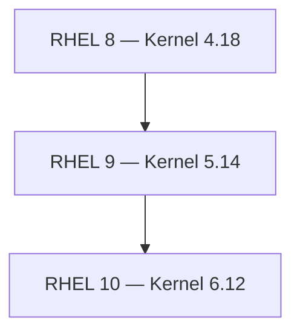

| Release | Kernel | Highlights |
|---|---|---|
| **RHEL 8** | 4.18 | Long term stable • Widely used in enterprise • Many legacy applications |
| **RHEL 9** | 5.14 | Improved hardware support • Better security features • cgroups v2 default • OpenSSL 3 |
| **RHEL 10** | 6.12 | Newer hardware enablement • cgroups v1 removed • More security enhancements • Preparing for post-quantum crypto |

### 8.3 DNF / YUM Package Manager

- RHEL 8, 9 and 10 all use ==DNF== (yum is a wrapper).
- DNF has better dependency resolution and modularity.
- RHEL 9 and 10 have updated DNF behavior and repository structure.
- Use ==dnf instead of yum==.

```bash
dnf --version
dnf repolist
dnf repolist all
dnf history
dnf updateinfo list
dnf module list
```

> [!note] Key Points
> - `yum` still works (alias).
> - Repositories are different.
> - RHEL 9/10 use DNF modules.
> - Check repo compatibility during upgrade.

### 8.4 OpenSSL 3 in RHEL 9

- RHEL 8 uses OpenSSL 1.1.1 — RHEL 9 and 10 use ==OpenSSL 3==.
- Removed legacy algorithms (e.g. ==SHA1, RC4==).
- Can cause TLS/certificate issues with older applications.
- Use ==system crypto policies== instead of custom OpenSSL config.

```bash
openssl version -a
# Example output (RHEL 9):
# OpenSSL 3.0.7  1 Nov 2022
# built on: ...
```

### 8.5 System Crypto Policies

- Controls allowed ciphers, protocols and algorithms ==system-wide==.
- RHEL 9/10 are more stricter (LEGACY does not enable very old algos).
- Prefer ==application upgrade== instead of weakening crypto policy.

```bash
update-crypto-policies --show
update-crypto-policies --set DEFAULT
update-crypto-policies --set LEGACY
```

### 8.6 Cgroups Changes

- RHEL 8 → cgroups v1 (default)
- RHEL 9 → cgroups v2 (default)
- RHEL 10 → ==cgroups v1 removed (v2 only)==
- Some older applications, monitoring agents or containers may require changes.

```bash
stat -fc %T /sys/fs/cgroup   # cgroup2fs → v2 | tmpfs → v1
mount | grep cgroup
cat /proc/1/cgroup
```

> [!warning] Impact
> - Applications using cgroups v1 may ==not work on RHEL 10==.
> - Container runtimes (e.g. Docker, K8s) already support v2.
> - Need to test custom scripts, monitoring agents and older tools.

### 8.7 Check Current RHEL Version

```bash
cat /etc/redhat-release
cat /etc/os-release
uname -r
```

```text
Red Hat Enterprise Linux release 9.3 (Plow)
NAME="Red Hat Enterprise Linux"
VERSION="9.3 (Plow)"
Kernel: 5.14.0-362.el9.x86_64
```

**Check repos & updates:** `dnf repolist` • `dnf repolist all` • `dnf history` • `dnf history info <ID>` • `dnf updateinfo list`

**Check crypto & cgroups:** `update-crypto-policies --show` • `openssl version -a` • `stat -fc %T /sys/fs/cgroup` • `mount | grep cgroup` • `cat /proc/1/cgroup`

### 8.8 Practical Upgrade Compatibility Checks

1. Check application compatibility (OpenSSL 3, Python, cgroups).
2. Review 3rd party agents (Datadog, monitoring, backup, AV).
3. Check kernel modules / drivers.
4. Verify custom scripts and hardcoded paths.
5. Review SELinux policies and file contexts.
6. Check repository availability.
7. Test in non-production or staging first.

### 8.9 Production Scenario

> [!example] Scenario
> After upgrading a RHEL 8 server to RHEL 9, application fails to connect to an external API with ==TLS handshake error==.

**Possible Causes:**

- OpenSSL 3 is stricter.
- Old TLS version/cipher not allowed.
- Application using deprecated algorithm.
- System crypto policy blocking it.
- Certificate chain or CA issue.

### 8.10 Troubleshooting Flow

1. Check application error logs.
2. Test connectivity with `openssl s_client`.
3. Check TLS versions and cipher.
4. Verify server certificate and chain.
5. Check system crypto policy.
6. Compare working client (e.g. RHEL 8).
7. Apply the right fix (upgrade app / adjust policy).
8. Validate from the application.

> [!warning] Common Mistakes
> - Assuming yum and dnf are the same.
> - Not checking application compatibility.
> - Ignoring OpenSSL 3 impact.
> - Overlooking crypto policy.
> - Missing cgroups changes for older tools.
> - Upgrading directly in production.
> - Not validating third-party agents (e.g. Datadog).

### 8.11 Validation Checklist (After Upgrade)

- [ ] System boots and services are running.
- [ ] Application works end-to-end.
- [ ] TLS connections succeed.
- [ ] Required repositories are enabled.
- [ ] cgroups-dependent applications work.
- [ ] Monitoring agents (Datadog) are reporting.
- [ ] No unexpected SELinux denials.
- [ ] Disk space, performance and logs are normal.

> [!question]- Interview Follow-ups
> 1. How does OpenSSL 3 affect applications?
> 2. What is system crypto policy?
> 3. How to check cgroups version?
> 4. What will break if an app requires cgroups v1 on RHEL 10?
> 5. How do you plan an RHEL 8 → 9 upgrade?
> 6. How do you rollback if an issue occurs?
> 7. What checks will you do before upgrading a production server?

---

## 9. DevOps Release Pipeline — L3 Admin Guide

### 9.1 What is a DevOps Release Pipeline?

- An ==automated process== to build, test, scan, and deploy application changes from source code to production.
- Ensures faster, consistent, repeatable and reliable releases.
- Reduces manual effort and human errors.
- Provides audit, visibility and easy rollback.

**Key Terms (Quick Definitions):**

- **Source Code** — Application code stored in Git.
- **Build** — Compile/package code into artifact.
- **Unit Test** — Test code functionality.
- **Security Scan** — Check for vulnerabilities (SAST/DAST).
- **Artifact** — ==Immutable== build output (e.g., container image).
- **Deploy** — Release artifact to environments.
- **Pipeline** — Automated sequence of stages.
- **Rollback** — Revert to previous stable version.

### 9.2 Typical DevOps Release Pipeline Flow


> [!note] Promotion Rule
> The ==same immutable artifact== is promoted across all environments (Dev → Integration → Production).

### 9.3 Pipeline Variables vs Secrets

| Pipeline Variables | Secrets |
|---|---|
| Non-sensitive values | Sensitive values: passwords, tokens, certificates, API keys |
| Used for configuration | Should ==never== be stored in code |
| Examples: environment name, image tag, replicas, config values | Use secret management (Vault, AWS Secrets Manager, Kubernetes Secrets, CI/CD secret store) |
| Can be stored in pipeline config or variable groups | Inject at runtime and ==avoid printing in logs== |

```yaml
# Pipeline Variables (non-sensitive)
ENV = production
IMAGE_TAG = v1.2.3
REPLICAS = 3

# Secrets (GitHub Actions example)
DB_PASSWORD: ${{ secrets.DB_PASSWORD }}
API_TOKEN: ${{ secrets.API_TOKEN }}
```

### 9.4 Deployment Success vs Application Health

| Deployment Success (Pipeline Level) | Application Health (Actual Functionality) |
|---|---|
| Pipeline completes without error | Application endpoints respond correctly |
| Artifact is deployed to target environment | All dependent services are reachable (DB, external APIs, etc.) |
| Kubernetes shows pods as Running | No runtime errors in application logs |
| No errors in deployment logs | Business functionality works as expected |
| Does ==NOT== always mean the app works for users | Users can access the application without errors |

### 9.5 Production Scenario — Pipeline Success but Users See Errors

> [!example] Scenario
> A new version is deployed to production. The pipeline shows ==SUCCESS==, pods are running, but users report errors or the application is not working.

**Possible Causes:**

- Application configuration issue
- Missing or incorrect environment variable
- Database connection failure
- External API or third-party service not reachable
- Cache/Session issue
- TLS/Certificate validation error
- Wrong image version or tag
- Application crash or runtime error
- Insufficient resources (CPU/Memory)
- Ingress/LoadBalancer/Network issue
- SSL/TLS or API endpoint misconfiguration
- Schema/database migration issue
- Feature flag or new code bug
- Health check endpoint not validating actual functionality

### 9.6 Step-by-Step Troubleshooting Approach (L3)

1. Check deployment status (pods, rollout, events).
2. Check application logs for errors.
3. Verify environment variables and secrets.
4. Check application configuration (ConfigMap/values).
5. Verify connectivity to dependent services (DB, APIs, etc.).
6. Test application endpoints manually (curl/browser).
7. Check ingress/service/load balancer configuration.
8. Compare with previous working version.
9. If needed, ==rollback to last stable version==.
10. After fixing, redeploy and validate end-to-end.

### 9.7 Useful Commands (Kubernetes Example)

```bash
# Check deployment status
kubectl get deployment <app> -n <namespace>
kubectl rollout status deployment/<app> -n <namespace>
# Check pods and health
kubectl get pods -n <namespace>
kubectl describe pod <pod-name> -n <namespace>
# Check logs
kubectl logs <pod-name> -n <namespace>
kubectl logs <pod-name> -n <namespace> --previous
kubectl logs -f <pod-name> -n <namespace>
# Check events
kubectl get events -n <namespace> --sort-by=.lastTimestamp
# Test application endpoint
curl -v https://app.example.com/health
# Exec into pod (if needed)
kubectl exec -it <pod-name> -n <namespace> -- /bin/sh
```

**Other Useful Commands:** `kubectl get svc -n <ns>` • `kubectl get ingress -n <ns>` • `kubectl describe ingress <name>` • `kubectl get configmap -n <ns>` • `kubectl describe configmap <name>` • `kubectl get secret -n <ns>` • `kubectl describe secret <name>` • `kubectl top pods -n <ns>` • `kubectl get hpa -n <ns>` • `kubectl get nodes`

### 9.8 Rollback Strategy

- Keep previous stable artifact/image.
- Use ==versioned image tags== (e.g., v1.2.3).
- Rollback using deployment rollout.
- Verify application health after rollback.

```bash
kubectl rollout undo deployment/<app> -n <namespace>
# or rollback to specific revision
kubectl rollout undo deployment/<app> -n <namespace> --to-revision=2
```

### 9.9 Validation Checklist (After Deployment)

- [ ] Pods are running and ready.
- [ ] No errors in application logs.
- [ ] Health endpoint returns 200 OK.
- [ ] All dependent services are reachable.
- [ ] Database connection is working.
- [ ] Application functionality is tested.
- [ ] No increase in error rate or latency.
- [ ] Monitoring metrics are normal.
- [ ] Business users can access the application.

### 9.10 Common Failure Causes

- Wrong image tag or version.
- Missing/incorrect environment variables.
- Secret not injected or wrong value.
- Configuration mismatch (ConfigMap/values).
- Database migration not applied.
- External API/third-party service down.
- Ingress/LoadBalancer/Network issue.
- TLS/Certificate validation failure.
- Insufficient resources (OOMKilled).
- Application runtime error or bug.
- Health check not validating real functionality.

> [!question]- Interview Follow-up Questions
> 1. How do you ensure the same artifact is deployed across all environments?
> 2. How do you handle secrets in a pipeline?
> 3. What if pipeline is successful but application is not working?
> 4. How do you rollback to a previous version?
> 5. How do you validate deployment in production?
> 6. What monitoring tools do you use after deployment?
> 7. How do you troubleshoot a pod in CrashLoopBackOff?
> 8. How do you check if a ConfigMap/Secret is applied correctly?
> 9. What steps do you follow before promoting to production?
> 10. How do you handle a failed database migration?

> [!quote] L3 Rule to Remember ★
> **Artifact → Test → Gate → Deploy → Validate → Rollback if needed.**

---

## 10. CI/CD Secrets Management — L3 Guide

### 10.1 What is Secrets Management?

- Securely store, manage, and provide sensitive data to applications and pipelines ==without exposing it== in code, logs or configuration files.
- Ensures confidentiality, controlled access, rotation and audit of sensitive information.
- Used in CI/CD, cloud, applications and infrastructure.

### 10.2 Examples of Secrets

- Passwords (DB, application, system)
- API tokens (Datadog, GitHub, Docker, etc.)
- Private keys (SSH, TLS, signing keys)
- Cloud credentials (AWS IAM keys, GCP service accounts)
- Certificates and keystores
- Webhook tokens
- Encryption keys
- Container registry credentials

### 10.3 Secrets Flow in CI/CD (Ideal Design)

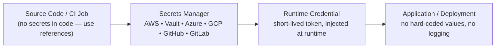

> [!tip] Best Practices
> - ==Never hard-code== secrets in code, scripts or config files.
> - Store secrets in a dedicated secret manager.
> - Retrieve secrets at ==runtime== (not during build if possible).
> - Use ==least privilege== access (minimum required permissions).
> - Use ==short-lived credentials== (temporary tokens).
> - ==Mask secrets== in CI/CD logs.
> - Rotate secrets periodically.
> - Enable audit logging and access tracking.
> - Use environment-specific secrets (dev/stage/prod).
> - Restrict who can access and approve secret changes.

### 10.4 Production Scenario & Step-by-Step Response

> [!example] Scenario
> A cloud token (e.g., AWS or Datadog API key) accidentally appears in ==CI/CD pipeline logs==. This can lead to unauthorized access and security risk.

**Step-by-Step Response (L3 Approach):**

1. Treat as ==compromised immediately==.
2. Revoke or rotate the exposed credential.
3. Identify what permissions the credential had.
4. Check audit logs for any unauthorized or unusual usage.
5. Find the source of the leak and remove the logging path.
6. Move to a proper secret manager and update the pipeline.
7. Test the pipeline with the new secret (without exposing it).
8. Add preventive controls to avoid recurrence.

### 10.5 Useful Commands / Checks (Do NOT Print Secrets)

```bash
aws sts get-caller-identity                  # Verify current AWS identity
aws iam list-access-keys --user-name <user>  # Check IAM access keys (metadata)
aws cloudtrail lookup-events                 # Check recent API usage (AWS)
gcloud auth list                             # Check active GCP account (no secret)
gcloud projects get-iam-policy <project>     # Check IAM permissions (GCP)
datadog api key list                         # List Datadog API keys (metadata)
kubectl get secrets -n <ns>                  # Check Kubernetes secrets (no values)
kubectl describe secret <name> -n <ns>       # View secret metadata
vault token lookup                           # Check Vault token information
git log -S "AKIA" --all                      # Search for leaked keys in Git history
```

### 10.6 Common Causes of Secret Leakage

- Hard-coded secrets in code or scripts.
- Printing environment variables in logs (`echo`, `set -x`).
- Misconfigured CI/CD variables (set as plain text).
- Debug mode enabled (verbose logging).
- Artifacts containing configuration files with secrets.
- Secrets passed as command-line arguments.
- Secrets included in container images.
- Inadequate access controls and code reviews.

> [!danger] Dangerous Mistakes (Avoid These)
> - Committing secrets to Git repositories.
> - Hard-coding secrets in Dockerfiles, Terraform, or scripts.
> - Printing secrets in logs (even partially).
> - Using long-lived credentials instead of temporary tokens.
> - Giving broad permissions (admin access).
> - Storing secrets in plain text CI/CD variables.
> - Disabling certificate verification to "make it work".
> - Sharing secrets over chat or email.

### 10.7 Validation Checklist After Fix

- [ ] Old credential is revoked/rotated.
- [ ] New secret is stored in a secret manager.
- [ ] Pipeline uses runtime retrieval (no hard-coded value).
- [ ] Pipeline logs do not contain secrets.
- [ ] Application works with the new secret.
- [ ] Access permissions are minimal and correct.
- [ ] Audit logs show only expected usage.
- [ ] Monitoring and alerts are enabled.
- [ ] Documentation is updated.

> [!question]- Interview Follow-Up Questions
> 1. What is a secret manager and why do we use it?
> 2. How will you handle a leaked secret in production?
> 3. How do you rotate secrets with zero downtime?
> 4. What is the difference between a secret and a configuration variable?
> 5. How do you prevent secrets from appearing in CI/CD logs?
> 6. Which secret manager have you used? (AWS/GCP/Vault)
> 7. How do you manage secrets for multiple environments?
> 8. How do you ensure least privilege access?

> [!quote] Final Rule / Key Takeaway ★
> **Never Log → Never Commit → Retrieve at Runtime → Least Privilege → Rotate**

---

## 11. SELinux Troubleshooting — L3 Guide

### 11.1 What is SELinux?

- SELinux (Security-Enhanced Linux) is a ==Mandatory Access Control (MAC)== system in addition to Discretionary Access Control (==DAC==).
- It enforces security policies to control what processes can access files, ports, and resources.
- Even if traditional permissions (DAC — `chmod`, `chown`) allow access, ==SELinux can still deny it==.

### 11.2 SELinux Modes

| Mode | Behavior |
|---|---|
| **Enforcing** | Default in production • Enforces SELinux policies • Denies unauthorized access |
| **Permissive** | Logs denials but does not block • Useful for troubleshooting |
| **Disabled** | SELinux is not running • Not recommended for production |

### 11.3 Important Commands

```bash
getenforce                                  # Check current mode
sestatus                                    # Detailed SELinux status
ausearch -m AVC -ts recent                  # Recent AVC denials
journalctl -t setroubleshoot                # SELinux logs (RHEL)
ls -Z /path                                 # Check file/directory context
semanage fcontext -l | grep /path           # Check persistent context rules
semanage fcontext -a -t <type> "/path(/.*)?"  # Add persistent context rule
restorecon -Rv /path                        # Restore correct SELinux context
semanage port -l | grep <port>              # Check SELinux port labels
semanage port -a -t <type> -p tcp <port>    # Add port to SELinux type
getsebool -a | grep <name>                  # Check boolean value
setsebool -P <name> on                      # Enable boolean (persistent)
```

### 11.4 Common File Context Types

| Type | Used for |
|---|---|
| `httpd_sys_content_t` | Web content (/var/www) |
| `httpd_sys_rw_content_t` | Web content (writable) |
| `httpd_exec_t` | Web executables (CGI) |
| `httpd_sys_script_exec_t` | CGI scripts |
| `var_log_t` | Log files |
| `var_lib_t` | Application data |
| `etc_t` | Configuration files |
| `ssh_home_t` | User SSH files |

### 11.5 Important Port Types

| Port Type | Ports |
|---|---|
| `httpd_port_t` | 80, 8080 (HTTP) |
| `https_port_t` | 443 (HTTPS) |
| `ssh_port_t` | 22 (SSH) |
| `mysqld_port_t` | 3306 (MySQL) |
| `postgresql_port_t` | 5432 (PostgreSQL) |

### 11.6 Production Scenario

> [!example] Problem
> Apache (httpd) cannot access files in `/var/www/html` even though permissions (chmod/chown) are correct. We get ==403 Forbidden or Permission denied==.
>
> **Symptoms:**
> - Web page returns 403 or 500 error
> - Error log shows "Permission denied"
> - No issue with file permissions
> - Works when SELinux is disabled
>
> **Likely Cause:** Incorrect SELinux context on files/directories or missing SELinux policy (port/boolean/context) for Apache.

### 11.7 Troubleshooting Flow (Step by Step)

| # | Step | Command | Purpose |
|---|---|---|---|
| 1 | Check actual permissions (DAC) | `ls -l /var/www/html` | Confirm correct user, group and permissions |
| 2 | Check SELinux mode | `getenforce ; sestatus` | Should be Enforcing (normally) |
| 3 | Find AVC denials | `ausearch -m AVC -ts recent` | Check what exactly is being denied |
| 4 | Check file/directory context | `ls -Z /var/www/html` | Verify current SELinux context |
| 5 | Compare with expected context | `semanage fcontext -l \| grep /var/www/html` | Check persistent context rule |
| 6 | Add/Correct persistent rule | `semanage fcontext -a -t httpd_sys_content_t "/var/www/html(/.*)?"` | Set correct type for web content |
| 7 | Apply the context | `restorecon -Rv /var/www/html` | Apply the correct context to files |
| 8 | Validate and test | `ls -Z /var/www/html` + `curl -I http://localhost` | Confirm context and application access |

### 11.8 Restorecon vs Semanage Fcontext

| Tool | What it does |
|---|---|
| **restorecon** | Applies the correct SELinux context based on ==existing persistent rules== — does not create or change the rule |
| **semanage fcontext** | Creates/updates a ==persistent mapping== (path → SELinux type) — use this first, then run restorecon |

### 11.9 Common Causes

- Wrong file/directory context
- Missing persistent fcontext rule
- Wrong SELinux port type
- Necessary boolean is disabled
- Custom application path not labeled
- New disk/mount without context
- After application deployment/upgrade
- Restored files with incorrect context

> [!danger] Dangerous Mistakes (Avoid)
> - `chmod 777` to bypass the issue
> - Disabling SELinux permanently
> - Leaving system in Permissive mode
> - Blindly using audit2allow and loading custom policy without understanding
> - Ignoring the real root cause
> - Changing file context without persistent rule
> - Opening all ports with permissive rules

### 11.10 Validation Checklist

- [ ] `getenforce` shows Enforcing (or approved mode)
- [ ] No new AVC denials in logs
- [ ] Correct SELinux context on files/directories (`ls -Z`)
- [ ] Required ports are correctly labeled (`semanage port -l`)
- [ ] Application (e.g., Apache) is working (curl / browser test)
- [ ] No security risk introduced by wide or incorrect rules

> [!question]- Interview Follow-Up Questions
> 1. How do you check SELinux mode and status?
> 2. How do you find the reason for an access denial?
> 3. What is the difference between restorecon and semanage fcontext?
> 4. How do you allow Apache to use a custom directory like /data/web?
> 5. How do you allow a custom port (e.g., 8080) for HTTP?
> 6. What are SELinux booleans? Give examples.
> 7. When would you use Permissive mode?
> 8. What are the risks of disabling SELinux?

---

## 12. Ansible Idempotency + changed_when + Handlers

### 12.1 What is Idempotency?

- ==Idempotency== means running the same playbook multiple times will bring the system to the ==same desired state== **without unnecessary changes**.
- First run may show changes. Subsequent runs should be mostly =="ok"== (no change) if nothing has changed.

> [!note] Key Points
> - Use ==native Ansible modules== (idempotent by design).
> - Avoid using `shell`/`command` when a module exists.
> - Only report "changed" when an actual change occurs.
> - Use ==handlers== for controlled service restarts/reloads.
> - This makes playbooks safe, predictable and repeatable.

### 12.2 Idempotent Example — Using Native Module (package)

```yaml
- name: Install httpd package
  ansible.builtin.package:
    name: httpd
    state: present
```

- **First run:** ==CHANGED== (httpd installed)
- **Second run:** ==OK== (already present, no change)

> [!info] Why?
> Native modules are idempotent and will ==not show change== if the desired state is already achieved.

### 12.3 Bad Playbook — Restarts Service Every Run (Not Idempotent)

```yaml
- name: Copy configuration file
  ansible.builtin.copy:
    src: httpd.conf
    dest: /etc/httpd/conf/httpd.conf

- name: Restart httpd (bad approach)
  ansible.builtin.service:
    name: httpd
    state: restarted
```

> [!warning] Problem
> - Service will restart ==every time==, even if the file did not change.
> - Causes unnecessary downtime.
> - Not idempotent and not a good practice.

### 12.4 Correct Approach — Use Handlers (Idempotent)

```yaml
- name: Copy configuration file
  ansible.builtin.template:
    src: httpd.conf.j2
    dest: /etc/httpd/conf/httpd.conf
  notify: Reload httpd

handlers:
  - name: Reload httpd
    ansible.builtin.service:
      name: httpd
      state: reloaded
```

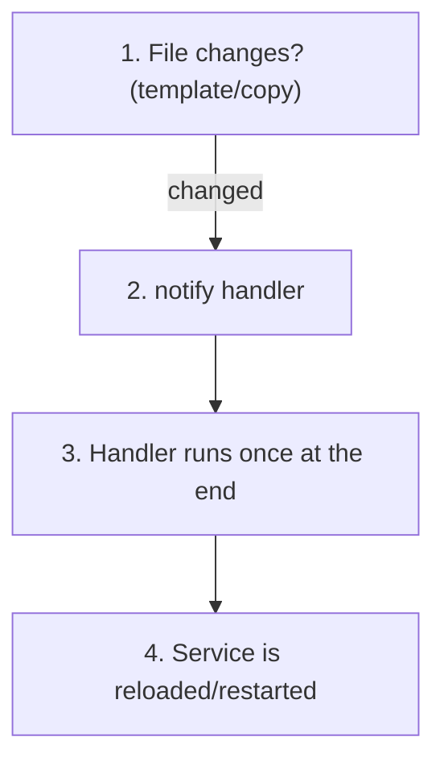

### 12.5 Using changed_when with Read-Only Commands

```yaml
- name: Check disk usage (read-only)
  ansible.builtin.command: df -h /app
  register: df_output
  changed_when: false
  failed_when: false
```

> [!info] Why `changed_when: false`?
> - This is a ==read-only command==.
> - We are only collecting information.
> - It should not show as "changed".
> - Keeps playbook output ==clean and meaningful==.

### 12.6 Troubleshooting — Why is a Task Showing Changed?

1. Check if you are using a native module.
2. Review the task output.
3. Check if content is actually different (file/template).
4. Look for missing `changed_when` or incorrect logic.
5. Check if handlers are triggering unnecessarily.
6. Run playbook with `-v` or `-vvv` for detailed output.

```bash
ansible-playbook site.yml -v
ansible-playbook site.yml --check
ansible-playbook site.yml --diff
ansible all -m setup -a 'filter=ansible_facts'
ansible-inventory -i inventory --list
ansible server01 -m debug -a 'var=ansible_facts.os.family'
```

> [!warning] Common Mistakes
> - Using shell/command when a module exists.
> - Restarting services directly in tasks.
> - Not using handlers.
> - Incorrect use of `changed_when`.
> - Ignoring idempotency in custom scripts.
> - Using always-changed logic.
> - Not testing with a second run.

> [!success] Success Criteria (After Two Runs)
> 1. First run: only required tasks show ==CHANGED==.
> 2. Second run: most tasks show ==OK==.
> 3. Handlers run only when there is a change.
> 4. No unnecessary service restarts.
> 5. Desired state is maintained reliably.

> [!question]- Interview Follow-up Questions
> 1. What is idempotency in Ansible?
> 2. Why are native modules preferred over shell?
> 3. How does `changed_when` work?
> 4. When should you use handlers?
> 5. How do you ensure a playbook is truly idempotent?
> 6. How will you troubleshoot a task that always shows "changed"?

> [!quote] Golden Flow ★
> **Desired State → Detect Change → Notify → Controlled Action → Verify**

---

## 13. Ansible Uptime on 15 Servers

### 13.1 Definition & What it Proves

Ansible ==ad-hoc command== is used to run a single task on multiple servers. Here we use it to run `uptime` on ==exactly 15 servers== in parallel in a safe and controlled manner.

**What it proves:**

- Inventory connectivity
- SSH access (auth)
- Command execution
- Server is reachable and responsive
- Uptime, load and system health

> [!tip] Key Points
> - Use correct inventory
> - Verify ==exactly 15 servers==
> - Run a ==read-only== command
> - Use parallelism (`-f 15`)
> - Use `--limit` for safety in production

### 13.2 Step-by-Step

| Step | Goal | Command | Note |
|---|---|---|---|
| 1 | Verify inventory has exactly 15 servers | `ansible linux_servers -i inventory.ini --list-hosts`<br>or `ansible-inventory -i inventory.ini --list \| wc -l` | Ensure output shows 15 servers only |
| 2 | Test connectivity (ping) | `ansible linux_servers -i inventory.ini -m ping -f 15` | Checks SSH, auth and basic connectivity — should return "SUCCESS" |
| 3 | Run uptime on 15 servers | `ansible linux_servers -i inventory.ini -m command -a 'uptime' -f 15` | Runs `uptime` in parallel on 15 servers |
| 4 | Limit to specific servers (optional) | `ansible all -i inventory.ini -m command -a 'uptime' --limit 'server01,server02,server03'` | Use `--limit` to run on a subset for safety |
| 5 | Save output to file (optional) | `ansible linux_servers -i inventory.ini -m command -a 'uptime' -f 15 > uptime_output.txt` | Useful for audits and reports |

### 13.3 Sample Output (Success)

```text
server01 | CHANGED | rc=0 >>
 09:42:11 up 12 days,  3:21,  2 users,  load average: 0.10, 0.05, 0.01
server02 | CHANGED | rc=0 >>
 09:42:13 up 5 days,  1:10,  1 user,   load average: 0.20, 0.10, 0.05
server03 | CHANGED | rc=0 >>
 09:42:12 up 20 days,  2:33,  3 users,  load average: 0.08, 0.04, 0.01
```

**Other possible outputs:**

```text
# UNREACHABLE → Network, SSH, firewall or wrong inventory
server05 | UNREACHABLE! => {
  "msg": "Failed to connect to the host"
}

# FAILED → Host reached but command failed (check logs, permissions, shell)
server08 | FAILED! => {
  "rc": 1,
  "msg": "non-zero return code"
}
```

### 13.4 Interpreting Results

- ==CHANGED (rc=0)== — Command ran successfully. Uptime output is shown.
- ==UNREACHABLE== — Host not reachable. Check inventory, network, firewall, SSH, auth.
- ==FAILED== — Host reached but command failed. Check rc, error message and server logs.

> [!warning] Common Mistakes
> - Wrong inventory or group name.
> - Not verifying server count (not exactly 15).
> - Running on all servers in production by mistake.
> - Using shell module when not needed.
> - Ignoring UNREACHABLE or FAILED hosts.
> - Running a write/change command instead of read-only.
> - Not using `--limit` for safety.
> - Assuming "CHANGED" means a problem (for command module, ==CHANGED is expected==).

### 13.5 Useful Command Variations

```bash
ansible linux_servers -i inventory.ini -m command -a 'uname -a'
ansible linux_servers -i inventory.ini -m command -a 'uptime' -v
ansible linux_servers -i inventory.ini -m command -a 'uptime' -f 15
ansible linux_servers -i inventory.ini -m ping --limit 'server01'
ansible-inventory -i inventory.ini --graph
```

> [!question]- Likely Interview Follow-ups
> 1. How do you verify that the inventory has exactly 15 servers?
> 2. What is the difference between UNREACHABLE and FAILED?
> 3. When would you use `--limit`?
> 4. Why use `-f 15`? What happens if you don't use it?
> 5. Command module vs shell module?
> 6. How would you save the output to a file?
> 7. How do you run a different command on a subset of servers?

---

## 14. Ansible Variable Precedence + Uptime — L3 Interview

### 14.1 Variable Precedence (Low → High)

1. **Role defaults** — `roles/<role>/defaults/main.yml` *(lowest)*
2. **Inventory vars** — inventory file
3. **group_vars/all** — `group_vars/<group>.yml`
4. **host_vars** — `host_vars/<host>.yml`
5. **Play vars** — vars in playbook
6. **Role vars** — `roles/<role>/vars/main.yml`
7. **Block vars** — vars at block level
8. **Task vars** — vars at task level
9. **Extra vars** — `-e` on command line *(highest)*

### 14.2 Example: `http_port` Variable

| # | Source | Value | Meaning |
|---|---|---|---|
| 1 | `roles/web/defaults/main.yml` | 80 | Default value in role |
| 2 | inventory | 8080 | Set in inventory |
| 3 | `group_vars/all.yml` | 8081 | Applicable to all hosts |
| 4 | `group_vars/web.yml` | 9000 | Applicable to 'web' group |
| 5 | `host_vars/server01.yml` | 9090 | Applicable to server01 |
| 6 | playbook vars | 10000 | Set in playbook |
| 7 | task vars | 11000 | Set only for this task |
| 8 | extra vars (`-e`) | 12000 | Set from command line |

> [!note] Final value used: ==12000==
> ==Extra vars (`-e`) win over all other variables.==

### 14.3 Run Uptime on Exactly 15 Servers

```ini
[app_servers]
server01
server02
server03
...
server15        ; exactly 15 servers
```

| Step | Goal | Command |
|---|---|---|
| 1 | Test connectivity (ping) | `ansible app_servers -i inventory -m ping` |
| 2 | Run uptime command | `ansible app_servers -i inventory -m ansible.builtin.command -a "uptime"` |
| 3 | Use forks = 15 (parallel) | `ansible app_servers -i inventory -m command -a "uptime" -f 15` |
| 4 | Limit to specific 15 servers (if needed) | `ansible all -i inventory -m command -a "uptime" --limit 'server01,server02,...,server15'` |
| 5 | Save output to a file (optional) | `ansible app_servers -i inventory -m command -a "uptime" -f 15 > uptime_output.txt` |

### 14.4 Troubleshooting Steps (8 Steps)

1. Verify inventory has exactly 15 servers.
2. Run `ansible -m ping` to check basic connectivity.
3. If unreachable, check network, DNS, SSH and credentials.
4. Run the uptime command on a small subset first (`--limit`).
5. Use `-f 15` for parallel execution.
6. If a server fails, check the error message (permission/command).
7. Re-run on failed servers after fixing the issue.
8. Validate that output is correct and collect logs if needed.

### 14.5 Useful Commands

```bash
ansible app_servers -i inventory -m ping                          # Check connectivity
ansible app_servers -i inventory -m command -a "uptime"         # Run uptime command
ansible app_servers -i inventory -m command -a "uptime" -f 15   # Run in parallel (15)
ansible all -i inventory -m command -a "uptime" --limit 'server01,server02'  # Selected hosts
ansible-inventory -i inventory --list | grep app_servers -A 20  # Verify inventory
ansible app_servers -i inventory -m setup -a "gather_subset=network"  # Network info
ansible app_servers -i inventory -m shell -a "cat /etc/os-release"    # OS details
```

### 14.6 Common Mistakes & Interpreting Results

> [!warning] Common Mistakes
> - Running on the wrong inventory or group.
> - Not checking connectivity first.
> - Using shell instead of command (when not required).
> - Running on more or fewer than 15 servers.
> - Ignoring unreachable/failed results.
> - Hardcoding hostnames instead of using inventory.
> - Not using `--limit` in production.
> - Assuming command executed, but not checking output.

```text
# SUCCESS
server03 | CHANGED | rc=0 >>
 09:43:10 up 10 days, 2:15, 2 users, load average: 0.10, 0.05, 0.01

# UNREACHABLE → Network, DNS, firewall or SSH issue
server05 | UNREACHABLE! => {
  "msg": "Failed to connect to the host via ssh: Connection timed out"

# FAILED → Host reachable, but command failed
server08 | FAILED! => {
  "rc": 127, "stderr": "/bin/sh: uptime: command not found" }
```

> [!question]- Follow-up Interview Questions
> 1. What is the order of Ansible variable precedence?
> 2. Which variable source will win in a conflict and why?
> 3. How will you find the actual value used during a run?
> 4. What is the difference between group_vars and host_vars?
> 5. What are extra vars (-e) and when should they be used?
> 6. Why do we use ansible.builtin.command instead of shell?
> 7. How do you run a command on exactly 15 servers?
> 8. What does -f 15 do in an Ansible command?
> 9. How do you handle unreachable hosts?
> 10. How do you run on only a specific subset of servers?

> [!quote] Rule ★
> **Trace value → Prove connectivity → Run safely → Interpret results.**

---

## 15. Dracut / Initramfs Troubleshooting — L3 Guide

### 15.1 What is initramfs?

- Initramfs (initial RAM filesystem) is a ==temporary root filesystem== loaded into RAM by the bootloader.
- It provides the early userspace environment needed to load drivers, access storage (LVM, RAID, encryption), and mount the ==real root filesystem==.

### 15.2 What is Dracut?

- Dracut is a tool used to ==generate the initramfs image== on RHEL systems.
- It includes required kernel modules, storage drivers, LVM, filesystem, encryption and other components based on the system configuration.

### 15.3 Role in Boot Sequence

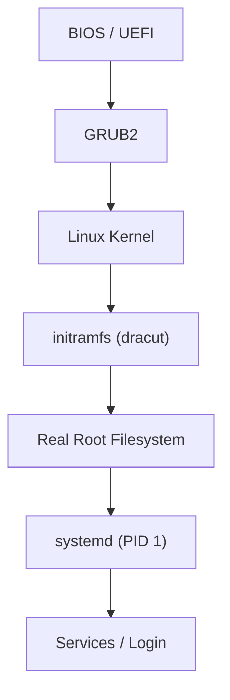

*initramfs loads required drivers and mounts the real root filesystem.*

### 15.4 Production Scenario & Symptoms

> [!example] Production Scenario
> After a kernel update, the RHEL server does not boot and enters ==emergency mode / dracut shell==. The root filesystem cannot be mounted.

**Common Symptoms:**

- Dracut emergency shell
- Cannot mount root filesystem
- `/dev/mapper/*` not found
- LVM devices not visible
- Kernel panic: ==VFS: Unable to mount root fs==

### 15.5 Step-by-Step Troubleshooting Workflow

| # | Step | Commands | What it tells you |
|---|---|---|---|
| 1 | Capture the exact error | (From console) note the error message | Tells which component is missing or failing (LVM, filesystem, driver, etc.) |
| 2 | Boot previous kernel | `grubby --info=ALL`<br>`grubby --set-default /boot/vmlinuz-<old>` | Confirms if the issue is specific to new kernel/initramfs |
| 3 | Check boot logs | `journalctl -b -1`<br>`journalctl -xb` | Shows detailed error from previous boot and current boot attempt |
| 4 | Check disks and LVM | `lsblk -f`<br>`pvs ; vgs ; lvs` | Confirms if storage, LVM and filesystems are visible to the kernel/initramfs |
| 5 | Inspect initramfs content | `lsinitrd /boot/initramfs-$(uname -r).img`<br>`lsinitrd /boot/initramfs-<kernel>.img \| grep <module>` | Checks if required drivers/modules (LVM, filesystem, encryption) are present |
| 6 | Identify missing dependency | Compare with working kernel's initramfs; check missing driver / LVM / filesystem / encryption | Root cause is usually a missing module or configuration in initramfs |
| 7 | Fix the root cause | Install required package/module • Update dracut configuration if needed • Ensure LVM/encryption/filesystem tools are installed | Ensures the required components are available for initramfs |
| 8 | Rebuild initramfs (after diagnosis) | `dracut -f` | Regenerates initramfs with required components (run only after identifying cause) |
| 9 | Reboot and validate | `reboot`<br>`systemctl --failed` | System should boot normally, mount root fs, and start services without errors |

### 15.6 Useful Commands and What They Prove

| Command | What it proves / shows |
|---|---|
| `grubby --info=ALL` | Available kernels and default kernel |
| `journalctl -b -1` | Logs from previous boot attempt |
| `lsblk -f` | Disks and filesystems visible |
| `pvs ; vgs ; lvs` | LVM metadata and logical volumes |
| `lsinitrd /boot/initramfs-<k>.img` | Contents of initramfs image |
| `lsinitrd ... \| grep lvm` | Checks if LVM module is included |
| `dracut -f` | Rebuilds initramfs |
| `systemctl --failed` | Checks failed services after boot |

### 15.7 Common Causes

- Missing LVM module in initramfs
- Storage driver not included (RAID, NVMe, iSCSI)
- Filesystem module missing (XFS, ext4, etc.)
- Encrypted root not unlocking (LUKS / Clevis / Tang)
- Incorrect dracut configuration
- Kernel update without required packages
- Custom driver not included
- Changed storage configuration

> [!danger] Dangerous Mistakes
> - Running `dracut -f` without identifying the real cause
> - Formatting or reinitializing disks
> - Modifying LVM metadata unnecessarily
> - Deleting the working kernel
> - Ignoring the actual error message
> - Not keeping a fallback/old kernel
> - Changing storage/encryption config randomly in emergency mode

### 15.8 Validation Checklist (After Fix)

- [ ] System boots to normal target (multi-user or graphical)
- [ ] Root filesystem mounted correctly (`findmnt` / `df -h`)
- [ ] No errors in `journalctl -b`
- [ ] `systemctl --failed` shows no critical failures
- [ ] Application services are running
- [ ] Disk, LVM and encrypted volumes are available
- [ ] Monitoring and alerts are normal

> [!question]- Interview Follow-up Questions
> 1. What is the difference between initramfs and the real root filesystem?
> 2. When should we run `dracut -f`?
> 3. How do you check if LVM modules are included in initramfs?
> 4. What can cause a system to drop into dracut emergency shell?
> 5. How will you recover if all kernels are affected?
> 6. How does this relate to LUKS/Tang/Clevis?
> 7. Which logs would you check for early-boot issues?
> 8. How do you prevent this issue in future?

---

## 16. LUKS + Clevis + Tang — Encrypted Disk Boot Troubleshooting

### 16.1 The Three Components

- **LUKS** — Linux Unified Key Setup. Provides ==block-level encryption at rest==; encrypts the disk/partition using passphrase or key.
- **Clevis** — Client-side framework for ==automated unlocking==; binds a LUKS volume to a policy (e.g. Tang); allows automatic unlock during boot (no manual passphrase).
- **Tang** — ==Network-bound cryptographic service==; does NOT store or return the disk password; helps Clevis to unlock the LUKS volume based on a network policy.

### 16.2 Boot Flow (High Level)

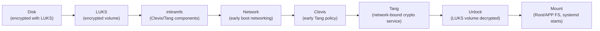

### 16.3 Production Scenario

> [!example] Scenario — Encrypted Disk Not Unlocking During Boot
> A RHEL server that previously auto-unlocked its encrypted volume now ==stops during boot== and drops to an emergency/dracut shell ==after a network or kernel change==.

### 16.4 Troubleshooting Steps (8 Steps)

| # | Step | Action |
|---|---|---|
| 1 | Capture the exact boot error | Note the console error message and take a screenshot if possible |
| 2 | Check LUKS metadata | Run `cryptsetup luksDump` to confirm the LUKS configuration |
| 3 | Check Clevis binding | Run `clevis luks list` to confirm the existing Tang binding |
| 4 | Inspect initramfs | Check if Clevis/Tang/crypt components are present in the initramfs |
| 5 | Check early network | Verify network interface, IP, DNS and routing are available during boot |
| 6 | Check previous boot logs | Use `journalctl -b -1` to see what failed in the last boot |
| 7 | Correct the dependency or configuration | Fix network, Tang URL, firewall, dracut modules or kernel parameters |
| 8 | Rebuild initramfs only after root cause | Rebuild initramfs with dracut and reboot to validate |

### 16.5 Useful Commands and Meaning

```bash
cryptsetup luksDump /dev/sdb        # Shows LUKS metadata, version, keyslots and configuration
clevis luks list -d /dev/sdb        # Shows Clevis binding information (e.g. Tang URL)
lsinitrd /boot/initramfs-$(uname -r).img | grep -Ei 'clevis|tang|crypt'  # Components in initramfs
ip a                                # Checks network interface status
ip route                            # Checks routing information
cat /etc/resolv.conf                # Checks DNS configuration
curl -v http://<tang-server>:7500   # Tests Tang server reachability
journalctl -b -1                    # Checks logs from the previous boot
dracut -f                           # Rebuilds initramfs (after fixing the root cause)
```

### 16.6 Common Causes

- Clevis binding missing or incorrect.
- Required Clevis/Tang components missing from initramfs.
- Early boot networking not available.
- DNS or routing issue.
- Tang server unreachable (firewall/network).
- Kernel update without required dracut modules.
- Incorrect kernel parameters or UUID changes.
- Disk or device renamed not matching the binding.

> [!danger] Important Notes / Warnings
> - Do ==NOT== remove encryption or disable LUKS to make it work.
> - Do ==NOT== alter LUKS metadata unnecessarily.
> - Keep an approved ==manual recovery method== (passphrase/key) available.
> - Rebuild initramfs only after confirming the actual root cause.
> - Validate in a maintenance window.
> - Document the configuration and recovery steps.

### 16.7 Validation After Fix

- [ ] System boots successfully without manual input.
- [ ] Encrypted volume is automatically unlocked.
- [ ] Root/application filesystems are mounted correctly.
- [ ] `systemctl --failed` shows no failures.
- [ ] Application services are running.
- [ ] Check logs: `journalctl -b`
- [ ] Monitor for any related warnings.

> [!quote] L3 Troubleshooting Rule ★
> **Check LUKS → Binding → initramfs → Network → Tang → Unlock → Validate**

---
## 17. SSL / TLS Certificate Troubleshooting

### 17.1 Understand Certificate Chain (Concept)

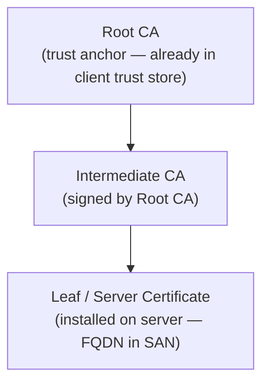

- **Root CA** — Trust anchor (already in client trust store); signs the Intermediate CA.
- **Intermediate CA** — Signed by Root CA; signs the leaf certificate.
- **Leaf / Server Certificate** — Installed on server (web/application); identifies the server (FQDN in SAN); contains public key, signed by Intermediate CA.

> [!note] Key Points
> - Client builds chain: ==Leaf → Intermediate → Root==
> - Root is trusted in client OS
> - ==SAN must contain hostname==
> - Private key belongs to leaf certificate

### 17.2 Inspect Live Certificate from Server

```bash
openssl s_client -connect host:443 \
  -servername host -showcerts
```

- Shows the certificate chain presented by the server.
- Check if intermediate certificate is included or missing.

### 17.3 Inspect Certificate Details (Leaf Certificate)

```bash
openssl x509 -in server.crt -text -noout
```

**Check the following:**

- Subject / Issuer
- Validity dates (Not Before / Not After)
- SAN (Subject Alternative Name)
- Key usage / Extended key usage

### 17.4 Verify Certificate Chain

```bash
openssl verify -CAfile ca-bundle.pem server.crt
```

- Verifies if the certificate can be validated against the CA chain.
- Shows =="OK"== if the chain is complete and trusted.

### 17.5 Verify Private Key Matches Certificate

```bash
openssl x509 -noout -modulus -in server.crt | openssl sha256
openssl rsa  -noout -modulus -in server.key | openssl sha256
```

- Both outputs should ==match==.
- If different, the key and certificate do not belong together.

### 17.6 Check Client Trust Store

```bash
# RHEL / Linux
trust list | grep -i <CA name>
update-ca-trust check
```

- Confirm Root/Intermediate CA is present in client trust store.
- Add missing CA using `update-ca-trust` (as per policy).

### 17.7 Check TLS Protocol, Cipher and Crypto Policy

```bash
openssl s_client -connect host:443 -tls1_2
openssl s_client -connect host:443 -tls1_3
openssl version -a
update-crypto-policies --show
```

- Check supported TLS versions and cipher suite.
- Identify protocol/cipher compatibility issues.
- Check system crypto policy (RHEL 8/9/10 use OpenSSL 3).

### 17.8 Reload Service and Validate

```bash
# For web server (example)
systemctl reload nginx    # or apache / application
# Verify from server and external client
curl -v https://host
openssl s_client -connect host:443 -servername host
```

- Reload service after fixing certificate configuration.
- Validate end-to-end from server and an external client.
- Check application logs for any TLS handshake errors.

### 17.9 Live Issue (Production Scenario)

> [!example] Scenario
> After certificate renewal, users started getting =="Certificate not trusted"== error. Application was working from some clients but failing from others.

**Common Causes:**

1. Expired certificate
2. Wrong or missing SAN
3. Missing intermediate certificate
4. Incorrect certificate chain order
5. Wrong private key / certificate pair
6. Client trust store missing CA
7. File permissions / SELinux issue
8. Unsupported TLS protocol or cipher (crypto policy)

**Useful Commands (Quick Reference):**

```bash
openssl s_client -connect host:443 -showcerts
openssl x509 -in server.crt -text -noout
openssl verify -CAfile ca-bundle.pem server.crt
openssl x509 -noout -modulus -in server.crt
openssl rsa -noout -modulus -in server.key
trust list | grep -i <CA name>
update-crypto-policies --show
curl -v https://host
```

> [!quote] L3 Troubleshooting Rule (Remember This Order) ★
> **Identity (Hostname/SAN) → Expiry (Validity Dates) → Chain (Complete & Correct) → Trust (Client Trust Store) → Key (Match Cert & Key) → TLS (Protocol/Cipher) → Application (Logs & End-to-End)**

---

## 18. Linux Boot Sequence & Boot Failure Troubleshooting

### 18.1 The Boot Sequence (6 Stages)

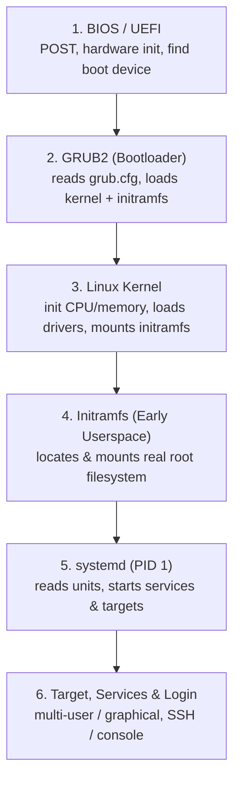

| # | Stage | What happens | Key points / files |
|---|---|---|---|
| 1 | **BIOS / UEFI** | Performs POST (Power On Self Test)<br>Initializes hardware (CPU, RAM, Storage, etc.)<br>Identifies the boot device (HDD / SSD / PXE)<br>Hands over control to bootloader (GRUB2) | Checks hardware • Finds boot device • Loads bootloader<br>==If disk not detected → system will not boot== |
| 2 | **GRUB2 (Bootloader)** | Reads `/boot/grub2/grub.cfg`<br>Shows boot menu (if configured)<br>Allows selection of kernel version<br>Loads the selected kernel and initramfs into memory | Files: `/boot/grub2/grub.cfg`, `/etc/default/grub`, `/etc/grub.d/`<br>Use previous good kernel for recovery if needed |
| 3 | **Linux Kernel** | Initializes CPU, memory and kernel subsystems<br>Loads required drivers (built-in or from initramfs)<br>Processes kernel command line parameters<br>Mounts initramfs as a temporary root filesystem | Cmdline examples: `root=/dev/mapper/...`, `rd.lvm.lv=...`, `rd.luks.uuid=...`, `net.ifnames=0`<br>If kernel panic → check console error and logs |
| 4 | **Initramfs (Early Userspace)** | Provides minimal userspace environment<br>Contains storage, filesystem, LVM, RAID drivers<br>Handles LUKS/Clevis/Tang (if encrypted)<br>Locates and mounts the real root filesystem<br>Then hands over control to systemd (PID 1) | Key components (dracut): storage drivers • LVM/RAID • filesystem drivers (xfs, ext4) • LUKS/Clevis/Tang • network (if needed)<br>==If initramfs missing driver/component → root filesystem may not be found== |
| 5 | **systemd (PID 1)** | First process started after real root is mounted<br>Reads unit files and starts required services<br>Manages dependencies, mounts, targets | Directories: `/etc/systemd/`, `/usr/lib/systemd/`, `/run/systemd/`<br>Check failed services: `systemctl --failed`, `journalctl -b` |
| 6 | **Target, Services & Login** | Reaches the configured target (multi-user or graphical)<br>Starts remaining services (network, sshd, app services)<br>Provides login (SSH / Console / Display Manager) | Common targets: `multi-user.target` (CLI) • `graphical.target` (GUI) • `rescue.target` (Recovery)<br>System is ready for user login and applications |

### 18.2 Live Issue — Server Fails to Boot After Kernel Update

| # | Step | Action / Commands | Purpose |
|---|---|---|---|
| 1 | Capture Console Error | Check exact error on screen (dracut, LVM, filesystem, etc.); note the failing stage (GRUB / Kernel / initramfs / systemd) | Identify where boot breaks |
| 2 | Boot Previous Kernel | Select previous known-good kernel from GRUB menu; if system boots, collect logs for further analysis | Isolate kernel-specific issue |
| 3 | Check Kernel Information | `grubby --default-kernel` • `grubby --info=ALL` | Confirm current and available kernels |
| 4 | Check Previous Boot Logs | `journalctl -b -1` | See why previous boot failed |
| 5 | Check Storage, LVM, Filesystem | `lsblk -f` • `pvs ; vgs ; lvs` | Confirm root device, VG/LV are visible |
| 6 | Inspect initramfs | `lsinitrd /boot/initramfs-<kernel>.img` | Verify required drivers and modules are present |
| 7 | Identify Root Cause | Missing storage driver / LVM module • Wrong kernel command line • Corrupted initramfs • Filesystem or disk issue • LUKS/Clevis/Tang issue | Fix the actual cause (do ==not== just run `dracut -f`) |
| 8 | Fix and Rebuild initramfs | `dracut -f` | Only after confirming missing/corrupt components |
| 9 | Reboot and Validate | Reboot and confirm system reaches systemd; check `systemctl --failed`; validate application services | Confirm full recovery |

### 18.3 Useful Commands (Quick Reference)

```bash
grubby --default-kernel                 # current default kernel
grubby --info=ALL                       # list all kernels
journalctl -b                           # current boot logs
journalctl -b -1                        # previous boot logs
lsinitrd /boot/initramfs-<k>.img        # inspect initramfs
lsblk -f                                # block devices & filesystems
pvs ; vgs ; lvs                         # LVM information
systemctl --failed                      # failed services
systemctl get-default                   # current default target
systemctl list-units --type=target      # list targets
```

### 18.4 Common Causes of Boot Failure

- Wrong or missing initramfs after kernel update
- Missing storage/LVM/RAID driver in initramfs
- Filesystem corruption (xfs/ext4)
- LUKS/Clevis/Tang auto-unlock failure
- Incorrect kernel command line (`root=`, `rd.lvm.lv=`, etc.)
- Disk not detected or hardware issue
- systemd service failure or dependency problem
- GRUB2 misconfiguration
- SELinux or permission issue (less common)

> [!quote] L3 Troubleshooting Rule ★
> **Observe** (check symptoms and logs) → **Analyze** (collect evidence and narrow down) → **Identify** (find root cause) → **Fix** (apply safe fix) → **Verify** (confirm system & applications)

---

## 19. DataVG / LVM Application Filesystem Recovery

### 19.1 Understand the Scenario

> [!info] Scenario
> ==OS disk corrupted (cannot boot)== — but application data lives on a separate ==datavg== (`/app`, `/data`, `/db`, `/logs` on separate disk/VG).

> [!tip] Goal 🎯
> Recover the OS ==without losing application data==.

### 19.2 LVM Hierarchy (Remember the Flow)

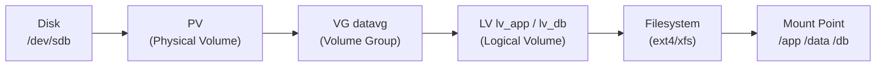

### 19.3 Recovery Workflow (12 Steps)

| # | Step | Commands / Actions | Notes |
|---|---|---|---|
| 1 | Understand the scenario | OS disk corrupted; app data on separate datavg | Goal: recover OS without losing app data |
| 2 | LVM hierarchy | Disk → PV → VG → LV → Filesystem → Mount point | Remember the flow |
| 3 | Boot to Rescue / Live environment | Use approved rescue media or rebuild the OS disk; do ==NOT== format or modify the application disk; identify the disks and LVM configuration | Keep a backup/snapshot if available before making changes |
| 4 | Identify disks and LVM (check existing metadata) | `lsblk -f` (disks, partitions, filesystems, UUIDs)<br>`pvs` • `vgs` • `lvs` | Look for existing datavg, PVs and LVs — if visible, metadata is intact |
| 5 | Activate the Volume Group (if inactive) | `vgscan` → scan for volume groups<br>`vgchange -ay datavg` → activate the existing datavg | Do ==NOT== create a new VG — use the existing VG only |
| 6 | Identify filesystem and mount | `blkid` (FS type and UUID)<br>`findmnt` (current mount points)<br>`mount /dev/datavg/lv_app /mnt/app` | Mount read-only first if unsure: `mount -o ro /dev/datavg/lv_app /mnt/app` |
| 7 | Verify application data | Check application files, database directories and logs are present; verify data integrity (file counts, directory structure, critical files); do ==NOT== run fsck blindly on a mounted or active filesystem | If filesystem corruption is suspected, follow the approved procedure |
| 8 | Rebuild / repair the OS | Reinstall or repair the OS without touching datavg; reinstall required packages (app runtime, database, tools); configure networking, hostname, and basic system settings | — |
| 9 | Restore /etc/fstab using UUID | Use UUID from `blkid` to update `/etc/fstab`<br>Example: `UUID=xxxxxxxx-xxxx-xxxx-xxxx-xxxxxxxxxx  /app  xfs  defaults 0 0` | Use ==UUID== instead of device names (e.g. `/dev/datavg/lv_app`) for stable mounts |
| 10 | Fix permissions and SELinux contexts | Check ownership and permissions (user/group); `restorecon -Rv /app` → restore correct SELinux labels | If needed, check SELinux status: `sestatus`, `ls -Z /app`, review `/var/log/audit/audit.log` |
| 11 | Start application dependencies | Start required services in the correct order (database → application → web server); check configuration files, environment variables, and connection details | — |
| 12 | Validate the application | `findmnt \| grep /app` • `df -h` • `journalctl -u <service>` or `tail -f /app/logs/app.log` • end-to-end application test (UI/API/DB connection) | Validation is complete ==only when the application is fully working== |

### 19.4 Common Causes (L3)

- OS filesystem corruption
- Accidental OS disk damage
- Wrong disk replacement
- LVM not activated at boot
- Missing/incorrect `/etc/fstab` entry
- SELinux permission issues
- Missing application packages
- Incorrect mount options

> [!danger] Dangers — Do NOT Do This
> - Do NOT run `mkfs` on existing data disks
> - Do NOT recreate the VG (datavg)
> - Do NOT initialize disks
> - Do NOT overwrite LVM metadata
> - Do NOT run fsck blindly on mounted FS
> - Do NOT assume data is lost
> - Do NOT use wrong device names in fstab
> - Do NOT change permissions/contexts randomly

### 19.5 Useful Commands (Quick Reference)

```bash
lsblk -f                              # disks and filesystems
pvs; vgs; lvs                         # LVM structure
vgscan                                # scan for VGs
vgchange -ay datavg                   # activate VG
blkid                                 # filesystem UUID/type
findmnt                               # current mounts
mount /dev/datavg/lv_app /mnt/app     # mount LV
df -h                                 # disk space
restorecon -Rv /app                   # SELinux context
journalctl -u <service>               # service logs
```

> [!quote] L3 Rule ★
> **Protect → Discover → Activate → Mount → Restore → Validate**

---

## 20. Disk I/O Bottleneck Troubleshooting

### 20.1 Scenario & Symptoms

> [!info] Scenario
> CPU looks fine, memory looks fine, and network looks fine — yet ==everything touching the disk crawls==.

> [!warning] Key Symptom
> ```text
> iostat: %util 99.8  await 480ms  aqu-sz 14  (device spec says 2ms)
> ```
> **Common triggers:** backup running on the data disk • no TRIM scheduled on SSD • WAL/logs sharing the same disk/spindle as application data.

### 20.2 Two-Path Diagnostic Flow

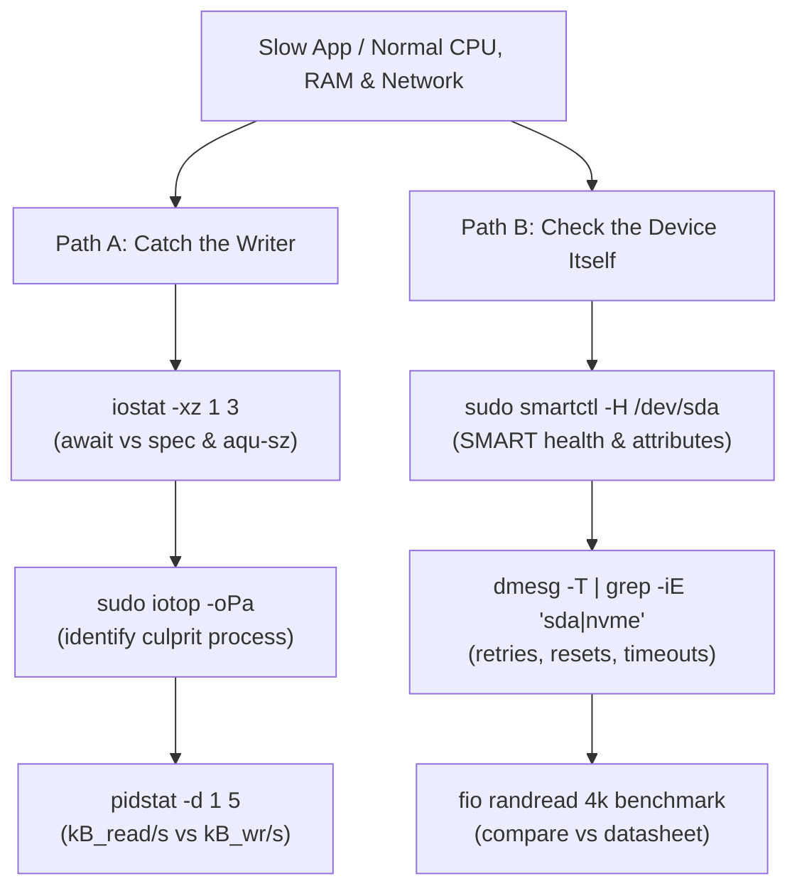

### 20.3 Step-by-Step Investigation Commands

#### Path A — Catch the Writer (Process & Queue)

| # | Goal | Command | What to Look For |
| --- | --- | --- | --- |
| 1 | Read the device queue | `iostat -xz 1 3` | Compare ==`await`== against device spec and check ==`aqu-sz`== (queue depth) — that's where the wall is. |
| 2 | Name the offending process | `sudo iotop -oPa` | Shows only active I/O processes (`-o`), processes not threads (`-P`), accumulated I/O (`-a`). |
| 3 | Measure per-process I/O rate | `pidstat -d 1 5` | Compare `kB_read/s` vs `kB_wr/s` — ==writes hurt more than reads==. |

#### Path B — Check the Device Itself (Hardware & Health)

| # | Goal | Command | What to Look For |
| --- | --- | --- | --- |
| 1 | Interrogate SMART health | `sudo smartctl -H /dev/sda` | `PASSED` is the floor, not a guarantee — inspect SMART attributes too (`smartctl -A`). |
| 2 | Scan kernel disk complaints | `dmesg -T \| grep -iE 'sda\|nvme'` | ==Retries, resets, and timeouts== precede disk failure. |
| 3 | Benchmark honestly | `fio --name=q --rw=randread --bs=4k --iodepth=32 --size=256m` | Compare actual IOPS and latency against the device's datasheet. |

### 20.4 Likely Root Causes & Fixes

| Root Cause | Fix / Action |
| --- | --- |
| Backup / vacuum / reindex storms | Schedule heavy jobs off-peak and throttle I/O priority: `ionice -c3 <command>` |
| SSD TRIM never scheduled | Enable periodic TRIM: `systemctl enable --now fstrim.timer` |
| WAL / logs and data sharing one disk | Split hot paths — move ==WAL/logs to a second device== |
| Failing disk slowing the entire queue | Verify via SMART & `dmesg`, evacuate/replace the failing drive |

### 20.5 Useful Commands (Quick Reference)

```bash
iostat -xz 1 3                                                # device queue, await & aqu-sz
sudo iotop -oPa                                               # active I/O processes (accumulated)
pidstat -d 1 5                                                # per-process read/write rate
sudo smartctl -H /dev/sda                                     # SMART health status
dmesg -T | grep -iE 'sda|nvme'                                # kernel storage errors with timestamps
fio --name=q --rw=randread --bs=4k --iodepth=32 --size=256m   # 4K random read benchmark
ionice -c3 <heavy-job>                                        # run job with idle I/O priority
sudo systemctl enable --now fstrim.timer                      # schedule automatic SSD TRIM
```

> [!quote] L3 Takeaway ★
> **"==`%util` lies on SSDs and RAID== — judge I/O by `await` against the device's spec, and by who is writing."**


---

## 21. No Space Left on Device

> [!info] Scenario & Symptom
> Writes start failing, the volume reads 100%, and the obvious suspects don't add up.
> ```text
> OSError: [Errno 28] No space left on device
> ```
> **When it happens:** runaway logs & core dumps • deleted files still held open • `journald` / Docker layers growing.

### Path A — Find the Space

| # | Step | Command | Notes |
| --- | --- | --- | --- |
| 1 | Confirm which mount is full | `df -h` | Check `Use%` per mount before hunting |
| 2 | Drill into biggest directories | `du -x --max-depth=2 / 2>/dev/null \| sort -n \| tail -12` | `-x` stays on one filesystem; repeat on guilty path |
| 3 | List giant files directly | `find /var -xdev -type f -size +500M -exec du -h {} + 2>/dev/null \| sort -rh \| tail -5` | Fastest route when one file ate the disk |

### Path B — The Hidden Space (Deleted-but-Open)

| # | Step | Command | Notes |
| --- | --- | --- | --- |
| 1 | Compare `df` vs `du` | `df -h / ; du -xsh / 2>/dev/null` | Disagreement means space is allocated but invisible |
| 2 | Find deleted-but-open files | `lsof +L1 2>/dev/null \| sort -k7 -n \| tail -8` | Files already `rm`'d while a process still writes to them |
| 3 | Free space without `rm` | `truncate -s 0 /var/log/app/huge.log` | `rm` waits for fd close; ==`truncate` frees space instantly== |

### Likely Root Causes & Fixes

- **Root Causes:** Missing/broken log rotation • Core dumps in `/var` • Docker images/layers/logs • Uncapped `journald`.
- **Fixes:**
  1. Truncate live offenders: `truncate -s 0 <file>`
  2. Cap journald now: `journalctl --vacuum-size=200M`
  3. Persist journald limit: set `SystemMaxUse=200M` in `/etc/systemd/journald.conf`

> [!quote] L3 Takeaway ★
> **"==`rm` frees nothing while a process still holds the file open== — truncate the fd, then fix the rotation."**

---

## 22. Inode Exhaustion

> [!info] Scenario & Symptom
> "No space left" — yet `df -h` shows gigabytes free. The filesystem ran out of ==names (inodes)==, not bytes.
> ```text
> touch: cannot touch 'f_93012.tmp': No space left on device
> ```
> **When it happens:** millions of tiny files • mail / session / cache queues • extracted archives in loops.

### Path A — Confirm It's Inodes

| # | Step | Command | Notes |
| --- | --- | --- | --- |
| 1 | Check byte space first | `df -h /var` | Plenty free confirms it is not a byte issue |
| 2 | Check inode usage | `df -i /var` | ==`IUse%` at or near 100%== is the smoking gun |
| 3 | Watch it while it fills | `watch -n 5 'df -i /var'` | Confirms a live process is still minting files |

### Path B — Find the File Factory

| # | Step | Command | Notes |
| --- | --- | --- | --- |
| 1 | Rank directories by file count | `find /var -type f \| sed 's\|/[^/]*$\|\|' \| sort \| uniq -c \| sort -nr \| head` | Top directory is the culprit (usually queue or cache) |
| 2 | Sample the files | `ls -lht /var/spool/clientmqueue \| head` | Names and timestamps reveal the creator |
| 3 | Match it to a process | `lsof +D /var/spool/mqueue 2>/dev/null \| head` | Slow but decisive — catches the writer in the act |

### Likely Root Causes & Fixes

- **Root Causes:** Uncleaned session/cache files • Mail queue backlog • Backup temp files in loops • Small-file workload on inode-poor `ext4`.
- **Fixes:**
  1. Purge queue output: `find /var/spool/clientmqueue -type f -delete`
  2. Clean stale cache: `find /var/cache/app -type f -mtime +1 -delete`
  3. Long-term rebuild: `mkfs.ext4 -i 8192` (or migrate to ==XFS==)

> [!quote] L3 Takeaway ★
> **"==Every file costs an inode even at zero bytes== — count names, not bytes, when 'full' doesn't compute."**

---

## 23. Too Many Open Files (EMFILE)

> [!info] Scenario & Symptom
> The app survives until traffic peaks, then everything fails at once with `EMFILE`.
> ```text
> accept() failed: EMFILE: Too many open files
> ```
> **When it happens:** connection spikes • unclosed sockets/files • low inherited `systemd` limits.

### Path A — Process Level

| # | Step | Command | Notes |
| --- | --- | --- | --- |
| 1 | Check current shell limit | `ulimit -n` | Soft limit for this shell only |
| 2 | Find the app's real limit | `cat /proc/$(pgrep -f myapp \| head -1)/limits \| grep 'open files'` | Soft vs hard — ==the soft limit is what bites== |
| 3 | Count live descriptors | `ls /proc/<pid>/fd \| wc -l` | If at the limit, every new `accept()` fails |

### Path B — System-Wide Table

| # | Step | Command | Notes |
| --- | --- | --- | --- |
| 1 | Check global allocation | `cat /proc/sys/fs/file-nr` | `allocated  free  max` — first creeping toward third = leak |
| 2 | Check configured kernel max | `sysctl fs.file-max` | Kernel-wide ceiling (usually millions) |
| 3 | Raise if system is capped | `sudo sysctl -w fs.file-max=2097152` | Per-process limits still apply afterwards |

### Likely Root Causes & Fixes

- **Root Causes:** Unclosed sockets/file handles • Sudden connection surge • Low systemd default `LimitNOFILE` • Threads × handles multiplier.
- **Fixes:**
  1. Raise per-service limit: `systemctl edit app` → add `LimitNOFILE=65535` under `[Service]`
  2. Apply & restart: `systemctl daemon-reload && systemctl restart app`
  3. Persist kernel ceiling: add `fs.file-max=2097152` under `/etc/sysctl.d/`

> [!quote] L3 Takeaway ★
> **"==The limit is per-process, not global== — fix it where the process is born, not in your shell."**

---

## 24. The OOM Killer Strikes

> [!info] Scenario & Symptom
> A process simply disappears overnight. Nothing in the app log — because the ==kernel killed it==.
> ```text
> Out of memory: Killed process 1234 (myapp) total-vm:8192000kB
> ```
> **When it happens:** memory spike or leak • no swap headroom • cgroup memory limits (`MemoryMax`).

### Path A — Confirm the Kill

| # | Step | Command | Notes |
| --- | --- | --- | --- |
| 1 | Search kernel ring buffer | `sudo dmesg -T \| grep -i 'out of memory'` | Shows victim, `oom_score`, and RSS of processes |
| 2 | Cross-check the journal | `journalctl -k --since -24h \| grep -i -A3 oom` | Same events with timestamps across reboots |
| 3 | Check cgroup v2 counter | `cat /sys/fs/cgroup/system.slice/app.service/memory.events` | ==`oom_kill > 0`== confirms a cgroup-level OOM kill |

### Path B — Who Held the RAM

| # | Step | Command | Notes |
| --- | --- | --- | --- |
| 1 | Read the honest number | `free -h` | ==`available` matters==, not `free` (page cache is reclaimable) |
| 2 | Rank processes by RSS | `ps aux --sort=-rss \| head -8` | Largest RSS at kill time is usually the trigger |
| 3 | Shared-memory aware view | `cat /proc/<pid>/smaps_rollup \| grep -E '^(Rss\|Pss)'` | `Pss` splits shared pages fairly across processes |

### Likely Root Causes & Fixes

- **Root Causes:** Memory leak or unbounded cache • Oversized worker/thread pool • No swap (zero spike tolerance) • cgroup `MemoryMax` smaller than workload.
- **Fixes:**
  1. Protect critical daemons: set `OOMScoreAdjust=-500` on `sshd`/DB unit files
  2. Cap heavy services: `systemctl set-property app MemoryMax=6G`
  3. Add headroom: create a swapfile + set `vm.swappiness=10`

> [!quote] L3 Takeaway ★
> **"==The OOM killer shoots the highest-scoring target, not the guilty one== — set `oom_score_adj` before it picks."**

---

## 25. Creeping Memory Leak

> [!info] Scenario & Symptom
> Every restart "fixes" it, then RSS starts climbing again — a little faster each week.
> ```text
> RSS 412 MB → 1.9 GB over 5 days (steady climb, no plateau)
> ```
> **When it happens:** unbounded in-app caches • `glibc` arenas on many threads • fd growth masquerading as RAM.

### Path A — Measure the Trend

| # | Step | Command | Notes |
| --- | --- | --- | --- |
| 1 | Record a baseline | `ps -o pid,rss,vsz,etime -p <pid>` | Repeat hourly — ==a leak is a slope, not a snapshot== |
| 2 | Watch private memory | `cat /proc/<pid>/smaps_rollup \| grep Private_Dirty` | Private dirty pages are what the process truly owns |
| 3 | Automate observation | `watch -n 300 'ps -o rss,etime -p <pid>'` | Linear growth with no plateau confirms a leak |

### Path B — Characterize It

| # | Step | Command | Notes |
| --- | --- | --- | --- |
| 1 | Largest anonymous mappings | `pmap -x <pid> \| sort -k2 -n \| tail -8` | Huge anon blocks = heap; many equal blocks = arenas |
| 2 | Check arena explosion | `env \| grep MALLOC_ARENA_MAX` | `glibc` opens arenas per thread (64 threads ≈ 64 private heaps) |
| 3 | Rule out fd mimicry | `ls /proc/<pid>/fd \| wc -l` | Climbing fd count leaks address space, not heap |

### Likely Root Causes & Fixes

- **Root Causes:** Cache without eviction policy • `glibc` malloc arenas × threads • Fragmentation after traffic spikes • Third-party lib holding buffers.
- **Fixes:**
  1. Cap arenas: set `MALLOC_ARENA_MAX=4` in the systemd unit file
  2. Stopgap reset: set `RuntimeMaxSec=24h` for graceful scheduled restarts
  3. Profile the heap: use `jemalloc` or `valgrind --tool=massif` on a test copy

> [!quote] L3 Takeaway ★
> **"==A leak is defined by the trend, not the level== — measure the same metric over hours before you call it."**

---

## 26. High Load, Idle CPU

> [!info] Scenario & Symptom
> Load average is 12 on 4 cores, yet `top` shows 92% idle. Something is ==waiting, not computing==.
> ```text
> load average: 12.40, 10.85, 9.72 — CPU 92% idle
> ```
> **When it happens:** storage saturation • hung NFS mounts • backup jobs on production disks.

### Path A — Find the Waiting

| # | Step | Command | Notes |
| --- | --- | --- | --- |
| 1 | Split load into run vs wait | `vmstat 1 5` | High `b` column or high `wa%` = blocked / I/O-wait tasks |
| 2 | List D-state processes | `ps axo pid,stat,wchan:32,comm \| awk '$2 ~ /D/'` | ==Uninterruptible sleep (`D`)== — every stuck task adds to load |
| 3 | See who is doing I/O | `sudo iotop -oPa` | The writer is the load source, not the CPU |

### Path B — Interrogate the Storage

| # | Step | Command | Notes |
| --- | --- | --- | --- |
| 1 | Check device saturation | `iostat -xz 1 3` | Rising `await` and pegged `%util` = disk bottleneck |
| 2 | Look for hardware screams | `dmesg -T \| grep -iE 'I/O error\|timeout\|reset'` | Disk resets/timeouts explain sudden D-states |
| 3 | Probe for a hung mount | `timeout 5 df -h ; echo exit=$?` | ==`exit=124`== means a hung mount (usually NFS) freezes even `df` |

### Likely Root Causes & Fixes

- **Root Causes:** Backup/`rsync` on the hot disk • Failing disk stalling the queue • Stale NFS or FUSE mount • Database `fsync` flood.
- **Fixes:**
  1. De-prioritize bulk I/O: `ionice -c3 -p <pid>` or `nice` the job
  2. Detach hung mount: `umount -l -f /mnt/nfs`
  3. Isolate workloads: move backups / WAL to a separate disk

> [!quote] L3 Takeaway ★
> **"==Load counts D-state waiters too== — disk and NFS problems regularly dress up as CPU load."**

---

## 27. CPU Pegged at 100%

> [!info] Scenario & Symptom
> One core or all of them — the box is hot, latency is up, and the app is struggling.
> ```text
> top: 340% CPU across 4 cores — 3 hot threads
> ```
> **When it happens:** regex backtracking • GC / JIT churn • runaway logging loop.

### Path A — Find the Thread

| # | Step | Command | Notes |
| --- | --- | --- | --- |
| 1 | Go per-thread | `top -H -p <pid>` | Often one hot thread inside an otherwise quiet process |
| 2 | Watch it over time | `pidstat -t -p <pid> 1` | Sustained vs bursty (bursty hints at periodic jobs) |
| 3 | Profile its syscalls | `timeout 10 strace -cp <tid>` | Spinning on one syscall (`futex`, `read`, `epoll`) shows why |

### Path B — Profile, Then Blame

| # | Step | Command | Notes |
| --- | --- | --- | --- |
| 1 | Sample the stack | `perf record -F 99 -p <pid> -g -- sleep 15` | Then run `perf report` to spot the exact hot function |
| 2 | Check cgroup throttling | `cat /sys/fs/cgroup/.../cpu.stat \| grep throttled` | Rising ==`nr_throttled`== means the quota — not the code — is the bottleneck |
| 3 | Correlate with app logs | `journalctl -u app --since -1h \| grep -i gc` | GC storms and retry loops leave clear fingerprints |

### Likely Root Causes & Fixes

- **Root Causes:** Hot loop / regex backtracking • GC pressure from oversized heaps • Retry storm against a down dependency • Crypto/regex on every request.
- **Fixes:**
  1. Demote noisy service: `systemctl set-property app CPUWeight=20`
  2. Throttle to a quota: set `CPUQuota=200%` in the systemd unit
  3. Fix the code path: cache results, bound regexes, tune GC

> [!quote] L3 Takeaway ★
> **"==Diagnose per-thread first==: 340% CPU is often one runaway thread multiplied by polite siblings."**


---

## 28. Swap Thrashing

> [!info] Scenario & Symptom
> RAM is not technically full, yet `kswapd0` burns CPU and every disk hit takes seconds.
> ```text
> vmstat: si 8,120  so 6,400 → constant paging in/out
> ```
> **When it happens:** `swappiness` too high • database on a general-purpose box • undersized RAM for the workload.

### Path A — See the Churn

| # | Step | Command | Notes |
| --- | --- | --- | --- |
| 1 | Watch swap traffic | `vmstat 1 5` | Continuous non-zero ==`si`/`so`== = thrashing, not harmless caching |
| 2 | Measure I/O wait spikes | `vmstat 1 \| awk '$16>50'` | `wa%` spikes line up with application stall reports |
| 3 | Find the swappers | `grep VmSwap /proc/*/status 2>/dev/null \| sort -k2 -rn \| head` | Lists which processes actually got paged out |

### Path B — Tune the Policy

| # | Step | Command | Notes |
| --- | --- | --- | --- |
| 1 | Read current bias | `sysctl vm.swappiness` | Default `60` swaps long-lived pages too eagerly on servers |
| 2 | Check swap layout | `swapon --show` | Verify size and priority (multiple devices should share equal priority) |
| 3 | Confirm RAM pressure | `grep -E 'MemAvailable\|CommitLimit' /proc/meminfo` | Commit far above RAM = risky overcommit |

### Likely Root Causes & Fixes

- **Root Causes:** `vm.swappiness=60` on a DB host • No `zram`/swap → OOM instead of slow • Memory forgotten by old daemons • Backup cache flooding page cache.
- **Fixes:**
  1. Keep anonymous pages in RAM: set `vm.swappiness=10` in `/etc/sysctl.d/`
  2. Add headroom: configure `zram` or a properly sized swapfile for spikes
  3. Pin critical daemons: use `mlock` / `OOMScoreAdjust`

> [!quote] L3 Takeaway ★
> **"==Swap used is fine; swap in motion is the disease== — judge by `si`/`so`, never by the `used` column."**

---

## 29. Server Unreachable

> [!info] Scenario & Symptom
> No ping, no SSH from your desk — yet the provider/hypervisor console works, so the machine itself is alive.
> ```text
> ping: connect: Network is unreachable / 100% packet loss
> ```
> **When it happens:** interface down or no IP • lost default route • cloud firewall / security group change.

### Path A — The Local Stack

| # | Step | Command | Notes |
| --- | --- | --- | --- |
| 1 | Is the link up? | `ip link show eth0` | `state UP` required — `DOWN` means driver, cable, or vSwitch |
| 2 | Does it have an address? | `ip addr show eth0` | No `inet` → DHCP died; wrong IP → lease or config changed |
| 3 | Is there a way out? | `ip route ; ping -c3 <gateway>` | Missing default route or dead gateway breaks everything |

### Path B — The Path Out

| # | Step | Command | Notes |
| --- | --- | --- | --- |
| 1 | Split IP from DNS | `ping -c3 8.8.8.8 ; ping -c3 example.com` | IP works but name fails → DNS issue |
| 2 | Trace where it dies | `mtr -rwc 20 8.8.8.8` | Packet loss starting at a specific hop identifies who owns the fault |
| 3 | Check Layer 2 neighbors | `ip neigh show dev eth0` | `FAILED` entries = no ARP response (L2 problem) |

### Likely Root Causes & Fixes

- **Root Causes:** DHCP lease lost / static config wiped • Default route missing • Cloud security group / SG quota • Upstream provider outage.
- **Fixes:**
  1. Bring stack up: `ip link set eth0 up && dhclient eth0`
  2. Restore default route: `ip route add default via <gw>`
  3. Check cloud/network layer: security groups, NAT gateway, provider status

> [!quote] L3 Takeaway ★
> **"==Bisect the path: link → address → route → name → remote.== One of the five is always lying."**

