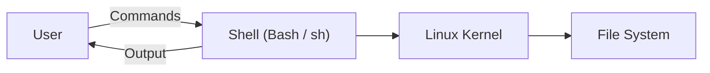
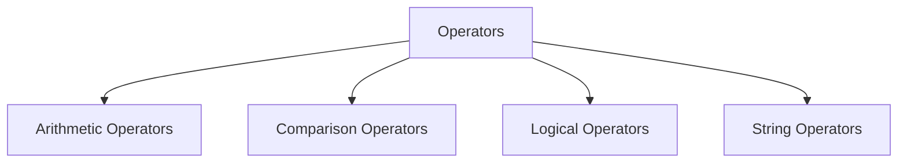
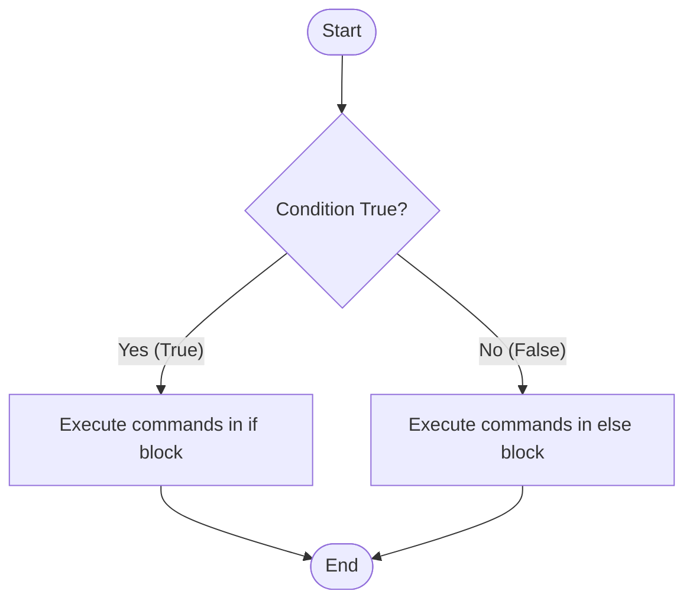
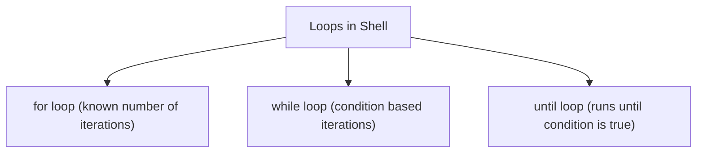
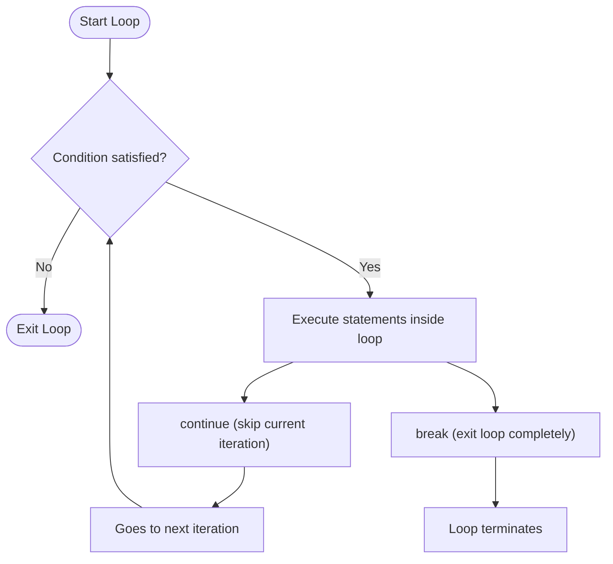
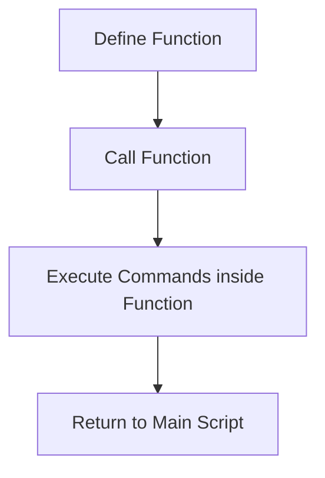

# Linux Shell Scripting — Complete Guide

> [!abstract] Complete Guide for DevOps, Automation & Interview Preparation
> ==Small Scripts → Big Automation → DevOps Power!==
> *Write Script → Automate → Save Time* — **Learn → Practice → Automate**

```text
[rakesh@linux ~]$ bash script.sh
Hello, DevOps!
Automate with Shell Scripting
```

> [!tip] Why Learn Shell Scripting?
> - ✅ Automate daily DevOps tasks
> - ✅ Save time & reduce manual work
> - ✅ Useful for interviews
> - ✅ Essential for production support
> - ✅ Works on all Linux systems
>
> **Use cases:** Automation · Task Scheduling · System Administration · Monitoring · Log Management · DevOps Support

### What's Inside?

1. Introduction to Shell Scripting
2. Linux Shell & Bash Basics
3. Variables & User Input
4. Operators
5. Conditional Statements
6. Case Statements
7. Loops (for, while, until)
8. Loop Control Statements (break, continue)
9. Functions
10. Arrays & Strings
11. Command-Line Arguments
12. File & Directory Operations
13. Text Processing (grep, awk, sed)
14. Exit Status & Error Handling
15. Cron Jobs & Task Scheduling
16. System Monitoring Scripts
17. Log Management & Backup
18. Real-World DevOps Scripts
19. Advanced Shell Scripting (source, getopts, here-docs)
20. Hands-on Project — User Management Utility
21. Quick One-Liners & Snippets
22. Resources & References
23. Best Practices *(planned)*
24. Interview Questions & Practical Tasks *(planned)*

## Contents of This Note

- [[#1. Introduction to Shell Scripting]]
- [[#2. Linux Shell & bash Basics]]
- [[#3. Variables & User Input]]
- [[#4. Operators in Shell Scripting]]
- [[#5. Conditional Statements in Shell Scripting]]
- [[#6. Case Statements in Shell Scripting]]
- [[#7. Loops in Shell Scripting]]
- [[#8. Loop Control Statements]]
- [[#9. Functions in Shell Scripting]]
- [[#10. Arrays & String Manipulation in Shell Scripting]]
- [[#11. Command-Line Arguments in Shell Scripting]]
- [[#12. File & Directory Operations in Shell Scripting]]
- [[#13. Text Processing Commands in Shell Scripting]]
- [[#14. Exit Status & Error Handling in Shell Scripting]]
- [[#15. Cron Jobs & Task Scheduling in Shell Scripting]]
- [[#16. System Monitoring Scripts in Shell Scripting]]
- [[#17. Log Management & Backup Automation in Shell Scripting]]
- [[#18. Real-World DevOps Shell Scripting]]
- [[#19. Advanced Shell Scripting]]
- [[#20. Hands-on Project — User Management Utility]]
- [[#21. Quick One-Liners & Snippets]]
- [[#22. Resources & References]]

---

## 1. Introduction to Shell Scripting

### 1.1 What is a Shell?

- A shell is a ==command line interface== between the user and the Linux operating system.
- It takes your commands, interprets them and passes them to the kernel for execution.
- Shell provides a way to interact with the system using commands or scripts.


### 1.2 What is Shell Scripting?

- Shell scripting is a way to write a series of Linux commands in a file and execute them together.
- A shell script is a ==plain text file== containing commands, logic and automation tasks.
- It is mostly written in ==Bash== (Bourne Again Shell).
- Helps to automate repetitive tasks, system administration, DevOps work and more.

> [!success] Benefits of Shell Scripting
> 1. Automate repetitive tasks
> 2. Save time and reduce manual work
> 3. Easy to learn and use
> 4. Useful for system administration
> 5. Widely used in DevOps and Cloud
> 6. Helps in monitoring, backup, deployment
> 7. Excellent for interview preparation

### 1.3 Types of Shells

- Linux supports different types of shells.
- Most commonly used shell is ==Bash==.
- Bash is default shell in most Linux distributions.

**Common Shells in Linux**

- `sh` — Bourne Shell (old)
- `bash` — Bourne Again Shell (default)
- `ksh` — Korn Shell
- `csh` — C Shell
- `zsh` — Z Shell (advanced features)

### 1.4 First Shell Script Example

- Create a simple script to print a message.

`hello.sh`

```bash
#!/bin/bash
# This is my first shell script
echo "Hello, DevOps!"
echo "Welcome to Shell Scripting"
```

**Run the Script**

1. Save the file: `hello.sh`
2. Give execute permission: `chmod +x hello.sh`
3. Run the script: `./hello.sh`

> [!example] Output
> ```text
> anush@linux:~$ ./hello.sh
> Hello, DevOps!
> Welcome to Shell Scripting
> ```

> [!success] Key Points
> - ✅ Shell is a command line interface.
> - ✅ Shell scripting automates tasks.
> - ✅ Bash is the most commonly used shell.
> - ✅ A shell script is a plain text file.
> - ✅ Useful for DevOps and system administration.

---

## 2. Linux Shell & bash Basics

### 2.1 What is Linux Shell?

- A shell is a command line interface that allows users to interact with the Linux operating system.
- It takes commands from the user, interprets them and passes them to the kernel for execution.
- Shell provides a way to run commands either interactively or through scripts.



### 2.2 What is Bash?

- ==Bash (Bourne Again Shell)== is the most commonly used shell in Linux.
- It is an enhanced version of the Bourne shell.
- Bash supports command history, tab completion, scripting and many useful features.
- It is the default shell in most Linux distributions like Ubuntu, CentOS, RHEL, Amazon Linux etc.

### 2.3 Types of Shells in Linux

| Shell  | Full Form         | Features                                        |
| ------ | ----------------- | ----------------------------------------------- |
| `sh`   | Bourne Shell      | Original shell, basic features                  |
| `bash` | Bourne Again Shell| Most common, default shell, advanced features   |
| `ksh`  | Korn Shell        | Developed by AT&T, used in many systems         |
| `csh`  | C Shell           | C-like syntax, less common                      |
| `zsh`  | Z Shell           | Advanced features, widely used in modern systems|

### 2.4 Shebang (#!)

- The first line of a shell script is called ==shebang (#!)==.
- It tells the system which shell should be used to execute the script.
- For bash scripting, we use:

```bash
#!/bin/bash   # ← This is bash shell
```

### 2.5 Check Current Shell

- To check which shell you are currently using:

```text
rakesh@linux:~$ echo $SHELL
/bin/bash
```

### 2.6 Check Available Shells

- List all available shells on your system:

```text
rakesh@linux:~$ cat /etc/shells
/bin/sh
/bin/bash
/bin/ksh
/bin/csh
/bin/zsh
```

### 2.7 Common Terminal Commands

| Command          | Description                            |
| ---------------- | -------------------------------------- |
| `pwd`            | Print current directory                |
| `ls`             | List files and directories             |
| `cd`             | Change directory                       |
| `whoami`         | Show current user                      |
| `hostname`       | Show system hostname                   |
| `date`           | Show current date and time             |
| `man <command>`  | Show manual/help for a command         |
| `clear`          | Clear terminal screen                  |

### 2.8 Script Structure

```bash
#!/bin/bash
# This is a comment
# Script logic goes here
echo "Hello from my script!"
```

> [!note] Structure Annotations
> - Line 1 `#!/bin/bash` → ==Shebang==
> - Lines with `#` → ==Comment==
> - `echo ...` → ==Commands==

### 2.9 Execute a Script

1. Save the script in a file (e.g. `script.sh`)
2. Give execute permission: `chmod +x script.sh`
3. Run the script: `./script.sh`
4. Or run using bash explicitly: `bash script.sh`

### 2.10 Key Points

> [!success] Key Points
> - ✅ Shell is a command line interface.
> - ✅ Bash is the most commonly used shell.
> - ✅ Shebang tells which shell to use.
> - ✅ Shell scripts automate repetitive tasks.

> [!warning] Important Notes
> - 🔹 Script needs ==execute permission==.
> - 🔹 Use comments to make script readable.
> - 🔹 Shell supports variables, conditions, loops and functions.
> - 🔹 Useful for system administration and DevOps.

---

## 3. Variables & User Input

### 3.1 What are Variables?

- Variables are used to ==store data== in shell scripts.
- They can store strings, numbers and command output.
- No need to declare variable type in shell.
- Variable names can contain letters, numbers and underscore (`_`).
- Variable names should ==not start with a number==.

**Variable Syntax**

```bash
VARIABLE_NAME=value      # No spaces around =
echo $VARIABLE_NAME      # Use variable with $
```

### 3.2 Create and Use Variables

`script.sh`

```bash
name="Anush"   # string variable
age=28         # number variable
echo "My name is $name"
echo "My age is $age"
```

> [!example] Output
> ```text
> anush@linux:~$ bash script.sh
> My name is Anush
> My age is 28
> ```

### 3.3 Types of Variables

| Type                 | Example            | Description                     |
| -------------------- | ------------------ | ------------------------------- |
| String Variable      | `name="DevOps"`    | Stores text value               |
| Number Variable      | `count=10`         | Stores numeric value            |
| Command Substitution | `date=$(date)`     | Stores output of a command      |
| Environment Variable | `echo $PATH`       | Predefined by the system        |
| Read-Only Variable   | `readonly PI=3.14` | Cannot be changed               |

### 3.4 Environment Variables

- Environment variables are ==global variables== available to all users and processes.

**Common environment variables:**

| Variable | Description                            |
| -------- | -------------------------------------- |
| `PATH`   | Directory paths for executable files   |
| `HOME`   | Home directory of current user         |
| `USER`   | Current username                       |
| `SHELL`  | Current shell path                     |
| `PWD`    | Current working directory              |

- Check environment variable:

```text
anush@linux:~$ echo $PATH
/usr/local/bin:/usr/bin:/bin:...
```

### 3.5 User Input using read

- `read` command is used to take input from the user and store it in a variable.
- Useful for ==interactive scripts==.

`input.sh`

```bash
#!/bin/bash
read -p "Enter your name: " name
read -p "Enter your age: " age
echo "Hello $name, you are $age years old."
```

> [!example] Output
> ```text
> anush@linux:~$ bash input.sh
> Enter your name: Anush
> Enter your age: 28
> Hello Anush, you are 28 years old.
> ```

Hidden & Advanced `read` Options

| Option | Purpose |
| --- | --- |
| `-p` | Show a prompt before reading |
| `-s` | ==Silent== — do not echo typed characters (passwords) |
| `-t N` | Timeout after N seconds (returns non-zero) |
| `-n N` | Read only N characters (no Enter needed) |
| `-r` | Raw — keep backslashes as-is (==recommended default==) |
| `-a` | Read words into an array |

`hidden_input.sh`
```bash
#!/bin/bash
read -r -p "Username: " username
read -r -s -p "Password: " password
echo                       # print a newline (Enter was not echoed)
read -r -n 1 -p "Continue? [y/n]: " confirm
echo
echo "User: $username | Password length: ${#password} | Choice: $confirm"
```

> [!warning] Passwords in scripts
> `read -s` ==hides the typing==, it does not encrypt anything.
> Never take a password as a ==command-line argument== (`$2`) — it is visible to every user via `ps aux` and stays in shell history.
> Never echo the password back; use `${#password}` if you only need to verify it is not empty.

> [!tip] Always use `-r`
> Without `-r`, a backslash in the input is treated as an escape character and gets lost.

### 3.6 Command Line Arguments

- You can pass values to a script while running it.
- These are called ==command line arguments==.
- `$0` — script name
- `$1` — first argument
- `$2` — second argument
- `$#` — total number of arguments
- `$@` — all arguments

**Example:** `args.sh`

```bash
#!/bin/bash
echo "Script name: $0"
echo "First argument: $1"
echo "Second argument: $2"
echo "Total arguments: $#"
echo "All arguments: $@"
```

---

## 4. Operators in Shell Scripting

### 4.1 What are Operators?

- Operators are ==special symbols== used to perform operations on variables and values.
- They help in arithmetic calculations, comparisons, logical operations and string operations.
- Operators are widely used in conditions, loops and automation scripts.



### 4.2 Arithmetic Operators

- Used to perform mathematical calculations.

| Operator | Description         | Example        | Result |
| -------- | ------------------- | -------------- | ------ |
| `+`      | Addition            | `$((5 + 3))`   | 8      |
| `-`      | Subtraction         | `$((5 - 3))`   | 2      |
| `*`      | Multiplication      | `$((5 * 3))`   | 15     |
| `/`      | Division            | `$((10 / 3))`  | 3      |
| `%`      | Modulus (Remainder) | `$((10 % 3))`  | 1      |

**Arithmetic Operator Example** — `arithmetic.sh`

```bash
#!/bin/bash
a=10
b=3
echo "Addition: $((a + b))"
echo "Subtraction: $((a - b))"
echo "Multiplication: $((a * b))"
echo "Division: $((a / b))"
echo "Modulus: $((a % b))"
```

> [!example] Output
> ```text
> Addition: 13
> Subtraction: 7
> Multiplication: 30
> Division: 3
> Modulus: 1
> ```


Alternative Arithmetic Methods

Bash has several ways to do math — `$(( ))` is the modern default, but you will meet the others in older scripts.

| Method | Example | Notes |
| --- | --- | --- |
| `$(( ))` | `sum=$((a + b))` | ✅ ==Recommended== — built-in, integers only |
| `(( ))` | `((sum = a + b))` | Arithmetic command — great for counters |
| `let` | `let "sum = a + b"` | Built-in, no `$` needed inside |
| `expr` | `sum=$(expr "$a" + "$b")` | External, legacy — ==spaces are mandatory==, `*` must be escaped as `\*` |
| `bc` | `sum=$(echo "$a + $b" \| bc)` | External — ==supports floats== |
| `$[ ]` | `sum=$[a+b]` | ❌ Obsolete legacy syntax — do not use |

Floating-Point Math (Bash cannot do it natively)
```bash
a=10
b=3
echo "$((a / b))"                                   # 3   ← integer division!
echo "scale=2; $a / $b" | bc -l                     # 3.33
awk -v a="$a" -v b="$b" 'BEGIN { printf "%.2f\n", a/b }'   # 3.33 (no bc needed)
```

Mini Calculator — `calculator.sh`
```bash
#!/bin/bash
read -r -p "First number: " a
read -r -p "Second number: " b
read -r -p "Operator (+ - * /): " op

case "$op" in
    +|-|\*)
        echo "Result: $((a $op b))" ;;
    /)
        if [ "$b" -eq 0 ]; then
            echo "Error: division by zero" >&2
            exit 1
        fi
        echo "Result: $(echo "scale=2; $a / $b" | bc -l)" ;;
    *)
        echo "Invalid operator: $op" >&2
        exit 1 ;;
esac
```

> [!warning] Validate the operator first
> The `case` above only allows `+ - * /`. Passing ==unvalidated user input== straight into `$(( ))` lets an attacker inject commands — always whitelist.

> [!note] `$(( ))` vs `bc`
> Use `$(( ))` for counters, sizes and thresholds (fast, no dependency).
> Use `bc -l` or `awk` only when you need ==decimals== (percentages, averages).

### 4.3 Comparison Operators

- Used to compare two values. Mostly used in ==if conditions==.

| Operator | Description            | Example         | Result |
| -------- | ---------------------- | --------------- | ------ |
| `-eq`    | Equal to               | `[ 5 -eq 5 ]`   | true   |
| `-ne`    | Not equal to           | `[ 5 -ne 3 ]`   | true   |
| `-gt`    | Greater than           | `[ 5 -gt 3 ]`   | true   |
| `-lt`    | Less than              | `[ 3 -lt 5 ]`   | true   |
| `-ge`    | Greater than or equal  | `[ 5 -ge 5 ]`   | true   |
| `-le`    | Less than or equal     | `[ 3 -le 5 ]`   | true   |

**Comparison Example** — `compare.sh`

```bash
#!/bin/bash
a=10
b=20
if [ $a -lt $b ]; then
    echo "$a is less than $b"
else
    echo "$a is not less than $b"
fi
```

> [!example] Output
> ```text
> 10 is less than 20
> ```

### 4.4 Logical Operators

- Used to combine multiple conditions.

| Operator | Description        | Example                                  |
| -------- | ------------------ | ---------------------------------------- |
| `&&`     | AND (Both true)    | `[ $a -gt 5 ] && [ $b -lt 10 ]`          |
| `\|\|`   | OR (Any one true)  | `[ $a -gt 5 ] \|\| [ $b -lt 10 ]`        |
| `!`      | NOT (Opposite)     | `[ ! $a -gt 5 ]`                         |

**Logical Operator Example** — `logical.sh`

```bash
#!/bin/bash
a=8
b=12
if [ $a -gt 5 ] && [ $b -gt 10 ]; then
    echo "Both conditions are true"
else
    echo "Condition failed"
fi
```

> [!example] Output
> ```text
> Both conditions are true
> ```

### 4.5 String Operators

- Used to perform operations on strings.

| Operator | Description           | Example                |
| -------- | --------------------- | ---------------------- |
| `=`      | Equal to              | `[ "$a" = "$b" ]`      |
| `!=`     | Not equal to          | `[ "$a" != "$b" ]`     |
| `-z`     | String is empty       | `[ -z "$a" ]`          |
| `-n`     | String is not empty   | `[ -n "$a" ]`          |

**String Operator Example** — `string.sh`

```bash
#!/bin/bash
name="Anush"
if [ -n "$name" ]; then
    echo "Name is not empty: $name"
else
    echo "Name is empty"
fi
```

> [!example] Output
> ```text
> Name is not empty: Anush
> ```

### 4.6 Key Points

> [!success] Key Points
> - ✅ Arithmetic operators are used with `$(( ))`.
> - ✅ Comparison operators are used in if conditions.
> - ✅ Logical operators combine multiple conditions.
> - ✅ String operators work on text values.
> - ✅ Operators are widely used in shell scripts for automation.

---

## 5. Conditional Statements in Shell Scripting

### 5.1 What are Conditional Statements?

- Conditional statements are used to ==make decisions== in a shell script.
- They allow the script to execute different commands based on a condition (true or false).
- Mainly used: `if`, `if-else`, `elif`, nested `if` and `case`.
- Conditions are evaluated using comparison operators.



### 5.2 if Statement (Basic Syntax)

`if_example.sh`

```bash
#!/bin/bash
if [ condition ]; then
    # commands to execute if true
fi
```

**Example: Check if a file exists** — `file_check.sh`

```bash
#!/bin/bash
if [ -f "data.txt" ]; then
    echo "File exists"
fi
```

> [!example] Output
> ```text
> $ bash file_check.sh
> File exists
> ```

### 5.3 if-else Statement

`if_else.sh`

```bash
#!/bin/bash
if [ condition ]; then
    # commands if true
else
    # commands if false
fi
```

**Example: Check if a directory exists** — `dir_check.sh`

```bash
#!/bin/bash
if [ -d "/home/anush" ]; then
    echo "Directory exists"
else
    echo "Directory not found"
fi
```

> [!example] Output (if exists)
> ```text
> $ bash dir_check.sh
> Directory exists
> ```

> [!warning] Output (if not exists)
> ```text
> $ bash dir_check.sh
> Directory not found
> ```

### 5.4 if-elif-else Statement

`if_elif.sh`

```bash
#!/bin/bash
age=18
if [ $age -lt 18 ]; then
    echo "Minor"
elif [ $age -eq 18 ]; then
    echo "Adult (18 years)"
else
    echo "Adult"
fi
```

**Example: Check number** — `check_number.sh`

```bash
#!/bin/bash
num=0
if [ $num -gt 0 ]; then
    echo "Positive"
elif [ $num -lt 0 ]; then
    echo "Negative"
else
    echo "Zero"
fi
```

%% ملاحظة: في الصفحة الأصلية يظهر num=10 بينما صندوق الإخراج يطبع "Zero" (أي أن التشغيل كان بقيمة num=0) — تم توحيد القيمة مع الإخراج للحفاظ على صحة المثال. %%

> [!example] Output
> ```text
> $ bash check_number.sh
> Zero
> ```

### 5.5 Nested if Statement

`nested_if.sh`

```bash
#!/bin/bash
num=10
if [ $num -gt 0 ]; then
    if [ $num -gt 5 ]; then
        echo "Number is greater than 5"
    else
        echo "Number is 1 to 5"
    fi
else
    echo "Number is zero or negative"
fi
```

Practical Example — Privilege / Root Check

Many admin scripts (`useradd`, `systemctl`, package installs) must run as root. Check it ==before== doing any work.

`check_root.sh`
```bash
#!/bin/bash
if [ "$EUID" -eq 0 ]; then
    echo "Welcome $USER — you have full access"
elif [ "$EUID" -ge 1000 ]; then
    echo "Welcome $USER — regular user (limited access)"
else
    echo "Welcome $USER — system account"
fi
```

Guard Pattern (fail fast — used in real scripts)
```bash
#!/bin/bash
if [ "$EUID" -ne 0 ]; then
    echo "This script must run as root. Try: sudo $0" >&2
    exit 1
fi
echo "Running with root privileges..."
```

| Variable             | Meaning                                                                              |
| -------------------- | ------------------------------------------------------------------------------------ |
| `$UID`               | Real user ID of the shell                                                            |
| `$EUID`              | ==Effective== user ID — changes with `sudo` / setuid → use this for privilege checks |
| `$USER` / `$LOGNAME` | Current username                                                                     |


> [!note] `-eq` vs `==`
> Use `==`-style operators (`-eq`, `-gt`, `-lt`) for ==numbers==, and `=` / `!=` for ==strings==.
> `[ "$UID" == 0 ]` happens to work in bash, but `-eq` is the correct numeric test.

> [!warning] Two classic syntax bugs
> `elif [$var -eq 2 ]` → ❌ missing space after `[`. `[` is a ==command==, so it needs spaces on both sides: `[ "$var" -eq 2 ]`.
> Nested `if ... else if ...` needs one `fi` per `if` — prefer ==`elif`== to avoid unbalanced blocks.

### 5.6 Common Conditions (File Test Operators)

| Operator | Description                       | Example             |
| -------- | --------------------------------- | ------------------- |
| `-f`     | File exists and is a regular file | `[ -f file.txt ]`   |
| `-d`     | Directory exists                  | `[ -d /home/user ]` |
| `-e`     | File or directory exists          | `[ -e file.txt ]`   |
| `-s`     | File exists and is not empty      | `[ -s file.txt ]`   |
| `-r`     | File is readable                  | `[ -r file.txt ]`   |
| `-w`     | File is writable                  | `[ -w file.txt ]`   |
| `-x`     | File is executable                | `[ -x file.sh ]`    |

---

## 6. Case Statements in Shell Scripting

### 6.1 What is Case Statement?

- Case statement is used to execute a block of commands based on a ==match with a value==.
- It is an alternative to multiple if-else conditions.
- Mostly used for ==menu-driven scripts==.
- It compares a value with multiple patterns and executes the matching block.
- More readable and easier to maintain than multiple if-else.

**Syntax of Case Statement**

```bash
case variable in
    pattern1)
        commands ;;
    pattern2)
        commands ;;
    pattern3)
        commands ;;
    *)
        default commands ;;
esac
```

> [!note] Syntax Annotations
> - `case variable in` → Keyword to start case statement
> - `pattern)` → Pattern to match the value
> - `commands ;;` → Commands to execute if pattern matches
> - `*)` → Default case (if no pattern matches)
> - `esac` → End of case statement

### 6.2 Simple Case Statement Example

`simple_case.sh`

```bash
#!/bin/bash
echo "Enter your choice (start/stop/restart):"
read choice
case $choice in
    start)
        echo "Starting the service..." ;;
    stop)
        echo "Stopping the service..." ;;
    restart)
        echo "Restarting the service..." ;;
    *)
        echo "Invalid choice!" ;;
esac
```

> [!example] Output
> ```text
> $ bash simple_case.sh
> Enter your choice (start/stop/restart):
> start
> Starting the service...
> ```

### 6.3 Case with Multiple Patterns

`multiple_pattern.sh`

```bash
#!/bin/bash
echo "Enter environment (dev/qa/stg/prod):"
read env
case $env in
    dev|development)
        echo "Deploying to Development" ;;
    qa|test)
        echo "Deploying to QA" ;;
    stg|stage)
        echo "Deploying to Staging" ;;
    prod|production)
        echo "Deploying to Production" ;;
    *)
        echo "Invalid environment!" ;;
esac
```

### 6.4 Menu Driven Script (Practical Example)

`menu.sh`

```bash
#!/bin/bash
echo "===== System Menu ====="
echo "1. Check Disk Space"
echo "2. Check Memory Usage"
echo "3. Check Current User"
echo "4. Show Running Services"
echo "5. Exit"
read -p "Enter your choice (1-5): " choice
case $choice in
    1)  df -h ;;
    2)  free -h ;;
    3)  whoami ;;
    4)  systemctl list-units --type=service --state=running ;;
    5)  echo "Exiting..." ;;
    *)  echo "Invalid choice!" ;;
esac
```

> [!example] Example Output (Option 1)
> ```text
> $ bash menu.sh
> ===== System Menu =====
> 1. Check Disk Space
> 2. Check Memory Usage
> 3. Check Current User
> 4. Show Running Services
> 5. Exit
> Enter your choice (1-5): 1
> Filesystem      Size  Used Avail Use% Mounted on
> /dev/xvda1      30G   12G   18G  40% /
> tmpfs           2.0G    0  2.0G   0% /dev/shm
> ```


Interactive Menus with `select`

`select` builds the numbered menu ==for you== and keeps asking until you `break` — no manual `echo` list, no `read`.

`select_menu.sh`
```bash
#!/bin/bash
PS3="Enter your choice: "          # custom prompt (default is "#? ")

select action in "Check Disk" "Check Memory" "Current User" "Exit"
do
    case "$action" in
        "Check Disk")   df -h ;;
        "Check Memory") free -h ;;
        "Current User") whoami ;;
        "Exit")         echo "Bye!"; break ;;
        "")             echo "Invalid choice: $REPLY" ;;
    esac
done
```

[[!example]] Output
```text
$ bash select_menu.sh
1) Check Disk
2) Check Memory
3) Current User
4) Exit
Enter your choice: 3
rakesh
Enter your choice: 4
Bye!
```

`read` + `case` vs `select`

| Feature | `read` + `case` | `select` |
| --- | --- | --- |
| Menu numbering | Manual `echo` lines | ==Automatic== |
| Repetition | Runs once (needs a `while` loop) | ==Loops automatically== |
| Exiting | Ends by itself | Must `break` |
| Raw input | Your variable | `$REPLY` (number) + your variable (text) |
| Invalid input | Hits `*)` default | Variable is ==empty== → match `""` |

> [!tip] Remember
> `PS3` sets the prompt.
> On invalid input the selected variable is ==empty==, while `$REPLY` keeps what the user typed.
> `select` is a ==bash/ksh== feature — not available in plain POSIX `sh`.

### 6.5 Key Points

> [!success] Key Points
> - ✅ Use case when you have multiple conditions.
> - ✅ Each pattern ends with `;;`
> - ✅ Use `*` as default case.
> - ✅ You can match multiple values using ==| (OR)==.
> - ✅ Case statement is more readable than multiple if-else.
> - ✅ Useful for menu-driven and automation scripts.

### 6.6 Real-World Use Cases

> [!example] Real-World Use Cases
> 1. Menu-driven utility scripts.
> 2. Environment selection (dev/qa/prod).
> 3. Service management (start/stop/restart).
> 4. File operations based on file type.
> 5. User input handling in automation scripts.

---

## 7. Loops in Shell Scripting

### 7.1 What are Loops?

- Loops are used to execute a set of commands ==multiple times==.
- They help in automating repetitive tasks.
- Mainly used for `for` loop, `while` loop and `until` loop.
- Useful in system administration, file operations, log analysis and DevOps automation.



### 7.2 for Loop

- Used when the ==number of iterations is known==.
- It iterates over a list of items (numbers, strings, files etc.).

**Syntax**

```bash
for variable in list
do
    commands
done
```

**Example: Print numbers 1 to 5** — `for_loop.sh`

```bash
#!/bin/bash
for i in 1 2 3 4 5
do
    echo "Number: $i"
done
```

> [!example] Output
> ```text
> $ bash for_loop.sh
> Number: 1
> Number: 2
> Number: 3
> Number: 4
> Number: 5
> ```

### 7.3 for Loop with List of Items

- Iterate over strings, files or command output.

**Example: Loop over a list of users** — `user_loop.sh`

```bash
#!/bin/bash
for user in anush rahul admin test
do
    echo "User: $user"
done
```

> [!example] Output
> ```text
> $ bash user_loop.sh
> User: anush
> User: rahul
> User: admin
> User: test
> ```

**Example: Loop over files in a directory** — `file_loop.sh`

```bash
#!/bin/bash
for file in *.txt
do
    echo "File: $file"
done
```

> [!example] Output (example)
> ```text
> $ bash file_loop.sh
> File: data.txt
> File: demo.txt
> File: notes.txt
> ```


Brace Expansion & C-Style Loops

```bash
for i in {1..10};      do echo "$i"; done   # 1 to 10
for i in {1..100..5};  do echo "$i"; done   # 1, 6, 11 ... 96  (step = 5)
for i in {01..05};     do echo "file$i"; done   # zero-padded: file01..file05
for c in {a..e};       do echo "$c"; done   # letters
for ((i=1; i<=5; i++)); do echo "$i"; done  # C-style loop
```

Counter Styles
```bash
x=1
while [ "$x" -lt 10 ]; do
    echo "x = $x"
    ((x++))            # arithmetic command
done

# equivalents:
# x=$((x + 1))   ← safest with set -e
# let "x = x + 1"
# ((x += 1))
```

> [!warning] `((x++))` and `set -e`
> `((expr))` returns exit status ==1 when the result is 0==.
> So `x=0; ((x++))` evaluates to `0` → status 1 → with `set -e` your script ==exits silently==!
> Use `((++x))`, `((x += 1))` or `x=$((x + 1))` instead. See [[#14. Exit Status & Error Handling in Shell Scripting]].

Reading a File Line by Line (the safe way)
```bash
# ❌ Wrong: breaks on spaces, expands * and ? , loads whole file
for name in $(cat names.txt); do
    echo "Name: $name"
done

# ✅ Correct: one line at a time, spaces preserved
while IFS= read -r line; do
    echo "Name: $line"
done < names.txt
```

> [!tip] Why `IFS= read -r`?
> `IFS=` → keeps leading/trailing whitespace.
> `-r` → keeps backslashes literally.
> `< file` → no `cat` subprocess, and the loop runs in the ==current shell== (variables survive).


### 7.4 while Loop

- Executes commands ==as long as the condition is true==.
- Best used when the number of iterations is not known.

**Syntax**

```bash
while [ condition ]
do
    commands
done
```

**Example: Print numbers 1 to 5 using while** — `while_loop.sh`

```bash
#!/bin/bash
i=1
while [ $i -le 5 ]
do
    echo "Number: $i"
    i=$((i+1))
done
```

> [!example] Output
> ```text
> $ bash while_loop.sh
> Number: 1
> Number: 2
> Number: 3
> Number: 4
> Number: 5
> ```

### 7.5 until Loop

- Executes commands ==until the condition becomes true==.
- It is opposite to while loop.

**Syntax**

```bash
until [ condition ]
do
    commands
done
```

**Example: Print numbers 1 to 5 using until** — `until_loop.sh`

```bash
#!/bin/bash
i=1
until [ $i -gt 5 ]
do
    echo "Number: $i"
    i=$((i+1))
done
```

> [!example] Output
> ```text
> $ bash until_loop.sh
> Number: 1
> Number: 2
> Number: 3
> Number: 4
> Number: 5
> ```

### 7.6 Key Points

> [!success] Key Points
> - ✅ Use `for` loop when the number of iterations is known.
> - ✅ Use `while` loop when the condition is true.
> - ✅ Use `until` loop when the condition becomes true.
> - ✅ Loops help in automating repetitive tasks.
> - ✅ Useful for file operations, system administration and DevOps.

### 7.7 Real-World Use Cases

> [!example] Real-World Use Cases
> 1. Loop through server list for health checks.
> 2. Process log files line by line.
> 3. Automate backups of multiple files.
> 4. Manage multiple users and directories.
> 5. Useful in DevOps and automation scripts.

---

## 8. Loop Control Statements

### 8.1 What are Loop Control Statements?

- Loop control statements are used to change the normal flow of loop execution.
- They are mainly of two types: ==break== and ==continue==.
- `break` is used to exit the loop completely.
- `continue` is used to skip the current iteration and move to the next iteration.
- These are useful when you want to apply specific conditions inside loops.



### 8.2 break Statement

- Used to ==terminate the loop completely==.
- Once `break` is executed, the loop is stopped and control moves to the next statement after the loop.

**Example: break after number 3** — `break_example.sh`

```bash
#!/bin/bash
for i in 1 2 3 4 5
do
    if [ $i -eq 3 ]; then
        break
    fi
    echo "Number: $i"
done
```

> [!example] Output
> ```text
> $ bash break_example.sh
> Number: 1
> Number: 2
> ```

> [!note]
> When `i = 3`, break is executed, so the loop stops and 3, 4, 5 are not printed.

### 8.3 continue Statement

- Used to ==skip the current iteration==.
- When `continue` is executed, the remaining commands in the current iteration are skipped and the loop moves to the next iteration.

**Example: skip even numbers** — `continue_example.sh`

```bash
#!/bin/bash
for i in 1 2 3 4 5
do
    if [ $i -eq 2 ] || [ $i -eq 4 ]; then
        continue
    fi
    echo "Number: $i"
done
```

> [!example] Output
> ```text
> $ bash continue_example.sh
> Number: 1
> Number: 3
> Number: 5
> ```

> [!note]
> When `i = 2` or `4`, continue is executed, so those numbers are skipped.

### 8.4 Nested Loop with break and continue

- Loop control statements can also be used in ==nested loops==.

**Example: nested loop** — `nested_loop.sh`

```bash
#!/bin/bash
for i in 1 2 3
do
    for j in 1 2 3
    do
        if [ $j -eq 2 ]; then
            continue   # skip j = 2
        fi
        if [ $i -eq 3 ] && [ $j -eq 3 ]; then
            break      # exit inner loop
        fi
        echo "i=$i, j=$j"
    done
done
```

> [!example] Output
> ```text
> $ bash nested_loop.sh
> i=1, j=1
> i=1, j=3
> i=2, j=1
> i=2, j=3
> i=3, j=1
> ```

> [!note]
> - `j = 2` is skipped due to continue.
> - For `i = 3, j = 3` stops due to break.

### 8.5 Key Points

> [!success] Key Points
> - ✅ `break` terminates the loop completely.
> - ✅ `continue` skips the current iteration.
> - ✅ Useful in nested loops.
> - ✅ Helps in handling specific conditions inside loops.
> - ✅ Commonly used in automation scripts, file processing and log analysis.

### 8.6 Real-World Use Cases

> [!example] Real-World Use Cases
> 1. Stop processing when an error occurs.
> 2. Skip specific files while iterating.
> 3. Process only required records.
> 4. Validate data in loops.
> 5. Useful in DevOps and automation scripts.

---

## 9. Functions in Shell Scripting

### 9.1 What are Functions?

- A function is a ==block of reusable code== that performs a specific task.
- Functions help to organize the script, reduce code repetition and make the script more readable.
- A function is defined once and can be called multiple times.
- Functions can accept parameters and can also return a value (exit status).
- Widely used in automation scripts, DevOps scripts and large shell scripts.

> [!success] Benefits of Functions
> - ✅ Code reusability
> - ✅ Better organization
> - ✅ Easy to maintain
> - ✅ Reduces code duplication
> - ✅ Helps in debugging
> - ✅ Useful for large scripts
> - ✅ Supports parameters and return status

### 9.2 Function Syntax

**Method 1 (Recommended)**

```bash
function_name() {
    commands
}
```

**Method 2 (Also valid)**

```bash
function function_name {
    commands
}
```



### 9.3 Simple Function Example

`simple_function.sh`

```bash
#!/bin/bash
greet() {
    echo "Hello, Welcome to Shell Scripting!"
}
# Calling the function
greet
```

> [!example] Output
> ```text
> $ bash simple_function.sh
> Hello, Welcome to Shell Scripting!
> ```

### 9.4 Function with Parameters

`function_parameter.sh`

```bash
#!/bin/bash
greet_user() {
    echo "Hello $1, Welcome to $2!"
}
# Calling the function with arguments
greet_user "Anush" "DevOps"
```

> [!example] Output
> ```text
> $ bash function_parameter.sh
> Hello Anush, Welcome to DevOps!
> ```

### 9.5 Function with Return Status

`function_return.sh`

```bash
#!/bin/bash
check_number() {
    if [ $1 -gt 0 ]; then
        return 0   # success
    else
        return 1   # failure
    fi
}
check_number 5
echo "Exit status: $?"

check_number -3
echo "Exit status: $?"
```

> [!example] Output
> ```text
> $ bash function_return.sh
> Exit status: 0
> Exit status: 1
> ```

> [!note]
> - Functions return an ==exit status== (0 for success, non-zero for failure).
> - We can check the return status using `$?`.
> - Return values are numbers, not strings.

### 9.6 Function with Local Variables

`local_variable.sh`

```bash
#!/bin/bash
show_name() {
    local name="Anush"   # local variable
    echo "Inside function: $name"
}
show_name
echo "Outside function: $name"
```

> [!example] Output
> ```text
> $ bash local_variable.sh
> Inside function: Anush
> Outside function:
> ```

> [!note]
> - Variables declared with ==local== are only accessible inside the function.
> - Helps to avoid variable conflict.

### 9.7 Key Points

> [!success] Key Points
> - ✅ Use functions to avoid code repetition.
> - ✅ Functions can accept parameters like `$1`, `$2` etc.
> - ✅ Functions can return exit status using `return`.
> - ✅ Use local variables to avoid conflicts.
> - ✅ Functions make scripts modular and easy to maintain.

### 9.8 Real-World Use Cases

> [!example] Real-World Use Cases
> 1. Create reusable functions for deployment steps.
> 2. Functions for system health checks (CPU, Memory, Disk).
> 3. Log processing and log analysis.
> 4. Backup and cleanup tasks.
> 5. Used in DevOps automation scripts.

---

## 10. Arrays & String Manipulation in Shell Scripting

### 10.1 What are Arrays?

- An array is a collection of multiple values stored in a single variable.
- Arrays help to store and process lists of data like names, files, servers etc.
- Bash supports ==indexed arrays== (numerical index).
- Array elements can be accessed using index starting from ==0==.
- Useful for iterating over multiple values in scripts.

### 10.2 Array Syntax

| Operation          | Syntax                              |
| ------------------ | ----------------------------------- |
| Declaration        | `array_name=(value1 value2 value3 ...)` |
| Access Element     | `${array_name[index]}`              |
| Get All Elements   | `${array_name[@]}` or `${array_name[*]}` |
| Get Array Length   | `${#array_name[@]}`                 |

### 10.3 Array Example

`array_example.sh`

```bash
#!/bin/bash
# Define array
fruits=("Apple" "Banana" "Orange" "Mango")

# Access elements
echo "First fruit: ${fruits[0]}"
echo "All fruits: ${fruits[@]}"
echo "Total fruits: ${#fruits[@]}"
```

> [!example] Output
> ```text
> $ bash array_example.sh
> First fruit: Apple
> All fruits: Apple Banana Orange Mango
> Total fruits: 4
> ```

### 10.4 Loop through Array

`array_loop.sh`

```bash
#!/bin/bash
fruits=("Apple" "Banana" "Orange" "Mango")

for fruit in "${fruits[@]}"
do
    echo "Fruit: $fruit"
done
```

> [!example] Output
> ```text
> $ bash array_loop.sh
> Fruit: Apple
> Fruit: Banana
> Fruit: Orange
> Fruit: Mango
> ```

### 10.5 Array with Index

`array_index.sh`

```bash
#!/bin/bash
fruits=("Apple" "Banana" "Orange" "Mango")

for i in "${!fruits[@]}"   # get all indexes
do
    echo "Index $i: ${fruits[$i]}"
done
```

> [!example] Output
> ```text
> $ bash array_index.sh
> Index 0: Apple
> Index 1: Banana
> Index 2: Orange
> Index 3: Mango
> ```

### 10.6 String Manipulation

- Strings are used to store and manipulate text.
- Bash provides many string operations like length, substring, replace, etc.
- Useful for working with file names, logs, user input and environment variables.


Common String Operations

| Operation | Example | Result |
| --- | --- | --- |
| String length | `${#str}` | number of characters |
| Substring | `${str:7:5}` | 5 chars starting at index 7 |
| Remove prefix | `${str#pattern}` | shortest match from start |
| Remove suffix | `${str%pattern}` | shortest match from end |
| Replace ==first== match | `${str/old/new}` | one replacement |
| Replace ==all== matches | `${str//old/new}` | global replacement |
| Uppercase ==all== | `${str^^}` | `HELLO` |
| Uppercase ==first== | `${str^}` | `Hello` |
| Lowercase ==all== | `${str,,}` | `hello` |
| Lowercase ==first== | `${str,}` | `hELLO` |
| Swap case (all) | `${str~~}` | `hELLO` ⇄ `Hello` |

`string_cases.sh`
```bash
#!/bin/bash
str1="Welcome To MoAdel Academy"
echo "${str1/Academy/Channel}"   # Welcome To MoAdel Channel
echo "${str1,,}"                 # welcome to moadel academy
echo "${str1,}"                  # welcome To MoAdel Academy
echo "${str1^^}"                 # WELCOME TO MOADEL ACADEMY
echo "${str1^}"                  # Welcome To MoAdel Academy
echo "${str1~~}"                 # wELCOME tO mOaDEL aCADEMY

str2="I Love Linux, Linux is more stable than Windows"
echo "${str2/Linux/Unix}"        # replaces the FIRST Linux only
echo "${str2//Linux/Unix}"       # replaces ALL Linux occurrences
echo "${#str2}"                  # length
echo "${str2:7:5}"               # Linux  (substring)
```

> [!warning] `${#str:7:5}` is invalid
> `#` means ==length only== — combining it with a substring (`${#str2:6:5}`) causes `bad substitution`.
> Correct form: `${str2:7:5}` (no `#`). Remember indices start at ==0==.

> [!note] Version & locale
> `${str~~}` (swap case) needs ==Bash 4.4+== — check with `echo "$BASH_VERSION"`.
> Case conversion follows your ==locale== (`LC_CTYPE`).
> Practical use: `${file%.txt}.bak` to change an extension, `${str,,}` to normalize user input before comparing.


### 10.7 String Example

`string_example.sh`

```bash
#!/bin/bash
str="DevOpsEngineer"

echo "Original String: $str"
echo "Length: ${#str}"
echo "Substring (0-6): ${str:0:6}"
echo "Remove prefix (Dev): ${str#Dev}"
echo "Replace (DevOps -> Cloud): ${str/DevOps/Cloud}"
echo "Uppercase: ${str^^}"
echo "Lowercase: ${str,,}"
```

> [!example] Output
> ```bash
> $ bash string_example.sh
> Original String: DevOpsEngineer
> Length: 15
> Substring (0-6): DevOps
> Remove prefix (Dev): OpsEngineer
> Replace (DevOps -> Cloud): CloudEngineer
> Uppercase: DEVOPSENGINEER
> Lowercase: devopsengineer
> ```

### 10.8 Taking User Input and Storing in Array

`user_array.sh`

```bash
#!/bin/bash
echo "Enter 3 server names:"
read -a servers

echo "You entered:"
for server in "${servers[@]}"
do
    echo "Server: $server"
done
```

> [!example] Output
> ```text
> $ bash user_array.sh
> Enter 3 server names:
> web1 web2 web3
> You entered:
> Server: web1
> Server: web2
> Server: web3
> ```

### 10.9 Key Points

> [!success] Key Points
> - ✅ Bash supports indexed arrays (start index 0).
> - ✅ Use `${array[@]}` to get all elements.
> - ✅ Use `${#array[@]}` to get array length.
> - ✅ Arrays are useful for processing lists of data.
> - ✅ String operations help in file handling, log analysis and text processing.
> - ✅ Commonly used in automation scripts and DevOps tasks.

### 10.10 Real-World Use Cases

> [!example] Real-World Use Cases
> 1. Store list of servers and perform operations in loop.
> 2. Read files and store lines in an array.
> 3. Process file names and extract information.
> 4. Handle user input and validate multiple values.
> 5. Log analysis and text processing.
> 6. Useful in DevOps automation scripts.

---

## 11. Command-Line Arguments in Shell Scripting

### 11.1 What are Command-Line Arguments?

- Command-line arguments allow us to ==pass values to a shell script== at the time of execution.
- These values can be accessed inside the script using special variables like `$1`, `$2`, `$0`, `$#`, `$@` etc.
- Useful for making scripts dynamic and reusable.
- Widely used in automation, DevOps scripts and production deployments.

### 11.2 Common Argument Variables

| Variable | Description                          |
| -------- | ------------------------------------ |
| `$0`     | Script name                          |
| `$1`     | First argument                       |
| `$2`     | Second argument                      |
| `$3`     | Third argument                       |
| `$#`     | Total number of arguments            |
| `$@`     | All arguments as separate words      |
| `$*`     | All arguments as a single string     |
| `$$`     | Current process ID (script PID)      |
| `$?`     | Exit status of last command          |
| `shift`  | Shift arguments to the left          |

### 11.3 Syntax and Execution

```text
./script_name.sh   arg1   arg2   arg3
│                  │      │      │
│                  │      │      └─ 3rd argument ($3)
│                  │      └──────── 2nd argument ($2)
│                  └─────────────── 1st argument ($1)
└────────────────────────────────── Script name ($0)
```

### 11.4 Simple Example: Print Arguments

`print_args.sh`

```bash
#!/bin/bash
echo "Script name: $0"
echo "First argument: $1"
echo "Second argument: $2"
echo "Third argument: $3"
echo "Total arguments: $#"
echo "All arguments: $@"
echo "All as single string: $*"
```

> [!example] Output
> ```text
> $ bash print_args.sh apple mango orange
> Script name: print_args.sh
> First argument: apple
> Second argument: mango
> Third argument: orange
> Total arguments: 3
> All arguments: apple mango orange
> All as single string: apple mango orange
> ```

### 11.5 Argument Validation

`validate_args.sh`

```bash
#!/bin/bash
if [ $# -lt 2 ]; then
    echo "Usage: $0 <username> <env>"
    echo "Example: $0 anush prod"
    exit 1
fi
user=$1
env=$2
echo "User: $user"
echo "Environment: $env"
```

> [!warning] Output (Without Arguments)
> ```text
> $ bash validate_args.sh
> Usage: validate_args.sh <username> <env>
> Example: validate_args.sh anush prod
> ```

> [!example] Output (With Arguments)
> ```text
> $ bash validate_args.sh anush prod
> User: anush
> Environment: prod
> ```

### 11.6 Using shift

- `shift` command is used to shift the arguments to the left.
- After shift, ==$2 becomes $1, $3 becomes $2==, etc.
- Useful when processing multiple arguments one by one.

### 11.7 Using shift to Process All Arguments

`shift_example.sh`

```bash
#!/bin/bash
echo "Total arguments: $#"
while [ $# -gt 0 ]; do
    echo "Argument: $1"
    shift   # move to next argument
done
echo "All arguments processed!"
```

> [!example] Output
> ```text
> $ bash shift_example.sh dev qa prod
> Total arguments: 3
> Argument: dev
> Argument: qa
> Argument: prod
> All arguments processed!
> ```

### 11.8 Real-World Example

`deploy_app.sh`

```bash
#!/bin/bash
if [ $# -lt 2 ]; then
    echo "Usage: $0 <app> <env>"
    exit 1
fi
app=$1
env=$2
echo "Deploying $app to $env environment..."
# Add deployment commands here
echo "Deployment completed!"
```

### 11.9 Key Points

> [!success] Key Points
> - ✅ Use `$#` to check the number of arguments.
> - ✅ Use `$@` to get all arguments as separate words.
> - ✅ Use `$*` to get all arguments as a single string.
> - ✅ Validate input arguments to avoid errors.
> - ✅ Use `shift` to process multiple arguments one by one.
> - ✅ Useful in automation scripts, file processing and deployments.

### 11.10 Real-World Use Cases

> [!example] Real-World Use Cases
> 1. Deployment scripts (app name, environment).
> 2. Backup scripts (source and destination paths).
> 3. Processing multiple files.
> 4. Log analysis with date and directory paths.
> 5. Environment specific configuration.
> 6. Useful in DevOps automation scripts.

---

## 12. File & Directory Operations in Shell Scripting

### 12.1 Introduction

- Shell scripting provides many commands to work with files and directories.
- We can create, read, copy, move, delete, rename and check file/directory properties.
- These operations are widely used in DevOps for automation, log management, backups and deployments.

### 12.2 Common File & Directory Commands

| Command        | Description                            |
| -------------- | -------------------------------------- |
| `touch`        | Create an empty file                   |
| `mkdir`        | Create a new directory                 |
| `ls`           | List files and directories             |
| `cp`           | Copy file or directory                 |
| `mv`           | Move or rename file or directory       |
| `rm`           | Delete file or directory               |
| `cat`          | View file content                      |
| `head` / `tail`| View first/last lines of a file        |
| `chmod`        | Change file permissions                |
| `chown`        | Change file ownership                  |
| `pwd`          | Show current directory path            |

### 12.3 File Test Operators

| Operator    | Description                            |
| ----------- | -------------------------------------- |
| `-e file`   | Check if file/directory exists         |
| `-f file`   | Check if it is a regular file          |
| `-d dir`    | Check if it is a directory             |
| `-r file`   | Check if file is readable              |
| `-w file`   | Check if file is writable              |
| `-x file`   | Check if file is executable            |
| `-s file`   | Check if file is not empty             |
| `-z string` | Check if string is empty               |
| `-n string` | Check if string is not empty           |

### 12.4 Create a File and Directory

`create_file_dir.sh`

```bash
#!/bin/bash
# Create directory
mkdir -p /tmp/demo
# Create a file
touch /tmp/demo/test.txt
echo "Directory and file created successfully!"
```

> [!example] Output
> ```text
> $ bash create_file_dir.sh
> Directory and file created successfully!
> ```

### 12.5 Check File/Directory Exists

`check_file.sh`

```bash
#!/bin/bash
if [ -f /tmp/demo/test.txt ]; then
    echo "File exists"
else
    echo "File does not exist"
fi
if [ -d /tmp/demo ]; then
    echo "Directory exists"
else
    echo "Directory does not exist"
fi
```

> [!example] Output
> ```text
> $ bash check_file.sh
> File exists
> Directory exists
> ```

### 12.6 Read File Content

`read_file.sh`

```bash
#!/bin/bash
echo "Full Content:"
cat /tmp/demo/test.txt
echo ""
echo "First 5 lines:"
head -n 5 /tmp/demo/test.txt
echo ""
echo "Last 5 lines:"
tail -n 5 /tmp/demo/test.txt
```

### 12.7 Copy and Move Files

`copy_move.sh`

```bash
#!/bin/bash
cp /tmp/demo/test.txt /tmp/demo/copy.txt
echo "File copied as copy.txt"
mv /tmp/demo/copy.txt /tmp/demo/moved.txt
echo "File moved as moved.txt"
```

> [!example] Output
> ```text
> $ bash copy_move.sh
> File copied as copy.txt
> File moved as moved.txt
> ```

### 12.8 Delete File and Directory

`delete_file_dir.sh`

```bash
#!/bin/bash
rm -f /tmp/demo/moved.txt
echo "File deleted!"
rm -r /tmp/demo
echo "Directory deleted!"
```

> [!example] Output
> ```text
> $ bash delete_file_dir.sh
> File deleted!
> Directory deleted!
> ```

### 12.9 Change Permissions and Ownership

`permission.sh`

```bash
#!/bin/bash
touch /tmp/demo.txt
chmod 755 /tmp/demo.txt
chown $USER:$USER /tmp/demo.txt
echo "Permissions and ownership changed!"
```

> [!example] Output
> ```text
> $ bash permission.sh
> Permissions and ownership changed!
> ```

### 12.10 Key Points

> [!success] Key Points
> - ✅ Use ==file test operators== to check file/directory conditions.
> - ✅ Common commands: `touch`, `mkdir`, `ls`, `cp`, `mv`, `rm`, `cat`, `head`, `tail`.
> - ✅ Use `-r`, `-w`, `-x` to check permissions (read, write, execute).
> - ✅ Use `-s` and `-z` to check file size and empty strings.
> - ✅ Useful for automation, log management, backups and deployments.

### 12.11 Real-World Use Cases

> [!example] Real-World Use Cases
> 1. Create logs with timestamps.
> 2. Backup important files and directories.
> 3. Clean old log files.
> 4. Deploy application files (copy/move).
> 5. Check if configuration files exist.
> 6. Manage file permissions and ownership.
> 7. Useful in DevOps and production environments.

---

## 13. Text Processing Commands in Shell Scripting

### 13.1 What are Text Processing Commands?

- Text processing commands are used to ==search, filter, extract, modify and analyze== text data from files or command output.
- Widely used in log analysis, monitoring, automation scripts and DevOps tasks.
- Common commands: `grep`, `awk`, `sed`, `cut`, `sort`, `uniq`, `head`, `tail`, `tr`, `wc`, etc.

### 13.2 Common Text Processing Commands

| Command | Description                          |
| ------- | ------------------------------------ |
| `grep`  | Search for a pattern                 |
| `awk`   | Pattern scanning and processing      |
| `sed`   | Stream editor to modify text         |
| `cut`   | Extract specific columns             |
| `sort`  | Sort lines of text                   |
| `uniq`  | Remove duplicate lines               |
| `head`  | Show first N lines                   |
| `tail`  | Show last N lines                    |
| `tr`    | Translate or delete characters       |
| `wc`    | Count lines, words and characters    |

### 13.3 grep Command (Search Pattern)

`grep_example.sh`

```bash
#!/bin/bash
# Search for 'ERROR' in log file
grep "ERROR" app.log
# Ignore case
grep -i "error" app.log
# Show line number
grep -n "ERROR" app.log
# Show lines before and after match
grep -C 2 "ERROR" app.log
```

> [!example] Output
> ```text
> $ grep "ERROR" app.log
> ERROR: Connection failed
> ERROR: Database not found
>
> $ grep -n "ERROR" app.log
> 12:ERROR: Connection failed
> 45:ERROR: Database not found
> ```

**Common grep Options**

| Option | Description                              |
| ------ | ---------------------------------------- |
| `-i`   | Ignore case                              |
| `-n`   | Show line number                         |
| `-v`   | Invert match                             |
| `-r`   | Search recursively                       |
| `-C N` | Show N lines before and after match      |

### 13.4 awk Command (Pattern Scanning)

`awk_example.sh`

```bash
#!/bin/bash
# Print first column
awk '{print $1}' app.log
# Print specific column (e.g. 3rd)
awk '{print $3}' app.log
# Filter rows with condition
awk '$3 > 100 {print $1, $3}' access.log
```

> [!example] Output
> ```text
> $ awk '{print $1}' app.log
> INFO
> ERROR
> WARN
> $ awk '$3 > 100 {print $1, $3}'
> user1 120
> user3 450
> ```

> [!success] awk Key Points
> - ✅ Works on columns (fields).
> - ✅ `$1`, `$2`, `$3` are column numbers.
> - ✅ Useful for log analysis.
> - ✅ Supports conditions, loops and calculations.
> - ✅ Very powerful for DevOps automation.

### 13.5 sed Command (Stream Editor)

`sed_example.sh`

```bash
#!/bin/bash
# Replace text in file (output to screen)
sed 's/old/new/g' file.txt
# Replace text and save to new file
sed 's/old/new/g' file.txt > newfile.txt
# Delete a specific line (e.g. line 3)
sed '3d' file.txt
```

> [!example] Output
> ```text
> $ sed 's/old/new/g' file.txt
> This is new line
> Another new line
> $ sed '3d' file.txt
> Line 1
> Line 2
> Line 4
> ```

> [!success] sed Common Use Cases
> - ✅ Find and replace text.
> - ✅ Delete specific lines.
> - ✅ Insert text.
> - ✅ Modify configuration files.
> - ✅ Useful in deployment scripts to update values dynamically.

### 13.6 cut Command (Extract Columns)

`cut_example.sh`

```bash
#!/bin/bash
# Extract first column (default delimiter)
cut -d' ' -f1 users.txt
# Extract specific column using :
cut -d':' -f1 /etc/passwd
# Extract multiple columns
cut -d',' -f1,3 data.csv
```

> [!example] Output
> ```text
> $ cut -d' ' -f1 users.txt
> anush
> john
> devops
> $ cut -d':' -f1 /etc/passwd
> root
> anush
> ec2-user
> ```

> [!success] cut Key Points
> - ✅ Used to extract specific fields from text.
> - ✅ Specify delimiter with `-d`.
> - ✅ Specify field number using `-f`.
> - ✅ Useful for working with CSV, logs and configuration files.

### 13.7 sort Command (Sort Lines)

`sort_example.sh`

```bash
#!/bin/bash
# Sort file in ascending order
sort names.txt
# Sort in descending order
sort -r names.txt
# Sort numerically
sort -n numbers.txt
```

> [!example] Output
> ```text
> $ sort names.txt
> anush
> devops
> john
> kubernetes
> $ sort -n numbers.txt
> 10
> 50
> 100
> ```

### 13.8 uniq Command (Remove Duplicates)

`uniq_example.sh`

```bash
#!/bin/bash
# Remove duplicate lines
sort names.txt | uniq
# Show only duplicate lines
sort names.txt | uniq -d
# Show count of duplicates
sort names.txt | uniq -c
```

> [!example] Output
> ```text
> $ sort names.txt | uniq
> anush
> devops
> john
> $ sort names.txt | uniq -d
> anush
> $ sort names.txt | uniq -c
>   2 anush
>   1 devops
> ```

### 13.9 Key Points

> [!success] Key Points
> - ✅ Used to search, filter, extract and modify text data.
> - ✅ Very useful for log analysis, file processing and automation.
> - ✅ Can be combined using ==pipes (|)== for powerful operations.
> - ✅ Commonly used in DevOps, monitoring and production scripts.

### 13.10 Real-World Use Cases

> [!example] Real-World Use Cases
> 1. Analyze and filter application logs.
> 2. Extract specific data from large files (CSV, logs).
> 3. Clean and transform text data.
> 4. Monitor system logs in real-time.
> 5. Update configuration files using `sed`.
> 6. Useful in DevOps automation and deployment scripts.

---

## 14. Exit Status & Error Handling in Shell Scripting

### 14.1 What is Exit Status?

- Every command in Linux returns an ==exit status==.
- Exit status is a number that indicates whether a command was successful or failed.
- ==0 → Success==
- ==Non-zero → Failure== (1, 2, 126, 127, etc.)
- We can check the exit status using `$?` variable.
- Useful for error handling, debugging and automation scripts.

### 14.2 Common Exit Status Codes

| Code  | Meaning                              |
| ----- | ------------------------------------ |
| `0`   | Success                              |
| `1`   | General error                        |
| `2`   | Misuse of shell builtins             |
| `126` | Command found but not executable     |
| `127` | Command not found                    |
| `130` | Script terminated (Ctrl + C)         |
| `137` | Killed (out of memory)               |
| `255` | Exit status out of range             |

### 14.3 Check Exit Status Example

`exit_status.sh`

```bash
#!/bin/bash
# Check exit status of a command
ls /tmp/demo
echo "Exit status: $?"

ls /tmp/notfound
echo "Exit status: $?"
```

> [!example] Output
> ```text
> $ bash exit_status.sh
> file.txt
> Exit status: 0
>
> ls: cannot access '/tmp/notfound': No such file or directory
> Exit status: 2
> ```

### 14.4 Using exit Command

`exit_example.sh`

```bash
#!/bin/bash
if [ -f "app.conf" ]; then
    echo "Config file found!"
    exit 0
else
    echo "Config file not found!"
    exit 1
fi
```

### 14.5 set -e (Exit on Error)

`set_e_example.sh`

```bash
#!/bin/bash
set -e   # Exit immediately if error
echo "Step 1: List files"
ls /tmp/demo
echo "Step 2: Invalid command"
invalid_command
echo "This line will not execute"
```

> [!example] Output
> ```text
> $ bash set_e_example.sh
> Step 1: List files
> file.txt
> Step 2: Invalid command
> set_e_example.sh: line 6: invalid_command: command not found
> ```

### 14.6 set -u (Error on Undefined Variables)

`set_u_example.sh`

```bash
#!/bin/bash
set -u   # Treat undefined variables as error
echo "Username: $USER"
echo "Home: $HOME"
echo "Undefined: $UNDEF"
```

> [!example] Output
> ```text
> $ bash set_u_example.sh
> Username: rakesh
> Home: /home/rakesh
> set_u_example.sh: line 5: UNDEF: unbound variable
> ```

### 14.7 set -o pipefail (Catch Errors in Pipeline)

`pipefail_example.sh`

```bash
#!/bin/bash
set -o pipefail
cat /tmp/notfound | grep "error"
echo "Exit status: $?"
```

> [!example] Output
> ```text
> $ bash pipefail_example.sh
> cat: /tmp/notfound: No such file or directory
> Exit status: 1
> ```

> [!note]
> - Without pipefail, pipeline returns exit status of ==last command only==.
> - With pipefail, pipeline fails if ==any command== in the pipeline fails.

### 14.8 Using trap for Error Handling

`trap_example.sh`

```bash
#!/bin/bash
trap 'echo "Error occurred at line $LINENO"; exit 1' ERR
echo "Starting script..."
ls /tmp/demo
invalid_command
echo "This will not run"
```

> [!example] Output
> ```text
> $ bash trap_example.sh
> Starting script...
> Error occurred at line 5
> trap_example.sh: line 5: invalid_command: command not found
> ```

> [!note]
> - `trap` is used to catch errors and perform ==cleanup actions==.
> - Here `ERR` trap will run when any command fails.

### 14.9 Debugging Shell Scripts

`debug_example.sh`

```bash
#!/bin/bash
set -x   # Print each command
echo "Debug mode enabled"
ls /tmp/demo
set +x   # Disable debug mode
```

> [!example] Output
> ```text
> $ bash debug_example.sh
> + echo 'Debug mode enabled'
> Debug mode enabled
> + ls /tmp/demo
> file.txt
> + set +x
> ```

> [!note]
> - `set -x` helps to print each command before executing it.
> - Useful for troubleshooting script issues.

### 14.10 Key Points

> [!success] Key Points
> - ✅ Use `$?` to check the exit status of a command.
> - ✅ 0 means success, non-zero means failure.
> - ✅ Use `exit` to stop script with a specific status.
> - ✅ Use `set -e` to exit on error.
> - ✅ Use `set -u` to catch undefined variables.
> - ✅ Use `set -o pipefail` to handle errors in pipelines.
> - ✅ Use `trap` to handle errors and perform cleanup.
> - ✅ Use `set -x` for debugging.
> - ✅ Important for DevOps automation and production scripts.

### 14.11 Real-World Use Cases

> [!example] Real-World Use Cases
> 1. Validate command execution before proceeding to next step.
> 2. Handle errors in deployment scripts.
> 3. Check if required files or directories exist.
> 4. Clean up resources on failure.
> 5. Ensure reliable automation in DevOps pipelines.

### 14.12 Sample Script: Safe Deployment with Error Handling

`deploy.sh`

```bash
#!/bin/bash
set -e
trap 'echo "Deployment failed at line $LINENO"; exit 1' ERR
echo "Deploying application..."
# deployment commands here
echo "Deployment completed successfully!"
```

---

## 15. Cron Jobs & Task Scheduling in Shell Scripting

### 15.1 What are Cron Jobs?

- Cron is a ==time-based job scheduler== in Linux.
- It allows us to run commands or shell scripts automatically at a specified date and time.
- Useful for automation, backups, log cleanup, monitoring and periodic tasks.
- Cron jobs are managed using ==crontab==.

### 15.2 Crontab Syntax

```text
*    *    *    *    *    command_to_execute
│    │    │    │    │
│    │    │    │    └─ Day of Week (0-6, 0 = Sun)
│    │    │    └────── Month (1-12)
│    │    └─────────── Day of Month (1-31)
│    └──────────────── Hour (0-23)
└───────────────────── Minute (0-59)
```

### 15.3 Special Characters in Cron

| Character | Description                       |
| :-------: | --------------------------------- |
|    `*`    | Matches all values                |
|    `,`    | Multiple values (e.g. `1,2,5`)    |
|    `-`    | Range of values (e.g. `1-5`)      |
|    `/`    | Step values (e.g. `*/5, 1-10/2`)  |

### 15.4 Common Cron Examples

| Schedule              | Cron Expression | Description                        |
| --------------------- | --------------- | ---------------------------------- |
| Every minute          | `* * * * *`     | Run every minute                   |
| Every 5 minutes       | `*/5 * * * *`   | Run every 5 minutes                |
| Every hour            | `0 * * * *`     | Run at 0th minute every hour       |
| Every day at 2 AM     | `0 2 * * *`     | Run daily at 2 AM                  |
| Every week on Sunday  | `0 2 * * 0`     | Run every Sunday at 2 AM           |
| Every month on 1st    | `0 2 1 * *`     | Run on 1st of every month          |
| Every weekday at 9 AM | `0 9 * * 1-5`   | Run on Mon–Fri at 9 AM             |

### 15.5 Basic Crontab Commands

- `crontab -e` → Edit crontab
- `crontab -l` → List existing cron jobs
- `crontab -r` → Remove all cron jobs
- `crontab -u <user>` → Edit for specific user

### 15.6 Create a Simple Cron Job

`cron_simple.sh`

```bash
#!/bin/bash
# This script will run every 5 minutes
echo "Cron job executed at: $(date)"
echo "Hello from cron!" >> /tmp/cron.log
```

> [!example] Add to Crontab
> ```text
> $ crontab -e
> */5 * * * * /home/anush/cron_simple.sh
> ```

> [!example] Verify Cron Job
> ```text
> $ crontab -l
> */5 * * * * /home/anush/cron_simple.sh
> ```

### 15.7 Cron Job for System Backup

`backup.sh`

```bash
#!/bin/bash
# Create backup of /var/log directory
DATE=$(date +%Y-%m-%d)
tar -czf /backup/logs_${DATE}.tar.gz /var/log
echo "Backup completed: logs_${DATE}.tar.gz"
```

> [!example] Add to Crontab (Daily at 2 AM)
> ```text
> $ crontab -e
> 0 2 * * * /home/anush/backup.sh
> ```

> [!success] Output (After Execution)
> ```text
> $ ls -lh /backup
> total 4.0M
> -rw-r--r-- 1 anush anush 4.0M Oct 20 02:00 logs_2026-10-20.tar.gz
> ```

### 15.8 Cron Job for Log Cleanup

`cleanup.sh`

```bash
#!/bin/bash
# Delete log files older than 7 days
find /var/log -name "*.log" -type f -mtime +7 -delete
echo "Old log files cleaned: $(date)" >> /tmp/cleanup.log
```

> [!example] Add to Crontab (Daily at 1 AM)
> ```text
> $ crontab -e
> 0 1 * * * /home/anush/cleanup.sh
> ```

### 15.9 Cron Job for Monitoring (Disk Usage Alert)

`disk_alert.sh`

```bash
#!/bin/bash
THRESHOLD=80
USAGE=$(df -h / | awk 'NR==2 {print $5}' | sed 's/%//')
if [ $USAGE -gt $THRESHOLD ]; then
    echo "Disk usage is high: ${USAGE}%" | mail -s "Disk Alert" anush@gmail.com
fi
```

> [!example] Add to Crontab (Every Hour)
> ```text
> $ crontab -e
> 0 * * * * /home/anush/disk_alert.sh
> ```

### 15.10 Key Points

> [!success] Key Points
> - ✅ Use ==absolute paths== in cron jobs.
> - ✅ Set proper permissions for scripts.
> - ✅ Use output redirection for logs.
> - ✅ Test scripts manually before adding to crontab.
> - ✅ Use `crontab -l` to verify scheduled jobs.
> - ✅ Very useful for automation, backups, monitoring and maintenance.

### 15.11 Real-World Use Cases

> [!example] Real-World Use Cases
> 1. Automated log cleanup.
> 2. Database backup scripts.
> 3. System health monitoring (CPU, Disk, Memory).
> 4. Send email alerts for failures.
> 5. Regular file processing and data updates.
> 6. Useful in DevOps automation and production environments.

---

## 16. System Monitoring Scripts in Shell Scripting

### 16.1 Introduction

- System monitoring helps us to check the ==health of a server== (CPU, Memory, Disk, Services, etc.).
- We can use shell scripts to automate monitoring and send alerts.
- Useful for DevOps, production environments and server maintenance.
- We can log the output, send email alerts or integrate with monitoring tools.

### 16.2 Common Commands for Monitoring

| Command                  | Description                   |
| ------------------------ | ----------------------------- |
| `uptime`                 | Show system uptime            |
| `top` / `htop`           | Real-time process monitoring  |
| `free -h`                | Check memory usage            |
| `df -h`                  | Check disk usage              |
| `du -sh <dir>`           | Check directory size          |
| `ps aux`                 | List running processes        |
| `pgrep <name>`           | Find process by name          |
| `netstat -tulnp`         | Check open ports              |
| `systemctl status <service>` | Check service status      |

### 16.3 CPU Usage Monitoring Script

`cpu_check.sh`

```bash
#!/bin/bash
# Check CPU usage and alert if above threshold
THRESHOLD=80
CPU_USAGE=$(top -bn1 | grep "Cpu(s)" | \
    awk '{print $2}' | cut -d. -f1)
echo "CPU Usage: ${CPU_USAGE}%"
if [ $CPU_USAGE -gt $THRESHOLD ]; then
    echo "ALERT: CPU usage is high! (${CPU_USAGE}%)"
fi
```

> [!example] Output (Normal)
> ```text
> $ bash cpu_check.sh
> CPU Usage: 32%
> ```

> [!warning] Output (High Usage)
> ```text
> $ bash cpu_check.sh
> CPU Usage: 92%
> ALERT: CPU usage is high! (92%)
> ```

> [!success] Key Points
> - ✅ Uses `top` command to get CPU usage.
> - ✅ Compares with threshold value.
> - ✅ Can send email/Slack alerts.
> - ✅ Useful for production monitoring.

### 16.4 Memory Usage Monitoring Script

`memory_check.sh`

```bash
#!/bin/bash
# Check memory usage
THRESHOLD=80
MEM_USAGE=$(free | awk '/Mem/ {print ($3/$2)*100}' | cut -d. -f1)
echo "Memory Usage: ${MEM_USAGE}%"
if [ $MEM_USAGE -gt $THRESHOLD ]; then
    echo "ALERT: Memory usage is high! (${MEM_USAGE}%)"
fi
```

> [!example] Output (Normal)
> ```text
> $ bash memory_check.sh
> Memory Usage: 45%
> ```

> [!warning] High Usage Output
> ```text
> $ bash memory_check.sh
> Memory Usage: 88%
> ALERT: Memory usage is high! (88%)
> ```

### 16.5 Disk Usage Monitoring Script

`disk_check.sh`

```bash
#!/bin/bash
# Check disk usage for root partition
THRESHOLD=80
DISK_USAGE=$(df -h / | awk 'NR==2 {print $5}' | cut -d'%' -f1)
echo "Disk Usage: ${DISK_USAGE}%"
if [ $DISK_USAGE -gt $THRESHOLD ]; then
    echo "ALERT: Disk usage is high! (${DISK_USAGE}%)"
fi
```

> [!example] Output (Normal)
> ```text
> $ bash disk_check.sh
> Disk Usage: 42%
> ```

> [!warning] High Usage Output
> ```text
> $ bash disk_check.sh
> Disk Usage: 95%
> ALERT: Disk usage is high! (95%)
> ```

### 16.6 Check Directory Size

`dir_size.sh`

```bash
#!/bin/bash
# Check size of a directory
DIR="/var/log"
echo "Directory: $DIR"
du -sh $DIR
```

> [!example] Output
> ```text
> $ bash dir_size.sh
> Directory: /var/log
> 1.2G    /var/log
> ```

### 16.7 Process Monitoring Script

`process_check.sh`

```bash
#!/bin/bash
# Check if a process is running
PROCESS="nginx"
if pgrep -x $PROCESS > /dev/null; then
    echo "$PROCESS is running."
else
    echo "$PROCESS is NOT running!"
fi
```

> [!example] Output (Running)
> ```text
> $ bash process_check.sh
> nginx is running.
> ```

> [!warning] Output (Not Running)
> ```text
> $ bash process_check.sh
> nginx is NOT running!
> ```

### 16.8 Service Health Check Script

`service_check.sh`

```bash
#!/bin/bash
# Check service status
SERVICE="docker"
if systemctl is-active --quiet $SERVICE; then
    echo "$SERVICE service is running."
else
    echo "$SERVICE service is NOT running!"
fi
```

> [!example] Output (Running)
> ```text
> $ bash service_check.sh
> docker service is running.
> ```

> [!warning] Output (Not Running)
> ```text
> $ bash service_check.sh
> docker service is NOT running!
> ```

### 16.9 Send Email Alert (Using mail command)

`email_alert.sh`

```bash
#!/bin/bash
# Send email when disk usage is high
THRESHOLD=80
USAGE=$(df -h / | awk 'NR==2 {print $5}' | cut -d'%' -f1)
if [ $USAGE -gt $THRESHOLD ]; then
    echo "Disk usage is high: ${USAGE}%" | \
    mail -s "Disk Alert" rakesh@example.com
fi
```

### 16.10 Key Points

> [!success] Key Points
> - ✅ Monitor CPU, memory, disk, processes and services.
> - ✅ Use ==threshold values==.
> - ✅ Send email/Slack alerts on failure.
> - ✅ Write logs for debugging.
> - ✅ Useful in DevOps and production environments.

### 16.11 Real-World Use Cases

> [!example] Real-World Use Cases
> 1. Monitor server health (CPU, Memory, Disk).
> 2. Automated log cleanup.
> 3. Database backup scripts.
> 4. Service health monitoring.
> 5. Send email alerts for failures.
> 6. Useful for DevOps automation and production environment.

---

## 17. Log Management & Backup Automation in Shell Scripting

### 17.1 Introduction

- Logs are important for ==troubleshooting, monitoring and auditing== applications and servers.
- We can use shell scripts to manage logs, create backups, archive old files and clean up unnecessary data.
- Useful for DevOps, production support and system administration.
- Common tasks: log filtering, log rotation, archiving, backup automation and cleanup.

### 17.2 Common Log Management Commands

| Command                       | Description                  |
| ----------------------------- | ---------------------------- |
| `tail -f file`                | View live log                |
| `grep "pattern" file`         | Search for pattern in file   |
| `grep -i "error" file`        | Case-insensitive search      |
| `wc -l file`                  | Count lines in file          |
| `head -n file`                | Show first N lines           |
| `tail -n file`                | Show last N lines            |
| `find /path -name "*.log"`    | Find log files               |
| `tar -czf file.tar.gz dir/`   | Create compressed archive    |
| `gzip file`                   | Compress file                |
| `logrotate`                   | Manage log rotation          |

### 17.3 View and Filter Logs

`log_filter.sh`

```bash
#!/bin/bash
# Filter ERROR logs from application log
LOG_FILE="/var/log/app.log"
echo "--- ERROR logs ---"
grep -i "ERROR" $LOG_FILE

echo "--- Last 10 lines ---"
tail -n 10 $LOG_FILE
```

> [!example] Output
> ```text
> $ bash log_filter.sh
> --- ERROR logs ---
> 2026-10-20 12:23 ERROR Database connection failed
> 2026-10-20 10:15:20 ERROR Timeout while calling API
> ...
> --- Last 10 lines ---
> 2026-10-20 10:16:21 INFO Request processed successfully
> 2026-10-20 10:17:02 INFO User login successful
> ```

> [!success] Key Points
> - ✅ Use `grep`, `tail`, `head` to analyze logs.
> - ✅ Filter logs by date, error level or keyword.
> - ✅ Helpful for troubleshooting application issues.
> - ✅ Can be used in automation scripts to send alerts.

### 17.4 Create Log Archive (Backup)

`log_backup.sh`

```bash
#!/bin/bash
# Create backup of log directory
LOG_DIR="/var/log/app"
BACKUP_DIR="/backup/logs"
DATE=$(date +%Y-%m-%d_%H-%M-%S)
mkdir -p $BACKUP_DIR
tar -czf $BACKUP_DIR/app_logs_$DATE.tar.gz $LOG_DIR
echo "Backup created: app_logs_$DATE.tar.gz"
```

> [!example] Output
> ```text
> $ bash log_backup.sh
> Backup created:
> app_logs_2026-10-20_10-30-15.tar.gz
> ```

> [!success] Key Points
> - ✅ Use `tar` with gzip for compression.
> - ✅ Use ==date in filename== for uniqueness.
> - ✅ Useful for daily/weekly log backups.
> - ✅ Store backups in different directory or remote server.

### 17.5 Log Rotation (Keep only last N days)

`log_cleanup.sh`

```bash
#!/bin/bash
# Delete log files older than 7 days
LOG_DIR="/var/log/app"
find $LOG_DIR -type f -name "*.log" -mtime +7 -delete
echo "Old log files deleted (older than 7 days)"
```

> [!example] Output
> ```text
> $ bash log_cleanup.sh
> Old log files deleted
> (older than 7 days)
> ```

> [!success] Key Points
> - ✅ Find and remove old files.
> - ✅ Helps in managing disk space.
> - ✅ Can be scheduled with ==cron==.
> - ✅ Useful for production servers.

### 17.6 Backup with Retention (Keep last N backups)

`backup_retention.sh`

```bash
#!/bin/bash
# Keep only last 5 backups
BACKUP_DIR="/backup/logs"
N=5
ls -1 $BACKUP_DIR | sort -r | tail -n +$((N+1)) | xargs -r rm -f
echo "Old backups deleted. Keeping last $N files."
```

> [!example] Output
> ```text
> $ bash backup_retention.sh
> Old backups deleted.
> Keeping last 5 files.
> $ ls /backup/logs
> app_logs_2026-10-20.tar.gz
> app_logs_2026-10-19.tar.gz
> ```

> [!success] Key Points
> - ✅ Keeps only last N backups.
> - ✅ Uses `ls -t` / sort to sort by time.
> - ✅ Good for automated cleanup.
> - ✅ Prevents disk space issues.

### 17.7 Copy Backup to Remote Server (SCP)

`remote_backup.sh`

```bash
#!/bin/bash
LOCAL_FILE="/backup/logs/app_logs_$(date +%F).tar.gz"
REMOTE_USER="ec2-user"
REMOTE_HOST="192.168.1.100"
REMOTE_DIR="/home/ec2-user/backups"
scp $LOCAL_FILE $REMOTE_USER@$REMOTE_HOST:$REMOTE_DIR
echo "Backup copied to remote server"
```

> [!example] Output
> ```text
> $ bash remote_backup.sh
> app_logs_2026-10-20.tar.gz
> copied to 192.168.1.100
> ```

> [!success] Key Points
> - ✅ Use `scp` or `rsync` for backup.
> - ✅ Requires ==SSH access and key==.
> - ✅ Useful for offsite backups.
> - ✅ Can be automated with cron.

### 17.8 Important Points

> [!success] Important Points
> - ✅ Use proper log level (ERROR, WARN, INFO, DEBUG).
> - ✅ Rotate logs to avoid large file size.
> - ✅ Keep backups with retention policy.
> - ✅ Use cron for scheduling tasks.
> - ✅ Ensure proper permissions and security.

### 17.9 Real-World Use Cases

> [!example] Real-World Use Cases
> 1. Monitoring application logs in production.
> 2. Automated backup of logs and config files.
> 3. Sending alerts for critical errors.
> 4. Managing disk space on servers.
> 5. Useful in DevOps, cloud and system administration.

---

## 18. Real-World DevOps Shell Scripting

### 18.1 Introduction

- Shell scripts are widely used in DevOps for ==automation, deployments, monitoring and maintenance==.
- These real-world scripts help to save time, reduce manual work and improve reliability.
- Common use cases: application deployment, service management, Docker/Kubernetes operations, log rotation, backup, health checks and notifications.

### 18.2 List of Real-World DevOps Shell Scripts

1. Deployment automation script
2. Application health check script
3. Start/Stop/Restart service script
4. Docker container management script
5. Kubernetes pod management script
6. Database backup script
7. AWS resource status check script
8. Disk cleanup script
9. Send Slack/Email notification script

### 18.3 Application Deployment Script

`deploy_app.sh`

```bash
#!/bin/bash
# Simple deployment script
APP_NAME="myapp"
APP_DIR="/opt/$APP_NAME"
echo "Stopping old application..."
sudo systemctl stop $APP_NAME 2>/dev/null
cd $APP_DIR || { echo "Directory not found"; exit 1; }
git pull origin main
mvn clean package -DskipTests
sudo systemctl start $APP_NAME
echo "Deployment completed successfully!"
```

> [!example] Output
> ```text
> $ bash deploy_app.sh
> Stopping old application...
> Already up to date.
> [INFO] BUILD SUCCESS
> Starting application...
> Deployment completed successfully!
> ```

> [!success] Key Points
> - ✅ Automates code pull, build and deployment.
> - ✅ Restarts application service.
> - ✅ Useful in ==CI/CD pipelines==.
> - ✅ Can be integrated with Jenkins, GitHub Actions or cron jobs.

### 18.4 Application Health Check Script

`health_check.sh`

```bash
#!/bin/bash
# Check if application is running
URL="http://localhost:8080/health"
HTTP_CODE=$(curl -s -o /dev/null -w "%{http_code}" $URL)
if [ $HTTP_CODE -eq 200 ]; then
    echo "Application is healthy (HTTP 200)"
else
    echo "Application is down! (HTTP $HTTP_CODE)"
    # Send notification (optional)
fi
```

> [!example] Output (Healthy)
> ```text
> $ bash health_check.sh
> Application is healthy (HTTP 200)
> ```

> [!warning] Output (Down)
> ```text
> $ bash health_check.sh
> Application is down! (HTTP 503)
> ```

> [!success] Key Points
> - ✅ Checks application health endpoint.
> - ✅ Useful for monitoring and alerting.
> - ✅ Can be scheduled using cron.
> - ✅ Can send notifications on failure.

### 18.5 Service Management Script

`manage_service.sh`

```bash
#!/bin/bash
# Start | Stop | Restart | Status a service
SERVICE_NAME="nginx"
ACTION=$1
case $ACTION in
    start)   systemctl start $SERVICE_NAME ;;
    stop)    systemctl stop $SERVICE_NAME ;;
    restart) systemctl restart $SERVICE_NAME ;;
    status)  systemctl status $SERVICE_NAME ;;
    *)       echo "Usage: $0 {start|stop|restart|status}" ;;
esac
```

> [!example] Output
> ```text
> $ bash manage_service.sh status
> nginx.service - A high performance web server
> Active: active (running)
> Loaded: loaded (/lib/...)
> ```

> [!success] Key Points
> - ✅ Manages system services using `systemctl`.
> - ✅ Supports start, stop, restart and status.
> - ✅ Can be used for multiple services.
> - ✅ Useful for production maintenance.

### 18.6 Docker Container Management Script

`docker_manage.sh`

```bash
#!/bin/bash
# Manage docker containers
ACTION=$1
CONTAINER_NAME="myapp"
case $ACTION in
    start)   docker start $CONTAINER_NAME ;;
    stop)    docker stop $CONTAINER_NAME ;;
    restart) docker restart $CONTAINER_NAME ;;
    logs)    docker logs -f $CONTAINER_NAME ;;
    *)       echo "Usage: $0 {start|stop|restart|status}" ;;
esac
```

> [!example] Output
> ```text
> $ bash docker_manage.sh start
> myapp
> $ bash docker_manage.sh logs
> Attaching to myapp...
> myapp | Server started
> myapp | Listening on port 8080
> ```

> [!success] Key Points
> - ✅ Manage docker containers easily.
> - ✅ Useful for troubleshooting.
> - ✅ Can be extended to handle docker compose.
> - ✅ Useful in CI/CD and production environments.

### 18.7 Kubernetes Pod Management Script

`k8s_pod.sh`

```bash
#!/bin/bash
# Check pods and restart if not running
NAMESPACE="default"
POD_NAME=$1
STATUS=$(kubectl get pod $POD_NAME -n $NAMESPACE \
    -o jsonpath='{.status.phase}')
if [ "$STATUS" != "Running" ]; then
    echo "Pod $POD_NAME is not running. Restarting..."
    kubectl delete pod $POD_NAME -n $NAMESPACE
else
    echo "Pod $POD_NAME is running."
fi
```

> [!example] Output
> ```text
> $ bash k8s_pod.sh myapp-pod
> Pod myapp-pod is not running. Restarting...
> pod "myapp-pod" deleted
> Pod myapp-pod is running.
> ```

> [!success] Key Points
> - ✅ Checks Kubernetes pod status.
> - ✅ Automatically restarts failed pods.
> - ✅ Useful for ==self-healing== mechanisms.
> - ✅ Can be extended for multiple pods or namespaces.

### 18.8 Important Points

> [!success] Important Points
> - ✅ Use proper log level (ERROR, WARN, INFO, DEBUG).
> - ✅ Rotate logs to avoid large file size.
> - ✅ Keep backups with retention policy.
> - ✅ Use cron for scheduling tasks.
> - ✅ Add email/Slack notifications for important events.
> - ✅ Ensure proper permissions and security.

### 18.9 Real-World Use Cases

> [!example] Real-World Use Cases
> 1. Monitor application logs in production.
> 2. Automated backup of logs and configuration files.
> 3. Service health monitoring and auto-restart.
> 4. Docker/Kubernetes operations and maintenance.
> 5. Sending alerts for failures (email/Slack).
> 6. Useful in DevOps, cloud and system administration.

---


## 19. Advanced Shell Scripting

### 19.1 Modular Scripts with `source`

Instead of one huge file, split reusable functions into ==modules== and load them with `source` (like `include` in other languages).

`source` runs the file in the ==current shell== — so its functions and variables stay available.

| Command | Runs in | Functions/variables available afterwards? |
| --- | --- | --- |
| `./script.sh` | New subshell | ❌ No |
| `bash script.sh` | New subshell | ❌ No |
| `source script.sh` | ==Current shell== | ✅ Yes |
| `. script.sh` | Current shell (POSIX form) | ✅ Yes |

Project layout
```text
user-management/
├── user_manager.sh          # main driver
└── modules/
    ├── user_add.sh          # function user_add
    └── user_del.sh          # function user_del
```

`user_manager.sh`
```bash
#!/bin/bash
# Resolve the script's own directory (works from anywhere)
SCRIPT_DIR="$(cd "$(dirname "${BASH_SOURCE[0]}")" && pwd)"

source "$SCRIPT_DIR/modules/user_add.sh"
source "$SCRIPT_DIR/modules/user_del.sh"

user_add        # function defined in the module
```

> [!warning] Two common mistakes
> ❌ `source ./modules/user_add.sh` → breaks when the script is run from another directory (or from cron).
> ✅ Always build the path from ==`${BASH_SOURCE[0]}`== as shown above.
> A sourced file does ==not== need `chmod +x` — it is read, not executed.

> [!tip] Guard your imports
> ```bash
> for mod in user_add user_del; do
>     file="$SCRIPT_DIR/modules/$mod.sh"
>     [ -r "$file" ] || { echo "Missing module: $file" >&2; exit 1; }
>     source "$file"
> done
> ```

### 19.2 Aliases Inside Scripts (`shopt -s expand_aliases`)

Aliases are ==disabled by default in non-interactive shells== — that is why an alias that works in your terminal fails inside a script.

```bash
#!/bin/bash
shopt -s expand_aliases      # enable alias expansion in this script
alias include='source'       # the course's "include" trick

include ./modules/user_add.sh
```

> [!tip] Prefer the real command
> `alias include='source'` only adds indirection. In production scripts write ==`source`== directly — aliases are meant for interactive convenience, not script logic.

### 19.3 Making Scripts Available Everywhere (`PATH`)

```bash
# Per-user (recommended)
mkdir -p ~/bin
echo 'export PATH="$PATH:$HOME/bin"' >> ~/.bashrc
source ~/.bashrc                 # apply now

# System-wide
sudo tee /etc/profile.d/custom-scripts.sh >/dev/null <<'EOF'
export PATH="$PATH:/opt/scripts"
EOF
source /etc/profile.d/custom-scripts.sh
```

| Location | Scope | Loaded by |
| --- | --- | --- |
| `~/.bashrc` | One user, interactive shells | Every new terminal |
| `~/.profile` | One user, login shells | Login |
| `/etc/profile.d/*.sh` | ==All users== | Login |

> [!warning] PATH rules
> Never add `.` (current directory) to PATH — a malicious `ls` in `/tmp` would run instead of the real one.
> ==Cron does not load your `.bashrc`== — always use absolute paths in cron jobs (see [[#15. Cron Jobs & Task Scheduling in Shell Scripting]]).
> Keep scripts in `~/bin` or `/opt/scripts`, not in a random root-level folder.

### 19.4 Parsing Options with `getopts`

Positional arguments (`$1`, `$2`) break as soon as options are optional. `getopts` is the built-in, portable parser.

`options_demo.sh`
```bash
#!/bin/bash
usage() { echo "Usage: $0 -u <user> [-e <env>] [-v]" >&2; exit 1; }

verbose=false
env="dev"

while getopts ":u:e:vh" opt; do
    case "$opt" in
        u) user="$OPTARG" ;;
        e) env="$OPTARG" ;;
        v) verbose=true ;;
        h) usage ;;
        :)  echo "Option -$OPTARG requires an argument" >&2; usage ;;
        \?) echo "Unknown option: -$OPTARG" >&2; usage ;;
    esac
done
shift $((OPTIND - 1))            # drop parsed options, keep the rest

[ -n "${user:-}" ] || usage
echo "User=$user Env=$env Verbose=$verbose Remaining=$*"
```

| Item | Meaning |
| --- | --- |
| `"u:e:v"` | `u` and `e` take an argument (`:`), `v` is a flag |
| Leading `:` | ==Silent mode== — you handle errors yourself |
| `$OPTARG` | The argument of the current option |
| `$OPTIND` | Index of the next argument → `shift $((OPTIND-1))` |

> [!note] Short options only
> `getopts` handles `-u value`, not `--user=value`. For long options use manual parsing or `getopt` (external).

### 19.5 Here-Documents & Here-Strings

Feed a block of text to a command — perfect for generating config files.

```bash
# Generate a config file
cat > /tmp/app.conf <<EOF
app_name=$APP_NAME
generated=$(date)
EOF

# Quoted delimiter → NO expansion (literal $ and `)
cat > /tmp/template.conf <<'EOF'
path=$HOME
literal=$(not executed)
EOF

# <<- strips leading TABS (lets you indent inside if/functions)
if true; then
	cat <<-EOF
	indented block
	EOF
fi

# Here-string: feed a single line
while read -r line; do echo "Got: $line"; done <<< "one two three"
```

> [!warning] Unquoted `EOF` expands everything
> With `<<EOF`, variables and `$(commands)` inside the block ==are executed==.
> Use `<<'EOF'` whenever the content is a template, a script, or comes from user input.

### 19.6 Key Points

> [!success] Key Points
> ✅ `source` loads code into the ==current shell==; `bash script.sh` does not.
> ✅ Resolve module paths with `${BASH_SOURCE[0]}` — never rely on `./`.
> ✅ Aliases need `shopt -s expand_aliases` in scripts (better: avoid them).
> ✅ Add your scripts folder to PATH via `~/.bashrc` or `/etc/profile.d/`.
> ✅ Use `getopts` for options, positional args for simple inputs.
> ✅ Use `<<'EOF'` when you do not want expansion.

### 19.7 Real-World Use Cases

> [!example] Real-World Use Cases
> Shared function library across many DevOps scripts.
> Loading environment config (`.env`) into a deployment script.
> CLI tools with flags (`-e prod -v`).
> Generating nginx/systemd/config files from templates.


## 20. Hands-on Project — User Management Utility

> [!abstract]
> One project, six steps: from a naive script to a ==modular, hardened CLI tool==.
> Concepts used: input · conditions · functions · loops · `select` · modules · arguments.

### 20.1 The Evolution Path

| Step | Version | Concept learned | Note section |
| --- | --- | --- | --- |
| 1 | Add user (inline) | `read`, `if`, exit status | [[#3. Variables & User Input]] |
| 2 | Delete user | Conditions + validation | [[#5. Conditional Statements in Shell Scripting]] |
| 3 | Menu (`if/elif` → `case`) | Menu-driven scripts | [[#6. Case Statements in Shell Scripting]] |
| 4 | Functions + `while` | Reusability, looping menu | [[#9. Functions in Shell Scripting]] |
| 5 | `select` + `case` | Auto-generated menu | [[#6. Case Statements in Shell Scripting]] |
| 6 | Modules + CLI args | `source`, `getopts` | [[#19. Advanced Shell Scripting]] |

### 20.2 Step 1 — The Naive Version (as taught in the course)

```bash
#!/bin/bash
read -p "Enter username: " username
read -s -p "Enter password: " password
grep -w "$username" /etc/passwd > /dev/null
if [ $? -eq 0 ]; then
    echo "User $username already exists"
else
    useradd $username -m -d /home/$username -p $password -s /bin/bash
    echo "User $username created"
fi
```

> [!danger] Why this script is broken
> `useradd -p` expects an ==encrypted hash==, not plain text → the account gets an unusable password.
> `grep -w "$username" /etc/passwd` matches ==any field== (home path, comment) → false positives.
> No root check → `useradd` fails halfway with a confusing error.
> Unquoted variables, no validation, no newline after `read -s`.

### 20.3 Step 2 — Hardened Functions (the modules)

`modules/user_add.sh`
```bash
#!/bin/bash
user_add() {
    local username password password2

    read -r -p "Enter username: " username

    # Linux username convention: start with letter/_, then letters/digits/_/-
    if [[ ! "$username" =~ ^[a-z_][a-z0-9_-]{0,31}$ ]]; then
        echo "Invalid username: '$username'" >&2
        return 1
    fi

    if id -u "$username" &>/dev/null; then
        echo "User '$username' already exists." >&2
        return 1
    fi

    read -r -s -p "Enter password: " password;  echo
    read -r -s -p "Confirm password: " password2; echo

    if [ -z "$password" ] || [ "$password" != "$password2" ]; then
        echo "Empty password or mismatch." >&2
        return 1
    fi

    # Create the account WITHOUT -p, then set the password safely
    if ! useradd -m -s /bin/bash "$username"; then
        echo "useradd failed for '$username'." >&2
        return 1
    fi

    printf '%s:%s\n' "$username" "$password" | chpasswd || {
        echo "Failed to set password for '$username'." >&2
        return 1
    }

    echo "User '$username' created successfully."
}
```

`modules/user_del.sh`
```bash
#!/bin/bash
user_del() {
    local username confirm

    read -r -p "Enter username to delete: " username

    if ! id -u "$username" &>/dev/null; then
        echo "User '$username' does not exist." >&2
        return 1
    fi

    if [ "$(id -u "$username")" -lt 1000 ]; then
        echo "Refusing to delete system account '$username' (UID < 1000)." >&2
        return 1
    fi

    if pgrep -u "$username" >/dev/null; then
        echo "User '$username' has running processes — log them out first." >&2
        return 1
    fi

    read -r -p "Delete '$username' AND its home directory? [y/N]: " confirm
    case "$confirm" in
        y|Y|yes|YES)
            userdel -r "$username" && echo "User '$username' deleted." ;;
        *)  echo "Cancelled." ;;
    esac
}
```

> [!tip] Why `chpasswd` and not `-p`?
> `chpasswd` reads `user:password` from ==stdin== and hashes it correctly.
> The password never appears in the process list (`ps aux`) — unlike a command-line argument.

### 20.4 Steps 3 + 4 — Menu Driver (`while` + `case` + functions)

`user_manager.sh`
```bash
#!/bin/bash
set -u                      # NOTE: no `set -e` here — see the warning below

SCRIPT_DIR="$(cd "$(dirname "${BASH_SOURCE[0]}")" && pwd)"
source "$SCRIPT_DIR/modules/user_add.sh"
source "$SCRIPT_DIR/modules/user_del.sh"

if [ "$EUID" -ne 0 ]; then
    echo "This script must run as root. Try: sudo $0" >&2
    exit 1
fi

while true; do
    echo
    echo "===== User Management Utility ====="
    echo "1) Add user"
    echo "2) Delete user"
    echo "3) List regular users"
    echo "4) Exit"
    read -r -p "Choice [1-4]: " choice

    case "$choice" in
        1) user_add ;;
        2) user_del ;;
        3) awk -F: '$3 >= 1000 && $3 < 65534 {print $1" (UID "$3")"}' /etc/passwd ;;
        4) echo "Bye!"; break ;;
        *) echo "Invalid choice: '$choice'" >&2 ;;
    esac
done
```

> [!warning] `set -e` kills interactive menus
> With `set -e`, a function that returns 1 (e.g. "user already exists") ==exits the whole script==.
> In menu scripts use `set -u` and handle return codes yourself: `user_add || echo "Try again"`.

### 20.5 Step 5 — Same Menu with `select`

```bash
#!/bin/bash
# ... same root check + source lines as above ...
PS3="Select an action: "

select action in "Add user" "Delete user" "List users" "Exit"
do
    case "$action" in
        "Add user")    user_add ;;
        "Delete user") user_del ;;
        "List users")  awk -F: '$3>=1000 && $3<65534 {print $1}' /etc/passwd ;;
        "Exit")        echo "Bye!"; break ;;
        "")            echo "Invalid option: $REPLY" >&2 ;;
    esac
done
```

> [!note] `select` vs `while`
> `select` prints the numbered menu automatically and loops until `break`.
> Invalid input → the variable is ==empty== (match `""`), while `$REPLY` holds what was typed.

### 20.6 Step 6 — Non-Interactive CLI Mode

`user_cli.sh`
```bash
#!/bin/bash
set -uo pipefail

usage() { echo "Usage: sudo $0 {add|del} <username>" >&2; exit 1; }

[ "$EUID" -eq 0 ] || { echo "Run as root." >&2; exit 1; }
[ $# -eq 2 ] || usage

action="$1"
username="$2"

case "$action" in
    add)
        id -u "$username" &>/dev/null && { echo "User exists." >&2; exit 1; }
        read -r -s -p "Password for $username: " password; echo
        [ -n "$password" ] || { echo "Empty password." >&2; exit 1; }
        useradd -m -s /bin/bash "$username" || exit 1
        printf '%s:%s\n' "$username" "$password" | chpasswd || exit 1
        echo "Created: $username" ;;
    del)
        id -u "$username" &>/dev/null || { echo "No such user." >&2; exit 1; }
        userdel -r "$username" && echo "Deleted: $username" ;;
    *)  usage ;;
esac
```

> [!danger] Never pass a password as an argument
> ❌ `./user_cli.sh add ali p@ssword`
> The password becomes visible in ==`ps aux`== to every user, and is saved in ==shell history==.
> ✅ Always prompt with `read -s`, or read from a protected file / secret manager.

### 20.7 Bugs in the Original Scripts (and the fixes)

| Original | Problem | Fix |
| --- | --- | --- |
| `useradd -p p@ssword` | `-p` takes a ==hash== → password unusable | `useradd` + `chpasswd` |
| `grep -w "$user" /etc/passwd` | Matches other fields → false positive | `id -u "$user" &>/dev/null` |
| No root check | Fails midway | `[ "$EUID" -ne 0 ] && exit 1` |
| `elif [$var -eq 2 ]` | Missing space after `[` | `[ "$var" -eq 2 ]` |
| `echo"..."` | Missing space | `echo "..."` |
| `useradd $username` | Word splitting / globbing | `"$username"` |
| `read -s password` | No newline afterwards | `read -s ...; echo` |
| `password=$2` | Visible in `ps` + history | Prompt with `read -s` |
| `userdel $username` | No confirmation, home left behind | Confirm + `userdel -r` |
| `./moudles/user_add` | Typo + relative path | `modules/` + `$SCRIPT_DIR` |
| No name validation | Invalid names accepted | Regex check |

### 20.8 Test It Safely

```bash
bash -n user_manager.sh            # syntax check only (no execution)
shellcheck user_manager.sh         # static analysis (highly recommended)
sudo ./user_manager.sh             # run on a VM / container — NOT production

id testuser                        # verify the account
sudo passwd -S testuser            # password status (P = set, L = locked)
sudo userdel -r testuser           # clean up
```

> [!tip] Related
> User/group commands and account files: [[archive/Linux Fundamentals#16. User & Group Management]]

### 20.9 Key Points

> [!success] Key Points
> ✅ Validate input ==before== touching the system.
> ✅ Check privileges first (`$EUID`), fail fast with a clear message.
> ✅ Use `id -u` to test existence, not `grep` on `/etc/passwd`.
> ✅ Set passwords with `chpasswd`, never `useradd -p`.
> ✅ Quote every variable; send errors to `>&2`; return meaningful statuses.
> ✅ Confirm destructive actions (`userdel -r`) and protect system accounts.
> ✅ Split into modules once the script grows past one screen.


## 21. Quick One-Liners & Snippets

> [!abstract]
> Copy-paste snippets for daily DevOps work — each one is a building block for a bigger script.

### 21.1 Network Checks

```bash
# Ping a list of hosts
for host in google.com github.com internal.local; do
    if ping -c 1 -W 1 "$host" &>/dev/null; then
        printf '%-20s UP\n' "$host"
    else
        printf '%-20s DOWN\n' "$host"
    fi
done

# Quick internet check
ping -c 1 -W 1 8.8.8.8 &>/dev/null && echo "Online" || echo "Offline"

# Is a TCP port open?
nc -z -w 2 localhost 22 && echo "Port 22 open" || echo "Port 22 closed"

# No nc installed? Use the bash built-in:
timeout 2 bash -c '</dev/tcp/localhost/22' 2>/dev/null && echo open || echo closed
```

> [!warning] Ping is not a service check
> Many servers block ==ICMP== — a "DOWN" host may still serve traffic. Test the ==actual port==.
> Ping by ==IP== vs by ==name== to tell a connectivity problem from a DNS problem.

### 21.2 Service Watchdog (Auto-Restart)

`service_watchdog.sh`
```bash
#!/bin/bash
SERVICE="docker"
LOG="/var/log/service_watchdog.log"

if ! systemctl is-active --quiet "$SERVICE"; then
    if systemctl restart "$SERVICE"; then
        echo "$(date '+%F %T') $SERVICE was down → restarted" >> "$LOG"
    else
        echo "$(date '+%F %T') FAILED to restart $SERVICE" >> "$LOG"
    fi
fi
```
```bash
*/5 * * * * /opt/scripts/service_watchdog.sh    # check every 5 minutes
```

> [!warning] Auto-restart hides the root cause
> Prefer systemd's own `Restart=always` + `StartLimitBurst` for production services.
> Always investigate ==why== it died: `journalctl -u docker -n 50`.
> See [[archive/Linux Fundamentals#18. Systemd & Service Management]].

### 21.3 Resource Snapshots

```bash
ps aux --sort=-%mem | head -n 6      # top 5 memory consumers
ps aux --sort=-%cpu | head -n 6      # top 5 CPU consumers
```

`system_report.sh`
```bash
#!/bin/bash
REPORT="/tmp/system_report_$(date +%F_%H-%M-%S).txt"
{
    echo "=== Host: $(hostname) | $(date) ==="
    echo; echo "=== CPU ===";    lscpu
    echo; echo "=== Memory ==="; free -h
    echo; echo "=== Disk ===";   df -h
    echo; echo "=== Uptime ==="; uptime
} > "$REPORT"
echo "Report saved: $REPORT"
```

> [!tip] Group with `{ ... } > file`
> One redirect writes the whole block — cleaner and faster than repeating `>>` on every line.

### 21.4 Security Snapshot (Failed SSH Logins)

```bash
# Debian / Ubuntu
sudo grep -c "Failed password" /var/log/auth.log

# RHEL / CentOS
sudo grep -c "Failed password" /var/log/secure

# Any distro (systemd)
sudo journalctl -u ssh -u sshd --since today | grep -c "Failed password"

# Top attacking IPs
sudo grep "Failed password" /var/log/auth.log \
  | awk '{print $(NF-3)}' | sort | uniq -c | sort -rn | head
```

> [!note]
> These logs are ==root-only== → `sudo` is required.
> A high count means brute-force attempts → consider `fail2ban`, key-only auth, and a non-default port.
> More log commands: [[archive/Linux Fundamentals#20. Troubleshooting & System Logs]]

### 21.5 Cloud Upload (AWS S3)

```bash
aws s3 cp "/backup/db_$(date +%F).tar.gz" s3://my-bucket/backups/

# Sync only archives (preview first!)
aws s3 sync /backup s3://my-bucket/backups/ --exclude "*" --include "*.tar.gz" --dryrun
```

> [!warning] Credentials & cost
> Never hardcode keys in the script — use an ==IAM role== (on EC2) or `aws configure`.
> Always check the exit status; a failed upload that reports "success" is worse than no backup.
> Use `--dryrun` before any `sync`/`rm` operation.

### 21.6 Scheduled Reboot — Handle With Care

```bash
# ❌ Risky: unattended weekly reboot
0 3 * * 0 /sbin/shutdown -r now
```

> [!danger] Think twice before scheduling reboots
> It kills running jobs and databases, and the machine may ==not come back== (fsck, bad fstab, failed mount).
> Nobody is watching at 3 AM. Prefer a ==manual reboot in a maintenance window==.

Safer: ==notify== instead of rebooting automatically.
```bash
# Debian / Ubuntu — check if a reboot is required
[ -f /var/run/reboot-required ] && \
  echo "Reboot required on $(hostname)" | mail -s "Reboot needed" admin@example.com

# RHEL family
needs-restarting -r || echo "Reboot required on $(hostname)"
```


### 21.7 Already Covered Elsewhere

| Snippet | Where to find it |
| --- | --- |
| Loop over `*.log` files | [[#7. Loops in Shell Scripting]] |
| Service running check | [[#16. System Monitoring Scripts in Shell Scripting]] |
| Disk usage alert by mail | [[#15. Cron Jobs & Task Scheduling in Shell Scripting]] |
| Timestamped `tar` backup | [[#17. Log Management & Backup Automation in Shell Scripting]] |
| Clean logs older than 7 days | [[#17. Log Management & Backup Automation in Shell Scripting]] |
| CPU usage monitor | [[#16. System Monitoring Scripts in Shell Scripting]] |

### 21.8 Key Points

> [!success] Key Points
> ✅ Test the ==port==, not just ping.
> ✅ Log every automated action with a timestamp.
> ✅ Prefer systemd features over hand-written watchdogs.
> ✅ Group output with `{ ... } > file`.
> ✅ Never hardcode cloud credentials.
> ✅ Automate ==detection and notification==; keep destructive actions manual.


## 22. Resources & References

### 22.1 Courses & Written Guides

| Type | Resource |
| --- | --- |
| Course (source of the project) | [KodeKloud — Shell Scripts for Beginners](https://notes.kodekloud.com/docs/Shell-Scripts-for-Beginners/Course-Introduction/Course-Introduction) |
| Free book | [bobbyiliev — Introduction to Bash Scripting](https://github.com/bobbyiliev/introduction-to-bash-scripting) |
| Curated list | [awesome-bash](https://github.com/awesome-lists/awesome-bash) — scripts, frameworks, package managers |
| Reference | [Unix & Linux exit codes tutorial](https://shapeshed.com/unix-exit-codes/) |
| Fun | [xcowsay](https://www.doof.me.uk/xcowsay/) — a cow that says your build status 🐮 |

> [!note] Credit
> The user-management project in [[#20. Hands-on Project — User Management Utility]] is adapted from ==MoAdel Academy== course scripts — corrected, hardened and restructured.

### 22.2 Recommended Tools

| Tool | Purpose |
| --- | --- |
| `shellcheck` | ==Static analysis== — catches quoting, splitting and logic bugs before you run |
| `shfmt` | Formats scripts consistently |
| `bash -n script.sh` | Syntax check without executing |
| `set -x` / `bash -x` | Trace execution while debugging |
| `explainshell.com` | Explains any command line piece by piece |

```bash
sudo apt install shellcheck shfmt      # Debian / Ubuntu
shellcheck user_manager.sh
shfmt -w user_manager.sh
```

### 22.3 Related Notes

- [[archive/Linux Fundamentals]] — commands, permissions, users, systemd, troubleshooting
- [[archive/Linux Fundamentals#12. Shell Scripting Basics]] — the short version of this guide
- [[archive/Linux Fundamentals#16. User & Group Management]] — used by the project in section 20
- [[Docker.txt|Docker Complete Notes]] — containerize the apps your scripts deploy
- [[git1|Git Complete Notes]] — version your scripts properly

> [!quote] Final Takeaway
> ==Small scripts → reusable functions → modules → automation.==
> Write it, test it, `shellcheck` it, then schedule it.
