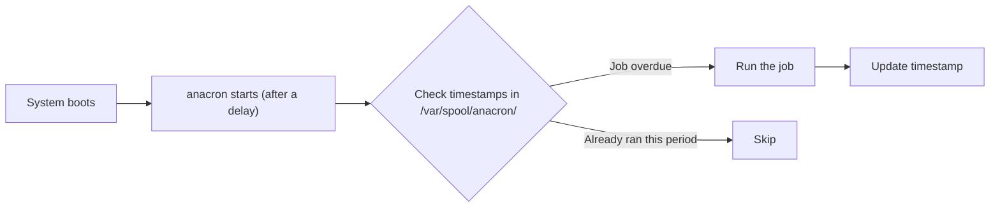

# Linux System Administration

> [!abstract] عن هذه الملاحظات
> جدولة المهام في لينكس (`at` · `cron` · `anacron` · `systemd timers`) + إدارة النظام (logrotate · tmpfiles · sysstat · nice/renice · tuned · ACLs) + الشبكات وFreeIPA والتخزين والمراقبة.
> ==دمج وتحسين== لملاحظتي `Task Scheduling` و`Scheduling Future` — مع تصحيح الأخطاء البرمجية والإملائية — ومضافًا إليها الأجزاء الإدارية من `Linux Administration Notes`.
> الأساسيات: [[ Linux Fundamentals]] — السكريبتات: [[Linux Shell Scripting - Complete Guide]]

## Contents

**الجدولة والصيانة:**
- [[#1. Time, Date & Timezone]]
- [[#2. One-Time Jobs with at]]
- [[#3. Recurring Jobs with cron]]
- [[#4. Missed Jobs with anacron]]
- [[#5. Modern Scheduling with systemd Timers]]
- [[#6. Log Rotation with logrotate]]
- [[#7. Temporary Files with systemd-tmpfiles]]

**الأداء والصلاحيات والحزم:**
- [[#8. Performance History with sysstat]]
- [[#9. Process Priority — nice & renice]]
- [[#10. System Tuning with tuned]]
- [[#11. Access Control Lists (ACLs)]]
- [[#12. Package Management Extras (RHEL)]]
- [[#13. Quick File Transfer & Watching Jobs]]
- [[#14. Troubleshooting & Cheat Sheet]]
- [[#15. Interview Questions]]

**الخدمات والهوية والأدوات:**
- [[#16. Networking (NetworkManager)]]
- [[#17. FreeIPA (Identity Management)]]
- [[#18. Storage & File Services]]
- [[#19. Monitoring & Troubleshooting]]
- [[#20. Resources & Tools]]

---

## 1. Time, Date & Timezone

Scheduling is useless if the system clock or timezone is wrong — ==always verify time first==.

```bash
date                              # current date & time
date '+%F %T'                     # 2026-11-13 14:30:00
timedatectl                       # time, timezone, NTP sync status
timedatectl list-timezones | grep -i riyadh
sudo timedatectl set-timezone Asia/Riyadh
sudo timedatectl set-ntp true     # enable network time sync
hwclock --show                    # hardware (BIOS) clock
```

| Command | Purpose |
| --- | --- |
| date | Show/set system date (script-friendly formats) |
| timedatectl | Inspect time, timezone, RTC, NTP |
| list-timezones | List all valid zone names |
| set-timezone \<Zone\> | Change timezone (==singular==, case-sensitive) |
| set-ntp true | Sync clock over the network |

> [!warning] Common typos
> ❌ `timedatectl list-timzones` → ✅ `list-timezones`
> ❌ `timedatectl set-timezones asia/rijg` → ✅ `set-timezone Asia/Riyadh`
> Zone names come from `list-timezones` — never guess the spelling.

> [!tip] Why this matters
> Wrong timezone = cron fires at the wrong hour, and log timestamps stop matching reality.
> See [[ Linux Fundamentals#20. Troubleshooting & System Logs]].

## 2. One-Time Jobs with at

`at` runs a command ==once== at a specific time. Jobs are executed by the `atd` daemon using `/bin/sh`.

### 2.1 Make sure atd is running

```bash
sudo dnf install at               # RHEL family (apt install at on Debian)
sudo systemctl enable --now atd
systemctl status atd
```

### 2.2 Submitting a job (interactive)

```text
at 3PM
at> pwd
at> touch /tmp/file1
at> <Ctrl+D>                      # end input → job is queued
```

```text
at 2am friday
at> mkdir -p /home/testat
at> ls /home > /home/testat/listing.txt
at> <Ctrl+D>
```

### 2.3 Submitting a job (one-liner)

```bash
echo "date >> /home/student/myjob.txt" | at now + 3 minutes
at -f /root/scripts/job.sh 10:00am        # read commands from a file
at -t 202611131430 10:00am                # numeric timespec (see man at)
```

### 2.4 Time formats

| Format | Example |
| --- | --- |
| Clock time | at 3PM · at 10:00am · at 14:30 |
| Date + time | at 2am friday · at 10:00am Nov 20 |
| Relative | at now + 3 minutes · at now + 2 hours · at now + 1 day |
| Keywords | at noon · at midnight · at teatime (16:00) |

### 2.5 Managing jobs

```bash
atq                 # list pending jobs      (= at -l)
at -l               # same as atq
at -c 2             # show the full commands of job 2
atrm 2              # delete job 2           (= at -r 2 = at -d 2)
watch -n 2 atq      # live view of the queue
```

| Command | Alias | Action |
| --- | --- | --- |
| atq | at -l | List queued jobs |
| atrm \<id\> | at -r \<id\> / at -d \<id\> | Remove a job |
| at -c \<id\> | — | Print the job's environment + commands |
| batch | at -b | Run when load average drops below ==1.5== |

### 2.6 Who may use at — allow / deny

| Situation | Result |
| --- | --- |
| /etc/at.allow ==exists== | Only users listed there may use `at` (`at.deny` is ==ignored==) |
| at.allow absent, /etc/at.deny exists | Everyone EXCEPT users listed in `at.deny` |
| Both absent | Only ==root== may use `at` |
| at.allow exists but is empty | Only ==root== |

> [!note] بالعربي
> لو ==مستخدم واحد== بس مش عايزه يستخدم `at` → حطه في `/etc/at.deny`.
> لو ==مستخدمين كتير== وعايز واحد أو اتنين بس يستخدموه → استخدم `/etc/at.allow` (وجوده بيلغي `at.deny` تمامًا).
> القاعدة: ==allow بيكسب deny== لو موجود.

> [!tip] Where is the output?
> `at` mails stdout/stderr to the job owner. No mail server? ==Redirect explicitly==:
> `echo "/root/job.sh >> /var/log/job.log 2>&1" | at 3PM`
> `at` jobs run with the environment and working directory ==captured at submission time==.

## 3. Recurring Jobs with cron

`cron` runs commands ==repeatedly== on a schedule. Managed with `crontab`.

### 3.1 Syntax

```text
*    *    *    *    *    command_to_execute
│    │    │    │    │
│    │    │    │    └─ Day of week (0-6, 0 = Sunday)
│    │    │    └────── Month (1-12)
│    │    └─────────── Day of month (1-31)
│    └──────────────── Hour (0-23)
└───────────────────── Minute (0-59)
```

| Character | Meaning | Example |
| --- | --- | --- |
| * | Every value | * * * * * = every minute |
| , | List | 1,5,10 |
| - | Range | 1-5 (Mon–Fri) |
| / | Step | */5 = every 5 units |

### 3.2 Reading real examples

| Expression | Meaning |
| --- | --- |
| */5 * * * * | Every 5 minutes |
| 25 * * * * | At minute ==25 of every hour== |
| 20 3 * 11 * | 03:20 ==every day in November== |
| 0 2 * * 0 | 02:00 every Sunday |
| 0 9 * * 1-5 | 09:00 Monday–Friday |
| 0 2 1 * * | 02:00 on the 1st of each month |
| * * 1,5,10 * * | ==Every minute== on the 1st, 5th and 10th ⚠️ |

> [!warning] Two classic misreadings
> `20 3 * 11 *` is ==not== "November 3rd" — the 3 is the ==hour==, 11 is the ==month==.
> `* * 1,5,10 * *` runs 1440 times on each of those days. You probably meant `0 2 1,5,10 * *`.

### 3.3 Managing crontabs

```bash
crontab -e                 # edit your crontab
crontab -l                 # list your jobs
crontab -r                 # REMOVE ALL your jobs (no confirmation!)
sudo crontab -l -u ali     # inspect another user's jobs
sudo crontab -e -u ali     # edit another user's jobs
```

### 3.4 Where cron jobs live

| Path | Scope | Has a user field? |
| --- | --- | --- |
| /var/spool/cron/\<user\> (RHEL) | Per-user crontab | ❌ No |
| /var/spool/cron/crontabs/\<user\> (Debian) | Per-user crontab | ❌ No |
| /etc/crontab | System-wide | ✅ Yes |
| /etc/cron.d/* | System-wide, per package | ✅ Yes |
| /etc/cron.{hourly,daily,weekly,monthly}/ | Drop-in ==scripts== | ❌ (run by run-parts/anacron) |

```bash
cat /etc/crontab
ls -l /etc/cron.d/ /etc/cron.daily/
ls /var/spool/cron/
```

> [!note] بالعربي
> لو محتاج تشغّل ==سكريبت== دوريًا: اعمله `chmod +x` وحطه في `/etc/cron.daily/` (أو `weekly` / `monthly`).
> مش محتاج تكتب له سطر crontab — النظام بيشغّل كل اللي في المجلد.
> ملاحظة: في Debian، `run-parts` بيتجاهل الملفات اللي فيها ==نقطة في الاسم== (زي `backup.sh`) — سمّيه `backup` بس.

### 3.5 A correct cron script

`/opt/scripts/cron_report.sh`

```bash
#!/bin/bash
# Always absolute paths — cron's PATH and CWD are minimal
OUT="/var/log/cron_report.txt"
{
    echo "===== $(date '+%F %T') ====="
    pwd
    /usr/bin/df -h /
} >> "$OUT" 2>&1
```

```bash
chmod +x /opt/scripts/cron_report.sh
crontab -e
# */1 * * * * /opt/scripts/cron_report.sh
```

> [!warning] Why the original script failed
> The original wrote to `scripts/cron.txt` (a ==relative path==). Cron starts in the user's `$HOME`,
> so the file lands somewhere unexpected — or the job fails silently.
> ✅ Use absolute paths for the script, the output, and every binary.

### 3.6 Cron access & logs

```text
/etc/cron.allow      # same allow/deny logic as at
/etc/cron.deny
```

```bash
# Logs:
sudo tail -f /var/log/cron            # RHEL family
sudo journalctl -u crond -f           # RHEL (crond)
sudo journalctl -u cron -f            # Debian (cron)
sudo grep CRON /var/log/syslog        # Debian alternative
```

> [!tip] Cron golden rules
> ==Absolute paths== everywhere (cron's PATH is usually `/usr/bin:/bin`).
> Escape `%` as `\%` — an unescaped `%` becomes a newline/stdin separator.
> Redirect output: `>> /var/log/job.log 2>&1` (otherwise cron tries to mail it).
> Test the script ==manually first==, then schedule it.
> Full scripting patterns: [[Linux Shell Scripting - Complete Guide#15. Cron Jobs & Task Scheduling in Shell Scripting]]

## 4. Missed Jobs with anacron

`cron` assumes the machine is ==always on==. If it was off at 02:00, the job is simply ==lost==.
`anacron` fixes that: it runs missed ==daily / weekly / monthly== jobs after boot.

### 4.1 How it works



### 4.2 Configuration

```bash
sudo vi /etc/anacrontab
ls -l /var/spool/anacron/          # last-run timestamps per job
```

`/etc/anacrontab`

```ini
SHELL=/bin/sh
PATH=/sbin:/bin:/usr/sbin:/usr/bin
MAILTO=root
RANDOM_DELAY=45                    # random extra delay (avoid storms)
START_HOURS_RANGE=3-22             # only start jobs between 03:00 and 22:59

# period(days)  delay(min)  job-identifier  command
1               5           cron.daily      nice run-parts /etc/cron.daily
7               25          cron.weekly     nice run-parts /etc/cron.weekly
@monthly        45          cron.monthly    nice run-parts /etc/cron.monthly
```

| Field | Meaning |
| --- | --- |
| period | Run every ==N days== (`1`, `7`, `@monthly`) |
| delay | Wait N minutes after anacron starts |
| job-identifier | Unique name — also the timestamp filename |
| command | Usually `run-parts /etc/cron.daily` |

> [!note] بالعربي
> لو عايز حاجة تشتغل ==حتى لو الجهاز كان مقفول== وقتها: حط السكريبت في `cron.daily` (أو weekly/monthly).
> أول ما الجهاز يقوم، `anacron` يستنى المدة المكتوبة في `/etc/anacrontab` وبعدين يشغّله.
> يعني ==مفيش وقت محدد بالدقيقة== — anacron بيشتغل بـ"كل كام يوم"، مش "الساعة كام".

> [!warning] Limitations
> anacron has ==no minute/hour granularity== — periods are in days only.
> Jobs may not run if the boot happens outside `START_HOURS_RANGE`.
> Hourly jobs stay with cron (`/etc/cron.d/0hourly` on RHEL).

## 5. Modern Scheduling with systemd Timers

systemd timers are the modern replacement for cron: ==logging, dependencies, and catch-up built in==.

### 5.1 Inspect existing timers

```bash
systemctl list-timers --all
systemctl list-units --type=timer
systemctl status logrotate.timer
journalctl -u backup.service          # output of the triggered job
```

### 5.2 Create your own (a `.timer` + a `.service`)

`/etc/systemd/system/backup.service`

```ini
[Unit]
Description=Backup job

[Service]
Type=oneshot
ExecStart=/opt/scripts/backup.sh
```

`/etc/systemd/system/backup.timer`

```ini
[Unit]
Description=Run backup daily at 02:00

[Timer]
OnCalendar=*-*-* 02:00:00
Persistent=true                  # catch up if the machine was off (anacron-like)
RandomizedDelaySec=300

[Install]
WantedBy=timers.target
```

```bash
sudo systemctl daemon-reload
sudo systemctl enable --now backup.timer
systemctl list-timers backup.timer
systemd-analyze calendar "Mon *-*-* 09:00"    # validate an OnCalendar expression
```

| Directive | Meaning |
| --- | --- |
| OnCalendar= | Wall-clock schedule |
| OnBootSec= / OnUnitActiveSec= | Relative to boot / last activation |
| Persistent=true | ==Run missed jobs== after downtime |
| RandomizedDelaySec= | Spread load across machines |

### 5.3 Which scheduler to use?

| Need | Use |
| --- | --- |
| Run ==once== at a specific time | at |
| Run ==repeatedly==, machine always on | cron |
| Daily/weekly job, machine may be off | anacron (or timer + `Persistent=true`) |
| Logs, dependencies, per-service control | ==systemd timer== |
| Run only when the system is idle | batch |

> [!see-also] الأساسيات
> أوامر systemctl وjournalctl كاملة: [[ Linux Fundamentals#18. Systemd & Service Management]]

## 6. Log Rotation with logrotate

Logs grow forever → disk fills up → services crash. `logrotate` ==rotates, compresses and deletes== them automatically.

```bash
cat /etc/logrotate.conf            # global defaults
ls /etc/logrotate.d/               # per-application configs
systemctl list-timers | grep logrotate
```

`/etc/logrotate.d/myapp`

```text
/var/log/myapp/*.log {
    daily                  # rotate daily (weekly / monthly / size 100M)
    rotate 7               # keep 7 old copies, then delete
    compress               # gzip old logs
    delaycompress          # compress only from the 2nd rotation
    missingok              # no error if the log is missing
    notifempty             # skip empty logs
    create 0640 myapp myapp
    sharedscripts
    postrotate
        systemctl reload myapp >/dev/null 2>&1 || true
    endscript
}
```

| Directive | Purpose |
| --- | --- |
| rotate N | How many old files to keep |
| daily / weekly / size | When to rotate |
| compress + delaycompress | Save space (keep the newest old log readable) |
| create | Recreate the log with owner/mode after rotation |
| postrotate … endscript | Reload the service so it reopens the file |

```bash
sudo logrotate -d /etc/logrotate.conf     # DEBUG / dry-run — changes nothing
sudo logrotate -f /etc/logrotate.d/myapp  # force a rotation now
cat /var/lib/logrotate/logrotate.status   # last rotation timestamps (RHEL)
```

> [!note] بالعربي
> `/etc/logrotate.conf` هو المسؤول عن ==الاحتفاظ بالـ log لفترة محددة وبعدها مسحه== عشان الهارد مايمتليش.
> بدله اليدوي (`find -mtime +7 -delete`) بيمسح من غير ضغط ولا إعادة فتح الملف — logrotate أأمن.

> [!warning] The classic bug
> Without `postrotate … reload`, the service keeps writing to the ==deleted inode== → the new log stays empty and disk space is never freed.
> Detect it with `sudo lsof +L1`. See [[ Linux Fundamentals#9. Disk & Memory Commands]].

## 7. Temporary Files with systemd-tmpfiles

`systemd-tmpfiles` ==creates, cleans and removes== temporary files and directories declaratively.

### 7.1 Configuration locations (precedence)

| Path | Owner | Priority |
| --- | --- | --- |
| /usr/lib/tmpfiles.d/*.conf | ==Packages / apps== | Lowest |
| /run/tmpfiles.d/*.conf | Runtime (lost on reboot) | Middle |
| /etc/tmpfiles.d/*.conf | ==Admin (you)== | ==Highest== |

> [!tip] Never edit `/usr/lib/tmpfiles.d/`
> A package update overwrites it. Copy the file to `/etc/tmpfiles.d/` with the ==same name== and edit there.

### 7.2 Format

```text
# Type  Path              Mode  UID    GID    Age   Argument
d       /run/myapp        0755  myapp  myapp  -
D       /tmp/myapp        1777  root   root   10d
f       /var/log/myapp.log 0640 myapp  myapp  -
```

| Type | Meaning |
| --- | --- |
| d | Create directory if missing |
| D | Like `d`, but ==remove contents== on `--remove` |
| f | Create file if missing |
| x | Ignore this path during cleanup |
| Age | Files older than this are cleaned (`10d`, `1h`) |

### 7.3 Commands

```bash
sudo systemd-tmpfiles --create          # create entries
sudo systemd-tmpfiles --clean           # delete files older than "Age"
sudo systemd-tmpfiles --remove          # remove entries of type D/X etc.
sudo systemd-tmpfiles --create --remove # both (what you originally wrote)
systemctl list-timers | grep tmpfiles   # automatic cleanup timer
```

> [!warning] Typo fixed
> ❌ `systemd-tempfiles` → ✅ ==`systemd-tmpfiles`== (no "e" after t).

## 8. Performance History with sysstat

`sysstat` collects ==historical== CPU / memory / I/O data — so you can investigate "the server was slow at 3 AM".

```bash
sudo dnf install sysstat
sudo systemctl enable --now sysstat            # RHEL: enables collect + summary timers
systemctl list-timers | grep sysstat

sar -u 1 3                    # CPU, 3 samples 1s apart
sar -r                        # memory
sar -b                        # I/O rates
sar -q                        # load average / run queue
sar -n DEV                    # network per interface
sar -f /var/log/sa/sa15       # read the 15th of the month (history!)

iostat -xz 1 3                # per-device I/O
mpstat -P ALL 1 3             # per-CPU
pidstat -p 1234 1 3           # per-process
```

| Item | Location |
| --- | --- |
| Binary history files | /var/log/sa/saDD (RHEL) · /var/log/sysstat/ (Debian) |
| Retention | HISTORY= in /etc/sysconfig/sysstat (RHEL) |
| Collectors | sa1 (sample) · sa2 (daily summary) via timers/cron |

> [!note] بالعربي
> `sysstat` باكدج لعمل ==تقارير (reports)== عن الـ CPU والـ memory — مش "ريبوت".
> فايدته الحقيقية إنه بيسجّل ==تاريخ== الأداء، فتقدر ترجع لأي يوم وتشوف حصل إيه.

> [!see-also] ذات صلة
> أوامر df / free / vmstat / iostat الحالية: [[ Linux Fundamentals#9. Disk & Memory Commands]]

## 9. Process Priority — nice & renice

Niceness = how "polite" a process is. ==Lower nice = higher priority = more CPU==.

| Nice value | Meaning |
| --- | --- |
| -20 | Highest priority (least nice) — ==root only== |
| 0 | Default |
| +19 | Lowest priority (most nice) |

### 9.1 Start a process with a priority

```bash
nice sleep 10000 &            # no -n → adjustment is +10 by default
nice -n 10 sleep 10000 &      # explicit +10
sudo nice -n -10 sleep 20000 &  # negative → needs root
```

### 9.2 Change a running process

```bash
sudo renice -n -10 -p 2703    # raise priority of PID 2703
renice -n 10 -p 2703          # lower it (any user, own process)
sudo renice -n 5 -u ali       # all processes of user ali
sudo renice -n 5 -g devs      # all processes of group devs
```

### 9.3 Inspect

```bash
ps -o pid,nice,user,comm,pri -p 2703
ps axo pid,user,nice,pri --sort=-nice | head
top                            # press r → PID → new nice value
```

> [!example] Real output (from the lab)
> ```text
>     PID  NI USER     COMMAND         PRI
>    2046   0 ansible  bash             19
>   12990  10 ansible  sleep             9
>   13231   0 ansible  ps               19
> ```
> Notice: `NI 10` → `PRI 9`, while `NI 0` → `PRI 19`.

> [!warning] ps and top disagree — that's normal
> In this `ps -o pri` column: ==higher number = higher priority==.
> In `top`, the `PR` column is the opposite (==lower = higher priority==, `PR = 20 + NI` for normal tasks).
> Don't compare the two columns — compare ==NI== only.

> [!tip] Remember
> Only ==root== can set a negative nice value (or lower an existing one).
> `nice` affects ==CPU scheduling only== — for disk I/O use `ionice`.
> Related: [[ Linux Fundamentals#8. Process Management]]

![[tuning.excalidraw|800]]

## 10. System Tuning with tuned

`tuned` applies ==ready-made performance profiles== (sysctl, disk, CPU governor, power settings) in one command.

```bash
sudo dnf install tuned
sudo systemctl enable --now tuned
systemctl status tuned
rpm -qa | grep tuned
```

### 10.1 tuned-adm subcommands

```bash
tuned-adm list                    # all available profiles
tuned-adm active                  # current profile
tuned-adm recommend               # suggested profile for this machine
sudo tuned-adm profile virtual-host   # switch profile
sudo tuned-adm profile throughput-performance network-latency   # merge two
tuned-adm profile_info            # description of the active profile
tuned-adm verify                  # do system settings still match the profile?
sudo tuned-adm off                # unload all tunings
sudo tuned-adm auto_profile       # automatic selection mode
tuned-adm profile_mode            # manual or automatic?
```

| Subcommand | Purpose |
| --- | --- |
| list / profiles | Show available profiles |
| active | Show the active one |
| profile \<name\> | Apply (multiple names = merged, ==last wins==) |
| recommend | Static recommendation for this system |
| verify | Detect manual drift from the profile |
| off | Unload tunings |

### 10.2 Common profiles

| Profile | Best for |
| --- | --- |
| balanced | General purpose / default |
| virtual-guest | A VM (guest) |
| virtual-host | A hypervisor hosting VMs |
| throughput-performance | Batch / throughput servers |
| network-latency | Low-latency networking |
| powersave | Minimum power consumption |

### 10.3 Files & custom profiles

| Path | Content |
| --- | --- |
| /usr/lib/tuned/ (newer: /usr/lib/tuned/profiles/) | ==Distribution== profiles |
| /etc/tuned/ (newer: /etc/tuned/profiles/) | ==Your== profiles (higher precedence) |
| /etc/tuned/tuned-main.conf | Daemon settings |
| /etc/tuned/active_profile | Currently applied profile name |

`/etc/tuned/myprofile/tuned.conf`

```ini
[main]
include=throughput-performance

[sysctl]
vm.swappiness=10
```

```bash
sudo tuned-adm profile myprofile
tuned-adm verify
```

### 10.4 Extra profile packages

```bash
dnf search tuned-profiles
sudo dnf install tuned-profiles-oracle
```

> [!warning] Typos fixed
> ❌ `tuned-adm profile blanced` → ✅ `balanced`
> ❌ `tuned-profile-orcal.noarch` → ✅ ==`tuned-profiles-oracle`== (search first, names vary by release)
> Profile directories moved in newer versions — check both layouts above.

## 11. Access Control Lists (ACLs)

Classic permissions give access to ==one owner, one group, everyone else==. ACLs let you grant access to ==any number of named users and groups==.

### 11.1 The base model (recap)

| Symbol | Meaning | Value |
| --- | --- | --- |
| r | read | 4 |
| w | write | 2 |
| x | execute | 1 |

`user (u) · group (g) · other (o)` → `user::rw- group::r-- other::r--`

Basics: [[ Linux Fundamentals#17. Permissions & Ownership]]

### 11.2 Spotting an ACL

```bash
ls -l fact.yaml
# -rw-r--r--.  1 ansible ansible 146 Apr 25 16:24 fact.yaml   ← "." = no ACL
# -rw-rw-r--+  1 ansible ansible 146 Apr 25 16:24 fact.yaml   ← "+" = ACL present
```

### 11.3 Grant access to a named user / group

```bash
setfacl -m u:ali:r-- fact.yaml        # user ali → read only
setfacl -m u:madel:rw- fact.yaml      # user madel → read/write
setfacl -m g:colord:rwx fact.yaml     # group colord → full
setfacl -R -m u:ali:r-x dir1/         # recursive
getfacl fact.yaml                     # inspect
```

> [!example]- getfacl output explained
> ```text
> # file: fact.yaml
> # owner: ansible
> # group: ansible
> user::rw-                ← owner (base entry)
> user:madel:rw-           ← named user
> group::r--               ← owning group (base entry)
> group:colord:rwx         ← named group
> mask::rwx                ← effective rights mask
> other::r--               ← everyone else
> ```

> [!note] بالعربي
> الـ `rwx` اللي بتظهر في `ls -l` في خانة الجروب ==بقت بتعبّر عن الـ mask==، مش عن صلاحيات الجروب المالك.
> عشان تشوف الحقيقة استخدم `getfacl`.

### 11.4 The mask — the ceiling

The mask limits ==every named user, every named group, and the owning group==.
It does ==NOT== affect the file owner (`user::`) or `other::`.

```bash
setfacl -m mask::r fact.yaml      # or: setfacl -m m::r fact.yaml
getfacl fact.yaml
```

> [!example]- After limiting the mask
> ```text
> user::rw-
> user:madel:rw-          #effective:r--
> group::r--
> group:colord:rwx        #effective:r--
> mask::r--
> other::r--
> ```

> [!note] بالعربي
> الـ mask بيعمل ==سقف (limitation)== لكل الناس ==ما عدا الأونر والـ other==.
> يعني حتى لو اديت `madel` صلاحية `rw-`، لو الـ mask بقى `r--` فاللي بيتنفذ فعليًا هو `r--` بس.
> بيظهر لك ده في `getfacl` جنب السطر: `#effective:r--`.

> [!warning] chmod changes the mask!
> On a file with an ACL, `chmod g-w` edits the ==mask==, not the owning group — silently cutting everyone's effective rights.
> Re-apply with `setfacl -m m::rw- file` if that happens.

### 11.5 Default ACLs (inheritance on directories)

A ==default ACL== on a directory is inherited by ==newly created== files and subdirectories.

```bash
mkdir direxy
setfacl -m d:u::rwx direxy/
setfacl -m d:g:colord:r-x direxy/
chmod g+s direxy/                 # SGID → also inherit group ownership
getfacl direxy/
```

> [!example]- Directory with a default ACL
> ```text
> # file: direxy/
> # owner: ansible
> # group: ansible
> # flags: -s-                      ← setgid bit
> user::rwx
> group::r-x
> other::r-x
> default:user::rwx
> default:group::r-x
> default:group:colord:r-x
> default:mask::r-x
> default:other::r-x
> ```

```bash
mkdir direxy/mo && touch direxy/file1
ls -l direxy/
# -rw-r--r--+ ... file1     ← inherited ACL (+)
# drwxr-sr-x+ ... mo        ← inherited ACL + SGID
```

> [!danger] Default ACL ≠ existing files
> A default ACL applies to ==NEW files only==. Existing files are untouched.
> ❌ `setfacl -R -m d:g:colord:r-x dir/` → this only sets default ACLs on ==existing subdirectories== (files can't hold default ACLs).
> ✅ To fix ==existing files==, apply an ==access== ACL recursively:
> `setfacl -R -m g:colord:r-x dir/`

> [!note] بالعربي
> اللي جوه المجلد ==قبل== ما تعمل default ACL مش بيتأثر — القاعدة بتطبق على ==الجديد فقط==.
> عشان تأثر على القديم استخدم ACL عادي مع `-R` (من غير `d:`).

### 11.6 Copying ACLs between files

```bash
# Copy the full ACL of file1 onto file2 (replaces file2's ACL)
getfacl file1 | setfacl --set-file=- file2

# Copy the ACCESS ACL of dir into the DEFAULT ACL of dir2
getfacl --access dir | setfacl -d -M- dir2

# Backup & restore a whole tree
getfacl -R /data > /root/acl-backup.txt
setfacl --restore=/root/acl-backup.txt
```

> [!warning] Two broken commands from the original notes
> ❌ `getfacl file1 | getfacl --set-file=-file2`
> ❌ `getfacl --access dir | getfacl -d -M- dir2`
> The receiver is ==`setfacl`==, not `getfacl` — and `--set-file=-` needs a space before the target file.

### 11.7 Removing ACLs

| Goal | Command |
| --- | --- |
| Remove one entry | setfacl -x u:ali fact.yaml |
| Remove several entries | setfacl -x u:ali,g:colord fact.yaml |
| Remove ==all== extended entries | setfacl -b fact.yaml |
| Remove the ==default== ACL | setfacl -k direxy/ |
| Remove default ACLs recursively | setfacl -R -k direxy/ |
| Remove one default entry | setfacl -x d:u:ali direxy/ |

```bash
setfacl -b fact.yaml
getfacl fact.yaml
# user::rw-
# group::r--
# other::r--          ← back to plain permissions, "+" disappears
```

> [!tip] `-x` syntax
> Entries for `-x` take ==no permissions and no trailing colon==: `u:ali` ✅ · `u:ali:` ❌
> Mnemonic: ==`-x` = one entry · `-b` = bulk (all) · `-k` = kill defaults==.

### 11.8 Combined example

```bash
setfacl -m u::rwx,g:consultant:rx,o::- project/   # owner full, group read+execute, others none
setfacl -m m::rx project/                          # cap effective rights at r-x
getfacl project/
```

## 12. Package Management Extras (RHEL)

Basics (`apt`/`yum`/`dnf`/`rpm`/`dpkg`) live in [[ Linux Fundamentals#11. Package Management]] — here only the ==extras== from the lab notes.

```bash
# Package groups
dnf grouplist
dnf groupinfo "Development Tools"
sudo dnf groupinstall "Development Tools"

# History & rollback
dnf history
dnf history info 4
sudo dnf history undo 4          # undo transaction #4

# Cache & logs
sudo dnf clean all
less /var/log/yum.log            # RHEL 7
less /var/log/dnf.log            # RHEL 8+

# RPM queries
rpm -qa                          # all installed packages
rpm -qi bash                     # info about an INSTALLED package
rpm -qpi ./pkg.rpm               # info about a LOCAL .rpm file (not installed)
rpm -qpl ./pkg.rpm               # list files inside a local .rpm
rpm -qf /usr/bin/ls              # which package owns this file?

# Install a local file (resolves dependencies)
sudo dnf localinstall ./pkg.rpm  # modern: dnf install ./pkg.rpm
```

| Query | Installed package | Local `.rpm` file |
| --- | --- | --- |
| Info | rpm -qi bash | rpm -qpi pkg.rpm |
| File list | rpm -ql bash | rpm -qpl pkg.rpm |

> [!note] `yum` on RHEL 8+
> `yum` is a ==symlink to `dnf`== — same commands, new engine.
> ❌ `yum updata` → ✅ `yum update`.

## 13. Quick File Transfer & Watching Jobs

```bash
# Copy a file FROM another machine (needs user@host)
scp user@192.168.1.10:/root/scripts/si.sh .

# Push a file / directory
scp si.sh user@192.168.1.10:/opt/scripts/
scp -r scripts/ user@192.168.1.10:/opt/

# Non-default SSH port (uppercase -P for scp!)
scp -P 2222 file user@host:/tmp/
```

```bash
watch -n 2 atq                # refresh every 2s
watch -d ip -s link           # -d highlights what changed
watch -n 1 'ls -l /tmp'
```

> [!warning] The original scp was invalid
> ❌ `scp 192.168.0.0:/root/scripts/si.sh .` — no username, and `.0.0` is a network address, not a host.
> ✅ `scp user@192.168.1.10:/root/scripts/si.sh .`

More: [[ Linux Fundamentals#10. Networking Commands]] · [[Linux Shell Scripting - Complete Guide#17. Log Management & Backup Automation in Shell Scripting]]

## 14. Troubleshooting & Cheat Sheet

### 14.1 "My job never ran"

| Symptom | Check |
| --- | --- |
| `at` job never ran | systemctl status atd · atq · /etc/at.allow / at.deny |
| `cron` job never ran | crontab -l · executable bit · journalctl -u crond · cron.deny |
| Job ran but no output file | ==Relative path== → use absolute; add `>> /var/log/x.log 2>&1` |
| Weird cron behaviour with `%` | Escape it: `\%` |
| anacron job skipped | START_HOURS_RANGE · RANDOM_DELAY · /var/spool/anacron/ timestamps |
| Timer inactive | systemctl enable --now x.timer · WantedBy=timers.target |
| ACL granted but denied | ==mask== → getfacl shows `#effective:` |
| New files don't inherit ACL | Parent needs a ==default== ACL (`d:`) |
| Log rotated but still empty | Missing `postrotate … reload` → lsof +L1 |
| Can't set negative nice | Needs ==root== |

### 14.2 Scheduling cheat sheet

```bash
# One-time
at 3PM                     atq            atrm 2         at -c 2
echo "cmd" | at now + 5 minutes           batch

# Recurring
crontab -e                 crontab -l     crontab -r     crontab -l -u ali
cat /etc/crontab           ls /etc/cron.d/                tail -f /var/log/cron

# Catch-up
cat /etc/anacrontab        ls /var/spool/anacron/

# Timers
systemctl list-timers --all               systemctl enable --now backup.timer
systemd-analyze calendar "Mon *-*-* 09:00"
```

### 14.3 System admin cheat sheet

```bash
# Logs & temp files
logrotate -d /etc/logrotate.conf          logrotate -f /etc/logrotate.d/myapp
systemd-tmpfiles --create --clean

# Performance
sar -u 1 3      sar -r      sar -f /var/log/sa/sa15      iostat -xz 1

# Priority
nice -n 10 cmd          sudo renice -n -5 -p PID         top   (press r)

# Tuning
tuned-adm list          tuned-adm active                 tuned-adm recommend
sudo tuned-adm profile virtual-host                      tuned-adm verify

# ACLs
getfacl f               setfacl -m u:ali:rw f            setfacl -m m::r f
setfacl -m d:g:devs:r-x dir/            setfacl -x u:ali f
setfacl -b f            setfacl -k dir/
```

> [!see-also] ذات صلة
> تتبّع المشاكل العامة (logs / موارد / خدمات): [[ Linux Fundamentals#20. Troubleshooting & System Logs]]
> مين ماسك بورت أو ملف: [[#lsof — List Open Files]]

## 15. Interview Questions

> [!faq]- 1.at vs cron?
> `at` = ==once== at a specific time; `cron` = ==repeating== schedule.

> [!faq]- 2.cron vs anacron?
> cron assumes the machine is always on and fires at an ==exact time==. anacron runs ==missed== daily/weekly/monthly jobs after boot, with a delay — no minute-level precision.

> [!faq]- 3.What does `Persistent=true` do in a systemd timer?
> Runs the job ==after downtime== if the last scheduled run was missed — the anacron behaviour, built into systemd.

> [!faq]- 4.Who can use `at` if both at.allow and at.deny exist?
> Only users in ==at.allow==; `at.deny` is ignored. If neither file exists → root only.

> [!faq]- 5.Why did my cron job work manually but not from cron?
> Minimal `PATH`, different working directory, no shell profile loaded → ==use absolute paths== and redirect output.

> [!faq]- 6.What is the ACL mask?
> The ==ceiling== of effective rights for all named users, named groups and the owning group. It does ==not== limit the file owner or `other`. `chmod g-…` on an ACL file modifies the mask.

> [!faq]- 7.Access ACL vs default ACL?
> Access ACL = who can access ==this== object. Default ACL (directories only) = the ACL ==inherited by new== children. Existing files are unaffected.

> [!faq]- 8.Nice range, and who can lower it?
> `-20` (highest priority) to `+19` (lowest). Only ==root== can set a negative nice or decrease an existing one. `nice` with no `-n` adds ==+10==.

> [!faq]- 9.What is tuned?
> A daemon that applies ==performance profiles== (sysctl/CPU/disk/power) via `tuned-adm profile <name>`; `tuned-adm recommend` suggests one, `verify` detects drift.

> [!faq]- 10.Why use logrotate instead of `find -delete`?
> It ==compresses, keeps N generations, recreates the file with correct owner/mode, and reloads the service== so it writes to the new file instead of a deleted inode.


## 16. Networking (NetworkManager)

### 16.1 Static IP with nmcli

```bash
sudo nmcli connection modify ens192 \
  ipv4.method manual \
  ipv4.addresses 192.168.50.40/24 \
  ipv4.gateway 192.168.50.1 \
  ipv4.dns "8.8.8.8 1.1.1.1" \
  ipv6.method disabled

sudo nmcli connection down ens192
sudo nmcli connection up ens192

# التحقق
nmcli connection show ens192
ip addr show ens192
ip route show
```

### 16.2 Checking Listening Ports

```text
[root@control ~]# netstat -ltn
Active Internet connections (only servers)
Proto Recv-Q Send-Q Local Address           Foreign Address         State
tcp        0      0 127.0.0.1:6010          0.0.0.0:*               LISTEN
tcp        0      0 0.0.0.0:22              0.0.0.0:*               LISTEN
tcp        0      0 127.0.0.1:631           0.0.0.0:*               LISTEN
tcp6       0      0 :::22                   :::*                    LISTEN
tcp6       0      0 ::1:631                 :::*                    LISTEN
tcp6       0      0 ::1:6010                :::*                    LISTEN
```

```text
[root@control ~]# netstat -ltn | grep 60
tcp        0      0 127.0.0.1:6010          0.0.0.0:*               LISTEN
tcp6       0      0 ::1:6010                :::*                    LISTEN
```

```text
[root@control ~]# netstat -ltn | grep -w 6010
tcp        0      0 127.0.0.1:6010          0.0.0.0:*               LISTEN
tcp6       0      0 ::1:6010                :::*                    LISTEN
```

> [!tip] البديل الحديث
> `netstat` بقت deprecated — استخدم `ss -ltn` من حزمة iproute (أسرع ومثبتة افتراضيًا).
> والبديل الأقوى: [[#lsof — List Open Files|lsof]].

### 16.3 DHCP & Lease Files

```bash
nmcli con show
less /etc/sysconfig/network-scripts/ifcfg-ens33
less /var/lib/dhclient/<lease_file>
```

لو في حالة إن NetworkManager مش شغال:

```bash
less /var/lib/NetworkManager/dhclient-<UUID>-<iface>.lease
```

ملفات الاتصال نفسها:

```bash
ls /etc/NetworkManager/system-connections/
```

> [!info] RHEL 9 وما بعده
> البروفايلات الجديدة بتتخزن بصيغة keyfile في `/etc/NetworkManager/system-connections/` — ملفات `ifcfg-*` بقت legacy.

> [!see-also] ذات صلة
> أدوات الشبكة الأساسية (ping / dig / ss / traceroute): [[ Linux Fundamentals#10. Networking Commands]]

## 17. FreeIPA (Identity Management)

> [!danger] الباسوردات استُبدلت بـ Placeholder
> الباسوردات في هذا القسم كانت مكتوبة ==Plaintext== (Directory Manager / IPA admin) واستُبدلت بـ ==`<IPA_PASSWORD>`==.
> خزّن القيم الحقيقية في ==مدير باسوردات== (زي Bitwarden أو KeePassXC)،
> وعلى الأقل ما تشاركش الملف ده أو ترفعه على repo عام.

### 17.1 Active Directory Trust — Resources

- [FreeIPA Docs — Active Directory trust setup](https://www.freeipa.org/page/Active_Directory_trust_setup)
- [ComputingForGeeks — Establish Trust between IPA and AD](https://computingforgeeks.com/establish-trust-between-ipa-and-active-directory/)
- [Red Hat — Access AD Users POSIX UID/GID via IPA AD Trust](https://access.redhat.com/solutions/1507803)
- [Siberoloji — Configure FreeIPA Trust with AD (AlmaLinux)](https://blog.siberoloji.com/configure-freeipa-trust-active-directory-almalinux/)

### 17.2 Server Installation

```bash
sudo yum install ipa-server
sudo ipa-server-install
```

> [!note] Log File
> لوج التثبيت: `/var/log/ipaserver-install.log`

ملخص الـ interactive setup (نفس القيم المستخدمة في اللاب):

```text
This program will set up the IPA Server.

This includes:
  * Configure a stand-alone CA (dogtag) for certificate management
  * Configure the Network Time Daemon (ntpd)
  * Create and configure an instance of Directory Server
  * Create and configure a Kerberos Key Distribution Center (KDC)
  * Configure Apache (httpd)

Do you want to configure integrated DNS (BIND)? [no]:
Server host name [server.mostafa.com]:
Please confirm the domain name [mostafa.com]:
Please provide a realm name [MOSTAFA.COM]:

Directory Manager password: <IPA_PASSWORD>     # LDAP database
Password (confirm):         <IPA_PASSWORD>

The IPA server requires an administrative user, named 'admin'.
IPA admin password: <IPA_PASSWORD>             # IPA GUI
Password (confirm): <IPA_PASSWORD>

The IPA Master Server will be configured with:
Hostname:       server.mostafa.com
IP address(es): 192.168.153.150
Domain name:    mostafa.com
Realm name:     MOSTAFA.COM

Continue to configure the system with these values? [no]: yes

Configuring NTP daemon (ntpd) ... Done.
Configuring directory server (dirsrv). Estimated time: 1 minute
  [1/47]: creating directory server user
  [2/47]: creating directory server instance
  ...
```

### 17.3 Required Firewall Ports

| Port | Protocol | Service |
| --- | --- | --- |
| 80, 443 | TCP | HTTP / HTTPS |
| 389, 636 | TCP | LDAP / LDAPS |
| 88, 464 | TCP + UDP | Kerberos |
| 53 | TCP + UDP | BIND (DNS) |
| 123 | UDP | NTP |

```bash
sudo firewall-cmd --permanent \
  --add-port=80/tcp --add-port=443/tcp \
  --add-port=389/tcp --add-port=636/tcp \
  --add-port=88/tcp --add-port=464/tcp --add-port=53/tcp \
  --add-port=88/udp --add-port=464/udp --add-port=53/udp \
  --add-port=123/udp
sudo firewall-cmd --reload

# التحقق
sudo firewall-cmd --list-ports --permanent
sudo firewall-cmd --list-ports
```

### 17.4 Kerberos Ticket & Service Status

```text
[ansible@control hosts]$ kinit admin
Password for admin@EXAMPLE.COM:

[ansible@control hosts]$ klist
Ticket cache: KCM:1001
Default principal: admin@EXAMPLE.COM

Valid starting       Expires              Service principal
05/01/2025 17:10:03  05/02/2025 16:22:31  krbtgt/EXAMPLE.COM@EXAMPLE.COM
```

```text
$ sudo ipactl status
Directory Service: RUNNING
krb5kdc Service: RUNNING
kadmin Service: RUNNING
httpd Service: RUNNING
ipa-custodia Service: RUNNING
pki-tomcatd Service: RUNNING
ipa-otpd Service: RUNNING
ipa: INFO: The ipactl command was successful
```

### 17.5 User Management

```text
$ ipa user-add
First name: mohamed
Last name: adel
User login [madel]: moadel
-------------------
Added user "moadel"
-------------------
  User login: moadel
  First name: mohamed
  Last name: adel
  Full name: mohamed adel
  Display name: mohamed adel
  Initials: ma
  Home directory: /home/moadel
  GECOS: mohamed adel
  Login shell: /bin/sh
  Principal name: moadel@EXAMPLE.COM
  Principal alias: moadel@EXAMPLE.COM
  Email address: moadel@example.com
  UID: 553000003
  GID: 553000003
  Password: False
  Member of groups: ipausers
  Kerberos keys available: False
```

```bash
ipa passwd moadel
# passwd: <IPA_PASSWORD>
```

> [!see-also] ذات صلة
> إدارة المستخدمين محليًا (useradd / usermod / chage): [[ Linux Fundamentals#16. User & Group Management]]

### 17.6 Client Preparation (Lab Only)

> [!warning] للّاب فقط — مش للـ Production
> تعطيل SELinux والـ Firewall بيحل مشاكل اللاب بسرعة، لكنه ==مش حل صح== في بيئة حقيقية.
> في الـ production: خلّيهم شغالين وافتح البورتات المطلوبة بس.

```bash
sudo yum install ipa-client

# SELinux → Permissive مؤقتًا
sudo setenforce 0
sudo vim /etc/sysconfig/selinux    # عطّله دايمًا لو اللاب محتاج

# Firewall
sudo systemctl stop firewalld
sudo systemctl disable firewalld

# hosts
sudo vim /etc/hosts
192.168.1.100   master.redhat.com  master
```

### 17.7 Client Installation

```text
[ansible@ansible1 ~]$ ipa-client-install
Must be root to run ipa-client-install.
The ipa-client-install command failed.

[ansible@ansible1 ~]$ sudo ipa-client-install
This program will set up IPA client.
Version 4.12.2

DNS discovery failed to determine your DNS domain
Provide the domain name of your IPA server (ex: example.com): example.com
Provide your IPA server name (ex: ipa.example.com): control.example.com
The failure to use DNS to find your IPA server indicates that your
resolv.conf file is not properly configured.
Autodiscovery of servers for failover cannot work with this configuration.
Proceed with fixed values and no DNS discovery? [no]: yes
Do you want to configure chrony with NTP server or pool address? [no]: yes
Enter NTP source server addresses separated by comma, or press Enter to skip:
Enter a NTP source pool address, or press Enter to skip:

Client hostname: ansible1.example.com
Realm: EXAMPLE.COM
DNS Domain: example.com
IPA Server: control.example.com
BaseDN: dc=example,dc=com

Continue to configure the system with these values? [no]: yes
Synchronizing time
Time synchronization was successful.
User authorized to enroll computers: admin
Password for admin@EXAMPLE.COM:
Successfully retrieved CA cert
    Subject:   CN=Certificate Authority,O=EXAMPLE.COM
    Issuer:    CN=Certificate Authority,O=EXAMPLE.COM
    Valid From: 2025-05-01 13:25:26+00:00
    Valid Until: 2045-05-01 13:25:26+00:00

Enrolled in IPA realm EXAMPLE.COM
Created /etc/ipa/default.conf
Configured /etc/sssd/sssd.conf
Systemwide CA database updated.
Hostname (ansible1.example.com) does not have A/AAAA record.
Failed to update DNS records.
Missing A/AAAA record(s) for host ansible1.example.com: 192.168.121.147.
Incorrect reverse record(s):
192.168.121.147 is pointing to 192.168.121.147. instead of ansible1.example.com.
Adding SSH public key from /etc/ssh/ssh_host_ecdsa_key.pub
Adding SSH public key from /etc/ssh/ssh_host_ed25519_key.pub
Adding SSH public key from /etc/ssh/ssh_host_rsa_key.pub
Could not update DNS SSHFP records.
SSSD enabled
Configured /etc/openldap/ldap.conf
Configured /etc/ssh/ssh_config
Configured /etc/ssh/sshd_config.d/04-ipa.conf
Configuring example.com as NIS domain.
Configured /etc/krb5.conf for IPA realm EXAMPLE.COM
Client configuration complete.
The ipa-client-install command was successful
```

> [!question] ليه ظهرت تحذيرات DNS؟
> لأن الكلاينت مش بيشاور على DNS بتاع IPA — ضيف A record وPTR record للهوست،
> أو خلّي `/etc/resolv.conf` يشاور على سيرفر IPA عشان الـ autodiscovery والـ failover يشتغلوا.

تفعيل إنشاء home directory تلقائيًا عند أول login:

```bash
sudo authconfig --enablemkhomedir --update
```

> [!tip] على RHEL 8 / 9
> `authconfig` اتشال — البديل:
> `sudo authselect enable-feature with-mkhomedir && sudo systemctl enable --now oddjobd`

### 17.8 Password Reset

لتغيير الباسورد عن طريق:

```bash
kinit admin
klist
ipa passwd moadel
```

### 17.9 Web UI Access

من Windows لازم تضيف سيرفر IPA في ملف الـ hosts:

```text
C:\Windows\System32\drivers\etc\hosts
```


```text
192.168.121.147  moadel@example.com
```

الدخول من Firefox على عنوان السيرفر (HTTPS):

المستخدمين المتاحين للدخول: `admin@example.com` / `admin@EXAMPLE.COM` / `root@EXAMPLE.COM`

- Login: `admin`
- Password: `<IPA_PASSWORD>`

## 18. Storage & File Services

![[NFS]]

![[Apache httpd]]

![[Samba]]

## 19. Monitoring & Troubleshooting

### Glances

```bash
apt install glances
```

### lsof — List Open Files

> [!info] الفكرة الأساسية
> في لينكس ==كل حاجة تعتبر ملف== (ملفات — بورتات — Sockets — Processes...)
> فأداة `lsof` بتجاوب على سؤال واحد مهم جدًا: "مين بيستخدم إيه دلوقتي؟"
> لو شغال SysAdmin أو DevOps فالأداة دي من أهم الحاجات اللي لازم تبقى معاك.

#### 1) مين ماسك Port معين؟

مثلاً بتشغل app على 8080 ومش راضي يشتغل:

```bash
lsof -i :8080
```

هتلاقي الـ process اللي واخد البورت وساعتها تقدر تقفله:

```bash
kill -9 <PID>
```

> [!warning] قبل kill -9
> جرّب `kill <PID>` الأول (إيقاف طبيعي) — `kill -9` ملاذ أخير لأنه بيقفل الـ process من غير ما ينضّف وراه.

#### 2) حل مشكلة "Port already in use"

بدل ما تخمّن:

```bash
lsof -i -P -n | grep LISTEN
```

دي بتوريك كل البورتات المفتوحة بسرعة ومن غير resolve (أسرع على السيرفرات).

#### 3) مين ماسك ملف ومش راضي يتقفل؟

لو جيت تمسح ملف وقالك `resource busy`:

```bash
lsof /path/to/file
```

هيقولك مين ماسك الملف ده بالظبط.

#### 4) لغز الديسك المليان فجأة

```bash
lsof | grep deleted
```

> [!warning] من أخطر مشاكل الـ Production
> هتلاقي ملفات اتمسحت… بس لسه processes شايفاها والمساحة مش بترجع!
> الحل: تعمل restart للـ process أو تقفله.

#### 5) كل الـ Network Connections

```bash
lsof -i        # كل الاتصالات
lsof -i tcp    # TCP فقط
```

مفيد جدًا في: debugging — security — تتبع behavior بتاع services.

#### 6) تفهم Process معين بيعمل إيه

```bash
lsof -p <PID>
```

ده بيديك: الملفات اللي فاتحها + الاتصالات + كل حاجة تقريبًا.

> [!abstract] القاعدة الذهبية
> أي مشكلة فيها: Port / File / Disk / Network → ابدأ بـ `lsof`

^lsof-golden-rule

> [!tip] نصيحة مهمة
> استخدم `sudo lsof` — من غير sudo مش هتشوف كل حاجة.

> [!see-also] ذات صلة
> الملفات المحذوفة المفتوحة بصيغة أدق (`lsof +L1`): [[ Linux Fundamentals#9. Disk & Memory Commands]]
> تتبّع المشاكل بالطبقات واللوجات: [[ Linux Fundamentals#20. Troubleshooting & System Logs]]
> جدول "المهمة لم تشتغل": [[#14. Troubleshooting & Cheat Sheet]]

## 20. Resources & Tools

### 20.1 Course Materials

- [Damp — Google Drive](https://drive.google.com/drive/u/0/folders/11kxtwSi7fqhOefwRG3eZqh8TW3EBWwSU)

### 20.2 Documentation & Articles

- [Server World — Linux Server Setup Guides](https://www.server-world.info/en/)
- [LinuxConfig — Red Hat](https://linuxconfig.org/redhat)
- [BIND 9 Documentation (v9.20.30)](https://bind9.readthedocs.io/en/v9.20.30/index.html)
- [GeeksforGeeks — grep Command in Unix/Linux](https://www.geeksforgeeks.org/grep-command-in-unixlinux/)
- [Red Hat — FAQ: No-cost Red Hat Enterprise Linux](https://developers.redhat.com/articles/faqs-no-cost-red-hat-enterprise-linux#)

### 20.3 Tools (GitHub)

| Tool | Description |
| --- | --- |
| [ai-shell](https://github.com/BuilderIO/ai-shell) | AI-powered shell assistant |
| [nps](https://github.com/ehang-io/nps) | TCP/UDP/SOCKS5 — lightweight, high-performance intranet penetration proxy server with web management |
| [101-linux-commands](https://github.com/bobbyiliev/101-linux-commands/) | 101 Linux commands ebook |
| [linutils](https://github.com/AbdullrahmanEissa/linutils/) | Linux utilities collection |
| [How-To-Secure-A-Linux-Server](https://github.com/imthenachoman/How-To-Secure-A-Linux-Server) | Server hardening guide |
| [witr](https://github.com/pranshuparmar/witr) | "Why is this running?" — explain running processes |
| [elio](https://github.com/elio-fm/elio) | File manager |
| [snapd](https://github.com/canonical/snapd) | Snap package manager daemon |

> [!see-also] أدوات الـ Scripting
> shellcheck · shfmt · كتب ودورات Bash: [[Linux Shell Scripting - Complete Guide#22. Resources & References]]

---

## Related Notes

- [[Linux Fundamentals]] — commands, permissions, users, systemd, troubleshooting
- [[Linux Fundamentals#17. Permissions & Ownership]] — the base u/g/o model before ACLs
- [[Linux Fundamentals#18. Systemd & Service Management]] — services & timers
- [[ Linux Fundamentals#9. Disk & Memory Commands]] — df / free / ncdu / lsof +L1
- [[ Linux Fundamentals#10. Networking Commands]] — ping / ss / dig / scp
- [[ Linux Fundamentals#11. Package Management]] — الأساسيات قبل [[#12. Package Management Extras (RHEL)]]
- [[ Linux Fundamentals#16. User & Group Management]] — الإدارة المحلية قبل FreeIPA
- [[Linux Shell Scripting - Complete Guide#15. Cron Jobs & Task Scheduling in Shell Scripting]] — cron in scripts
- [[Linux Shell Scripting - Complete Guide#17. Log Management & Backup Automation in Shell Scripting]] — backup & retention
- [[Linux Shell Scripting - Complete Guide#21. Quick One-Liners & Snippets]] — watchdogs & alerts

> [!quote] Takeaway
> ==`at` once · `cron` repeating · `anacron` catch-up · `timers` modern.==
> ثم: نظّف الـ logs، اضبط الأولويات، وامنح الصلاحيات بدقة — ده شغل الـ sysadmin الحقيقي.
