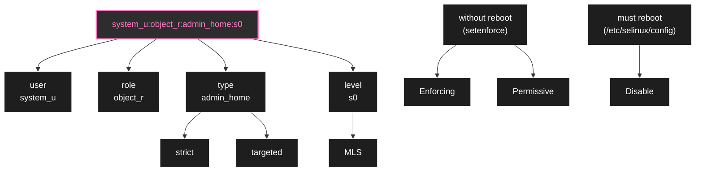
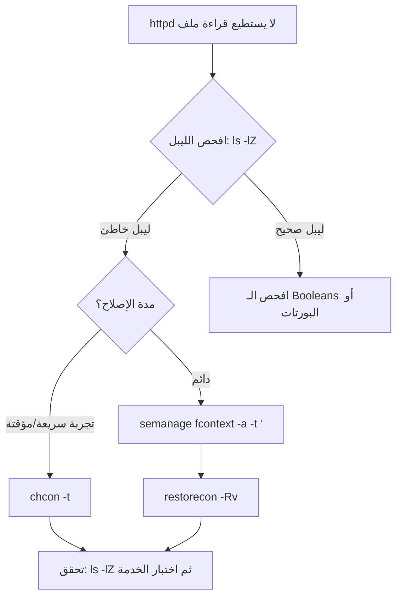
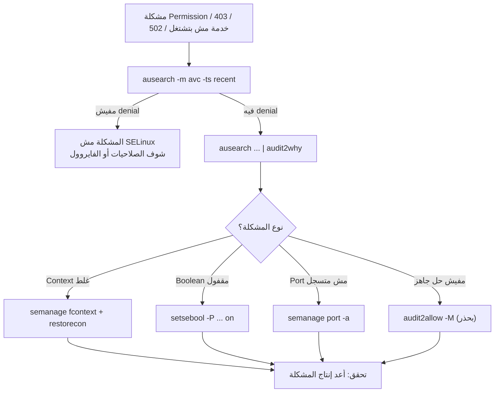

# SELinux — دليل عملي

> [!info] عن هذه الملاحظة
> تطبيق عملي على SELinux من جلسة حقيقية: فهم الـ security context، التبديل بين الـ modes، إصلاح labels الملفات (chcon مقابل semanage+restorecon)، الـ booleans، تغيير بورت خدمة، وقراءة logs الـ denial، بالإضافة إلى سيناريوهات شائعة في شغل الـ SysAdmin والتعامل مع Containers.
> ==جديد هذه النسخة==: نواتج الأوامر الفعلية (Outputs) من اللوج الخام مزروعة داخل الأقسام كأمثلة قابلة للطي.
> ذات صلة: [[Linux]] • [[Cgroup Notes]]



![[Selinux.excalidraw]]

## الفهرس
- [[#1) الـ Security Context وأوامر الفحص]]
- [[#2) أوضاع SELinux (Modes)]]
- [[#3) تغيير الـ Labels: chcon مؤقتًا وsemanage+restorecon دائمًا]]
- [[#4) الـ Booleans]]
- [[#5) تغيير بورت خدمة (مثال SSH)]]
- [[#6) اللوجات واستكشاف الـ Denials]]
- [[#7) سيناريوهات عملية شائعة في شغل الـ SysAdmin]]
- [[#8) SELinux مع Containers (Podman / Docker)]]
- [[#9) مرجع سريع للأوامر]]

---

## 1) الـ Security Context وأوامر الفحص

### أوامر عرض الـ context
```bash
id -Z            # الـ context الخاص بالمستخدم الحالي
ps aux -Z        # الـ context للعمليات (تُكتب أيضًا ps auxZ)
ps -Z
ls -lZ           # الـ context للملفات والمجلدات
ls -Zd /path     # للمجلد نفسه
netstat -Z       # الـ context للاتصالات/المنافذ
matchpathcon /path   # يعرض الليبل المتوقع حسب السياسة
```

> [!example]- Output: شكل ناتج `ls -lZ`
> ```
> $ ls -lZ /var/www/html
> -rw-r--r--. 1 ansible ansible unconfined_u:object_r:user_home_t:s0         54 May  8 15:00 index.html
> drwxr-xr-x. 2 root    root    unconfined_u:object_r:httpd_sys_content_t:s0 20 May  1 19:39 pub
> ```
> العمود قبل التاريخ هو الـ context بصيغة `user:role:type:level` — سيُحلَّل كاملًا في القسم 3.

### تشريح الـ context
مثال: `system_u:object_r:admin_home:s0`

| الجزء | المثال | المعنى |
| --- | --- | --- |
| User | `system_u` | نوع مستخدم SELinux |
| Role | `object_r` | نوع الدور |
| Type | `admin_home` | ==النوع== — أهم جزء في قرارات المنع/السماح |
| Level | `s0` | MLS (Multi Level Security) / MCS (Multi Category Security) |

> [!tip] النجمة هي الـ Type
> أغلب قرارات SELinux (Type Enforcement) تُبنى على الجزء الثالث؛ لذلك كل أوامر الإصلاح أدناه تدور حول `-t <type>`.

---

## 2) أوضاع SELinux (Modes)

| الوضع | السلوك | متى يُستخدم |
| --- | --- | --- |
| ==Enforcing== | يسجّل ==ويحمي== (يفرض السياسة) | التشغيل الطبيعي |
| ==Permissive== | يسجّل ==فقط== بدون منع | استكشاف الأخطاء |
| ==Disabled== | معطّل تمامًا | غير مستحسن |

> [!note] متى تحتاج Reboot؟
> - التبديل Enforcing ↔ Permissive: ==لا يحتاج== إعادة تشغيل (`setenforce 0/1`).
> - التعطيل الكامل، أو الخروج من Disabled إلى Enforcing/Permissive: ==يحتاج== إعادة تشغيل.

### ملف الإعدادات
```bash
ls -l /etc/sysconfig/    # في النسخ القديمة: symlink باسم selinux → ../selinux/config
vim /etc/selinux/config
```
```ini
# SELINUX= can take one of these three values:
#     enforcing - SELinux security policy is enforced.
#     permissive - SELinux prints warnings instead of enforcing.
#     disabled - No SELinux policy is loaded.
SELINUX=enforcing
```

> [!example]- Output: الـ symlink في النسخ القديمة
> ```
> lrwxrwxrwx. 1 root root   17 Apr 23 00:26 selinux -> ../selinux/config
> ```

### الفحص والتبديل أثناء التشغيل
```bash
getenforce      # Enforcing
sestatus        # معلومات مفصلة
setenforce 0
getenforce      # Permissive
setenforce 1
```

> [!example]- Output: التبديل بين الوضعين بدون reboot
> ```
> getenforce
> Enforcing
> setenforce 0
> getenforce
> Permissive
> setenforce 1
> ```

---

## 3) تغيير الـ Labels: chcon مؤقتًا وsemanage+restorecon دائمًا

### 3.1 تغيير مؤقت بـ chcon
```bash
chcon -t test_t /var/www/index.html
ll -Z /var/www/index.html
chcon -t httpd_sys_content_t /var/www/html/index.html
```

> [!bug] خطأ وارد في اللوج
> ```
> chcon -t httpd_syst /var/www/html/index.html
> chcon: failed to change context of ...: invalid argument
> ```
> النوع `httpd_syst` ==غير موجود== في السياسة → invalid argument. الأنواع الصحيحة مثلًا: `httpd_sys_content_t` (قراءة فقط) أو `httpd_sys_rw_content_t` (قراءة/كتابة).

> [!warning] chcon تعديل ==مؤقت==
> أي `restorecon` أو إعادة وسم لاحقًا تمحوه. للتغيير الدائم استخدم semanage fcontext + restorecon (التالي).

### 3.2 قاعدة mv مقابل cp
> [!failure] لماذا حمل index.html ليبل خاطئًا؟
> لأن الملف نُقل بـ ==mv==: الأمر mv يحتفظ بالـ metadata (ومنهما الليبل `user_home_t`) كما هي، بينما ==cp== يرث الليبل الافتراضي لمجلد الوجهة.
> ```
> sudo ls -lZ /var/www/html
> -rw-r--r--. 1 ansible ansible unconfined_u:object_r:user_home_t:s0         54 May  8 15:00 index.html
> drwxr-xr-x. 2 root    root    unconfined_u:object_r:httpd_sys_content_t:s0 20 May  1 19:39 pub
> ```
> القاعدة: عند نقل ملفات إلى مسار تخدمه سياسة SELinux استخدم `cp` (أو mv ثم restorecon).

### 3.3 الإصلاح الدائم: semanage fcontext + restorecon
```bash
# 1) اعرض قواعد الليبل الافتراضية للمسار
sudo semanage fcontext -l | grep /var/www/html
sudo semanage fcontext -l | grep httpd_sys_rw_content_t
# 2) أضف قاعدة دائمة جديدة
sudo semanage fcontext -a -t httpd_sys_rw_content_t '/var/www/html(/.*)?'
# 3) طبّق القاعدة على الملفات الموجودة فعليًا
sudo restorecon -Rvv /var/www/html/
# 4) تحقق
sudo ls -lZ /var/www/html/
```

> [!example]- Output 1: القواعد الافتراضية قبل الإضافة (`semanage fcontext -l | grep /var/www/html`)
> ```
> /var/www/html(/.*)?/sites/default/files(/.*)?      all files          system_u:object_r:httpd_sys_rw_content_t:s0
> /var/www/html(/.*)?/sites/default/settings\.php    regular file       system_u:object_r:httpd_sys_rw_content_t:s0
> /var/www/html(/.*)?/uploads(/.*)?                  all files          system_u:object_r:httpd_sys_rw_content_t:s0
> /var/www/html(/.*)?/wp-content(/.*)?               all files          system_u:object_r:httpd_sys_rw_content_t:s0
> /var/www/html(/.*)?/wp_backups(/.*)?               all files          system_u:object_r:httpd_sys_rw_content_t:s0
> /var/www/html/[^/]*/cgi-bin(/.*)?                  all files          system_u:object_r:httpd_sys_script_exec_t:s0
> /var/www/html/cgi/munin.*                          all files          system_u:object_r:munin_script_exec_t:s0
> /var/www/html/configuration\.php                   all files          system_u:object_r:httpd_sys_rw_content_t:s0
> /var/www/html/munin(/.*)?                          all files          system_u:object_r:munin_content_t:s0
> /var/www/html/munin/cgi(/.*)?                      all files          system_u:object_r:munin_script_exec_t:s0
> /var/www/html/nextcloud/data(/.*)?                 all files          system_u:object_r:httpd_sys_rw_content_t:s0
> /var/www/html/owncloud/data(/.*)?                  all files          system_u:object_r:httpd_sys_rw_content_t:s0
> ```

> [!example]- Output 2: بعد `semanage fcontext -a` ==وقبل== restorecon — الليبلات لم تتغير!
> ```
> sudo ls -lZ /var/www/html/
> -rw-r--r--. 1 ansible ansible unconfined_u:object_r:user_home_t:s0         54 May  8 15:00 index.html
> drwxr-xr-x. 2 root    root    unconfined_u:object_r:httpd_sys_content_t:s0 20 May  1 19:39 pub
> ```

> [!tip] درس مهم من الـ Output 2
> `semanage fcontext -a` يعدّل ==السياسة فقط== ولا يلمس الملفات الموجودة؛ لذلك الليبلات بقيت كما هي حتى نفّذنا `restorecon -Rvv` الذي طبّق القاعدة الجديدة على الأرض.

> [!example]- Output 3: النتيجة بعد `restorecon -Rvv /var/www/html/`
> ```
> total 4
> -rw-r--r--. 1 ansible ansible unconfined_u:object_r:httpd_sys_rw_content_t:s0 54 May  8 15:00 index.html
> drwxr-xr-x. 2 root    root    unconfined_u:object_r:httpd_sys_rw_content_t:s0 20 May  1 19:39 pub
> ```

### إرجاع ملف إلى ليبله الافتراضي
```bash
restorecon -R /var/www/html/index.html    # يعود إلى httpd_sys_content_t الافتراضي
ll -Z /var/www/index.html
```

### أنواع Context شائعة ومهمة
| Type | استخدامه |
| --- | --- |
| `httpd_sys_content_t` | ملفات ويب للقراءة فقط |
| `httpd_sys_rw_content_t` | مجلدات uploads / cache قابلة للكتابة |
| `httpd_sys_script_exec_t` | سكربتات CGI/PHP قابلة للتنفيذ |
| `mysqld_db_t` / `postgresql_db_t` | مجلدات بيانات قواعد البيانات |
| `bin_t` | ملفات تنفيذية عامة |
| `var_log_t` | ملفات اللوجات |
| `container_file_t` | ملفات تُستخدم داخل Containers |

### خريطة قرار إصلاح الليبل


---

## 4) الـ Booleans

```bash
getsebool -a                          # كل الـ booleans الحالية
sudo semanage boolean -l              # قائمة مفصلة بالوصف
sudo setsebool zabbix_run_sudo on     # تفعيل ==مؤقت== (current فقط)
sudo setsebool -P zabbix_run_sudo on  # تفعيل ==دائم== (-P permanent)
getsebool zabbix_run_sudo             # → on
```

> [!example]- Output: عينة من `semanage boolean -l` قبل التفعيل
> ```
> zabbix_can_network             (off  ,  off)  Allow zabbix to can network
> zabbix_run_sudo                (off  ,  off)  Allow zabbix to run sudo
> zarafa_setrlimit               (off  ,  off)  Allow zarafa to setrlimit
> zebra_write_config             (off  ,  off)  Allow zebra to write config
> zoneminder_anon_write          (off  ,  off)  Allow zoneminder to anon write
> ```

> [!example]- Output: التسلسل كاملًا (مؤقت ثم دائم)
> ```
> sudo setsebool zabbix_run_sudo on
> sudo semanage boolean -l | grep zabbix_run_sudo
> zabbix_run_sudo                (on   ,  off)  Allow zabbix to run sudo
> sudo setsebool -P zabbix_run_sudo on
> getsebool zabbix_run_sudo
> zabbix_run_sudo --> on
> ```
> لاحظ السطر `(on , off)`: مفعّل حاليًا لكن غير دائم → لذلك احتجنا `-P`.

### أهم Booleans في شغل الـ SysAdmin
| Boolean | يعمل إيه | متى تستخدمه |
| --- | --- | --- |
| `httpd_can_network_connect` | يسمح للويب يتصل بأي بورت TCP | Reverse proxy / الاتصال بخدمات تانية |
| `httpd_can_network_connect_db` | يسمح للويب يتصل بقواعد البيانات | PHP/Python apps + MySQL/PostgreSQL |
| `httpd_can_sendmail` | يسمح للتطبيقات تبعت إيميل | فورمات اتصل بنا / إشعارات |
| `httpd_use_nfs` / `httpd_use_cifs` | يسمح بقراءة محتوى من NFS أو Samba | لما الويب بيخدم ملفات من شير |
| `httpd_enable_homedirs` | يسمح بخدمة ملفات من home directories | `~user/public_html` |
| `httpd_unified` | يخفف القيود بين أنواع محتوى الويب | تطبيقات معقدة أحيانًا |
| `samba_export_all_rw` | يسمح لـ Samba بالتصدير بكتابة | شيرات قابلة للكتابة |
| `virt_use_nfs` / `virt_use_samba` | يسمح للـ VMs تستخدم NFS/Samba | بيئات virtualization |

> [!tip] نصيحة ذهبية
> مش لازم تفتح `httpd_can_network_connect` دايمًا. أحيانًا الأفضل إنك تسجّل البورت المحدد بـ `semanage port` بدل ما تفتح الشبكة كلها. ده أضيق وأأمن.

---

## 5) تغيير بورت خدمة (مثال SSH)

```bash
sudo semanage port -l | grep ssh
# ssh_port_t    tcp    22
semanage port -a -t ssh_port_t -p tcp 2222
# ValueError: SELinux policy is not managed or store cannot be accessed.  ← بدون sudo!
sudo semanage port -a -t ssh_port_t -p tcp 2222
sudo semanage port -l | grep ssh
# ssh_port_t    tcp    2222, 22
```

> [!example]- Output: قبل الإضافة وبعدها (مع خطأ الـ ValueError)
> ```
> sudo semanage port -l | grep ssh
> ssh_port_t                     tcp      22
> semanage port -a -t ssh_port_t -p tcp 2222
> ValueError: SELinux policy is not managed or store cannot be accessed.
> sudo semanage port -a -t ssh_port_t -p tcp 2222
> sudo semanage port -l | grep ssh
> ssh_port_t                     tcp      2222, 22
> ```

> [!bug] درس اللوج
> أوامر `semanage` التعديلية (port/fcontext/boolean) تحتاج ==sudo==؛ بدونها تظهر ValueError الخاصة بالـ policy store.

ثم في إعدادات الخدمة نفسها:
```bash
# /etc/ssh/sshd_config
Port 2222
```
واختبر:
```bash
ssh user@192.x.x.x -p 2222
```

### أمثلة أخرى شائعة
```bash
# HTTP على 8080
sudo semanage port -a -t http_port_t -p tcp 8080
# PostgreSQL على 5433
sudo semanage port -a -t postgresql_port_t -p tcp 5433
```

---

## 6) اللوجات واستكشاف الـ Denials

### سير العمل المنهجي (Workflow)


### أوامر التشخيص الأساسية
```bash
# البحث عن denials
sudo ausearch -m avc -ts recent
sudo ausearch -m avc -ts recent -c httpd     # خاص بخدمة معينة
sudo ausearch -m avc -ts today -i            # تفسير أسهل
# فهم السبب
sudo ausearch -m avc -ts recent | audit2why
sealert -a /var/log/audit/audit.log          # يحتاج setroubleshoot-server
# قراءة اللوجات
sudo tail -f /var/log/audit/audit.log
sudo tail -f /var/log/messages
sudo cat /var/log/messages | grep sealert
sealert -l e2d258ec-2d77-4e0e-a4f0-b930210b4e5b   # تفاصيل denial معيّن
```

> [!example]- Output: رسالة denial حقيقية من `/var/log/messages`
> ```
> May  8 15:08:01 control setroubleshoot[14809]: SELinux is preventing /usr/sbin/httpd
> from read access on the file index.html.
> For complete SELinux messages run: sealert -l e2d258ec-2d77-4e0e-a4f0-b930210b4e5b
> ```
> المسار الصحيح للتعامل: انسخ الـ ID وشغّل `sealert -l <id>` ليقترح لك الحل (غالبًا restorecon أو semanage fcontext أو boolean).

> [!warning] عن audit2allow
> استخدمه فقط لما تكون متأكد إن السلوك مطلوب ومفيش boolean أو context يحل المشكلة. متولدش modules عشوائية.
> ```bash
> # إنشاء module من denials برنامج معين
> ausearch -m avc -c myapp -ts recent | audit2allow -M myapp_local
> semodule -i myapp_local.pp
> semodule -l | grep myapp_local
> ```

---

## 7) سيناريوهات عملية شائعة في شغل الـ SysAdmin

> [!abstract] الهدف
> معظم مشاكل SELinux اللي بتقابلها يوميًا مش "bug"، دي سياسة أمان شغالة. الحل مش تعطيلها، الحل إنك تفهم السبب وتعدّل الـ context أو الـ boolean أو الـ port بشكل صحيح.

### السيناريو 1: الويب بيرجع 403 بعد نقل الملفات
السبب: الملفات اتاخدت context غلط (`default_t` أو `user_home_t`).
```bash
semanage fcontext -a -t httpd_sys_content_t "/srv/mysite(/.*)?"
semanage fcontext -a -t httpd_sys_rw_content_t "/srv/mysite/uploads(/.*)?"
restorecon -Rv /srv/mysite
```

### السيناريو 2: التطبيق مش بيقدر يتصل بقاعدة البيانات
السبب: Boolean مقفول.
```bash
setsebool -P httpd_can_network_connect_db on
# أو بشكل أوسع:
setsebool -P httpd_can_network_connect on
```

### السيناريو 3: الخدمة مش بتشتغل على بورت مخصص
السبب: البورت مش متسجل في SELinux.
```bash
semanage port -a -t ssh_port_t -p tcp 2222
semanage port -a -t http_port_t -p tcp 8080
semanage port -a -t postgresql_port_t -p tcp 5433
```

### السيناريو 4: نقل مجلد بيانات قاعدة البيانات
```bash
systemctl stop mariadb
semanage fcontext -a -t mysqld_db_t "/data/mysql(/.*)?"
restorecon -Rv /data/mysql
systemctl start mariadb
```

### السيناريو 5: مفاتيح SSH مش شغالة بعد التعديل
```bash
restorecon -Rv ~/.ssh
```

---

## 8) SELinux مع Containers (Podman / Docker)

> [!tip] الفكرة الأساسية
> لما بتعمل bind mount، SELinux بيمنع الـ container من الوصول للملفات إلا لو عملت label صح. الحل الجاهز: `:Z` أو `:z`.

| الخيار | المعنى | متى تستخدمه |
| --- | --- | --- |
| `:Z` (حرف كبير) | Private label — خاص بالـ container ده بس | مجلد بيانات خاص (DB data, app data) |
| `:z` (حرف صغير) | Shared label — أي container يقدر يوصل | لما أكتر من container محتاجين نفس المجلد |

### أمثلة
```bash
# مجلد خاص بـ Container واحد (الأكثر أمانًا)
podman run -d -v /srv/appdata:/data:Z --name myapp myimage
# مجلد مشترك بين أكثر من Container
podman run -d -v /srv/shared:/shared:z --name app1 myimage1
podman run -d -v /srv/shared:/shared:z --name app2 myimage2
# الطريقة اليدوية
semanage fcontext -a -t container_file_t "/srv/appdata(/.*)?"
restorecon -Rv /srv/appdata
```

> [!danger] تحذيرات مهمة
> - متستخدمش `:Z` أو `:z` على مجلدات النظام زي `/etc` أو `/home` أو `/var/log` — هتبوظ النظام.
> - `:Z` بيعمل relabel كامل، فلو المجلد كبير ممكن ياخد وقت.
> - لو استخدمت `:Z` وبعدين حاولت تستخدم نفس المجلد مع container تاني، هيفشل (وده مقصود).

---

## 9) مرجع سريع للأوامر

| الهدف | الأمر |
| --- | --- |
| عرض context للمستخدم/العمليات/الملفات | `id -Z` / `ps aux -Z` / `ls -lZ` |
| الليبل المتوقع لمسار حسب السياسة | `matchpathcon /path` / `ls -Zd /path` |
| الوضع الحالي | `getenforce` / `sestatus` |
| تبديل مؤقت للوضع | `setenforce 0` / `setenforce 1` |
| الوضع بعد الإقلاع | `vim /etc/selinux/config` |
| تغيير ليبل مؤقت | `chcon -t <type> <file>` |
| إضافة قاعدة ليبل دائمة | `semanage fcontext -a -t <type> '<path>'` |
| عرض قواعد الليبل | `semanage fcontext -l` / `semanage fcontext -l -C` |
| تطبيق القواعد على الملفات | `restorecon -Rv <path>` |
| عرض/ضبط boolean | `getsebool -a` / `setsebool [-P] <name> on` |
| عرض/إضافة بورت لنوع | `semanage port -l` / `semanage port -a -t <type> -p tcp <port>` |
| قراءة الـ denials | `ausearch -m avc -ts recent` / `audit2why` / `sealert -l <id>` |
| Containers | `-v /host:/container:Z` أو `:z` |

---

## ملاحظات ذات صلة
- [[Linux]]
- [[Cgroup|Linux Cgroups & Network Namespaces — لاب عملي]]