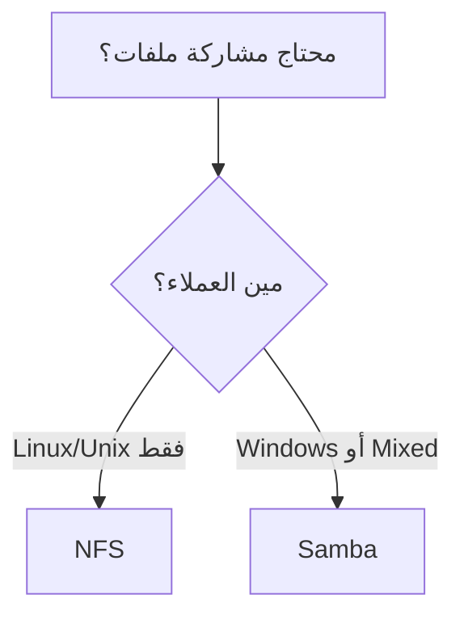

# 🗂️ File Sharing — NFS & Samba

> [!abstract] الهدف
> ملف فهرس (MOC) بيجمع خدمتي مشاركة الملفات ==بدون دمج المحتوى==.
> كل خدمة ملف مستقل: [[Samba]] و [[NFS]] — والمحتوى بيظهر هنا بالـ Embeds.

## 🧭 أختار أنهي خدمة؟

## 📚 الخدمتان

| الخدمة | البروتوكول | المنفذ   | البيئة          | الدليل الكامل              |
| ------ | ---------- | -------- | --------------- | -------------------------- |
| Samba  | SMB/CIFS   | 445/tcp  | Linux + Windows | [[Samba\|🗂️ Samba Guide]] |
| NFS    | RPC-based  | 2049/tcp | Linux/Unix فقط  | [[NFS\|🗂️ NFS Guide]]     |

## 🔄 المقارنة المباشرة

![[NFS#🔄 NFS vs Samba — Quick Comparison]]

## ⚡ وصول سريع

> [!example]- Samba — أهم الأقسام
> - [[Samba#📝 Step 6 — smb.conf Configuration|إعداد smb.conf]]
> - [[Samba#🛡️ Step 12 — Credentials File (Security)|ملف Credentials الآمن]]
> - [[Samba#📋 Commands Cheat Sheet|Cheat Sheet]]
> - [[Samba#❓ Interview Questions|أسئلة المقابلة]]

> [!example]- NFS — أهم الأقسام
> - [[NFS#📝 Step 4 — Configure /etc/exports|إعداد exports]]
> - [[NFS#🔓 exports Options Explained|خيارات exports]]
> - [[NFS#📋 Commands Cheat Sheet|Cheat Sheet]]
> - [[NFS#❓ Interview Questions|أسئلة المقابلة]]

## 🧱 القواعد المشتركة بين الخدمتين

> [!tip] بتتكرر في الملفين — احفظها مرة واحدة
> - الصلاحيات الفعلية = ==الأكثر تقييداً== بين Linux والخدمة
> - `_netdev,nofail` في fstab يحمي الـ boot
> - لا تعطّل SELinux — استخدم `semanage` / `setsebool -P`
> - اختبر قبل الـ reboot: `testparm` / `exportfs -r` + `mount -a`

الأساسيات: [[Samba#🔥 Step 3 — Firewall|Firewalld]] • [[Samba#🔐 Step 7 — SELinux|SELinux]] • [[Samba#⚓ Step 11 — Persistent Mount (fstab)|fstab]] • [[Linux Fundamentals#16. User & Group Management|User Management]] • [[Linux Fundamentals#17. Permissions & Ownership|File Permissions]]

## 📚 Related Notes
- [[Linux]]