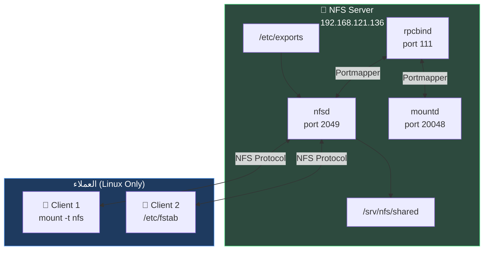
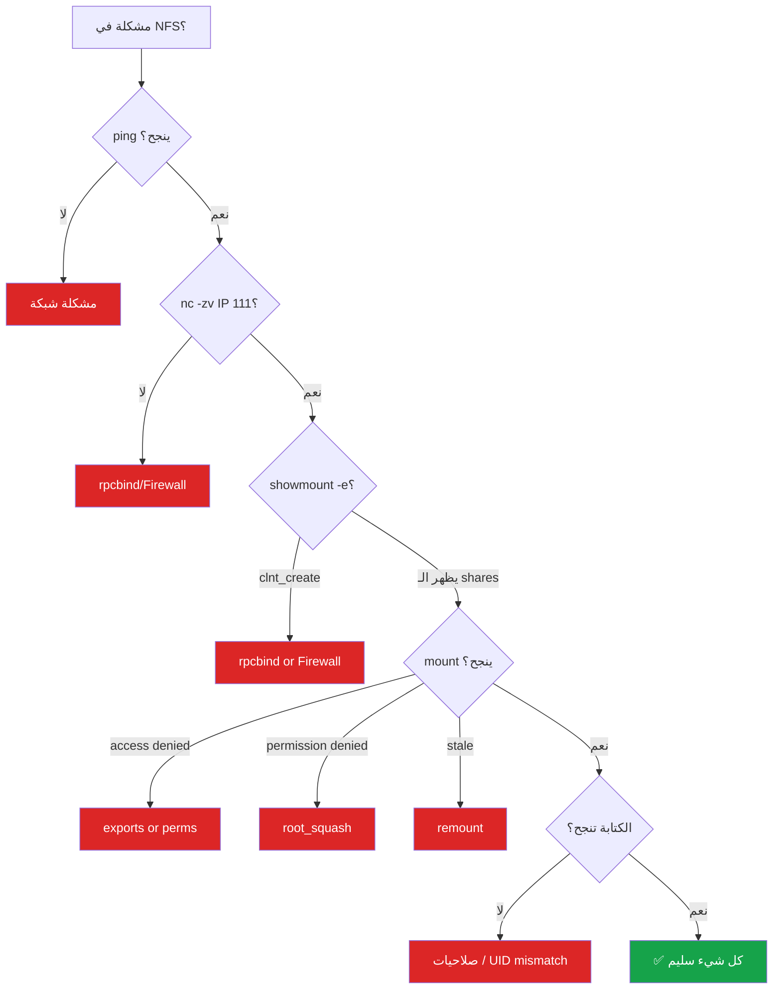

# 🗂️ NFS (Network File System) — Full Configuration Guide

> [!abstract] الخلاصة في سطرين
> **NFS** = بروتوكول ==RPC-based== يتيح مشاركة ==المجلدات والملفات== بين أنظمة **Linux/Unix**.
> المنفذ الرئيسي: `2049/tcp` (nfsd) و `111/tcp` (rpcbind).


---

## 📑 Table of Contents

- [[#🎯 Big Picture|Big Picture]]
- [[#📦 Packages & Services]]
- [[#🔄 NFS vs Samba — Quick Comparison]]
- [[#🛠️ Step 1 — Installation (Server)]]
- [[#⚙️ Step 2 — Enable & Start Services]]
- [[#📁 Step 3 — Create Shared Directory]]
- [[#📝 Step 4 — Configure /etc/exports]]
- [[#🔓 exports Options Explained]]
- [[#🚀 Step 5 — Export & Verify]]
- [[#🔥 Step 6 — Firewall]]
- [[#🔐 Step 7 — SELinux]]
- [[#💻 Step 8 — Client Installation]]
- [[#⚓ Step 9 — Mount the Share]]
- [[#📌 Step 10 — Persistent Mount (fstab)]]
- [[#🧪 Step 11 — Testing & Verification]]
- [[#🚨 Troubleshooting]]
- [[#📋 Commands Cheat Sheet]]
- [[#❓ Interview Questions]]
- [[#🎓 Quick Lab Checklist]]

---

## 🎯 Big Picture



> [!tip]- 3 قواعد ذهبية قبل البدء
> 1. **NFS يعمل بين Linux/Unix فقط** — لو محتاج Windows، استخدم [[Samba]]
> 2. ==`/etc/exports`== هو الملف الوحيد اللي يتحكم في المشاركات
> 3. **`_netdev` إلزامي** في fstab حتى لا يفشل الإقلاع

---

## 📦 Packages & Services

### الحزم المطلوبة

| Package | الوظيفة | المكان |
| :--- | :--- | :---: |
| `nfs-utils` | الأدوات الكاملة (server + client) | Both |
| `rpcbind` | RPC portmapper | Both |

### الخدمات

| Service | الوظيفة | Port | الحالة |
| :--- | :--- | :---: | :---: |
| `nfs-server` | السيرفر الرئيسي (nfsd) | `2049` | ==إلزامية== |
| `rpcbind` | Portmapper للـ RPC | `111` | ==إلزامية== |
| `nfs-mountd` | معالجة طلبات الـ mount | `20048` | ==إلزامية== |
| `nfs-idmapd` | ترجمة الأسماء (NFSv4) | - | اختيارية |
| `nfs-blkmap` | pNFS block layout | - | اختيارية |

---

## 🔄 NFS vs Samba — Quick Comparison

| الميزة | NFS | Samba (SMB/CIFS) |
| :--- | :--- | :--- |
| ==البيئة== | Linux/Unix فقط | Linux + Windows |
| البروتوكول | RPC-based | SMB/CIFS |
| المنفذ الرئيسي | `2049` | `445` |
| الأمان | Kerberos (optional) | Active Directory (optional) |
| الأداء | أسرع بين Linux hosts | أفضل لـ Windows |
| الإعداد | بسيط (ملف واحد) | متوسط (smb.conf) |
| المستخدمون | Unix users | Samba users (قاعدة منفصلة) |

> [!info] متى تختار؟
> - **NFS** لو كل الأجهزة Linux/Unix
> - **Samba** لو عندك Windows أو mixed environment

---

## 🛠️ Step 1 — Installation (Server)

```bash
dnf install nfs-utils -y
```
  

> [!output]- 📤 Output الكامل
> ```output
> Last metadata expiration check: 0:22:13 ago on Sat 12 Apr 2025 11:07:01 PM EET.
> Dependencies resolved.
> =======================================================================================================
>  Package                      Architecture         Version                         Repository            Size
> =======================================================================================================
> Installing:
>  nfs-utils                    x86_64               1:2.5.4-34.el9                  baseos               458 k
>  rpcbind                      x86_64               1.2.6-7.el9                     baseos                58 k
> Installing dependencies:
>  gssproxy                     x86_64               0.8.4-7.el9                     baseos               110 k
>  libev                        x86_64               4.33-6.el9                      baseos                52 k
>  libverto-libev               x86_64               0.3.2-3.el9                     baseos                14 k
>
> Transaction Summary
> =======================================================================================================
> Install  5 Packages
>
> Total download size: 692 k
> Installed size: 1.7 M
> Is this ok [y/N]: y
>
> Installed:
>   gssproxy-0.8.4-7.el9.x86_64          libev-4.33-6.el9.x86_64         libverto-libev-0.3.2-3.el9.x86_64
>   nfs-utils-1:2.5.4-34.el9.x86_64      rpcbind-1.2.6-7.el9.x86_64
> Complete!
> ```

### التحقق

```bash
rpm -q nfs-utils rpcbind
```

```output
nfs-utils-2.5.4-34.el9.x86_64
rpcbind-1.2.6-7.el9.x86_64
```

---

## ⚙️ Step 2 — Enable & Start Services

```bash
systemctl enable --now nfs-server rpcbind nfs-mountd
```

> [!info] ملاحظة
> `enable --now` = `enable` + `start` في أمر واحد.

### التحقق من الحالة

```bash
systemctl status nfs-server
```

  

> [!output]- 📤 Output
> ```output
> ● nfs-server.service - NFS server and services
>      Loaded: loaded (/usr/lib/systemd/system/nfs-server.service; enabled; preset: disabled)
>     Drop-In: /run/systemd/generator/nfs-server.service.d
>              └─order-with-mounts.conf
>      Active: active (exited) since Sat 2025-04-12 23:35:53 EET; 2s ago
>        Docs: man:rpc.nfsd(8)
>              man:exportfs(8)
>     Process: 7150 ExecStartPre=/usr/sbin/exportfs -r (code=exited, status=0/SUCCESS)
>     Process: 7151 ExecStart=/usr/sbin/rpc.nfsd (code=exited, status=0/SUCCESS)
>    Main PID: 7173 (code=exited, status=0/SUCCESS)
> ```

### التحقق من rpcbind

```bash
systemctl status rpcbind
```

> [!output]- 📤 Output
> ```output
> ● rpcbind.service - RPC Bind
>      Loaded: loaded (/usr/lib/systemd/system/rpcbind.service; enabled)
>      Active: active (running) since Sat 2025-04-12 23:35:50 EET; 5s ago
> ```

### التأكد من المنافذ

```bash
ss -tlnp | grep -E '2049|111|20048'
```

```output
LISTEN 0  64   0.0.0.0:2049   0.0.0.0:*
LISTEN 0  64      [::]:2049      [::]:*
LISTEN 0  128  0.0.0.0:111    0.0.0.0:*   users:(("rpcbind",pid=7100,fd=5))
LISTEN 0  128     [::]:111       [::]:*   users:(("rpcbind",pid=7100,fd=7))
```

---

## 📁 Step 3 — Create Shared Directory

### الطريقة البسيطة (من Lab)

```bash
mkdir -p /data
```

### الطريقة الاحترافية (FHS Standard)

```bash
mkdir -p /srv/nfs/shared
```

> [!tip] FHS Standard
> `/srv` هو المسار القياسي للبيانات المقدمة من السيرفر (service data).

### ضبط الملكية والصلاحيات

```bash
chown -R nobody:nobody /srv/nfs/shared
chmod 755 /srv/nfs/shared
```

> [!info] لماذا `nobody:nobody`؟
> NFS يستخدم `nobody` كمستخدم افتراضي للـ ==anonymous access==.
> لو عايز مستخدمين محددين، استخدم نفس الـ UID/GID على السيرفر والعميل.

### التحقق

```bash
ls -ld /srv/nfs/shared
```

```output
drwxr-xr-x. 2 nobody nobody 6 Apr 12 23:40 /srv/nfs/shared
```

---

## 📝 Step 4 — Configure /etc/exports

### أخذ نسخة احتياطية

```bash
cp /etc/exports /etc/exports.orig
```

### تحرير الملف

```bash
vim /etc/exports
```

### المحتوى

```exports
# Format: /path/to/share  client(options)
/srv/nfs/shared    192.168.121.0/24(rw,sync,no_root_squash,no_subtree_check)

# مثال من Lab
/data              192.168.121.0/24(rw,no_root_squash)
/OpenStack         192.168.121.149(rw,no_root_squash)
```

> [!warning] تنسيق مهم
> ==**لا تضع مسافة**== بين المسار وقوس الخيارات!
> - ✅ `/data 192.168.121.0/24(rw,sync)` ← صحيح
> - ❌ `/data 192.168.121.0/24 (rw,sync)` ← خطأ (space قبل `(`)

### تحديد العملاء (Client Specification)

| الصيغة | المعنى |
| :--- | :--- |
| `192.168.121.0/24` | كل الشبكة (CIDR) |
| `192.168.121.149` | IP محدد |
| `192.168.121.*` | wildcard |
| `*.example.com` | كل الـ domain |
| `client.example.com` | hostname محدد |
| `*` | ==كل العالم== (خطير!) |

---

## 🔓 exports Options Explained

### الخيارات الأساسية

| الخيار | الوظيفة |
| :--- | :--- |
| `rw` | ==قراءة وكتابة== (Read/Write) |
| `ro` | قراءة فقط (Read Only) |
| `sync` | الكتابة تتم على الـ disk ==قبل الرد== (آمن) |
| `async` | الكتابة في الـ cache (أسرع لكن خطر) |

### خيارات الأمان

| الخيار | الوظيفة |
| :--- | :--- |
| `no_root_squash` | يسمح لـ root على العميل بـ ==root== على السيرفر |
| `root_squash` | (الافتراضي) يحوّل root إلى `nobody` |
| `all_squash` | يحوّل كل المستخدمين إلى `nobody` |
| `anonuid=UID` | UID المستخدم المجهول |
| `anongid=GID` | GID المجموعة المجهولة |

### خيارات الأداء والموثوقية

| الخيار | الوظيفة |
| :--- | :--- |
| `no_subtree_check` | ==يوصى به== — يعطّل فحص الـ subtree (أكثر استقراراً) |
| `subtree_check` | يفحص كل ملف عند الـ access |
| `nohide` | يُظهر الـ mounted subdirs |
| `crossmnt` | يسمح بالوصول للـ mounted filesystems |

### 🎯 المجموعة الموصى بها للإنتاج

```exports
/srv/nfs/shared  192.168.121.0/24(rw,sync,no_root_squash,no_subtree_check)
```

> [!danger] تحذير أمني
> `no_root_squash` ==خطر جداً== لو العميل غير موثوق!
> لو root على العميل اخترق، يبقى root على السيرفر.
> **للإنتاج:** استخدم `root_squash` (الافتراضي).

---

## 🚀 Step 5 — Export & Verify

### تطبيق التغييرات

```bash
exportfs -r
```

> [!info] المعاني
> - `exportfs -r` = re-export (يطبّق التغييرات في `/etc/exports`)
> - `exportfs -a` = export all
> - `exportfs -u` = unexport all
> - `exportfs -v` = verbose (عرض الإعدادات الحالية)

### عرض المشاركات النشطة

```bash
exportfs -v
```

> [!output]- 📤 Output
> ```output
> /data           192.168.121.0/24(rw,sync,wdelay,hide,nocrossmnt,secure,root_squash,no_all_squash,no_subtree_check,secure_locks,acl,no_pnfs,fsid=0,anonuid=65534,anongid=65534,sec=sys,rw,secure,root_squash,no_all_squash)
> ```

### التحقق من العميل

```bash
showmount -e 192.168.121.136
```

> [!output]- 📤 Output
> ```output
> Export list for 192.168.121.136:
> /data 192.168.121.0/24
> 

> [!bug] خطأ شائع
> لو ظهر:
> ```output
> clnt_create: RPC: Unable to receive
> ```
> **الأسباب:**
> 1. الخدمة متوقفة → `systemctl start nfs-server rpcbind`
> 2. Firewall يمنع المنفذ → `firewall-cmd --add-service=nfs`
> 3. SELinux يمنع الوصول → `setsebool -P nfs_export_all_rw on`

---

## 🔥 Step 6 — Firewall

```bash
firewall-cmd --permanent --add-service=nfs
firewall-cmd --permanent --add-service=rpc-bind
firewall-cmd --permanent --add-service=mountd
firewall-cmd --reload
```

```output
success
success
success
success
```

### التحقق

```bash
firewall-cmd --list-all
```

```output
public (active)
  target: default
  services: cockpit dhcpv6-client mountd nfs rpc-bind ssh
  ports:
  forward: yes
```

> [!tip] لماذا 3 خدمات؟
> NFS يستخدم ==3 بروتوكولات مختلفة==:
> - `nfs` = nfsd (2049)
> - `rpc-bind` = portmapper (111)
> - `mountd` = mount daemon (20048)
> لازم تفتح الثلاثة!

---

## 🔐 Step 7 — SELinux

### التحقق من الحالة

```bash
getenforce
```

```output
Enforcing
```

### ❌ الحل السيئ (للاختبار فقط)

```bash
setenforce 0
getenforce
```

```output
Permissive
```

> [!warning] مؤقت فقط
> `setenforce 0` يرجع `Enforcing` بعد الـ reboot.

### ✅ الحل الصحيح (Production-Ready)

```bash
setsebool -P nfs_export_all_ro on
setsebool -P nfs_export_all_rw on
```

### التحقق من الـ Booleans

```bash
getsebool -a | grep nfs
```

```output
nfs_export_all_ro --> on
nfs_export_all_rw --> on
nfsd_anon_write --> off
```

> [!info] `-P` = Permanent
> يبقى بعد الـ reboot.

### 📊 مقارنة الحلول

| الطريقة | دائم؟ | آمن؟ | متى تستخدمها؟ |
| :--- | :---: | :---: | :--- |
| `setenforce 0` | ❌ | ❌ | تشخيص سريع |
| `setsebool -P` | ✅ | ✅ | ==الإنتاج== |
| `chcon` + `restorecon` | ❌ | ✅ | مجلدات خاصة |

---

## 💻 Step 8 — Client Installation

```bash
dnf install nfs-utils -y
```

```output
Installed:
  nfs-utils-1:2.5.4-34.el9.x86_64
  rpcbind-1.2.6-7.el9.x86_64
Complete!
```

### التحقق من الوصول للمشاركات

```bash
showmount -e 192.168.121.136
```

```output
Export list for 192.168.121.136:
/data 192.168.121.0/24
```

> [!bug] لو فشل `showmount`
> 1. تأكد إن السيرفر شغال: `ping 192.168.121.136`
> 2. تأكد من Firewall: `nc -zv 192.168.121.136 111`
> 3. تأكد إن الـ client في الـ subnet المسموح

---

## ⚓ Step 9 — Mount the Share

### إنشاء نقطة التركيب

```bash
mkdir -p /mnt/nfs_share
```

### التركيب اليدوي

```bash
mount -t nfs 192.168.121.136:/data /mnt
```

أو بالنسخة (NFSv4):

```bash
mount -t nfs4 192.168.121.136:/data /mnt/nfs_share
```

### التحقق

```bash
df -h -t nfs
```

```output
Filesystem                    Size  Used Avail Use% Mounted on
192.168.121.136:/data          20G  2.1G   18G  11% /mnt/nfs_share
```

```bash
mount | grep nfs
```

```output
192.168.121.136:/data on /mnt/nfs_share type nfs4 (rw,relatime,vers=4.2,rsize=1048576,wsize=1048576,...)
```

### اختبار الكتابة

```bash
touch /mnt/nfs_share/test-from-client.txt
ls -l /mnt/nfs_share/
```

```output
-rw-r--r--. 1 nobody nobody 0 Apr 12 23:45 test-from-client.txt
```

### 📋 خيارات mount المفيدة

| الخيار | الوظيفة |
| :--- | :--- |
| `rw` / `ro` | قراءة وكتابة / قراءة فقط |
| `vers=4.2` | إصدار البروتوكول |
| `rsize=` / `wsize=` | حجم الـ buffer (بالـ bytes) |
| `hard` / `soft` | سلوك عند فشل السيرفر |
| `intr` | السماح بمقاطعة الـ mount |
| `timeo=600` | timeout بالـ deciseconds |
| `retrans=2` | عدد المحاولات |
| `_netdev` | ==إلزامي== (انتظر الشبكة) |
| `nofail` | لا توقف الـ boot |
| `noexec` | منع تنفيذ binaries |
| `nosuid` | منع SUID |

### ⚡ Mount للأداء العالي

```bash
mount -t nfs -o rsize=1048576,wsize=1048576,vers=4.2 \
  192.168.121.136:/data /mnt/nfs_share
```

---

## 📌 Step 10 — Persistent Mount (fstab)

### تحرير fstab

```bash
vim /etc/fstab
```

### المحتوى

```fstab
# NFS Mounts
192.168.121.136:/data        /mnt/nfs_share  nfs  defaults,_netdev,nofail  0  0
192.168.121.149:/OpenStack   /mnt            nfs  defaults,_netdev        0  0
```

### تفكيك السطر

```
192.168.121.136:/data  /mnt/nfs_share  nfs  defaults,_netdev,nofail  0  0
└─────────┬──────────┘  └──────┬─────┘  └─┬┘  └──────────┬──────────┘ │  │
      Source              Mount Point    Type        Options        dump fsck
```

| العمود | المعنى |
| :---: | :--- |
| 1 | `IP:/path` — السيرفر والمسار |
| 2 | نقطة التركيب المحلية |
| 3 | `nfs` (النوع) |
| 4 | الخيارات |
| 5 | `0` = لا backup |
| 6 | `0` = ==لا تفحص== (ضروري للشبكة) |

### 🎯 أهمية `_netdev`

> [!important] نقطة جوهرية
> `_netdev` يخبر النظام أن الجهاز ==يعتمد على الشبكة==.
> بدونه، النظام يحاول التركيب ==قبل== جاهزية الشبكة → **يفشل الإقلاع!**

### اختبار fstab

```bash
umount /mnt/nfs_share
systemctl daemon-reload
mount -a
df -h -t nfs
```

> [!danger] تحذير قبل الـ reboot
> **لازم** `mount -a` ينجح — سطر خاطئ في fstab قد يمنع النظام من الإقلاع!

### التركيب باستخدام الاسم (اختياري)

```bash
mount /mnt/nfs_share
```

> [!tip] لما يكون السطر موجود في fstab، تكفي نقطة التركيب فقط.

---

## 🧪 Step 11 — Testing & Verification

### على العميل

```bash
# عرض التركيبات النشطة
df -h -t nfs

# عرض كل التفاصيل
mount | grep nfs

# استكشاف السيرفر
showmount -e SERVER_IP

# عرض حالة RPC
rpcinfo -p SERVER_IP
```

> [!output]- 📤 Output لـ rpcinfo
> ```output
>    program vers proto   port  service
>     100000    4   tcp    111  portmapper
>     100000    3   tcp    111  portmapper
>     100000    2   tcp    111  portmapper
>     100000    4   udp    111  portmapper
>     100005    1   udp  20048  mountd
>     100005    2   udp  20048  mountd
>     100005    3   udp  20048  mountd
>     100005    1   tcp  20048  mountd
>     100003    3   tcp   2049  nfs
>     100003    4   tcp   2049  nfs
> ```


### مراقبة التغييرات في الوقت الفعلي

```bash
watch -n 1 'ls -la /mnt/nfs_share/'
```

> [!tip] استخدام `watch`
> `watch` ينفذ الأمر كل ثانية — مفيد لاختبار التزامن بين السيرفر والعميل.

### على السيرفر

```bash
# عرض العملاء المتصلين
showmount -a

# عرض الإحصائيات
nfsstat -s

# عرض الـ exports
exportfs -v

# عرض العمليات النشطة
ss -tnp | grep 2049
```

### اختبار التزامن (Sync Test)

**على العميل:**
```bash
echo "test sync" > /mnt/nfs_share/sync_test.txt
```

**على السيرفر (فوري):**
```bash
cat /srv/nfs/shared/sync_test.txt
```

```output
test sync
```

> [!success] ملاحظة
> لو استخدمت `sync` في exports، التغييرات ==فورية==.
> لو استخدمت `async`، ممكن تأخير بسيط.

---

## 🚨 Troubleshooting

### ❌ المشكلة 1: `clnt_create: RPC: Unable to receive`

```output
[root@client ~]# showmount -e 192.168.121.136
clnt_create: RPC: Unable to receive
```

**خطوات التشخيص:**

```bash
# 1. هل السيرفر شغال؟
ping 192.168.121.136

# 2. هل المنفذ 111 مفتوح؟
nc -zv 192.168.121.136 111

# 3. على السيرفر: الخدمات شغالة؟
systemctl status nfs-server rpcbind

# 4. على السيرفر: Firewall؟
firewall-cmd --list-services

# 5. على السيرفر: SELinux؟
getenforce
```

### ❌ المشكلة 2: `mount.nfs: access denied by server`

**الأسباب:**

| السبب | الحل |
| :--- | :--- |
| الـ IP غير مسموح في exports | عدّل `/etc/exports` + `exportfs -r` |
| Firewall يمنع | `firewall-cmd --add-service=nfs` |
| SELinux | `setsebool -P nfs_export_all_rw on` |
| صلاحيات المجلد | `chmod 755 /srv/nfs/shared` |

### ❌ المشكلة 3: `Permission denied` عند الكتابة

**السبب 1:** `root_squash` مفعل (الافتراضي)

**الحل:** استخدم `no_root_squash` في exports (للاختبار فقط):
```exports
/data 192.168.121.0/24(rw,sync,no_root_squash)
```

**السبب 2:** صلاحيات Linux على السيرفر:
```bash
ls -ld /srv/nfs/shared
chmod 777 /srv/nfs/shared   # للاختبار فقط!
```

**السبب 3:** UID/GID غير متطابق بين العميل والسيرفر:
```bash
# على السيرفر
id -u
# على العميل
id -u
# لازم نفس الـ UID!
```

### ❌ المشكلة 4: `No such file or directory` في exportfs

```output
[root@server ~]# exportfs -r
exportfs: Failed to stat /data: No such file or directory
```

**الحل:** أنشئ المجلد أولاً:
```bash
mkdir -p /data
exportfs -r
```

### ❌ المشكلة 5: النظام لا يقلع بعد تعديل fstab

**السبب:** الشبكة غير جاهزة وقت الـ mount.

**الحل:** أضف `_netdev,nofail`:
```fstab
192.168.121.136:/data /mnt nfs defaults,_netdev,nofail,x-systemd.automount 0 0
```

**في الطوارئ (Emergency mode):**
```bash
mount -o remount,rw /
vim /etc/fstab      # علّق السطر بـ #
systemctl reboot
```

### ❌ المشكلة 6: `stale file handle`

**السبب:** المجلد تم حذفه أو إعادة تصديره.

**الحل:**
```bash
umount /mnt/nfs_share
mount -a
```

### 🧭 خريطة التشخيص



---

## 📋 Commands Cheat Sheet

### التثبيت والخدمات

| الغرض | الأمر |
| :--- | :--- |
| تثبيت Server/Client | `dnf install nfs-utils -y` |
| تفعيل الخدمات | `systemctl enable --now nfs-server rpcbind nfs-mountd` |
| إعادة تشغيل | `systemctl restart nfs-server` |
| الحالة | `systemctl status nfs-server` |
| المنافذ | `ss -tlnp \| grep -E '2049\|111'` |

### إدارة الـ Exports

| الغرض | الأمر |
| :--- | :--- |
| تطبيق التغييرات | `exportfs -r` |
| عرض الصادرات | `exportfs -v` |
| تصدير الكل | `exportfs -a` |
| إلغاء الكل | `exportfs -u` |
| عرض العملاء | `showmount -a` |
| عرض الـ shares | `showmount -e IP` |
| معلومات RPC | `rpcinfo -p IP` |

### Client — التركيب

| الغرض | الأمر |
| :--- | :--- |
| تركيب يدوي | `mount -t nfs SERVER:/path /mnt` |
| تركيب NFSv4 | `mount -t nfs4 SERVER:/path /mnt` |
| تركيب fstab | `mount -a` |
| تركيب participation واحدة | `mount /mnt/nfs_share` |
| فك التركيب | `umount /mnt/nfs_share` |
| فك بالقوة | `umount -l /mnt/nfs_share` (lazy) |
| عرض المركبة | `df -h -t nfs` |
| تفاصيل التركيب | `mount \| grep nfs` |

### Firewall & SELinux

| الغرض | الأمر |
| :--- | :--- |
| فتح NFS | `firewall-cmd --permanent --add-service=nfs` |
| فتح rpc-bind | `firewall-cmd --permanent --add-service=rpc-bind` |
| فتح mountd | `firewall-cmd --permanent --add-service=mountd` |
| تطبيق | `firewall-cmd --reload` |
| عرض القواعد | `firewall-cmd --list-all` |
| حالة SELinux | `getenforce` |
| تعطيل مؤقت | `setenforce 0` |
| Booleans | `getsebool -a \| grep nfs` |
| تفعيل RW | `setsebool -P nfs_export_all_rw on` |
| تفعيل RO | `setsebool -P nfs_export_all_ro on` |

### الاختبار والمراقبة

| الغرض | الأمر |
| :--- | :--- |
| مراقبة مباشرة | `watch -n 1 'ls /mnt'` |
| إحصائيات | `nfsstat -s` |
| عرض الاتصالات | `ss -tnp \| grep 2049` |
| فحص المنافذ | `nc -zv SERVER 2049` |

---

## ❓ Interview Questions

> [!question]- 1.ما هو NFS وما البروتوكول الذي يعتمد عليه؟
> NFS (Network File System) هو بروتوكول ==RPC-based== لمشاركة الملفات بين أنظمة Unix/Linux.
> المنفذ الرئيسي ==2049/tcp==.

> [!question]- 2.ما الفرق بين NFS و Samba؟
> - **NFS** = Linux/Unix فقط، أسرع، أبسط
> - **Samba** = mixed environment (Linux + Windows)، يدعم Active Directory
> - ==اختر NFS== لو كل العملاء Linux

> [!question]- 3.ما الفرق بين `sync` و `async`؟
> - `sync` = الكتابة تتم على الـ disk ==قبل الرد== (آمن، أبطأ)
> - `async` = الكتابة في الـ cache (أسرع، خطر فقدان بيانات)
> - ==استخدم sync== للإنتاج

> [!question]- 4.ما وظيفة `root_squash` و `no_root_squash`؟
> - `root_squash` (الافتراضي) = يحوّل root إلى `nobody` (أمان)
> - `no_root_squash` = يسمح لـ root على العميل بـ root على السيرفر (خطر)
> - ==الإنتاج= root_squash==

> [!question]- 5.لماذا `_netdev` ضروري في fstab؟
> يخبر النظام أن الجهاز ==يعتمد على الشبكة==، فيؤجل التركيب حتى تجهز الشبكة.
> بدونه قد ==يفشل الإقلاع==!

> [!question]- 6.ما الفرق بين `exportfs -r` و `exportfs -a`؟
> - `-r` = re-export (يطبّق التغييرات في `/etc/exports`)
> - `-a` = export all (يصدّر كل ما في `/etc/exports`)
> - ==الأكثر استخدامًا: `-r`==

> [!question]- 7.لماذا نحتاج 3 خدمات في Firewall لـ NFS؟
> NFS يستخدم 3 بروتوكولات:
> - `nfs` = nfsd (2049)
> - `rpc-bind` = portmapper (111)
> - `mountd` = mount daemon (20048)
> ==لازم تفتح الثلاثة==!

> [!question]- 8.كيف تتحقق من العملاء المتصلين؟
> `showmount -a` على السيرفر — يعرض كل العملاء والمشاركات المتصلة.

> [!question]- 9.ما مشكلة `stale file handle`؟
> تحصل لما المجلد يتم حذفه أو إعادة تصديره، والعميل لسه ماسك reference قديم.
> **الحل:** `umount` ثم `mount -a`.

> [!question]- 10.كيف تجعل NFS دائم عبر reboot؟
> أضف سطر في `/etc/fstab`:
> ```
> SERVER:/path /mnt nfs defaults,_netdev,nofail 0 0
> ```
> ==`_netdev` و `nofail` ضروريان==.

> [!question]- 11.ما الفرق بين `no_subtree_check` و `subtree_check`؟
> - `subtree_check` = يفحص كل ملف عند الـ access (أبطأ)
> - `no_subtree_check` = يعطّل الفحص (أسرع، أكثر استقراراً)
> - ==الموصى به: no_subtree_check==

> [!question]- 12.كيف تتحقق من أن NFS يعمل؟
> - على العميل: `df -h -t nfs`
> - على السيرفر: `exportfs -v`
> - اختبار كتابة من العميل وقراءة من السيرفر

> [!question]- 13.ما الفرق بين `hard` و `soft` mount؟
> - `hard` = يعيد المحاولة ==إلى ما لا نهاية== (يفضل للإنتاج)
> - `soft` = يفشل بعد timeout (خطر فقدان بيانات)
> - ==استخدم hard==

> [!question]- 14.ما هو `rpcinfo -p`؟
> يعرض كل البرامج RPC المسجلة على السيرفر ومنافذها.
> مفيد للتحقق من أن nfsd و mountd و rpcbind شغالة.

> [!question]- 15.كيف تحل مشكلة UID/GID mismatch؟
> NFS يعتمد على ==UID و GID== وليس usernames.
> لازم ==نفس الـ UID/GID== على السيرفر والعميل، أو استخدم NFSv4 مع idmapd.

---

## 🎓 Quick Lab Checklist

> [!todo] Lab Progress
> - [ ] **Server** (192.168.121.136)
>     - [ ] تثبيت nfs-utils
>     - [ ] تفعيل nfs-server + rpcbind + nfs-mountd
>     - [ ] إنشاء المجلد `/srv/nfs/shared`
>     - [ ] ضبط الملكية: `chown nobody:nobody`
>     - [ ] ضبط الصلاحيات: `chmod 755`
>     - [ ] تعديل `/etc/exports`
>     - [ ] `exportfs -r`
>     - [ ] `exportfs -v` للتحقق
>     - [ ] Firewall: nfs + rpc-bind + mountd
>     - [ ] SELinux: `setsebool -P nfs_export_all_rw on`
>     - [ ] `showmount -e localhost` للتحقق
> - [ ] **Client**
>     - [ ] تثبيت nfs-utils
>     - [ ] `showmount -e SERVER_IP`
>     - [ ] إنشاء نقطة التركيب
>     - [ ] `mount -t nfs SERVER:/path /mnt`
>     - [ ] `df -h -t nfs` للتحقق
>     - [ ] اختبار الكتابة
>     - [ ] تعديل fstab مع `_netdev,nofail`
>     - [ ] `umount` + `mount -a`
>     - [ ] اختبار الـ persistence
> - [ ] **اختبارات إضافية**
>     - [ ] `watch ls /mnt` على العميل أثناء الكتابة من السيرفر
>     - [ ] `showmount -a` على السيرفر لرؤية العملاء
>     - [ ] `rpcinfo -p SERVER`

---

## 🏆 The 10 Golden Rules

> [!quote] احفظها في الذاكرة العضلية!
> 1. **`_netdev` إلزامي** في fstab لـ NFS
> 2. **لا تضع مسافة** بين المسار والقوس في `/etc/exports`
> 3. **افتح 3 خدمات** في Firewall (nfs + rpc-bind + mountd)
> 4. **`exportfs -r`** بعد أي تعديل في exports
> 5. **`showmount -e`** للتحقق من الوصول
> 6. **لا تعطّل SELinux** — استخدم `setsebool -P`
> 7. **`root_squash` للإنتاج** (أمان)
> 8. **`sync` بدل `async`** (عدم فقدان بيانات)
> 9. **`nofail` في fstab** يحمي الـ boot
> 10. **اختبر `mount -a`** قبل الـ reboot

---

## 📚 Related Notes

- [[school/Linux Fundamentals|Linux Fundamentals]]
-  [[Linux Fundamentals#16. User & Group Management|User Management]]
- [[Linux Fundamentals#17. Permissions & Ownership|File Permissions]]
- [[SELinux]]
- [[Samba#🔥 Step 3 — Firewall|Firewalld]]
- [[fstab]]
- [[Samba]] — بديل للـ Windows + Linux
- [[FTP Server]]

---

## 📖 References

- Red Hat Documentation: [Configuring NFS](https://access.redhat.com/documentation/en-us/red_hat_enterprise_linux/9/html/managing_file_systems/configuring-an-nfs-server_managing-file-systems)
- Linux man pages: `man 5 exports`, `man 8 mount.nfs`, `man 8 exportfs`
- NFS RFC: [RFC 8881 - NFSv4.1](https://datatracker.ietf.org/doc/html/rfc8881)

---

