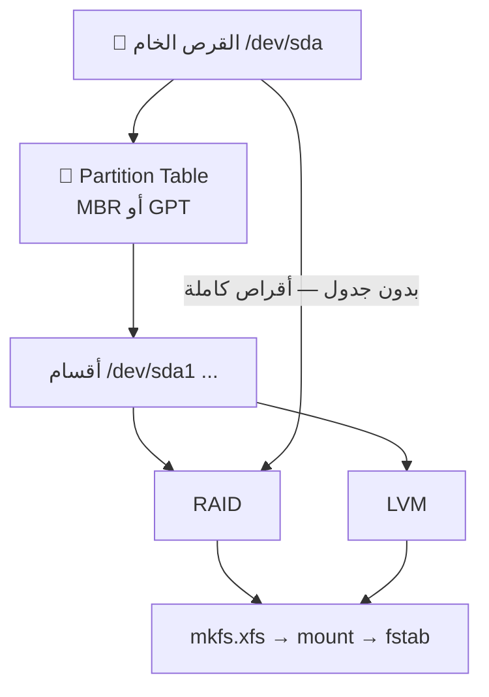

# 🧭 Partitioning (MBR & GPT) — Full Guide

> [!abstract] الخلاصة في سطرين
> Partition Table = ==الفهرس== المكتوب على القرص والذي يعرّف أقسامه.
> هي الطبقة ==تحت== [[RAID]] و[[LVM]] — وليست نوعاً منهما.

## 📑 Table of Contents
- [[#🎯 Big Picture]]
- [[#📊 MBR vs GPT — المقارنة الصحيحة]]
- [[#🗂️ أشهر 5 أنواع Partition Tables]]
- [[#🛠️ Step 1 — عرض الجدول الحالي]]
- [[#🧱 Step 2 — إنشاء MBR بـ fdisk]]
- [[#🏗️ Step 3 — إنشاء GPT بـ parted]]
- [[#🔷 Step 4 — إنشاء GPT بـ gdisk]]
- [[#✅ Step 5 — التحقق من سلامة GPT]]
- [[#🔄 Step 6 — التحويل بين MBR و GPT]]
- [[#🏷️ Step 7 — Partition Type Codes]]
- [[#🧹 Step 8 — المسح وإعادة القراءة]]
- [[#🚨 Troubleshooting]]
- [[#📋 Commands Cheat Sheet]]
- [[#❓ Interview Questions]]
- [[#🏆 Golden Rules]]

## 🎯 Big Picture



> [!info] علاقتها بملفاتك
> - [[RAID]]: استخدم أقراص كاملة ==بدون جدول== (mdadm يكتب superblock خاص به)
> - [[LVM]]: الخطوة 2 (`fdisk` + نوع `8e`) ==هي== خطوة الـ Partition Table

## 📊 MBR vs GPT — المقارنة الصحيحة

| وجه المقارنة | MBR (msdos) | GPT |
| --- | --- | --- |
| مكان الجدول | أول قطاع (512 bytes) | LBA1 + LBA2–33 |
| عدد الأقسام | ==4 primary== (أو 3 + extended) | ==128== افتراضياً (قابل للزيادة) |
| العنونة | ==32-bit== LBA | ==64-bit== LBA |
| أقصى حجم قرص | ==2 TiB== | 8 ZiB |
| نسخة احتياطية | ==لا يوجد== | ==نهاية القرص + CRC32== |
| التمهيد | BIOS / Legacy | ==UEFI== |
| الأداة الأشهر | fdisk | gdisk / parted / fdisk |

### تشريح الـ 512 bytes في MBR

```text
┌──────────────────── Sector 0 = 512 bytes ────────────────────┐
│ Bootstrap code │ Partition Table (4 × 16 = 64 B) │ Signature │
│    446 bytes   │   كل مدخل 16 B = قسم واحد        │ 0x55AA 2B │
└──────────────────────────────────────────────────────────────┘
```

> [!note] لماذا 4 أقسام فقط؟
> 64 bytes ÷ 16 bytes لكل مدخل = ==4 مداخل==.
> الحل القديم: 3 primary + 1 ==extended== تحتوي logical partitions (تبدأ من `sda5`).

### تخطيط GPT على القرص

```text
LBA0        LBA1       LBA2–33            ...البيانات...   LBA-33→-2      LBA-1
Protective  GPT Header Partition Entries                   Backup         Backup
MBR (EE)    (primary)  128 × 128 B                         Entries        Header
```

> [!tip] Protective MBR
> أول قطاع في GPT يحتوي MBR وهمي بنوع `EE` — ==يحمي القرص== من الأدوات القديمة التي لا تفهم GPT فتظنه فارغاً.

## 🗂️ أشهر 5 أنواع Partition Tables

| # | النوع | اسم parted | الاستخدام |
| --- | --- | --- | --- |
| 1 | ==MBR== | msdos | BIOS Legacy — شائع |
| 2 | ==GPT== | gpt | UEFI — المعيار الحديث |
| 3 | BSD disklabel | bsd | FreeBSD / NetBSD / OpenBSD |
| 4 | Apple Partition Map | mac | أجهزة Mac PowerPC القديمة |
| 5 | Sun disklabel | sun | Solaris / SPARC |

> [!info] والباقي؟
> `parted` يدعم أيضاً: `dvh` (SGI), `aix`, `atari`, `amiga`, `pc98`, `loop` (بدون جدول).
> ==في RHEL 9 و RHCSA: MBR و GPT فقط==.

## 🛠️ Step 1 — عرض الجدول الحالي

```bash
lsblk
fdisk -l /dev/sda
parted /dev/sda print
```

> [!example]- outpout `fdisk -l` و `parted print` على قرص جديد
> ```text
> [root@appsvr01 ~]# fdisk -l /dev/sda
> Disk /dev/sda: 5 GiB, 5368709120 bytes, 10485760 sectors
> Disk model: VMware Virtual S
> Units: sectors of 1 * 512 = 512 bytes
> Sector size (logical/physical): 512 bytes / 512 bytes
> I/O size (minimum/optimal): 512 bytes / 512 bytes
>
> [root@appsvr01 ~]# parted /dev/sda print
> Error: /dev/sda: unrecognised disk label
> ```

> [!note] اقرأ النتيجة
> `unrecognised disk label` = القرص ==بدون partition table== بعد (طبيعي لقرص جديد).
> بعد الإنشاء سترى `Disklabel type: dos` أو `Disklabel type: gpt`.

## 🧱 Step 2 — إنشاء MBR بـ fdisk

```bash
fdisk /dev/sda
```

> [!note] تسلسل الأوامر داخل fdisk
> `o` → جدول DOS/MBR جديد
> `n` → `p` → `1` → أول sector افتراضي → `+1G`
> `t` → `8e` (Linux LVM) — أو `83` Linux عادي
> `p` → معاينة | `w` → كتابة وخروج

> [!example]- outpout جلسة fdisk كاملة
> ```text
> [root@appsvr01 ~]# fdisk /dev/sda
> Command (m for help): o
> Created a new DOS disklabel with disk identifier 0x9379158e.
>
> Command (m for help): n
> Partition type:
>    p   primary (0 primary, 0 extended, 4 free)
>    e   extended (container for logical partitions)
> Select (default p): p
> Partition number (1-4, default 1): 1
> First sector (2048-10485759, default 2048):
> Last sector, +/-sectors or +/-size{K,M,G,T,P}: +1G
> Created a new partition 1 of type 'Linux' and of size 1 GiB.
>
> Command (m for help): t
> Hex code or alias (type L to list all): 8e
> Changed type of partition 'Linux' to 'Linux LVM'.
>
> Command (m for help): w
> The partition table has been altered.
> Calling ioctl() to re-read partition table.
> Syncing disks.
> ```

```bash
partprobe /dev/sda
lsblk /dev/sda
```

> [!tip] fdisk يعمل GPT أيضاً
> حرف `g` بدل `o` = جدول GPT جديد. (الأداة ليست حكراً على MBR)

> [!warning] حد الـ 4 أقسام
> بعد 4 primary لن يقبل `n` قسم primary جديد.
> الحل: اجعل الرابع ==extended== (`e`) ثم أنشئ داخله logical (`sda5`, `sda6`...).

## 🏗️ Step 3 — إنشاء GPT بـ parted (مثالي للسكربتات)

```bash
parted /dev/sdb mklabel gpt
parted /dev/sdb mkpart data 1MiB 2GiB
parted /dev/sdb mkpart lvmdata 2GiB 100%
parted /dev/sdb set 2 lvm on
parted /dev/sdb print
```

> [!example]- outpout `parted print`
> ```text
> Model: VMware Virtual S (scsi)
> Disk /dev/sdb: 5369MB
> Sector size (logical/physical): 512B/512B
> Partition Table: gpt
> Disk Flags:
>
> Number  Start   End     Size    File system  Name     Flags
>  1      1049kB  2147MB  2146MB               data
>  2      2147MB  5369MB  3221MB               lvmdata  lvm
> ```

> [!danger] mklabel يمحو الجدول فوراً
> `mklabel` ==يدمّر الجدول القديم== (وبالتالي الوصول للبيانات).
> في الوضع التفاعلي يسألك Yes/No — في السكربت ==ينفذ بدون سؤال==!

> [!note] mkpart لا ينشئ Filesystem!
> الاسم `data` مجرد ==label==. نظام الملفات خطوة منفصلة: `mkfs.xfs /dev/sdb1`.
> البداية `1MiB` وليس `0` = ==alignment== صحيح للأداء.

## 🔷 Step 4 — إنشاء GPT بـ gdisk (تفاعلي)

```bash
dnf install gdisk -y
gdisk /dev/sdc
```

> [!example]- outpout جلسة gdisk كاملة
> ```text
> [root@appsvr01 ~]# gdisk /dev/sdc
> GPT fdisk (gdisk) version 1.0.7
>
> Partition table scan:
>   MBR: not present
>   BSD: not present
>   APM: not present
>   GPT: not present
>
> Command (? for help): o
> This option deletes all partitions and creates a new protective MBR.
> Proceed? (Y/N): y
>
> Command (? for help): n
> Partition number (1-128, default 1): 1
> First sector (34-10485726, default = 2048):
> Last sector (2048-10485726, default = 10485726) or {+-}size{KMGTP}: +2G
> Current type is 8300 (Linux filesystem)
> Hex code or GUID: 8e00
> Changed type of partition to 'Linux LVM'
>
> Command (? for help): p
> Number  Start (sector)  End (sector)  Size     Code  Name
>    1            2048       4196351    2.0 GiB  8E00  Linux filesystem
>
> Command (? for help): w
> Final checks complete. About to write GPT data.
> THIS WILL OVERWRITE EXISTING PARTITIONS!!
> Do you want to proceed? (Y/N): y
> OK; writing new GUID partition table (GPT) to /dev/sdc.
> The operation has completed successfully.
> ```

```bash
partprobe /dev/sdc
```

## ✅ Step 5 — التحقق من سلامة GPT (ميزة الـ Backup)

```bash
gdisk -l /dev/sdb
```

> [!example]- outpout الفحص
> ```text
> Partition table scan:
>   MBR: protective
>   BSD: not present
>   APM: not present
>   GPT: present
>
> Found valid GPT with protective MBR; using GPT.
> ```

داخل `gdisk` اكتب `v` (verify):

> [!example]- outpout `v`
> ```text
> Command (? for help): v
> No problems found. 2014 free sectors (1007.0 KiB) available in 1
> segments, the largest of which is 2014 (1007.0 KiB) in size.
> ```

> [!tip] لو النسخة الأساسية اتلفت
> `gdisk` → `r` (recovery) → `b` = ==إعادة بناء الجدول الأساسي من النسخة الاحتياطية== آخر القرص.
> ده بالظبط اللي MBR ==لا يملكه==.

## 🔄 Step 6 — التحويل بين MBR و GPT

### 6.1备份 أولاً (إلزامي!)

```bash
dd if=/dev/sda of=/root/mbr-sda-backup.img bs=512 count=1
```

### 6.2 MBR → GPT بـ gdisk (يحافظ على الأقسام)

```bash
gdisk /dev/sda
# سيظهر: MBR: MBR only / GPT: not present
# اكتب: w ثم y
```

> [!warning] نظرياً آمن — عملياً خذ backup
> gdisk يحوّل مداخل MBR إلى GPT ==في الذاكرة== ثم يكتبها — الأقسام والبيانات تبقى.
> لكن أي خطأ = كارثة. الـ `dd` في 6.1 ==غير قابل للتفاوض==.

### 6.3 الطريقة المدمرة (لو القرص فاضي أصلاً)

```bash
parted /dev/sda mklabel gpt    # ❌ يمحو كل الأقسام!
```

### 6.4 GPT → MBR (رجعة للخلف)

```bash
gdisk /dev/sda
# r → g → w
```

> [!danger] شروط الرجعة
> - القرص ≤ ==2 TiB==
> - عدد الأقسام ≤ ==4==
> غير كده التحويل يفشل أو يفقد أقساماً.

## 🏷️ Step 7 — Partition Type Codes

### MBR (Hex)

| الكود | المعنى |
| --- | --- |
| 83 | Linux filesystem |
| 82 | Linux swap |
| ==8e== | ==Linux LVM== ← المستخدم في [[LVM]] |
| fd | Linux RAID autodetect ← بديل لأقراص [[RAID]] |
| 5 | Extended partition |
| 7 | NTFS / exFAT |
| c | FAT32 (LBA) |
| ee | Protective MBR (علامة وجود GPT) |

### GPT (gdisk codes)

| الكود | المعنى |
| --- | --- |
| 8300 | Linux filesystem |
| 8200 | Linux swap |
| ==8e00== | ==Linux LVM== |
| fd00 | Linux RAID |
| ef00 | EFI System Partition (ESP) |
| ef02 | BIOS boot partition (GRUB على BIOS + GPT) |
| 0700 | Microsoft basic data |

## 🧹 Step 8 — المسح وإعادة القراءة

```bash
wipefs -a /dev/sdc      # يمسح توقيعات الجداول (بداية ونهاية القرص)
partprobe /dev/sdc      # إجبار النواة على إعادة قراءة الجدول
udevadm settle          # انتظار انتهاء udev
lsblk /dev/sdc
```

> [!example]- outpout `wipefs`
> ```text
> /dev/sdc: 8 bytes were erased at offset 0x00000200 (gpt): 45 46 49 20 50 41 52 54
> /dev/sdc: 8 bytes were erased at offset 0x13ffee00 (gpt): 45 46 49 20 50 41 52 54
> /dev/sdc: 2 bytes were erased at offset 0x000001fe (PMBR): 55 aa
> ```

> [!info] لاحظ
> wipefs مسح ==نسختين== من GPT (بداية + نهاية) + الـ Protective MBR — دليل عملي على وجود الـ backup.

## 🚨 Troubleshooting

| المشكلة | السبب | الحل |
| --- | --- | --- |
| Device or resource busy | النواة تستخدم الجدول القديم | `partprobe` أو reboot |
| قرص 4TB يظهر 2TiB فقط | جدول MBR (32-bit) | حوّله GPT |
| GPT لا يقلع على BIOS قديم | ينقصه مكان GRUB | أنشئ قسم `ef02` (BIOS boot) |
| mkpart نجح لكن mount فشل | لا يوجد filesystem بعد | `mkfs.xfs /dev/sdbX` |
| الأقسام لا تظهر في lsblk | udev لم يتحدث | `partprobe` + `udevadm settle` |
| unrecognised disk label | قرص بدون جدول | `fdisk`/`parted mklabel` أولاً |

## 📋 Commands Cheat Sheet

| الغرض | الأمر |
| --- | --- |
| عرض الجدول | `fdisk -l /dev/sdX` |
| عرض parted | `parted /dev/sdX print` |
| MBR جديد (تفاعلي) | `fdisk /dev/sdX` → `o` |
| GPT جديد (تفاعلي) | `fdisk /dev/sdX` → `g` أو `gdisk` → `o` |
| GPT جديد (سكربت) | `parted /dev/sdX mklabel gpt` |
| قسم جديد (سكربت) | `parted /dev/sdX mkpart name 1MiB 100%` |
| تفعيل flag LVM | `parted /dev/sdX set N lvm on` |
| فحص GPT | `gdisk -l /dev/sdX` ثم `v` |
| استعادة من Backup | `gdisk` → `r` → `b` |
| MBR → GPT | `gdisk /dev/sdX` → `w` |
| GPT → MBR | `gdisk` → `r` → `g` → `w` |
| backup الـ MBR | `dd if=/dev/sdX of=mbr.img bs=512 count=1` |
| مسح التوقيعات | `wipefs -a /dev/sdX` |
| إعادة قراءة الجدول | `partprobe /dev/sdX` |

## ❓ Interview Questions

> [!question]- 1.الفرق بين MBR و GPT؟
> MBR: 4 أقسام، 32-bit (حد 2TiB)، ==بدون backup==، BIOS.
> GPT: 128 قسم، 64-bit (8ZiB)، ==backup + CRC32==، UEFI.

> [!question]- 2.لماذا حد MBR هو 2TiB بالذات؟
> عنونة 32-bit × قطاع 512 bytes = 2³² × 512 = ==2 TiB==.

> [!question]- 3.لماذا 4 أقسام primary فقط في MBR؟
> مساحة الجدول 64 bytes ÷ 16 bytes لكل مدخل = ==4==.

> [!question]- 4.أين النسخة الاحتياطية في GPT وما فائدتها؟
> ==آخر القرص== (header + entries) مع CRC32 — استعادة الجدول لو تلف الأساسي (`gdisk r → b`).

> [!question]- 5.ما هو الـ Protective MBR؟
> MBR وهمي بنوع `EE` في أول قطاع GPT — يمنع الأدوات القديمة من اعتبار القرص فارغاً.

> [!question]- 6.هل RAID يحتاج Partition Table؟
> ==لا== — mdadm يعمل على أقراص كاملة أو أقسام. الجدول طبقة مستقلة تحته.

> [!question]- 7.الفرق بين mklabel و mkpart؟
> `mklabel` = إنشاء ==جدول== جديد (يمحو القديم!)
> `mkpart` = إنشاء ==قسم== داخل الجدول (لا ينشئ filesystem).

## 🏆 Golden Rules

> [!quote] احفظها في الذاكرة العضلية!
> 1. `mklabel` ==يمحو== — backup قبل أي تحويل (`dd` لأول 512 bytes)
> 2. `partprobe` بعد كل تعديل جدول
> 3. قرص أكبر من 2TiB → ==GPT إلزامي==
> 4. UEFI → GPT | BIOS Legacy → MBR (أو GPT + قسم ef02)
> 5. `mkpart` لا ينشئ filesystem — `mkfs` خطوة منفصلة
> 6. نوع `8e`/`8e00` لـ LVM و `fd`/`fd00` لـ RAID
> 7. ابدأ الأقسام من `1MiB` (alignment) وليس من القطاع 0

## 📚 Related Notes
- [[Storage]] — الفهرس الرئيسي
- [[LVM]] — الخطوة التالية: PV → VG → LV
- [[RAID]] — بديل: أقراص كاملة بدون جدول
- [[fstab]] — التثبيت الدائم بعد mkfs