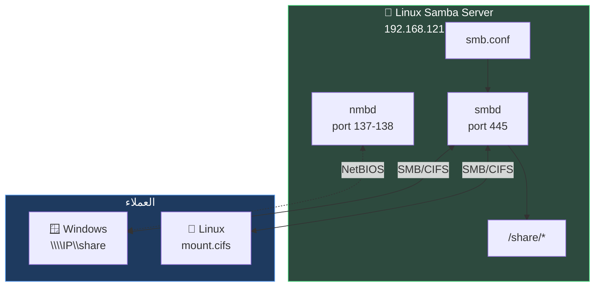
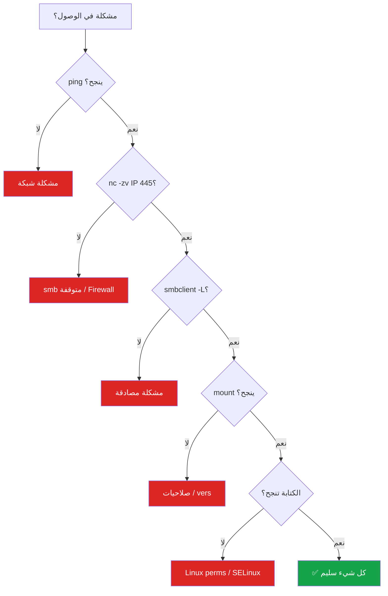

# 🗂️ Samba (SMB/CIFS) — Full Configuration Guide

> [!abstract] الخلاصة في سطرين
> **Samba** = بروتوكول **SMB/CIFS** يتيح مشاركة ==الملفات والطابعات== بين **Linux** و **Windows**.
> المنفذ الافتراضي: `445/tcp` (SMB) و `139/tcp` (NetBIOS).


---

## 📑 Table of Contents

- [[#🎯 Big Picture|Big Picture]]
- [[#📦 Packages & Services]]
- [[#🛠️ Step 1 — Installation]]
- [[#⚙️ Step 2 — Enable Services]]
- [[#🔥 Step 3 — Firewall]]
- [[#👥 Step 4 — Users & Groups]]
- [[#📁 Step 5 — Shared Directories]]
- [[#📝 Step 6 — smb.conf Configuration]]
- [[#🔐 Step 7 — SELinux]]
- [[#🔄 Step 8 — Reload & Validate]]
- [[#🌐 Step 9 — Network Verification]]
- [[#💻 Step 10 — Client Access (Mount)]]
- [[#⚓ Step 11 — Persistent Mount (fstab)]]
- [[#🛡️ Step 12 — Credentials File (Security)]]
- [[#🪟 Step 13 — Access From Windows]]
- [[#🧪 Testing & Verification]]
- [[#🚨 Troubleshooting]]
- [[#📋 Commands Cheat Sheet]]
- [[#❓ Interview Questions]]
- [[#🎓 Quick Lab Checklist]]

---

## 🎯 Big Picture



> [!tip]- 3 قواعد ذهبية قبل البدء
> 1. الصلاحيات = **الأكثر تقييداً** بين ==Linux== و ==Samba==
> 2. المستخدم لازم يكون في `Linux` **و** في قاعدة `smbpasswd`
> 3. كل `[section]` في `smb.conf` = **مشاركة مستقلة** بصلاحياتها

---

## 📦 Packages & Services

### الحزم المطلوبة

| Package | الوظيفة | المكان |
| :--- | :--- | :---: |
| `samba` | السيرفر (`smbd` + `nmbd`) | Server |
| `samba-common` | ملفات الإعدادات | Server |
| `samba-client` | أدوات `smbclient` | Both |
| `cifs-utils` | أداة `mount.cifs` | Client |

### الخدمات

| Service | الوظيفة | Port | الحالة |
| :--- | :--- | :---: | :---: |
| `smb` | مشاركة الملفات (الأساسي) | `445/tcp` | ==إلزامية== |
| `nmb` | NetBIOS name resolution | `137-138/udp` | اختيارية |

> [!info] ملاحظة
> في الشبكات الحديثة اللي تعتمد على DNS، خدمة `nmb` ==اختيارية== — `smb` وحدها تكفي.

---

## 🛠️ Step 1 — Installation

### على الـ Server

```bash
dnf install samba samba-common samba-client -y
```


```output
Installed:
  samba-4.19.5-1.el9.x86_64
  samba-common-4.19.5-1.el9.noarch
  samba-common-tools-4.19.5-1.el9.x86_64
  samba-client-4.19.5-1.el9.x86_64

Complete!
```


### على الـ Client

```bash
dnf install samba-client cifs-utils -y
```

```output
Installed:
  cifs-utils-7.0-1.el9.x86_64
  samba-client-4.19.5-1.el9.x86_64

Complete!
```


### التحقق من التثبيت

```bash
rpm -q samba samba-client cifs-utils
```

```output
samba-4.19.5-1.el9.x86_64
samba-client-4.19.5-1.el9.x86_64
cifs-utils-7.0-1.el9.x86_64
```

---

## ⚙️ Step 2 — Enable Services

```bash
systemctl enable --now smb nmb
```

```output
Created symlink /etc/systemd/system/multi-user.target.wants/smb.service → /usr/lib/systemd/system/smb.service.
Created symlink /etc/systemd/system/multi-user.target.wants/nmb.service → /usr/lib/systemd/system/nmb.service.
```

### التحقق من الحالة

```bash
systemctl status smb
```

<details>
<summary>📤 Output</summary>

```output
● smb.service - Samba SMB Daemon
     Loaded: loaded (enabled; preset: disabled)
     Active: active (running) since Tue 2025-04-29 23:59:27 IST; 9s ago
       Docs: man:smbd(8)
             man:samba(7)
             man:smb.conf(5)
   Main PID: 34110 (smbd)
     Status: "smbd: ready to serve connections..."
```

</details>

### التأكد من المنافذ

```bash
ss -tlnp | grep -E '445|139'
```

```output
LISTEN 0  50   0.0.0.0:445    0.0.0.0:*  users:(("smbd",pid=34110,fd=31))
LISTEN 0  50   0.0.0.0:139    0.0.0.0:*  users:(("smbd",pid=34110,fd=32))
```

---

## 🔥 Step 3 — Firewall

```bash
firewall-cmd --permanent --zone=public --add-service=samba
firewall-cmd --reload
```

```output
success
success
```

> [!warning] تحذير
> استخدم `firewall-cmd --reload` **بدلاً من** `systemctl reload firewalld` لأنه لا يقطع الاتصالات النشطة (stateful).

### التحقق

```bash
firewall-cmd --list-all
```

```output
public (active)
  target: default
  services: cockpit dhcpv6-client samba ssh
  ports:
  forward: yes
```

### طريقة بديلة (بالمنافذ)

```bash
firewall-cmd --permanent --add-port=445/tcp
firewall-cmd --permanent --add-port=139/tcp
firewall-cmd --reload
```

---

## 👥 Step 4 — Users & Groups

### 4.1 إنشاء المستخدمين

```bash
useradd sambausr1
passwd !$
```

> [!tip] اختصار مفيد
> `$!` = آخر argument من الأمر السابق. بدل كتابة `sambausr1` مرتين.

```output
Changing password for user sambausr1.
New password:
BAD PASSWORD: The password is shorter than 8 characters
Retype new password:
passwd: all authentication tokens updated successfully.
```

```bash
useradd sambausr2
passwd !$
```

### 4.2 منع تسجيل الدخول (Shell Access)

> [!note] لماذا؟
> هؤلاء المستخدمون للسهم في **Samba فقط** — مش للدخول على السيرفر.

```bash
usermod -s /sbin/nologin sambausr1
usermod -s /sbin/nologin sambausr2
```

### التحقق

```bash
getent passwd sambausr1 sambausr2
```

```output
sambausr1:x:1001:1001::/home/sambausr1:/sbin/nologin
sambausr2:x:1002:1002::/home/sambausr2:/sbin/nologin
```

### 4.3 إنشاء المجموعة

```bash
groupadd sambagrp1
usermod -aG sambagrp1 sambausr1
usermod -aG sambagrp1 sambausr2
```

> [!danger] خطأ شائع
> `-G` لوحدها **تحذف** كل المجموعات الإضافية!
> **الصحيح:** `-aG` (append + group).

### التحقق

```bash
id sambausr1 && id sambausr2
```

```output
uid=1001(sambausr1) gid=1001(sambausr1) groups=1001(sambausr1),1003(sambagrp1)
uid=1002(sambausr2) gid=1002(sambausr2) groups=1002(sambausr2),1003(sambagrp1)
```

### 4.4 إضافة المستخدمين لـ Samba

```bash
smbpasswd -a sambausr1
smbpasswd -a sambausr2
```

```output
New SMB password:
Retype new SMB password:
Added user sambausr1.
```

> [!important] نقطة جوهرية
> كلمة مرور **Samba** ==منفصلة تماماً== عن كلمة مرور **Linux**.
> - `passwd` → للنظام
> - `smbpasswd` → لـ Samba

### عرض قاعدة بيانات Samba

```bash
pdbedit -L
```

```output
sambausr1:1001:
sambausr2:1002:
```

---

## 📁 Step 5 — Shared Directories

### 5.1 إنشاء المجلدات

```bash
mkdir -p /share/public /share/mohamed /share/it
ls /share/
```

```output
it  mohamed  public
```

### 5.2 ضبط الملكية والصلاحيات

```bash
chown nobody:nobody /share/public
chown sambausr1     /share/mohamed
chown :sambagrp1    /share/it

chmod 777 /share/public
chmod 700 /share/mohamed
chmod 770 /share/it
```

### فهم الصلاحيات (Octal Notation)

$$
\text{Mode} = (r\cdot4 + w\cdot2 + x\cdot1)_{\text{Owner,Group,Other}}
$$

مثال: `770` = 
- Owner: $4+2+1=7$ (rwx)
- Group: $4+2+1=7$ (rwx)
- Other: $0+0+0=0$ (---)

### التحقق

```bash
ls -l /share/
```

```output
drwxrwx---. 2 root      sambagrp1 6 Apr 13 14:47 it
drwx------. 2 sambausr1 root      6 Apr 13 14:47 mohamed
drwxrwxrwx. 2 nobody    nobody    6 Apr 13 14:47 public
```

### 📊 خريطة الصلاحيات

| المجلد | Owner | Group | Mode | مين يقدر يدخل؟ |
| :--- | :---: | :---: | :---: | :--- |
| `/share/public` | `nobody` | `nobody` | `777` | ==الجميع== (guest) |
| `/share/mohamed` | `sambausr1` | `root` | `700` | ==sambausr1== فقط |
| `/share/it` | `root` | `sambagrp1` | `770` | ==أعضاء sambagrp1== فقط |

---

## 📝 Step 6 — smb.conf Configuration

### 6.1 النسخ الاحتياطي

```bash
cd /etc/samba/
cp smb.conf smb.conf.orig
```

> [!bug] خطأ شائع
> `cat smb.conf > smb.conf.orig` — مخاطر إفراغ الملف لو حصل خطأ في الـ redirection.
> **استخدم:** `cp` دائماً.

### 6.2 المحتوى الكامل للملف

```ini
#======================= Global Settings =======================
[global]
    workgroup = WORKGROUP
    netbios name = Tacademy_fs
    server string = Tacademy File Server
    security = user
    map to guest = bad user
    dns proxy = no
    log file = /var/log/samba/%m.log
    log level = 1
    max log size = 1000

#======================= Public Directory ======================
[public]
    comment = company public files
    path = /share/public
    browsable = yes
    read only = no
    guest ok = yes

#======================= IT Directory ==========================
[it]
    comment = it files
    path = /share/it
    browsable = yes
    read only = no
    guest ok = no
    valid users = @sambagrp1

#======================= Mohamed Directory =====================
[mohamed]
    comment = Mohamed's files
    path = /share/mohamed
    browsable = yes
    read only = no
    guest ok = no
    valid users = sambausr1
```

### شرح الخيارات

#### Global Options

| الخيار | الوظيفة |
| :--- | :--- |
| `workgroup` | اسم مجموعة العمل (يطابق Windows) |
| `netbios name` | اسم السيرفر على الشبكة |
| `security = user` | مصادقة بـ username + password |
| `map to guest = bad user` | مستخدم غير معروف → guest |
| `dns proxy = no` | لا يستخدم DNS لحل أسماء NetBIOS |
| `log file` | `%m` = اسم العميل (log منفصل) |
| `log level` | مستوى التسجيل (1-10) |

#### Share Options

| الخيار | الوظيفة |
| :--- | :--- |
| `comment` | الوصف |
| `path` | المسار الفعلي |
| `browsable` | يظهر في القائمة؟ |
| `read only = no` | السماح بالكتابة (= `writable = yes`) |
| `guest ok = yes` | دخول بدون كلمة مرور (= `public = yes`) |
| `valid users = @group` | مجموعة (علامة `@`) |
| `valid users = user` | مستخدم محدد |

> [!example] خيارات متقدمة
> ```ini
> [advanced]
>     write list = sambausr1              # هذا فقط يكتب
>     create mask = 0664                  # صلاحيات الملفات الجديدة
>     directory mask = 0775               # صلاحيات المجلدات
>     force group = sambagrp1             # إجبار المجموعة
>     hosts allow = 192.168.121. 127.     # تقييد بالـ IP
>     vfs objects = recycle               # سلة محذوفات
> ```

---

## 🔐 Step 7 — SELinux

### التحقق من الحالة

```bash
getenforce
```

```output
Enforcing
```

> [!danger] تحذير هام
> **لا تعطّل SELinux نهائياً** — استخدم الحل الصحيح أدناه.

### ❌ الحل السيئ (للاختبار فقط)

```bash
setenforce 0
getenforce
```

```output
Permissive
```

> [!warning] مؤقت فقط
> `setenforce 0` يرجع `Enforcing` بعد الـ reboot.
> للتعطيل الدائم: `SELINUX=disabled` في `/etc/selinux/config` — ==غير مستحسن إنتاجياً==.

### ✅ الحل الصحيح (Production-Ready)

#### أ) وضع الـ context الصحيح

```bash
semanage fcontext -a -t samba_share_t "/share(/.*)?"
restorecon -Rv /share
```

```output
Relabeled /share from unconfined_u:object_r:default_t:s0 
         to unconfined_u:object_r:samba_share_t:s0
Relabeled /share/public
Relabeled /share/it
Relabeled /share/mohamed
```

#### ب) تفعيل الـ Booleans

```bash
setsebool -P samba_export_all_rw on
setsebool -P samba_enable_home_dirs on
```

> [!info] `-P` = Permanent
> يبقى بعد الـ reboot.

### التحقق

```bash
ls -Zd /share/*
```

```output
unconfined_u:object_r:samba_share_t:s0 /share/it
unconfined_u:object_r:samba_share_t:s0 /share/mohamed
unconfined_u:object_r:samba_share_t:s0 /share/public
```

### 📊 مقارنة الحلول

| الطريقة | دائم؟ | آمن؟ | متى تستخدمها؟ |
| :--- | :---: | :---: | :--- |
| `setenforce 0` | ❌ | ❌ | تشخيص سريع |
| `chcon` | ❌ | ✅ | اختبار |
| `semanage fcontext` + `restorecon` | ✅ | ✅ | ==الإنتاج== |
| `setsebool -P` | ✅ | ✅ | حسب الحاجة |

> [!note] لو `semanage` غير موجود
> ```bash
> dnf install policycoreutils-python-utils -y
> ```

---

## 🔄 Step 8 — Reload & Validate

### 8.1 فحص صحة الملف (مهم جداً!)

```bash
testparm
```

```output
Load smb config files from /etc/samba/smb.conf
Loaded services file OK.
Weak crypto is allowed by GnuTLS

Server role: ROLE_STANDALONE

[public]
	comment = company public files
	guest ok = Yes
	path = /share/public
	read only = No
```

> [!success] علامة النجاح
> ظهور `Loaded services file OK.` يعني أن الملف سليم.

### 8.2 إعادة التحميل (بدون قطع الاتصالات)

```bash
smbcontrol all reload-config
```

### 8.3 أو إعادة تشغيل كاملة

```bash
systemctl restart smb nmb
```

> [!tip] الفرق
> - `reload-config` = يحافظ على الاتصالات النشطة
> - `restart` = يقطع الكل ويعيد التشغيل

---

## 🌐 Step 9 — Network Verification

```bash
ip -br a s
```

```output
lo    UNKNOWN   127.0.0.1/8
ens33 UP        192.168.121.140/24
```

---

## 💻 Step 10 — Client Access (Mount)

### 10.1 استكشاف المشاركات

```bash
smbclient -L //192.168.121.140 -N
```

```output
	Sharename       Type      Comment
	---------       ----      -------
	public          Disk      company public files
	it              Disk      it files
	mohamed         Disk      Mohamed's files
	IPC$            IPC       IPC Service
```

> [!info] المعاني
> - `-N` = بدون كلمة مرور (guest)
> - `-L` = list shares

### 10.2 إنشاء نقاط التركيب

```bash
mkdir -p /smb/{public,mohamed,it}
```

### 10.3 التثبيت اليدوي

```bash
# Public (guest)
mount -t cifs //192.168.121.140/public /smb/public/ -o guest

# Mohamed (authenticated)
mount -t cifs //192.168.121.140/mohamed /smb/mohamed/ \
  -o username=sambausr1,password=123456

# IT (authenticated)
mount -t cifs //192.168.121.140/it /smb/it/ \
  -o username=sambausr1,password=123456
```

> [!warning] غير آمن!
> كتابة الـ `password` في الأمر تظهر في `history` و `ps`.
> استخدم ملف credentials في الخطوة 12.

### 10.4 التحقق

```bash
df -h -t cifs
```

```output
Filesystem                 Size  Used Avail Use% Mounted on
//192.168.121.140/public    20G  2.1G   18G  11% /smb/public
//192.168.121.140/mohamed   20G  2.1G   18G  11% /smb/mohamed
//192.168.121.140/it        20G  2.1G   18G  11% /smb/it
```

### 10.5 اختبار الكتابة

```bash
touch /smb/public/test-from-client.txt
ls -l /smb/public/
```

```output
-rwxr-xr-x. 1 nobody nobody 0 Apr 13 15:20 test-from-client.txt
```

### 📋 خيارات mount المفيدة

| الخيار | الوظيفة |
| :--- | :--- |
| `guest` | بدون مصادقة |
| `username=` / `password=` | بيانات الدخول |
| `credentials=` | ملف بيانات آمن |
| `_netdev` | انتظر الشبكة |
| `uid=` / `gid=` | الملكية المحلية |
| `vers=3.0` | إصدار البروتوكول |
| `ro` / `rw` | قراءة فقط /读写 |
| `nofail` | لا توقف الـ boot لو فشل |
| `x-systemd.automount` | تركيب تلقائي |

---

## ⚓ Step 11 — Persistent Mount (fstab)

### 11.1 الطريقة غير الآمنة (❌)

```fstab
//192.168.121.140/public   /smb/public    cifs  defaults,guest,_netdev                               0 0
//192.168.121.140/mohamed  /smb/mohamed   cifs  defaults,username=sambausr1,password=123456,_netdev 0 0
//192.168.121.140/it       /smb/it        cifs  defaults,username=sambausr1,password=123456,_netdev 0 0
```

> [!danger] مشكلة خطيرة
> - كلمة المرور ==ظاهرة كنص صريح==
> - `/etc/fstab` يقرأه ==أي مستخدم== (صلاحية `644`)

### 11.2 تفكيك سطر fstab

```
//192.168.121.140/public  /smb/public  cifs  defaults,guest,_netdev  0  0
└──────────┬───────────┘  └────┬────┘  └─┬┘  └──────────┬─────────┘  │  │
     Source               Mount Point    Type         Options    dump fsck
```

| العمود | المعنى |
| :---: | :--- |
| 1 | مسار المشاركة على السيرفر |
| 2 | نقطة التركيب المحلية |
| 3 | نوع الـ filesystem |
| 4 | خيارات التركيب |
| 5 | `0` = لا تعمل backup |
| 6 | `0` = لا تفحص (ضروري للشبكة) |

### 11.3 الاختبار

```bash
umount /smb/{public,mohamed,it}
mount -a
df -h -t cifs
```

> [!danger] تحذير قبل الـ reboot
> **لازم** `mount -a` ينجح — سطر خاطئ في fstab قد يمنع النظام من الإقلاع!

---

## 🛡️ Step 12 — Credentials File (Security)

### 12.1 إنشاء الملف الآمن

```bash
vim /root/smbsec
```

```ini
username=sambausr1
password=123456
```

### 12.2 الحماية

```bash
chmod 600 /root/smbsec
chown root:root /root/smbsec
ls -l /root/smbsec
```

```output
-rw-------. 1 root root 38 Apr 13 15:30 /root/smbsec
```

### 12.3 تحديث fstab (✅ الطريقة الصحيحة)

```fstab
//192.168.121.140/public   /smb/public    cifs  defaults,guest,_netdev,nofail                     0 0
//192.168.121.140/mohamed  /smb/mohamed   cifs  defaults,credentials=/root/smbsec,_netdev,nofail  0 0
//192.168.121.140/it       /smb/it        cifs  defaults,credentials=/root/smbsec,_netdev,nofail  0 0
```

### 12.4 التطبيق

```bash
umount /smb/{mohamed,it}
systemctl daemon-reload
mount -a
df -h -t cifs
```

### 🔐 مقارنة الأمان

| الطريقة | مخفية؟ | التقييم |
| :--- | :---: | :---: |
| `password=` في الأمر | ❌ | ❌❌ |
| `password=` في fstab | ❌ | ❌ |
| `credentials=` (600) | ✅ | ==✅✅== |

---

## 🪟 Step 13 — Access From Windows

### من Run

```
Win + R  →  \\192.168.121.140
```

أو:
```
\\192.168.121.140\public
\\192.168.121.140\mohamed
\\192.168.121.140\it
```

### Map Network Drive (دائم)

```cmd
net use Z: \\192.168.121.140\it /user:sambausr1 123456 /persistent:yes
```

```output
The command completed successfully.
```

### عرض وقطع التوصيلات

```cmd
net use
net use Z: /delete
```

> [!tip] لو غيّرت الباسورد
> امسح الـ cached credentials من **Credential Manager** في Windows.

---

## 🧪 Testing & Verification

### على السيرفر

```bash
# فحص الإعدادات
testparm -s

# عرض المشاركات
smbclient -L localhost -N

# المستخدمين
pdbedit -L

# الاتصالات النشطة
smbstatus
```

### الدخول التفاعلي (Interactive)

```bash
smbclient //192.168.121.140/it -U sambausr1
```

```output
Enter WORKGROUP\sambausr1's password:
smb: \> ls
  .                                   D        0  Sun Apr 13 14:47:22 2025
  ..                                  D        0  Sun Apr 13 14:47:00 2025

smb: \> put localfile.txt
putting file localfile.txt as \localfile.txt (12.3 kb/s)

smb: \> get it-notes.txt

smb: \> exit
```

---

## 🚨 Troubleshooting

### ❌ `Permission denied`

```output
mount error(13): Permission denied
```

| السبب | الحل |
| :--- | :--- |
| المستخدم غير في Samba | `smbpasswd -a user` |
| كلمة مرور خاطئة | `smbpasswd user` |
| `valid users` لا يشمل | راجع `smb.conf` |
| صلاحيات Linux تمنع | `chmod` / `chown` |
| SELinux | `semanage fcontext` |

### ❌ `Host is down`

```output
mount error(112): Host is down
```

**خطوات التشخيص:**

```bash
ping 192.168.121.140
nc -zv 192.168.121.140 445
systemctl status smb
firewall-cmd --list-services
```

> [!tip] مشكلة الإصدار
> `Host is down` غالباً بسبب عدم توافق SMB version.
> جرّب: `-o vers=3.0` أو `vers=2.1`

### ❌ الكتابة تفشل رغم `read only = no`

**السبب:** صلاحيات Linux أقوى من Samba.

```bash
ls -ld /share/it
# drwxr-xr-x. 2 root root 6  ← لا يسمح بالكتابة!

chown :sambagrp1 /share/it
chmod 770 /share/it
```

> [!important] القاعدة الذهبية
> الصلاحية الفعلية = ==الأكثر تقييداً== بين Linux و Samba.

### ❌ SELinux يمنع الوصول

```bash
ausearch -m avc -ts recent | grep samba
```

**الحل:**
```bash
semanage fcontext -a -t samba_share_t "/share(/.*)?"
restorecon -Rv /share
setsebool -P samba_export_all_rw on
```

### ❌ النظام لا يقلع بعد تعديل fstab

**في الطوارئ (Emergency mode):**

```bash
mount -o remount,rw /
vim /etc/fstab      # علّق السطر بـ #
systemctl reboot
```

> [!tip] الحل الوقائي
> استخدم `nofail,x-systemd.automount` في fstab دائماً.

### ❌ `Unknown parameter`

```output
Unknown parameter encountered: "valid user"
```

**الخطأ:** الاسم `valid user` (مفرد) — **الصحيح:** `valid users` (جمع).

```bash
testparm    # دايماً استخدمه!
```

### 🧭 خريطة التشخيص



---

## 📋 Commands Cheat Sheet

### التثبيت والخدمات

| الغرض | الأمر |
| :--- | :--- |
| تثبيت Server | `dnf install samba samba-common samba-client -y` |
| تثبيت Client | `dnf install samba-client cifs-utils -y` |
| تفعيل | `systemctl enable --now smb nmb` |
| إعادة تشغيل | `systemctl restart smb nmb` |
| الحالة | `systemctl status smb` |
| المنافذ | `ss -tlnp \| grep 445` |

### إدارة المستخدمين

| الغرض | الأمر |
| :--- | :--- |
| إضافة | `smbpasswd -a user` |
| تغيير كلمة المرور | `smbpasswd user` |
| تعطيل | `smbpasswd -d user` |
| تمكين | `smbpasswd -e user` |
| حذف | `smbpasswd -x user` |
| عرض | `pdbedit -L` |
| تفاصيل | `pdbedit -Lv user` |
| العضويات | `id user` |

### الإعدادات والتحقق

| الغرض | الأمر |
| :--- | :--- |
| فحص الملف | `testparm` |
| مختصر | `testparm -s` |
| إعادة تحميل | `smbcontrol all reload-config` |
| الاتصالات | `smbstatus` |
| عرض المشاركات | `smbclient -L //IP -N` |
| دخول تفاعلي | `smbclient //IP/share -U user` |

### Client — التركيب

| الغرض | الأمر |
| :--- | :--- |
| تركيب guest | `mount -t cifs //IP/share /mnt -o guest` |
| تركيب آمن | `mount -t cifs //IP/share /mnt -o credentials=/root/smbsec` |
| تركيب fstab | `mount -a` |
| فك | `umount /mnt` |
| عرض المركبة | `df -h -t cifs` |

### Firewall & SELinux

| الغرض | الأمر |
| :--- | :--- |
| فتح Samba | `firewall-cmd --permanent --add-service=samba` |
| تطبيق | `firewall-cmd --reload` |
| عرض القواعد | `firewall-cmd --list-all` |
| حالة SELinux | `getenforce` |
| تعطيل مؤقت | `setenforce 0` |
| Context | `semanage fcontext -a -t samba_share_t "/share(/.*)?"` |
| تطبيق | `restorecon -Rv /share` |
| Booleans | `getsebool -a \| grep samba` |
| تفعيل Boolean | `setsebool -P samba_export_all_rw on` |

---

## ❓ Interview Questions

> [!question]- 1.ما هو Samba وما البروتوكول الذي يستخدمه؟
> خدمة تتيح مشاركة الملفات والطابعات بين Linux و Windows باستخدام بروتوكول ==SMB/CIFS== على المنفذ ==445/tcp==.

> [!question]- 2.ما الفرق بين `smb` و `nmb`؟
> - `smb` = مشاركة الملفات الفعلية (445)
> - `nmb` = NetBIOS name resolution (137-138)
> - `nmb` ==اختيارية== في الشبكات الحديثة

> [!question]- 3.لماذا `smbpasswd` بعد `useradd`؟
> لأن Samba تحتفظ بقاعدة بيانات كلمات مرور ==منفصلة== عن `/etc/shadow`.

> [!question]- 4.ما وظيفة `map to guest = bad user`؟
> أي محاولة دخول باسم مستخدم ==غير موجود== تُحوَّل تلقائياً إلى **guest**.

> [!question]- 5.ماذا تعني `@` في `valid users = @group`؟
> `@` تعني ==مجموعة== وليس مستخدم. بدونها يُعتبر اسماً لمستخدم.

> [!question]- 6.لماذا لا تعمل الكتابة رغم `read only = no`؟
> لأن الصلاحية الفعلية = ==الأكثر تقييداً== بين Linux و Samba.

> [!question]- 7.الفرق بين `mount -a` و `daemon-reload`؟
> - `mount -a` = يركّب fstab
> - `daemon-reload` = يعيد قراءة systemd للـ units
> - يُفضّل استخدام الاثنين معاً بعد تعديل fstab

> [!question]- 8.لماذا `_netdev` ضروري؟
> يخبر النظام أن الجهاز يعتمد على ==الشبكة==، فيؤجل التركيب حتى تجهز الشبكة.

> [!question]- 9.كيف تحمي كلمة المرور في fstab؟
> باستخدام `credentials=/root/smbsec` مع `chmod 600`، بدلاً من كتابة `password=` صريحاً.

> [!question]- 10.الفرق بين `setenforce 0` و `semanage`؟
> - `setenforce 0` = تعطيل مؤقت (==غير آمن==)
> - `semanage` = وضع context صحيح (==الحل السليم==)

> [!question]- 11.كيف تعيد تحميل smb.conf بدون قطع المستخدمين؟
> `smbcontrol all reload-config`

> [!question]- 12.ما الأمر الذي يفحص صحة smb.conf؟
> `testparm`

> [!question]- 13.لماذا `chmod 600` على credentials؟
> ليقرأه ==root فقط==، فلا يرى المستخدمون الآخرون كلمة المرور.

> [!question]- 14.كيف تمنع مستخدم Samba من shell access؟
> `usermod -s /sbin/nologin user`

> [!question]- 15.الفرق بين `browsable` و `guest ok`؟
> - `browsable` = هل ==يظهر== في القائمة
> - `guest ok` = هل الدخول ==بدون كلمة مرور==

---

## 🎓 Quick Lab Checklist

> [!todo] Lab Progress
> - [ ] **Server** (192.168.121.140)
>     - [ ] تثبيت samba
>     - [ ] تفعيل smb + nmb
>     - [ ] فتح Firewall
>     - [ ] إنشاء المستخدمين + المجموعة
>     - [ ] `smbpasswd -a` للمستخدمين
>     - [ ] إنشاء المجلدات + الصلاحيات
>     - [ ] تعديل smb.conf
>     - [ ] `testparm` للفحص
>     - [ ] SELinux (semanage + restorecon)
>     - [ ] `smbcontrol all reload-config`
> - [ ] **Client**
>     - [ ] تثبيت cifs-utils
>     - [ ] `smbclient -L` للاستكشاف
>     - [ ] إنشاء نقاط التركيب
>     - [ ] إنشاء /root/smbsec (chmod 600)
>     - [ ] تعديل fstab
>     - [ ] `mount -a`
>     - [ ] `df -h -t cifs`
>     - [ ] اختبار الكتابة
> - [ ] **Windows**
>     - [ ] Win+R → \\IP
>     - [ ] Map Network Drive
>     - [ ] اختبار الكتابة من Windows

---

## 🏆 The 10 Golden Rules

> [!quote] احفظها في الذاكرة العضلية!
> 1. **الصلاحيات = الأكثر تقييداً** بين Linux و Samba
> 2. **`smbpasswd -a` إلزامي** — Linux user وحده لا يكفي
> 3. **`testparm` قبل كل reload**
> 4. **`cp` وليس `cat >`** للنسخ الاحتياطي
> 5. **`username=` وليس `user=`** في fstab
> 6. **`valid users`** (جمع) وليس `valid user`
> 7. **`-aG` وليس `-G`** عند إضافة مجموعة
> 8. **`_netdev,nofail`** في fstab يحمي الـ boot
> 9. **`credentials=` + `chmod 600`** بدل كلمة مرور صريحة
> 10. **لا تعطّل SELinux** — استخدم `semanage`

---
## 📚 Related Notes

- [[school/Linux Fundamentals|Linux Fundamentals]]
-  [[Linux Fundamentals#16. User & Group Management|User Management]]
- [[Linux Fundamentals#17. Permissions & Ownership|File Permissions]]
- [[SELinux]]
- [[Samba#🔥 Step 3 — Firewall|Firewalld]]
- [[SELinux]]
- [[Samba#⚓ Step 11 — Persistent Mount (fstab)|fstab]]
- [[NFS]] — بديل للمشاركات بين Linux فقط
- [[FTP Server]]

---
