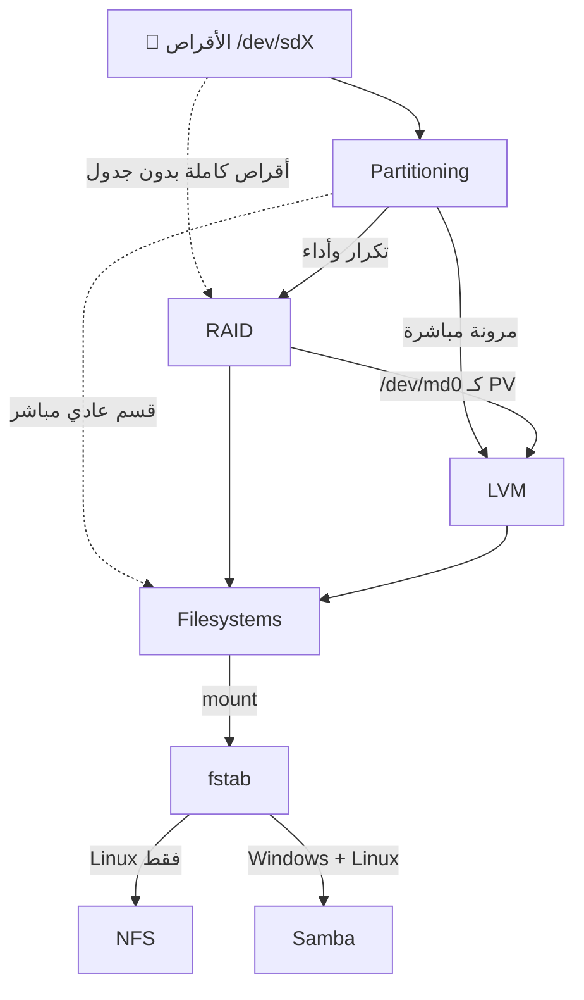
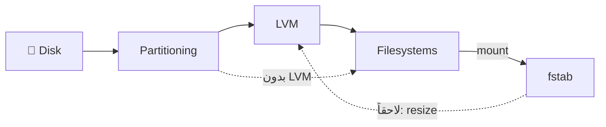

# 🗄️ Storage — من القرصRaw إلى المشاركة على الشبكة

> [!abstract] الفكرة
> فهرس واحد لأربع طبقات: ==RAID== (حماية) → ==LVM== (مرونة) → ==NFS/Samba== (مشاركة).
> المحتوى كامل في ملفاته الأصلية — هنا خريطة + مقارنة + Embeds.

## 🧱 The Storage Stack

> [!tip] RAID + LVM = تكامل مش بدائل
> السيناريو الإنتاجي: `mdadm` يبني `/dev/md0` → `pvcreate /dev/md0` → VG → LV.
> [[RAID]] يحمي من فشل الأقراص، و[[LVM]] يعطيك التوسيع بدون توقف.

## 🧭 أختار أنهي أداة؟

| الاحتياج                    | الحل                          | الدليل                                  |
| --------------------------- | ----------------------------- | --------------------------------------- |
| حماية من فشل قرص / أداء I/O | mdadm                         | [[RAID\|🗄️ RAID Guide]]                |
| توسيع المساحة بدون downtime | LVM                           | [[LVM\|📦 LVM Guide]]                   |
| مشاركة ملفات بين Linux فقط  | NFS                           | [[NFS\|🐧 NFS Guide]]                   |
| مشاركة مع Windows أو Mixed  | Samba                         | [[Samba\|🪟 Samba Guide]]               |
| تقسيم القرص (MBR/GPT)       | fdisk / parted / gdisk        | [[Partitioning\|🧭 Partitioning Guide]] |
| نظام ملفات (Format/Resize)  | mkfs / xfs_growfs / resize2fs | [[Filesystems\|🧬 Filesystems Guide]]   |
## 📊 مقارنة مستويات RAID (من ملف RAID)

![[RAID#جدول مقارنة RAID المطوّر (مع المساحة الفعلية والهدر)]]

## ⚡ أوامر LVM السريعة (من ملف LVM)

![[LVM#ملخص سريع لأوامر LVM]]

## 🔗 وصول سريع

> [!example]- RAID — أهم الأقسام
> - [[RAID#الصيغ العامة لحساب المساحة الفعلية|حساب المساحة (N×S)]]
> - [[RAID#8. محاكاة فشل قرص والتعافي (RAID 1)|محاكاة فشل قرص والتعافي]]

> [!example]- LVM — أهم الأقسام
> - [[RAID#ملخص سريع|جدول المستويات المختصر]]
> - [[LVM#الخطوة 3: إنشاء Physical Volume (PV)|PV → VG → LV]]

> [!example]- المشاركة على الشبكة
> - [[NFS#📝 Step 4 — Configure /etc/exports|إعداد exports]]
> - [[Samba#📝 Step 6 — smb.conf Configuration|إعداد smb.conf]]
> - [[NFS#🔄 NFS vs Samba — Quick Comparison|NFS vs Samba]]

## 🔄 Disk Lifecycle

## 🏆 قواعد مشتركة بين الأربعة

> [!quote] بتتكرر في كل الملفات — احفظها مرة واحدة
> - اختبر `mount -a` ==قبل أي reboot== — سطر fstab خاطئ يمنع الإقلاع
> - استخدم `UUID=` من `blkid` في fstab وليس اسم الجهاز
> - `wipefs -a` قبل إعادة استخدام قرص في مصفوفة جديدة
> - بعد `lvextend` لازم `xfs_growfs` — التوسيع خطوتان مش واحدة

الأساسيات: [[Samba#⚓ Step 11 — Persistent Mount (fstab)|fstab]] • [[Linux Fundamentals#17. Permissions & Ownership|File Permissions]] • [[school/Linux Fundamentals|Linux Fundamentals]]

